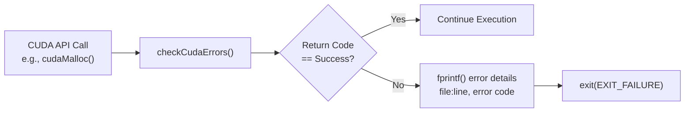
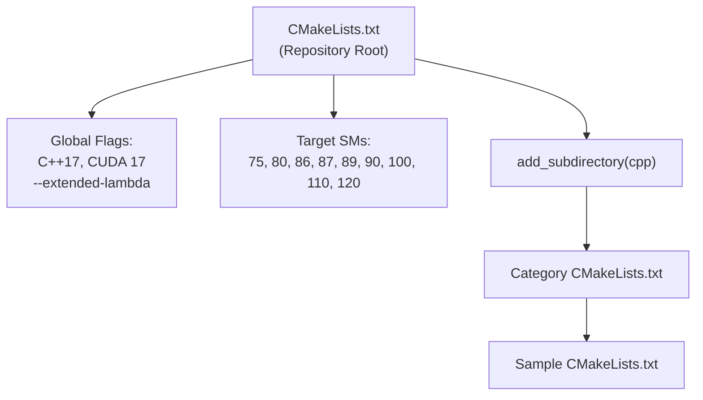

<!-- source: DeepWiki mcp.deepwiki.com · repo NVIDIA/cuda-samples · page 1 Overview · fetched 2026-10-26 -->

# Overview

<details>
<summary>Relevant source files</summary>

The following files were used as context for generating this wiki page:

- [CHANGELOG.md](CHANGELOG.md)
- [CMakeLists.txt](CMakeLists.txt)
- [LICENSE](LICENSE)
- [README.md](README.md)

</details>


The CUDA Samples repository is a collection of example programs and utilities that demonstrate CUDA programming concepts, techniques, and features. This repository serves as a reference implementation and learning resource for developers working with NVIDIA CUDA Toolkit version 13.3 and later [README.md:3-4]().

This document covers the overall repository organization, infrastructure components, and architectural patterns. For detailed information about specific subsystems, see:
- Build system configuration: [Build System](#2)
- Shared utility libraries: [Common Utilities and Helper Functions](#3)
- Individual sample categories: [Introduction Samples (Category 0)](#4), [Advanced CUDA Features (Category 3)](#5), [CUDA Libraries Integration (Category 4)](#6), etc.

## Repository Organization

The repository is organized into 9 numbered C++ categories (0-8) plus a new CUDA Tile category (9), and a parallel Python samples tree [CHANGELOG.md:4, 11, 17-18]().

**Sample Categories:**

| Category | Directory | Purpose |
|----------|-----------|---------|
| 0 | `cpp/0_Introduction` | Basic CUDA concepts, memory operations, simple kernels [CHANGELOG.md:35]() |
| 1 | `cpp/1_Utilities` | Device queries, topology, and diagnostics [CHANGELOG.md:41, 111]() |
| 2 | `cpp/2_Concepts_and_Techniques` | 32 samples covering advanced algorithms and optimization [CHANGELOG.md:43, 59]() |
| 3 | `cpp/3_CUDA_Features` | Driver API, Graphs, Dynamic Parallelism, and Tensor Cores [CHANGELOG.md:63, 76]() |
| 4 | `cpp/4_CUDA_Libraries` | Integration with cuBLAS, cuFFT, NPP, CCCL (CUB/libcudacxx) [CHANGELOG.md:5-10, 45, 66]() |
| 5 | `cpp/5_Domain_Specific` | Graphics, physics, and medical imaging applications [CHANGELOG.md:47]() |
| 6 | `cpp/6_Performance` | Benchmarks for Unified Memory, graphs, and memory alignment [CHANGELOG.md:81]() |
| 7 | `cpp/7_libNVVM` | 6 samples for NVVM IR compilation and LLVM integration [CHANGELOG.md:68]() |
| 8 | `cpp/8_Platform_Specific/Tegra` | 13 samples for NvSci, NvMedia, and cuDLA [CHANGELOG.md:73]() |
| 9 | `cpp/9_CUDA_Tile` | Tile-based GPU programming with `cuda::tiles` [CHANGELOG.md:4]() |
| Python | `python/` | CUDA Python (cuda.core/cuda.compute) equivalents [CHANGELOG.md:11-17]() |

**Infrastructure Components:**

| Component | Location | Purpose |
|-----------|----------|---------|
| Common utilities | `cpp/Common/` | Shared headers for error handling, device management, IPC [CHANGELOG.md:18, 51, 97]() |
| Build system | `cmake/`, `CMakeLists.txt` | Three-tier CMake architecture [CMakeLists.txt:1-34](), [README.md:31-33]() |
| Testing framework | `run_tests.py`, `test_args.json` | Automated sample validation and parallel execution [CHANGELOG.md:107]() |

Sources: [CHANGELOG.md:1-125](), [README.md:1-100](), [CMakeLists.txt:1-34]()

### Category Hierarchy Diagram

```mermaid
graph TB
    Root["CUDA Samples Repository<br/>https://github.com/NVIDIA/cuda-samples"]
    
    Root --> CPP["cpp/ (C++ Samples)"]
    Root --> PY["python/ (Python Samples)"]
    Root --> Infrastructure["Infrastructure"]
    
    CPP --> Cat0["0_Introduction"]
    CPP --> Cat3["3_CUDA_Features"]
    CPP --> Cat4["4_CUDA_Libraries"]
    CPP --> Cat7["7_libNVVM"]
    CPP --> Cat8["8_Platform_Specific/Tegra"]
    CPP --> Cat9["9_CUDA_Tile"]
    
    PY --> PY1["1_GettingStarted"]
    PY --> PY2["2_CoreConcepts"]
    
    Infrastructure --> Common["cpp/Common/"]
    Infrastructure --> CMake["cmake/"]
    Infrastructure --> Test["run_tests.py<br/>test_args.json"]
    
    Common --> "helper_cuda.h"
    Common --> "helper_cuda_drvapi.h"
    Common --> "helper_multiprocess.h"
    
    Cat4 --> CCCL["CCCL (CUB/libcudacxx)"]
    Cat9 --> Tiles["cuda::tiles"]
```

Sources: [CHANGELOG.md:4, 11, 17-18](), [CMakeLists.txt:33](), [README.md:107]()

## Infrastructure Components

### Common Utilities

The `cpp/Common/` directory provides shared header-only utility libraries. These utilities abstract common CUDA programming patterns, specifically error handling and device discovery.

**Core Utility Headers:**

| Header | Primary Functions | Usage |
|--------|-------------------|-------|
| `helper_cuda.h` | `checkCudaErrors()`, `findCudaDevice()` | Runtime API error handling and device selection [CHANGELOG.md:97]() |
| `helper_cuda_drvapi.h` | `checkCudaErrors()` (Driver API) | Driver API equivalents and error translation |
| `nvrtc_helper.h` | `compileFileToPTX()` | NVRTC runtime compilation utilities [CHANGELOG.md:52]() |

**Error Handling Pattern:**

The `checkCudaErrors()` macro wraps CUDA API calls and automatically checks return codes. In CUDA 13.3, this includes updated error codes for libraries like cuFFT (e.g., `CUFFT_NVJITLINK_FAILURE`) [CHANGELOG.md:86-95]().



Sources: [CHANGELOG.md:86-97](), [Common/helper_cuda.h:1-989]()

### Build System

The repository uses a three-tier CMake hierarchy. Global settings are defined in the root `CMakeLists.txt`, which targets C++17 and CUDA 17 standards [CMakeLists.txt:9-13]().

**Key Build Configurations:**
- **Architectures:** Targets SM 75, 80, 86, 87, 89, 90, 100, 110, 120 [CMakeLists.txt:15]().
- **Debug Modes:** `ENABLE_CUDA_DEBUG` enables the `-G` flag for `cuda-gdb`; otherwise, `-lineinfo` is used for profiling tools [CMakeLists.txt:17-21]().
- **MSVC Compatibility:** Uses `-Xcompiler=/Zc:preprocessor` to comply with modern CCCL requirements [CMakeLists.txt:26-28]().



Sources: [CMakeLists.txt:1-34](), [CHANGELOG.md:21]()

### Testing Framework

The `run_tests.py` utility, introduced in CUDA 12.9, exercises all samples by parsing `test_args.json` to determine execution parameters and GPU requirements [CHANGELOG.md:107]().

**Automated Validation Workflow:**
1. **Discovery:** Scans build directories for executables.
2. **Filtering:** Checks `min_gpus` requirement against available hardware.
3. **Execution:** Runs samples with arguments defined in `test_args.json`.
4. **Reporting:** Captures stdout/stderr and validates return codes.

Sources: [CHANGELOG.md:107](), [README.md:107]()

## Prerequisites and Platform Support

**Required Software:**
- **CUDA Toolkit:** 13.3+ [README.md:3]().
- **CMake:** 3.20+ [CMakeLists.txt:1]().
- **Python:** Required for `run_tests.py` and Python samples [CHANGELOG.md:17, 107]().

**Platform Support:**
- **Linux/Windows:** Native support via CMake [README.md:35-71]().
- **Tegra (aarch64):** Specialized samples in Category 8, supporting both Linux and QNX [CHANGELOG.md:73, 103, 106]().
- **Cross-Compilation:** Supported via toolchain files in `cmake/toolchains/` [README.md:98-111]().

**Target GPU Architectures:**
The samples target a range of compute capabilities, from Turing (SM 75) to future architectures (SM 120) [CMakeLists.txt:15](). Specific samples like `graphConditionalNodes` or `cudaNvSci` require specific hardware or software versions [CHANGELOG.md:74-77]().

Sources: [README.md:3-111](), [CMakeLists.txt:1-15](), [CHANGELOG.md:74-77]()

---

