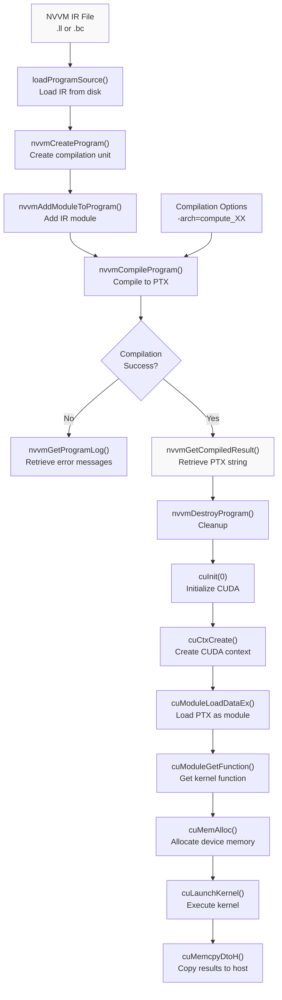
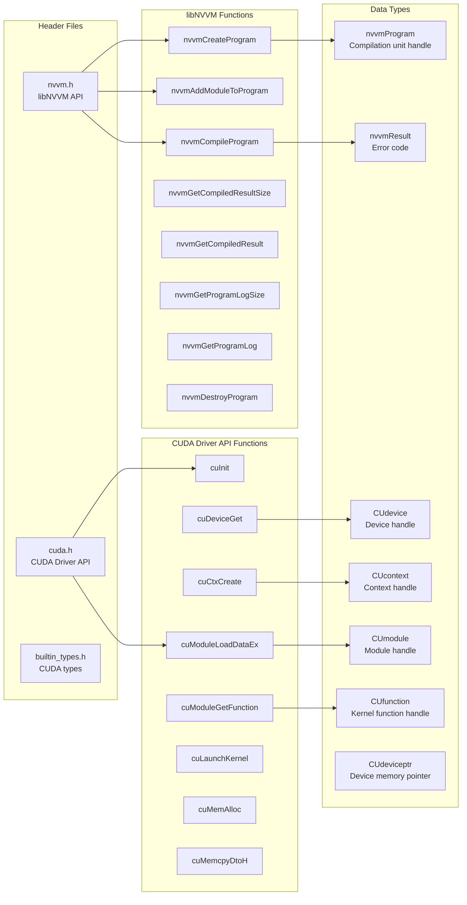

<!-- source: DeepWiki mcp.deepwiki.com · repo NVIDIA/cuda-samples · page 10 libNVVM Samples (Category 7) · fetched 2026-10-26 -->

# libNVVM Samples (Category 7)

Relevant source files

The following files were used as context for generating this wiki page:

- [CHANGELOG.md](CHANGELOG.md)
- [CMakeLists.txt](CMakeLists.txt)

## Purpose and Scope

This page documents the libNVVM samples in Category 7, which demonstrate low-level NVVM IR compilation and execution using the libNVVM library. These samples illustrate how to programmatically generate PTX code from NVVM IR (LLVM-based intermediate representation) and execute it using the CUDA Driver API.

For higher-level CUDA programming concepts, see [Introduction Samples (Category 0)](#4). For CUDA Driver API usage without libNVVM, see [CUDA Driver API and Dynamic Loading](#5.1). For CUDA dynamic parallelism using CUDA C++, see [CUDA Dynamic Parallelism](#5.3).

**Sources:** [cpp/7_libNVVM/README.md:1-101]()

---

## libNVVM Overview

libNVVM is NVIDIA's library for compiling NVVM IR (NVIDIA's dialect of LLVM IR) into PTX code. NVVM IR provides a stable, low-level interface for code generation that is independent of CUDA C/C++ language features. The compilation workflow involves:

1.  **NVVM IR Creation** - Generate or load `.ll` files containing NVVM IR.
2.  **libNVVM Compilation** - Use `nvvmCompileProgram` to generate PTX.
3.  **PTX Loading** - Load PTX using CUDA Driver API (`cuModuleLoadDataEx`).
4.  **Kernel Execution** - Launch kernels using `cuLaunchKernel`.

This category contains 6 samples demonstrating various aspects of this workflow. Recent updates in CUDA 13.0 updated the Driver API calls within these samples to use `cuCtxCreate_v4` by default [CHANGELOG.md:50-72]().

For details on the specific API calls and compiler flags, see [NVVM IR Compilation Pipeline](#10.1).

**Sources:** [cpp/7_libNVVM/README.md:1-32](), [cpp/7_libNVVM/simple/simple.c:125-188](), [CHANGELOG.md:50-72]()

---

## Sample Categories and Dependencies

The following table summarizes all samples in Category 7:

| Sample | Executable | Purpose | Dependencies |
| :--- | :--- | :--- | :--- |
| **simple** | `simple` | Basic NVVM IR → PTX → execution workflow | libNVVM, CUDA Driver API |
| **ptxgen** | `ptxgen` | Standalone IR-to-PTX compiler utility | libNVVM |
| **cuda-c-linking** | `cuda-c-linking` | LLVM IR generation + linking with nvcc code | libNVVM, LLVM 7-14, nvcc |
| **device-side-launch** | `dsl` | Dynamic parallelism (kernel launches kernel) | libNVVM, libcudadevrt.a |
| **uvmlite** | `uvmlite` | Unified virtual memory (managed memory) | libNVVM, UVM support |
| **cuda-shared-memory** | N/A (test only) | Shared memory usage examples | ptxgen |
| **syscalls** | N/A (test only) | Device malloc/free/vprintf | ptxgen |

**Sources:** [cpp/7_libNVVM/README.md:11-31](), [cpp/7_libNVVM/CMakeLists.txt:123-129]()

---

## libNVVM Compilation Pipeline

The libNVVM compilation pipeline involves creating a program handle, adding IR modules, and compiling with target-specific options.

For details, see [NVVM IR Compilation Pipeline](#10.1).

### Compilation and Execution Workflow

**Sources:** [cpp/7_libNVVM/simple/simple.c:125-188](), [cpp/7_libNVVM/simple/simple.c:190-251]()

---

## LLVM Integration and Linking

The `cuda-c-linking` sample demonstrates how to use the LLVM IRBuilder to generate code that is then linked with existing CUDA C++ code using the CUDA JIT linker.

For details, see [LLVM Integration and Linking](#10.2).

### Key Code Entities in libNVVM Workflow

This diagram maps the natural language concepts to specific code symbols used throughout the samples:

**Sources:** [cpp/7_libNVVM/simple/simple.c:27-33](), [cpp/7_libNVVM/simple/simple.c:125-188](), [cpp/7_libNVVM/simple/simple.c:86-101]()

---

## Advanced NVVM Features

Advanced features include dynamic parallelism, unified virtual memory, and system calls (malloc/free/vprintf) executed from within NVVM-generated kernels.

For details, see [Advanced NVVM Features](#10.3).

### Sample: uvmlite (Unified Memory)

The `uvmlite` sample demonstrates automatic coherency between host and device using `addrspace(1)` global variables in NVVM IR. It uses `cuPointerGetAttribute` with `CU_POINTER_ATTRIBUTE_IS_MANAGED` to verify memory properties [cpp/7_libNVVM/uvmlite/uvmlite.c:268-273]().

### Sample: device-side-launch (CDP)

Demonstrates linking with `libcudadevrt.a` to enable device-side kernel launches from NVVM-compiled code. The sample uses the CUDA JIT linker (`cuLinkCreate`, `cuLinkAddFile`) to resolve device runtime symbols [cpp/7_libNVVM/device-side-launch/dsl.c:216-222]().

**Sources:** [cpp/7_libNVVM/uvmlite/uvmlite.c:1-321](), [cpp/7_libNVVM/device-side-launch/dsl.c:1-261]()

---

## Build System and Testing

The libNVVM samples use a hierarchical CMake configuration. The root `CMakeLists.txt` sets standard CUDA architectures (SM 75-120) and handles MSVC-specific flags like `-Xcompiler=/Zc:preprocessor` [CMakeLists.txt:15-28]().

### Testing Infrastructure

The repository uses `run_tests.py` to exercise all samples [CHANGELOG.md:107](). For libNVVM, the `ptxgen` utility serves as a test fixture, ensuring the IR-to-PTX compiler is built before running dependent IR tests for shared memory and syscalls [cpp/7_libNVVM/ptxgen/CMakeLists.txt:29-32]().

**Sources:** [CMakeLists.txt:1-34](), [CHANGELOG.md:107](), [cpp/7_libNVVM/ptxgen/CMakeLists.txt:29-32]()

---

