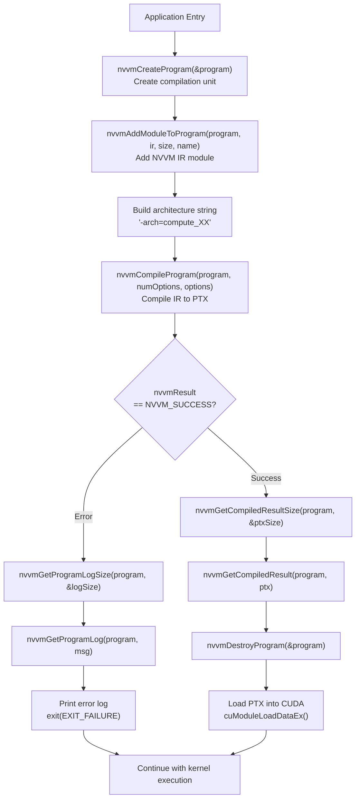
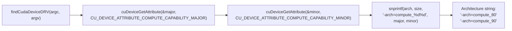
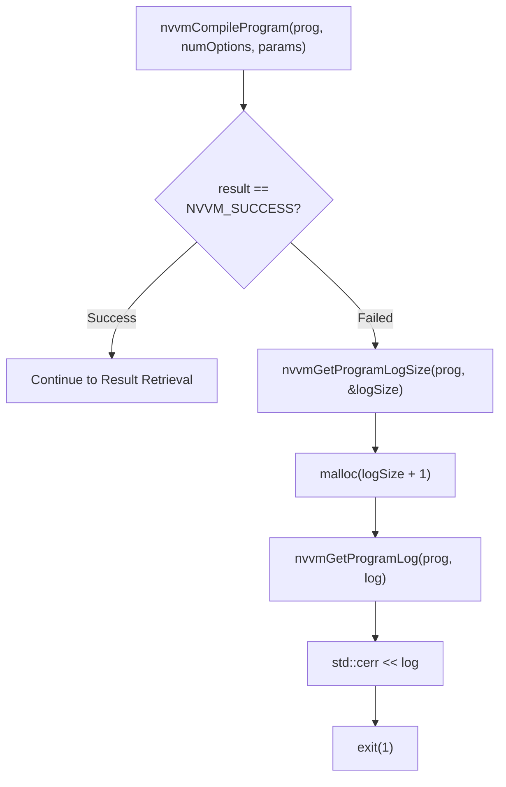

<!-- source: DeepWiki mcp.deepwiki.com · repo NVIDIA/cuda-samples · page 10.1 NVVM IR Compilation Pipeline · fetched 2026-10-26 -->

# NVVM IR Compilation Pipeline

Relevant source files

The following files were used as context for generating this wiki page:

- [CHANGELOG.md](CHANGELOG.md)
- [Common/nvrtc_helper.h](Common/nvrtc_helper.h)

## Purpose and Scope

This document describes the **libNVVM compilation pipeline** used to transform NVVM IR (NVIDIA's LLVM-based intermediate representation) into PTX (Parallel Thread Execution) code. The pipeline consists of a sequence of libNVVM API calls that create a compilation program, add IR modules, specify target architecture, compile to PTX, and retrieve results.

The libNVVM library provides a compiler SDK that allows developers to generate high-performance PTX from LLVM-based IR without requiring the full `nvcc` toolchain at runtime.

---

## Core libNVVM Compilation Workflow

The NVVM IR compilation pipeline follows a consistent pattern across all libNVVM samples, centered around the `nvvmProgram` handle and a series of API calls.

### Workflow Diagram

Title: libNVVM Compilation State Machine

**Sources:** [CHANGELOG.md:68-72](), [Common/nvrtc_helper.h:149-178]() (Note: `nvrtc_helper.h` shows a similar NVRTC pipeline which mirrors the libNVVM logic used in Category 7 samples).

---

## Program Creation and Initialization

### nvvmCreateProgram

The `nvvmCreateProgram` function initializes a new compilation unit represented by an `nvvmProgram` handle. This handle is used for all subsequent operations in the compilation pipeline.

| Function | Purpose | Return Type |
|----------|---------|-------------|
| `nvvmCreateProgram` | Create a new libNVVM compilation program | `nvvmResult` |

**Usage Pattern:**
As of CUDA 13.0, samples within `7_libNVVM` (such as `cuda-c-linking`, `device-side-launch`, `simple`, and `uvmlite`) have been updated to ensure compatibility with the latest Driver API requirements, including context creation parameters.

**Sources:** [CHANGELOG.md:41-72]()

---

## Adding NVVM IR Modules

### nvvmAddModuleToProgram

The `nvvmAddModuleToProgram` function adds NVVM IR source code to the compilation program. The IR can be provided in either LLVM bitcode or textual format.

| Parameter | Type | Description |
|-----------|------|-------------|
| `program` | `nvvmProgram` | The compilation program handle |
| `buffer` | `const char*` | Pointer to NVVM IR source |
| `size` | `size_t` | Size of the IR buffer in bytes |
| `name` | `const char*` | Module name for debugging/errors |

**Sources:** [CHANGELOG.md:68-72]()

---

## Compilation with Architecture Targeting

### Architecture String Construction

All samples dynamically construct the compute architecture string based on the device's compute capability. Since CUDA 13.0, samples have been updated to use `cudaDeviceGetAttribute` instead of deprecated `cudaDeviceProp` fields.

Title: Hardware Capability to Compiler Option Mapping

**Sources:** [Common/nvrtc_helper.h:82-102](), [CHANGELOG.md:27-34]()

### nvvmCompileProgram

The `nvvmCompileProgram` function performs the actual compilation of NVVM IR to PTX. It accepts an array of compiler options, most importantly the target architecture defined above.

**Sources:** [Common/nvrtc_helper.h:153]()

---

## Error Handling and Logging

### Compilation Error Recovery

When `nvvmCompileProgram` fails, libNVVM provides detailed error messages through a compilation log. This pattern is essential for debugging IR syntax errors or architecture mismatches.

Title: libNVVM Error Retrieval Pipeline

**Sources:** [Common/nvrtc_helper.h:153-171]() (Logic mirrored from NVRTC helper which implements the same protocol).

---

## PTX Retrieval and Cleanup

### Extracting Compiled PTX

After successful compilation, the PTX code (or CUBIN in some runtime compilation contexts) is extracted:

1. **Query Size:** Use `nvvmGetCompiledResultSize` to determine the buffer size.
2. **Retrieve Data:** Use `nvvmGetCompiledResult` to copy the PTX into a host buffer.
3. **Cleanup:** Use `nvvmDestroyProgram` to release libNVVM internal resources.

**Sources:** [Common/nvrtc_helper.h:173-179]()

---

## Driver API Integration (CUDA 13.0 Updates)

The output of the libNVVM pipeline is typically loaded into the CUDA Driver API. With the release of CUDA 13.0, the compilation and loading workflow requires updated context management.

- **Context Creation:** `cuCtxCreate` has been updated to `cuCtxCreate_v4` by default, requiring the `CUctxCreateParams` parameter.
- **Module Loading:** Compiled PTX is loaded using `cuModuleLoadDataEx`.

**Updated Samples in Category 7:**
- `cuda-c-linking`
- `device-side-launch`
- `simple`
- `uvmlite`

**Sources:** [CHANGELOG.md:50-72]()

---

## Key libNVVM Samples

| Sample | Feature Demonstrated |
|--------|----------------------|
| `simple` | Basic IR to PTX compilation and execution. |
| `cuda-c-linking` | Linking LLVM IR with existing CUDA C code. |
| `device-side-launch` | Compiling IR that utilizes Dynamic Parallelism. |
| `uvmlite` | NVVM IR compilation targeting Unified Virtual Memory. |
| `ptxgen` | A utility for generating PTX from NVVM IR files. |

**Sources:** [CHANGELOG.md:68-72](), [CHANGELOG.md:126-128]()

---

