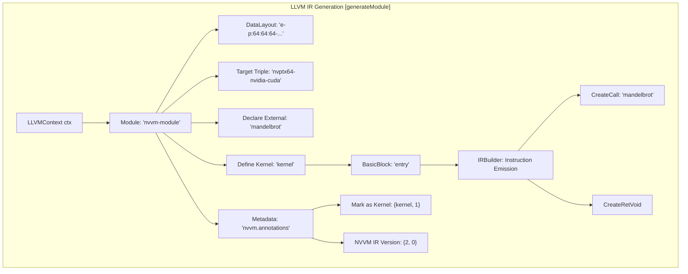
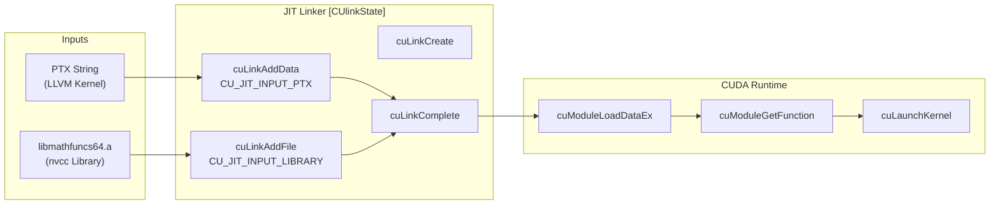

<!-- source: DeepWiki mcp.deepwiki.com · repo NVIDIA/cuda-samples · page 10.2 LLVM Integration and Linking · fetched 2026-10-26 -->

# LLVM Integration and Linking

Relevant source files

The following files were used as context for generating this wiki page:

- [CHANGELOG.md](CHANGELOG.md)
- [CMakeLists.txt](CMakeLists.txt)

## Purpose and Scope

This page describes how to integrate LLVM IR generation with the libNVVM compilation pipeline and link the resulting PTX with `nvcc`-compiled CUDA code. The `cuda-c-linking` sample demonstrates programmatic LLVM IR module creation, compilation to PTX via libNVVM, and runtime linking using the CUDA JIT linker to produce executable CUBIN.

The sample serves as a bridge between the LLVM compiler infrastructure and the CUDA driver's JIT capabilities, specifically showing how to resolve external symbols in LLVM-generated code by linking against pre-compiled CUDA static libraries.

**Sources:** [cpp/7_libNVVM/cuda-c-linking/cuda-c-linking.cpp:1-30](), [CHANGELOG.md:68-69]()

## LLVM Version Requirements

The `cuda-c-linking` sample requires LLVM development libraries between versions 7 and 14 inclusive. LLVM 15 introduced opaque pointers by default, which are not supported in libNVVM for architectures prior to Blackwell.

| LLVM Version | Compatibility | Notes |
|--------------|---------------|-------|
| < 7 | Not supported | Deprecated IR features |
| 7 - 14 | Supported | Recommended range for libNVVM compatibility |
| 15+ | Not supported | Opaque pointers incompatible with libNVVM 2.0 |

The build system validates this requirement and skips the sample if an incompatible LLVM version is detected or if LLVM is not found.

**Sources:** [cpp/7_libNVVM/cuda-c-linking/CMakeLists.txt:27-34]()

## LLVM IR Generation Workflow

### Module Creation with LLVM C++ APIs

The sample generates LLVM IR programmatically using LLVM's `IRBuilder` and `Module` classes. The process creates a module containing a kernel that calls an external function `mandelbrot` defined in a separate `nvcc`-compiled library.

**Key code entities:**

- `generateModule()`: Main function orchestrating the LLVM IR construction [cpp/7_libNVVM/cuda-c-linking/cuda-c-linking.cpp:85-139]().
- **Data Layout**: Configured for 64-bit NVPTX (`e-p:64:64:64-i1:8:8-i8:8:8-i16:16:16-i32:32:32-i64:64:64-f32:32:32-f64:64:64-v16:16:16-v32:32:32-v64:64:64-v128:128:128-n16:32:64`) [cpp/7_libNVVM/cuda-c-linking/cuda-c-linking.cpp:89-91]().
- **Target Triple**: Set to `nvptx64-nvidia-cuda` [cpp/7_libNVVM/cuda-c-linking/cuda-c-linking.cpp:92]().
- **External Linkage**: The `mandelbrot` function is declared with `ExternalLinkage` to allow the JIT linker to resolve it later [cpp/7_libNVVM/cuda-c-linking/cuda-c-linking.cpp:100-103]().
- **Metadata**: libNVVM requires `nvvm.annotations` to identify kernel entry points [cpp/7_libNVVM/cuda-c-linking/cuda-c-linking.cpp:112-129]().

**Sources:** [cpp/7_libNVVM/cuda-c-linking/cuda-c-linking.cpp:85-139]()

### Serialization

Once constructed, the LLVM `Module` is serialized to a textual string using `llvm::raw_string_ostream` for consumption by the libNVVM compiler.

**Sources:** [cpp/7_libNVVM/cuda-c-linking/cuda-c-linking.cpp:235-239]()

## Compilation to PTX with libNVVM

The `generatePtx()` function processes the LLVM IR string through the libNVVM compilation pipeline.

| Step | Function | Description |
|------|----------|-------------|
| 1 | `nvvmCreateProgram` | Initializes the compilation unit [cpp/7_libNVVM/cuda-c-linking/cuda-c-linking.cpp:144](). |
| 2 | `nvvmAddModuleToProgram` | Loads the LLVM IR string into the program [cpp/7_libNVVM/cuda-c-linking/cuda-c-linking.cpp:148](). |
| 3 | `nvvmCompileProgram` | Compiles IR to PTX using flags like `-arch=compute_XY` [cpp/7_libNVVM/cuda-c-linking/cuda-c-linking.cpp:156](). |
| 4 | `nvvmGetCompiledResult` | Retrieves the generated PTX string [cpp/7_libNVVM/cuda-c-linking/cuda-c-linking.cpp:175](). |

**Sources:** [cpp/7_libNVVM/cuda-c-linking/cuda-c-linking.cpp:141-180]()

## Building the Math Library with nvcc

The `mandelbrot` implementation resides in `math-funcs.cu`. This file must be compiled into a static library that the JIT linker can ingest.

### Library Build Configuration

The CMake configuration ensures the library is built for device-side linking:

[cpp/7_libNVVM/cuda-c-linking/CMakeLists.txt:56-82]()

Key settings:
- `CUDA_SEPARABLE_COMPILATION ON`: Required to produce relocatable device code [cpp/7_libNVVM/cuda-c-linking/CMakeLists.txt:82]().
- **Target Architecture**: Fixed to `compute_75` for the library to match the minimum requirement of the sample [cpp/7_libNVVM/cuda-c-linking/CMakeLists.txt:71]().

**Sources:** [cpp/7_libNVVM/cuda-c-linking/CMakeLists.txt:56-82]()

## CUDA JIT Linker Integration

### Linker Workflow

The CUDA Driver API's JIT linker (`CUlinkState`) combines the PTX (from libNVVM) and the static library (`libmathfuncs64.a`) into a single executable CUBIN.

### Linker Options and Logging

The sample initializes the linker with specific options to capture diagnostic information:

[cpp/7_libNVVM/cuda-c-linking/cuda-c-linking.cpp:254-267]()

- `CU_JIT_INFO_LOG_BUFFER`: Stores verbose linker progress.
- `CU_JIT_ERROR_LOG_BUFFER`: Stores specific error messages if linking fails.
- `CU_JIT_LOG_VERBOSE`: Set to `1` to provide maximum detail in the info log.

**Sources:** [cpp/7_libNVVM/cuda-c-linking/cuda-c-linking.cpp:254-267]()

### Completing the Link

After adding both the PTX data (`cuLinkAddData`) and the library file (`cuLinkAddFile`), `cuLinkComplete` is called to generate the CUBIN image. This image is then loaded into the CUDA context using `cuModuleLoadDataEx`.

**Sources:** [cpp/7_libNVVM/cuda-c-linking/cuda-c-linking.cpp:268-286]()

## Execution Pipeline and Data Flow

The final execution involves launching the linked kernel. The data flow from host to device follows standard Driver API patterns.

1. **Context Initialization**: `cuCtxCreate` (v4 by default in CUDA 13.0) [CHANGELOG.md:50-69]().
2. **Device Allocation**: `cuMemAlloc` for the output buffer.
3. **Kernel Launch**: `cuLaunchKernel` using the function handle retrieved from the linked module [cpp/7_libNVVM/cuda-c-linking/cuda-c-linking.cpp:302-315]().
4. **Result Verification**: The output is copied back and compared against a host-side Mandelbrot implementation.

**Sources:** [cpp/7_libNVVM/cuda-c-linking/cuda-c-linking.cpp:292-325](), [CHANGELOG.md:50-69]()

## Build System Integration

The sample uses CMake to manage the complex dependency between LLVM and the CUDA Toolkit.

[cpp/7_libNVVM/cuda-c-linking/CMakeLists.txt:36-48]()

- **LLVM Mapping**: Uses `llvm_map_components_to_libnames` to resolve `core` and `support` libraries.
- **Library Linking**: Links the executable against `llvm_libs`, `nvvm` (libNVVM), and `cuda` (Driver API).

**Sources:** [cpp/7_libNVVM/cuda-c-linking/CMakeLists.txt:36-48]()

## Debugging and Output Options

The sample provides command-line arguments to inspect intermediate stages of the compilation and linking process:

| Argument | Effect |
|----------|--------|
| `--save-ir` | Writes the LLVM IR to `cuda-c-linking.kernel.ll` [cpp/7_libNVVM/cuda-c-linking/cuda-c-linking.cpp:229-233](). |
| `--save-ptx` | Writes the compiled PTX to `cuda-c-linking.kernel.ptx` [cpp/7_libNVVM/cuda-c-linking/cuda-c-linking.cpp:243-247](). |
| `--save-cubin` | Writes the final linked CUBIN to `cuda-c-linking.linked.cubin` [cpp/7_libNVVM/cuda-c-linking/cuda-c-linking.cpp:275-279](). |

**Sources:** [cpp/7_libNVVM/cuda-c-linking/cuda-c-linking.cpp:47-49](), [cpp/7_libNVVM/cuda-c-linking/cuda-c-linking.cpp:229-279]()

---

