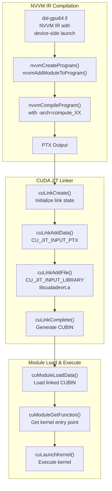
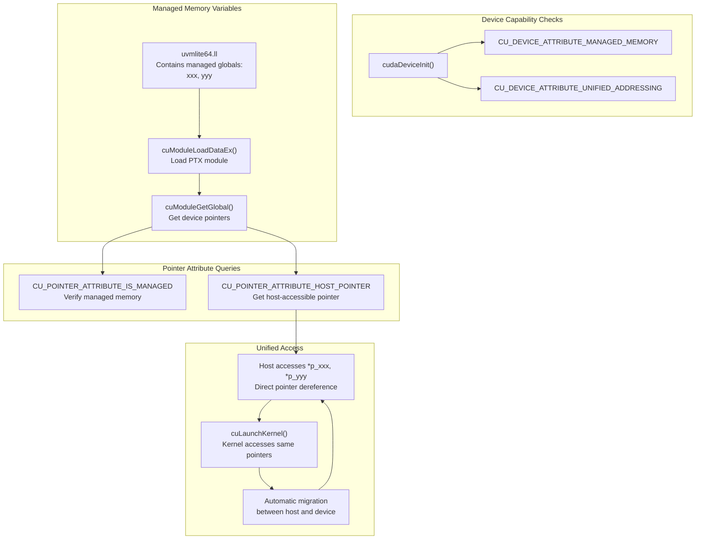
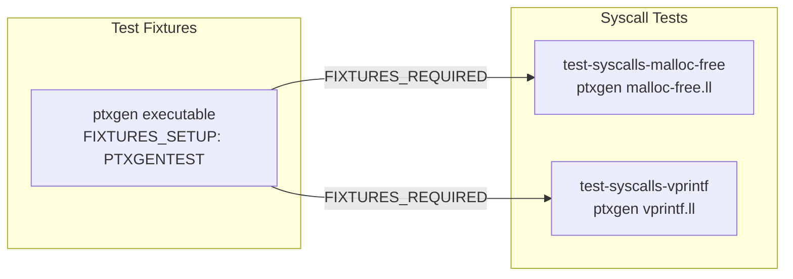
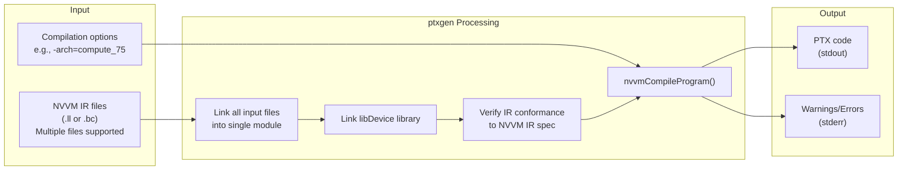
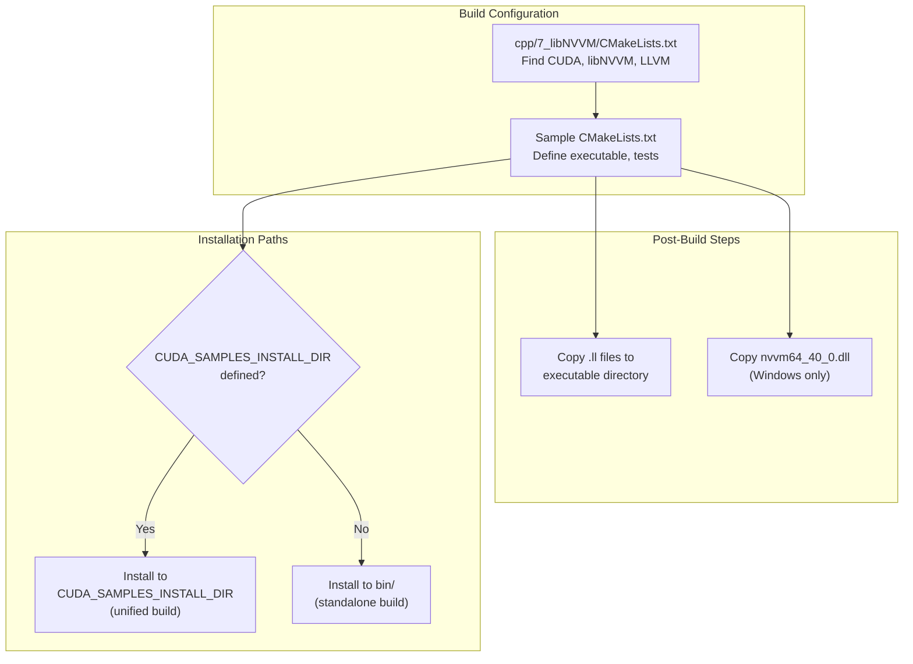

<!-- source: DeepWiki mcp.deepwiki.com · repo NVIDIA/cuda-samples · page 10.3 Advanced NVVM Features · fetched 2026-10-26 -->

# Advanced NVVM Features

<details>
<summary>Relevant source files</summary>

The following files were used as context for generating this wiki page:

- [CHANGELOG.md](CHANGELOG.md)
- [CMakeLists.txt](CMakeLists.txt)

</details>


## Purpose and Scope

This page documents advanced libNVVM capabilities demonstrated in the `7_libNVVM` sample collection. These samples illustrate device-side kernel launches (dynamic parallelism), unified virtual memory management, device-side system calls, and the standalone PTX generation utility.

For basic NVVM IR compilation workflow (`nvvmCreateProgram`, `nvvmCompileProgram`, PTX generation), see [NVVM IR Compilation Pipeline](#10.1). For LLVM IR integration and linking with nvcc-compiled code, see [LLVM Integration and Linking](#10.2).

**Sources:** [cpp/7_libNVVM/README.md:1-32]()

---

## Device-Side Launch and Dynamic Parallelism

### Overview

The `device-side-launch` sample demonstrates CUDA Dynamic Parallelism (CDP), enabling kernels to launch child kernels directly from device code without CPU intervention. This requires linking against `libcudadevrt`, the CUDA device runtime library.

### Device Runtime Linking Workflow



**Sources:** [cpp/7_libNVVM/device-side-launch/dsl.c:94-231](), [cpp/7_libNVVM/device-side-launch/CMakeLists.txt:29-30]()

### Implementation Details

The `dsl.c` sample implements the complete workflow:

| Stage | Function | Purpose |
|-------|----------|---------|
| **IR Loading** | `loadProgramSource()` | Reads `dsl-gpu64.ll` from disk |
| **PTX Generation** | `generatePTX()` | Compiles NVVM IR to PTX using libNVVM |
| **Device Runtime Lookup** | `getLibCudaDevRtName()` | Locates `libcudadevrt` path (from CMake) |
| **Linking** | `cuLinkCreate/AddData/AddFile/Complete()` | Links PTX with device runtime |
| **Execution** | `cuModuleLoadData()`, `cuLaunchKernel()` | Loads and executes kernel |

The device runtime library path is injected at compile time via CMake preprocessor definition:

[cpp/7_libNVVM/device-side-launch/CMakeLists.txt:29-30]()
```cmake
set_property(SOURCE dsl.c
             PROPERTY COMPILE_DEFINITIONS LIBCUDADEVRT="${CUDADEVRT_LIB}")
```

The linking sequence creates a single CUBIN containing both the kernel code and the device runtime functions needed for child kernel launches. Note that in CUDA 13.0, `cuCtxCreate` was updated to `cuCtxCreate_v4`, which is used during context initialization for these samples [CHANGELOG.md:50-72]().

**Sources:** [cpp/7_libNVVM/device-side-launch/dsl.c:1-261](), [cpp/7_libNVVM/device-side-launch/CMakeLists.txt:1-70](), [CHANGELOG.md:50-72]()

---

## Unified Virtual Memory (UVM)

### Overview

The `uvmlite` sample demonstrates Unified Virtual Memory (UVM), where memory is automatically migrated between host and device as needed. A single pointer can be accessed from both host and device code without explicit `cudaMemcpy` operations.

### UVM Architecture and Capabilities



**Sources:** [cpp/7_libNVVM/uvmlite/uvmlite.c:151-198](), [cpp/7_libNVVM/uvmlite/uvmlite.c:260-286]()

### Device Attribute Verification

The sample verifies UVM support through device attributes. In CUDA 13.0, many legacy `cudaDeviceProp` fields were replaced with `cudaDeviceGetAttribute` calls [CHANGELOG.md:27-33]().

| Attribute | Purpose | Query Result |
|-----------|---------|--------------|
| `CU_DEVICE_ATTRIBUTE_MANAGED_MEMORY` | Supports managed memory allocation | Must be non-zero |
| `CU_DEVICE_ATTRIBUTE_UNIFIED_ADDRESSING` | Host and device share address space | Must be non-zero |

[cpp/7_libNVVM/uvmlite/uvmlite.c:180-196]()

### Managed Memory Access Pattern

The `uvmlite` sample demonstrates bidirectional access to managed variables:

1. **Device Initialization**: Variables `xxx` and `yyy` are defined in `uvmlite64.ll`.
2. **Host Access**: Host reads initial values, then modifies them directly.
3. **Kernel Access**: Kernel further modifies the same variables.
4. **Host Verification**: Host reads final values without explicit copy operations.

The pointer attribute `CU_POINTER_ATTRIBUTE_IS_MANAGED` confirms that a given `CUdeviceptr` points to managed memory [cpp/7_libNVVM/uvmlite/uvmlite.c:268-274](). The pointer attribute `CU_POINTER_ATTRIBUTE_HOST_POINTER` returns the host-accessible pointer for a device pointer [cpp/7_libNVVM/uvmlite/uvmlite.c:279-286]().

**Sources:** [cpp/7_libNVVM/uvmlite/uvmlite.c:1-321](), [cpp/7_libNVVM/uvmlite/CMakeLists.txt:1-73](), [CHANGELOG.md:27-33]()

---

## Device-Side System Calls

### Overview

The `syscalls` directory contains NVVM IR programs demonstrating device-side system calls: `malloc`, `free`, and `vprintf`. These functions enable dynamic memory allocation and formatted output directly from kernel code.

### Supported System Calls

| System Call | IR File | Purpose |
|-------------|---------|---------|
| `malloc` / `free` | `malloc-free.ll` | Dynamic device memory allocation/deallocation |
| `vprintf` | `vprintf.ll` | Formatted output from kernel code |

These NVVM IR files are compiled using the `ptxgen` utility rather than having dedicated host wrappers.

### Testing Infrastructure

The `syscalls` tests use CMake's CTest framework with fixture dependencies. The `run_tests.py` utility added in CUDA 12.9 is used to exercise these samples [CHANGELOG.md:107]().



The fixture dependency ensures `ptxgen` is built before syscall tests execute [cpp/7_libNVVM/syscalls/CMakeLists.txt:28-37]().

**Sources:** [cpp/7_libNVVM/syscalls/CMakeLists.txt:1-55](), [cpp/7_libNVVM/README.md:28-29](), [CHANGELOG.md:107]()

---

## PTX Generation Utility (ptxgen)

### Overview

`ptxgen` is a standalone command-line tool that compiles NVVM IR files to PTX. It serves as both a utility for manual PTX generation and as the basis for testing other NVVM IR samples.

### Command-Line Interface



**Sources:** [cpp/7_libNVVM/ptxgen/README.md:1-28]()

### Implementation and Linking

`ptxgen` automatically links with the `libDevice` library. The `LIBNVVM_HOME` path is embedded at compile time via CMake to locate this library [cpp/7_libNVVM/ptxgen/CMakeLists.txt:44-49]().

In the repository-wide `CMakeLists.txt`, standard compilation options are defined, including `CMAKE_CUDA_ARCHITECTURES` ranging from SM 75 to 120 [CMakeLists.txt:15](). `ptxgen` respects these architecture targets when generating PTX.

### Integration with Test Infrastructure

`ptxgen` serves as the foundation for testing other libNVVM samples. The executable is designated as a CTest fixture [cpp/7_libNVVM/ptxgen/CMakeLists.txt:29-32](). This fixture is required by multiple test suites including `cuda-shared-memory` and `syscalls`.

**Sources:** [cpp/7_libNVVM/ptxgen/README.md:1-28](), [cpp/7_libNVVM/ptxgen/CMakeLists.txt:1-75](), [CMakeLists.txt:15]()

---

## Sample Build and Installation

All advanced NVVM samples share a common build pattern. Since CUDA 12.8, the repository uses a three-tier CMake architecture [CHANGELOG.md:116]().



**Sources:** [cpp/7_libNVVM/CMakeLists.txt:131-144](), [cpp/7_libNVVM/simple/CMakeLists.txt:43-59](), [CHANGELOG.md:116]()

---

