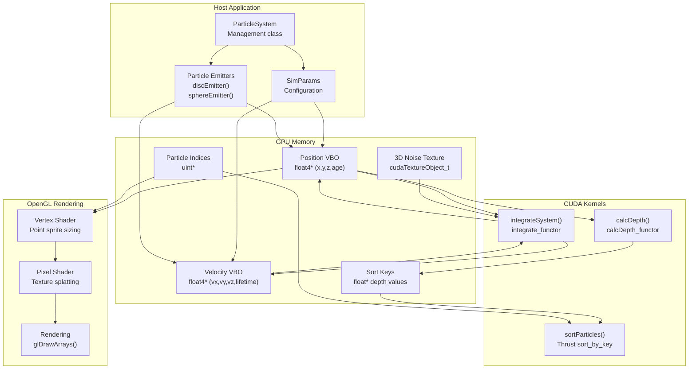
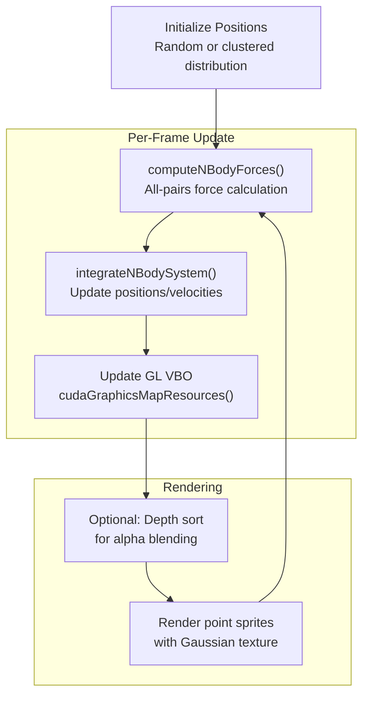
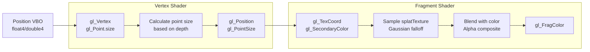
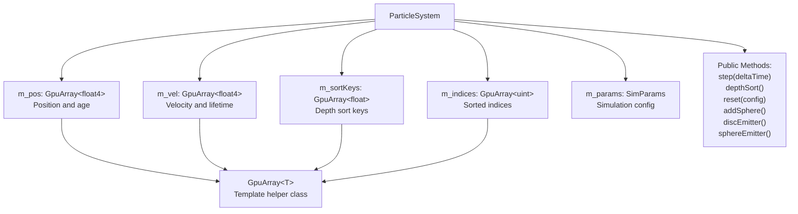
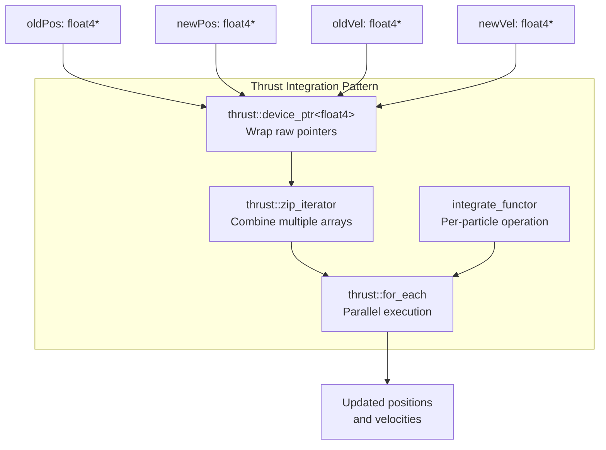
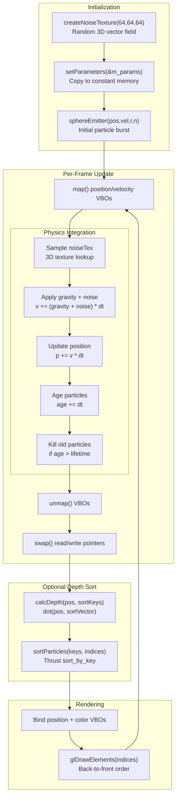
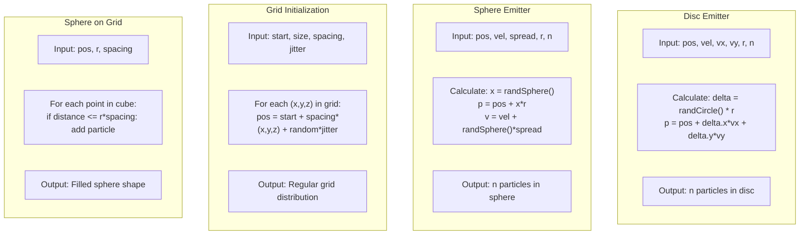
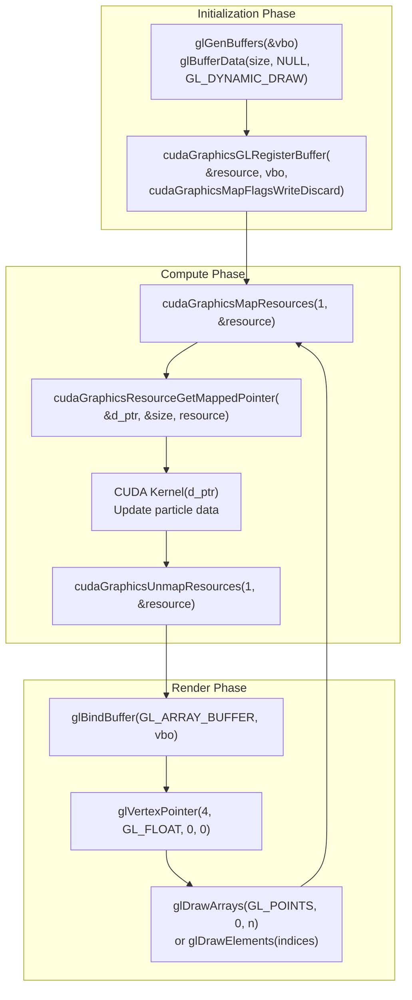

<!-- source: DeepWiki mcp.deepwiki.com · repo NVIDIA/cuda-samples · page 11.1 Physics Simulation and Particle Systems · fetched 2026-10-26 -->

# Physics Simulation and Particle Systems

Relevant source files

The following files were used as context for generating this wiki page:

- [CHANGELOG.md](CHANGELOG.md)
- [Common/helper_math.h](Common/helper_math.h)
- [Common/nvMath.h](Common/nvMath.h)
- [Common/nvVector.h](Common/nvVector.h)

## Purpose and Scope

This page documents the physics simulation and particle system samples in the CUDA Samples repository. These samples demonstrate real-time particle physics using CUDA for computation and OpenGL for visualization. The primary samples covered are:

- **nbody** - N-body gravitational simulation with up to millions of particles.
- **particles** - Generic particle system framework with Thrust integration.
- **smokeParticles** - Advanced particle effects with noise textures and depth sorting.

For fluid dynamics simulations using FFT, see [Fluid Dynamics and Visualization](#11.2). For volume rendering techniques, see [Volume Rendering and Medical Imaging](#11.3). For graphics API interoperability patterns, see [Graphics API Interoperability](#8).

---

## Particle System Architecture

The particle system architecture follows a CUDA-OpenGL interop pattern where particle data resides in GPU memory and is accessed by both CUDA kernels (for physics updates) and OpenGL shaders (for rendering).

### High-Level System Components

**Sources:** `ParticleSystem` class and simulation parameters are defined in [cpp/5_Domain_Specific/smokeParticles/ParticleSystem.cpp:1-403](). Integration kernels and depth sorting are implemented in [cpp/5_Domain_Specific/smokeParticles/ParticleSystem_cuda.cu:1-161](). Rendering logic for particles is found in [cpp/5_Domain_Specific/nbody/render_particles.cpp:1-377]().

### Data Structures

| Structure | Location | Fields | Purpose |
|-----------|----------|--------|---------|
| `float4` position | GPU VBO | `(x, y, z, age)` | Particle position and age. |
| `float4` velocity | GPU VBO | `(vx, vy, vz, lifetime)` | Particle velocity and lifetime. |
| `SimParams` | Constant memory | gravity, damping, noiseSpeed, time | Simulation parameters. |
| `GpuArray<T>` | Helper class | device/host pointers, VBO ID | Manages CPU-GPU data transfer. |
| `cudaGraphicsResource` | CUDA-GL interop | VBO mapping handle | Zero-copy access to OpenGL buffers. |

**Sources:** Particle system headers and parameters are defined in [cpp/5_Domain_Specific/smokeParticles/ParticleSystem.cuh]() and initialized in [cpp/5_Domain_Specific/smokeParticles/ParticleSystem.cpp:58-78]().

---

## N-body Simulation

The `nbody` sample implements gravitational N-body simulation using CUDA, computing pairwise forces between particles. This demonstrates real-time physics for astronomical simulations.

### N-body Algorithm Flow

### Rendering Configuration

The `ParticleRenderer` class handles visualization with multiple display modes defined in [cpp/5_Domain_Specific/nbody/render_particles.cpp:59-119]():

| Mode | Description | Implementation |
|------|-------------|----------------|
| `PARTICLE_POINTS` | Simple points | `glPointSize()`, solid color. |
| `PARTICLE_SPRITES` | Textured sprites | Point sprites with Gaussian texture blend. |
| `PARTICLE_SPRITES_COLOR` | Colored sprites | Per-particle color from VBO. |

The renderer supports both single-precision (`float`) and double-precision (`double`) positions via the `m_bFp64Positions` flag [cpp/5_Domain_Specific/nbody/render_particles.cpp:59-119]().

### Vertex and Fragment Shaders

**Sources:** Shader setup and execution are detailed in [cpp/5_Domain_Specific/nbody/render_particles.cpp:243-284]() and [cpp/5_Domain_Specific/nbody/render_particles.cpp:165-241]().

---

## Generic Particle System Framework

The `particles` sample provides a reusable framework for particle effects with configurable parameters and emitters.

### Particle System Class Hierarchy

**Sources:** Class structure and members are defined in [cpp/5_Domain_Specific/smokeParticles/ParticleSystem.h]() and implemented in [cpp/5_Domain_Specific/smokeParticles/ParticleSystem.cpp:58-102]().

### GpuArray Template

The `GpuArray<T>` template manages bidirectional data transfer and VBO creation:

| Method | Purpose | CUDA API |
|--------|---------|----------|
| `alloc(size, useVBO, useReadBack)` | Allocate GPU/host memory. | `cudaMalloc()`, `glGenBuffers()`. |
| `map()` | Map VBO for CUDA access. | `cudaGraphicsMapResources()`. |
| `unmap()` | Unmap VBO. | `cudaGraphicsUnmapResources()`. |
| `copy(direction)` | Copy between host/device. | `cudaMemcpy()`. |
| `swap()` | Swap read/write pointers. | Double buffering. |

**Sources:** Implementation details are found in [cpp/5_Domain_Specific/smokeParticles/ParticleSystem.cuh]().

---

## Thrust Integration for Parallel Operations

The particle samples extensively use Thrust for parallel algorithms, avoiding manual kernel implementations for common operations.

### Thrust-Based Particle Integration

### Integration Functor Implementation

The `integrate_functor` is a callable object used with `thrust::for_each`. It applies physics such as velocity integration and noise perturbation [cpp/5_Domain_Specific/smokeParticles/ParticleSystem_cuda.cu:122-134](). Note that `thrust::identity` has been replaced by `cuda::std::identity` in newer CUDA versions [CHANGELOG.md:83]().

**Sources:** Functor usage and logic are in [cpp/5_Domain_Specific/smokeParticles/ParticleSystem_cuda.cu:122-134]() and [cpp/5_Domain_Specific/smokeParticles/particles_kernel_device.cuh]().

### Thrust Sort for Depth Ordering

Depth sorting is implemented using Thrust's `sort_by_key`:

| Step | Thrust Operation | Purpose |
|------|------------------|---------|
| 1. Calculate depth | `thrust::for_each` with `calcDepth_functor` | Compute distance from camera. |
| 2. Initialize indices | `thrust::sequence` | Create [0, 1, 2, ..., N-1]. |
| 3. Sort by depth | `thrust::sort_by_key(keys, indices)` | Reorder indices by depth. |
| 4. Render | `glDrawElements(indices)` | Back-to-front rendering. |

**Sources:** Sorting logic is found in [cpp/5_Domain_Specific/smokeParticles/ParticleSystem_cuda.cu:136-158]() and [cpp/5_Domain_Specific/smokeParticles/ParticleSystem.cpp:133-150]().

---

## Smoke Particle Effects

The `smokeParticles` sample extends the generic particle system with noise-based motion and aging effects.

### Smoke Particle Simulation Pipeline

**Sources:** Pipeline implementation is found in [cpp/5_Domain_Specific/smokeParticles/ParticleSystem_cuda.cu:74-119]() and [cpp/5_Domain_Specific/smokeParticles/ParticleSystem.cpp:105-130]().

### Noise Texture Generation

The 3D noise texture provides turbulent motion via trilinear interpolation sampling [cpp/5_Domain_Specific/smokeParticles/ParticleSystem_cuda.cu:74-119]().

| Property | Value | Purpose |
|----------|-------|---------|
| Dimensions | 64×64×64 | Tileable 3D volume. |
| Format | `float4` | Random 3D vector + extra channel. |
| Values | `[-1, 1]` per component | Normalized direction vectors. |
| Filtering | `cudaFilterModeLinear` | Smooth interpolation. |
| Addressing | `cudaAddressModeWrap` | Seamless tiling. |

**Sources:** Noise texture logic is in [cpp/5_Domain_Specific/smokeParticles/ParticleSystem_cuda.cu:74-119]().

---

## Particle Emitters

The particle system provides multiple emitter types for generating particles with specific distributions.

### Emitter Types and Implementations

### Emitter Method Signatures

| Method | Parameters | Use Case |
|--------|------------|----------|
| `discEmitter()` | `pos, vel, vx, vy, r, n, lifetime` | Flat circular emitter (e.g., fountain). |
| `sphereEmitter()` | `pos, vel, spread, r, n, lifetime` | Volumetric burst (e.g., explosion). |
| `initGrid()` | `start, size, spacing, jitter, vel` | Regular grid initialization. |
| `addSphere()` | `pos, vel, r, spacing, lifetime` | Add sphere to existing particles. |

**Sources:** Emitter logic is implemented in [cpp/5_Domain_Specific/smokeParticles/ParticleSystem.cpp:295-369]() and [cpp/5_Domain_Specific/smokeParticles/ParticleSystem.cpp:193-265]().

---

## CUDA-OpenGL Interoperability

All particle samples use zero-copy memory sharing between CUDA and OpenGL for efficient rendering.

### VBO Registration and Mapping

**Sources:** Interop logic is found in [cpp/5_Domain_Specific/smokeParticles/ParticleSystem.cuh]() and [cpp/5_Domain_Specific/nbody/render_particles.cpp:66-163]().

### Double Buffering Strategy

The particle system uses double buffering for position and velocity arrays to prevent read-write hazards [cpp/5_Domain_Specific/smokeParticles/ParticleSystem.cpp:105-130]().

---

## Performance Considerations

| Technique | Implementation | Benefit |
|-----------|----------------|---------|
| Zero-copy interop | `cudaGraphicsGLRegisterBuffer()` | Eliminates CPU-GPU transfers. |
| Thrust algorithms | `thrust::for_each`, `thrust::sort_by_key` | Optimized parallel primitives. |
| Constant memory | `__constant__ SimParams` | Cached parameter access. |
| Texture memory | 3D noise texture | Cached, interpolated lookups. |
| Double buffering | Separate read/write pointers | Avoids synchronization stalls. |
| Optional depth sort | `m_doDepthSort` flag | Trade accuracy for performance. |

**Sources:** Performance strategies are implemented in [cpp/5_Domain_Specific/smokeParticles/ParticleSystem_cuda.cu:122-158]() and [cpp/5_Domain_Specific/smokeParticles/ParticleSystem.cpp:133-150]().

---

