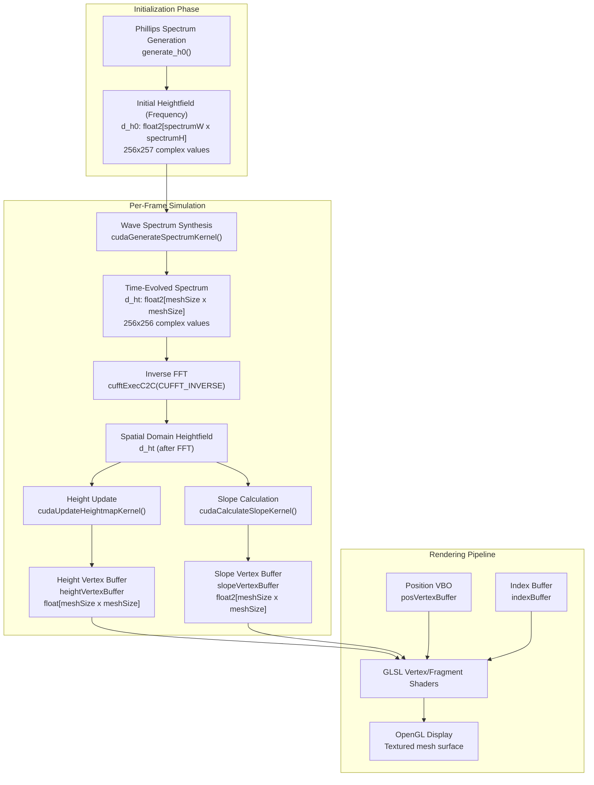
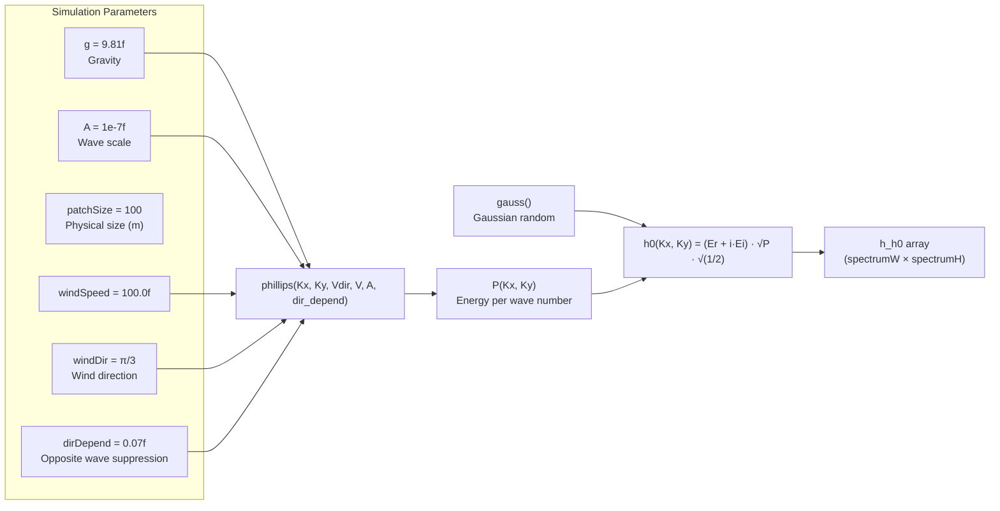
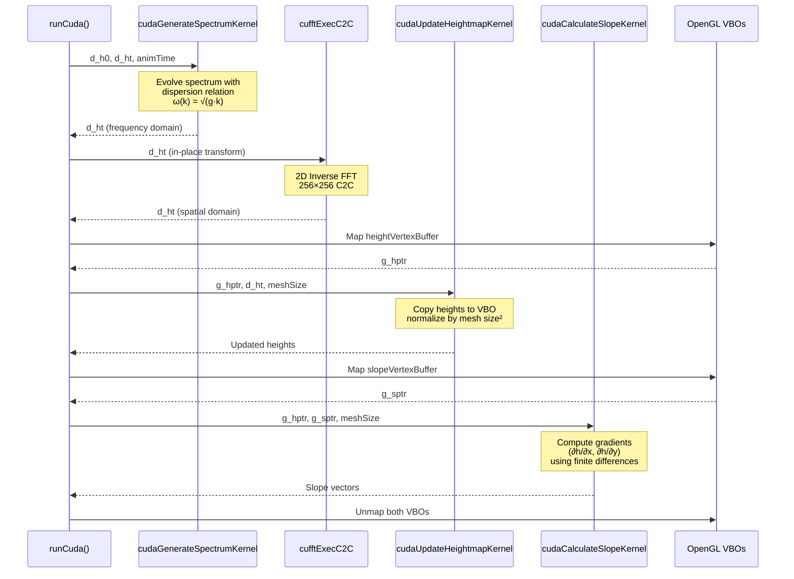
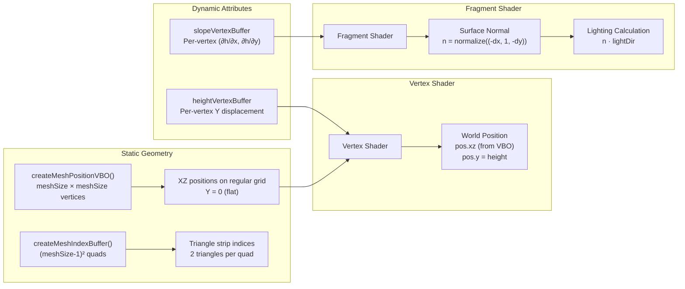
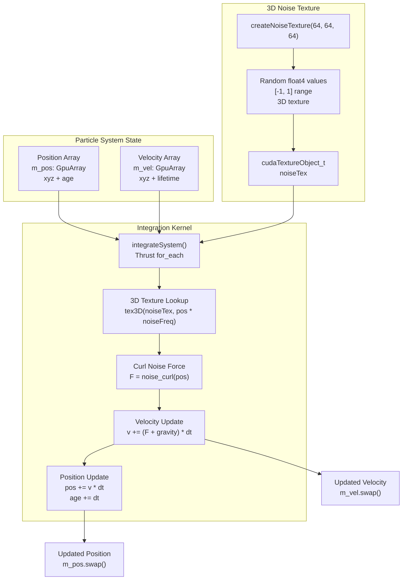
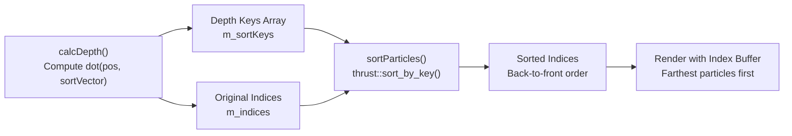

<!-- source: DeepWiki mcp.deepwiki.com · repo NVIDIA/cuda-samples · page 11.2 Fluid Dynamics and Visualization · fetched 2026-10-26 -->

# Fluid Dynamics and Visualization

Relevant source files

The following files were used as context for generating this wiki page:

- [CHANGELOG.md](CHANGELOG.md)
- [Common/helper_math.h](Common/helper_math.h)

## Purpose and Scope

This page documents CUDA-based fluid dynamics simulation samples in Category 5 (Domain-Specific Applications), focusing on FFT-based ocean surface simulation and particle-based fluid visualization techniques. These samples demonstrate real-time computational fluid dynamics using CUDA for physics calculations and OpenGL for rendering. For general physics simulation patterns including N-body systems, see [Physics Simulation and Particle Systems](#11.1). For volume rendering techniques, see [Volume Rendering and Medical Imaging](#11.3).

The primary sample covered is `oceanFFT`, which implements Tessendorf's FFT-based ocean surface synthesis algorithm using the cuFFT library. Additional coverage includes particle-based fluid visualization approaches used in smoke and fluid effects.

**Key Samples:**
- **oceanFFT**: FFT-based ocean wave simulation with real-time heightmap generation.
- **smokeParticles**: Particle system with fluid-like motion using 3D noise textures and depth sorting.
- **fluidsGL**: 2D fluid simulation solving Navier-Stokes equations on a grid with FFT-based pressure projection.

---

## FFT-Based Ocean Simulation Architecture

The `oceanFFT` sample implements a complete pipeline for simulating and rendering ocean surfaces using Fast Fourier Transforms. The simulation operates in frequency space for efficiency, converting to the spatial domain only for rendering.

### System Overview

Sources: [cpp/4_CUDA_Libraries/oceanFFT/oceanFFT.cpp:1-435]()

### Core Data Structures and Resources

| Resource | Type | Dimensions | Purpose |
|----------|------|------------|---------|
| `d_h0` | `float2*` | 260 x 257 | Initial frequency-space heightfield (Phillips spectrum) |
| `d_ht` | `float2*` | 256 x 256 | Time-evolved frequency spectrum / spatial heightfield |
| `d_slope` | `float2*` | 256 x 256 | Surface slope for lighting calculations |
| `heightVertexBuffer` | `GLuint` (VBO) | 256 x 256 floats | Per-vertex height displacement |
| `slopeVertexBuffer` | `GLuint` (VBO) | 256 x 256 float2 | Per-vertex slope (dx, dy) for shading |
| `posVertexBuffer` | `GLuint` (VBO) | 256 x 256 | Base mesh XZ positions |
| `fftPlan` | `cufftHandle` | 256 x 256 | cuFFT plan for 2D C2C transform |

Sources: [cpp/4_CUDA_Libraries/oceanFFT/oceanFFT.cpp:82-118]()

---

## Phillips Spectrum Wave Generation

The ocean surface is synthesized using the Phillips spectrum, which models realistic ocean waves based on wind parameters. The spectrum is generated once during initialization and then evolved over time.

### Phillips Spectrum Function

The Phillips spectrum $P(K_x, K_y)$ is computed as:

$$P(K_x, K_y) = A \frac{\exp(-1/(k^2 L^2))}{k^4} (w \cdot k)^2$$

Where:
- $k = \sqrt{K_x^2 + K_y^2}$ is the wave number magnitude.
- $L = V^2 / g$ is the largest possible wave (wind-dependent).
- $w = (\cos(V_{dir}), \sin(V_{dir}))$ is the wind direction vector.
- $A$ is the wave scale amplitude factor.
- $g$ is gravitational constant (9.81 m/s²).

Sources: [cpp/4_CUDA_Libraries/oceanFFT/oceanFFT.cpp:330-406]()

### Initialization Implementation

The `generate_h0()` function creates the base spectrum:

**Key Steps:**
1. **Wave number calculation**: For each grid point $(x, y)$, compute normalized wave numbers $(K_x, K_y)$ based on patch size [cpp/4_CUDA_Libraries/oceanFFT/oceanFFT.cpp:385-395]().
2. **Phillips spectrum evaluation**: Calculate spectral energy $P(K_x, K_y)$ using wind parameters [cpp/4_CUDA_Libraries/oceanFFT/oceanFFT.cpp:396-397]().
3. **Random phase initialization**: Generate Gaussian random numbers $E_r$ and $E_i$ for real and imaginary components [cpp/4_CUDA_Libraries/oceanFFT/oceanFFT.cpp:399-400]().
4. **Complex amplitude**: Compute $h_0(K_x, K_y) = (E_r + iE_i) \cdot \sqrt{P/2}$ [cpp/4_CUDA_Libraries/oceanFFT/oceanFFT.cpp:401-403]().

The spectrum uses a size of `(meshSize+4) × (meshSize+1)` (260×257) to handle FFT boundary conditions, while the output mesh is `meshSize × meshSize` (256×256).

Sources: [cpp/4_CUDA_Libraries/oceanFFT/oceanFFT.cpp:380-406]()

---

## FFT Pipeline and Kernel Execution

The core simulation loop transforms the frequency-space wave spectrum to spatial domain heightfield each frame using a multi-stage CUDA/cuFFT pipeline.

### Per-Frame Execution Flow

Sources: [cpp/4_CUDA_Libraries/oceanFFT/oceanFFT.cpp:411-435]()

### Wave Spectrum Evolution

The `cudaGenerateSpectrumKernel` evolves the initial spectrum over time using the dispersion relation:

**Dispersion Relation**: $\omega(k) = \sqrt{g \cdot k}$

For each wave number $(K_x, K_y)$:
1. Compute wave frequency: $\omega = \sqrt{g \cdot \sqrt{K_x^2 + K_y^2}}$ [cpp/4_CUDA_Libraries/oceanFFT/oceanFFT_kernel.cu:44-46]().
2. Compute phase evolution: $e^{i\omega t}$ and $e^{-i\omega t}$ [cpp/4_CUDA_Libraries/oceanFFT/oceanFFT_kernel.cu:51-54]().
3. Combine with initial spectrum: $h(k, t) = h_0(k)e^{i\omega t} + h_0^*(-k)e^{-i\omega t}$ [cpp/4_CUDA_Libraries/oceanFFT/oceanFFT_kernel.cu:56-61]().

This ensures the resulting heightfield is real-valued after FFT.

Sources: [cpp/4_CUDA_Libraries/oceanFFT/oceanFFT_kernel.cu:35-65]()

---

## CUDA-OpenGL Interoperability

The ocean simulation uses CUDA-OpenGL interop to efficiently transfer computed heightfield and slope data to vertex buffers for rendering without CPU roundtrips.

### VBO Mapping and Resource Management

**Key API Sequence:**

1. **VBO Creation**: `createVBO()` allocates OpenGL buffer with `GL_ARRAY_BUFFER` target [cpp/4_CUDA_Libraries/oceanFFT/oceanFFT.cpp:278-285]().
2. **Registration**: `cudaGraphicsGLRegisterBuffer()` with `cudaGraphicsMapFlagsWriteDiscard` hint [cpp/4_CUDA_Libraries/oceanFFT/oceanFFT.cpp:304-306]().
3. **Mapping**: `cudaGraphicsMapResources()` acquires CUDA access, blocking OpenGL [cpp/4_CUDA_Libraries/oceanFFT/oceanFFT.cpp:422-423]().
4. **Pointer Retrieval**: `cudaGraphicsResourceGetMappedPointer()` returns device pointer [cpp/4_CUDA_Libraries/oceanFFT/oceanFFT.cpp:424-427]().
5. **Kernel Execution**: Direct CUDA kernel writes to mapped device memory.
6. **Unmapping**: `cudaGraphicsUnmapResources()` releases to OpenGL for rendering [cpp/4_CUDA_Libraries/oceanFFT/oceanFFT.cpp:433-434]().

This avoids expensive `cudaMemcpy` calls and host-side staging buffers.

Sources: [cpp/4_CUDA_Libraries/oceanFFT/oceanFFT.cpp:304-314](), [cpp/4_CUDA_Libraries/oceanFFT/oceanFFT.cpp:422-434]()

---

## Mesh Generation and Rendering

The ocean surface is rendered as a regular grid mesh with dynamic height displacement. The mesh topology is static, while vertex attributes are updated each frame.

### Mesh Structure

**Vertex Layout:**
- **Position VBO** (attribute 0): `vec3` for XZ coordinates, Y always 0 [cpp/4_CUDA_Libraries/oceanFFT/oceanFFT.cpp:287-302]().
- **Height VBO** (attribute 1): `float` for Y displacement.
- **Slope VBO** (attribute 2): `vec2` for surface gradients.

The mesh uses `(meshSize-1) × (meshSize-1) × 2` triangles for a 256×256 grid.

Sources: [cpp/4_CUDA_Libraries/oceanFFT/oceanFFT.cpp:166-168](), [cpp/4_CUDA_Libraries/oceanFFT/oceanFFT.cpp:287-302]()

---

## Particle-Based Fluid Visualization

The `smokeParticles` sample demonstrates an alternative particle-based approach to fluid-like motion visualization, using 3D noise to simulate turbulence.

### Particle Integration with 3D Noise

**Integration Implementation**:
- **3D Texture Lookup**: Samples noise from a volume texture to compute pseudo-random velocity fields [cpp/5_Domain_Specific/smokeParticles/ParticleSystem_cuda.cu:90-95]().
- **Euler Integration**: Updates velocity with gravity and damping, then updates position [cpp/5_Domain_Specific/smokeParticles/ParticleSystem_cuda.cu:105-115]().
- **Aging**: Increments particle age and checks against lifetime [cpp/5_Domain_Specific/smokeParticles/ParticleSystem_cuda.cu:116-117]().

Sources: [cpp/5_Domain_Specific/smokeParticles/ParticleSystem_cuda.cu:74-119](), [cpp/5_Domain_Specific/smokeParticles/ParticleSystem_cuda.cu:122-134]()

### Depth Sorting for Transparency

For correct alpha blending of translucent particles, the system sorts particles back-to-front relative to the camera.

The `calcDepth()` function projects particle positions onto the view direction vector to compute depth keys [cpp/5_Domain_Specific/smokeParticles/ParticleSystem_cuda.cu:136-150](). `thrust::sort_by_key` is then used to sort indices based on these keys [cpp/5_Domain_Specific/smokeParticles/ParticleSystem_cuda.cu:152-158]().

Sources: [cpp/5_Domain_Specific/smokeParticles/ParticleSystem_cuda.cu:136-158](), [cpp/5_Domain_Specific/smokeParticles/ParticleSystem.cpp:133-150]()

---

## Build Configuration

Samples in this category utilize the unified CMake build system and require graphics API libraries.

### oceanFFT Dependencies

The `oceanFFT` sample links against:
- **cuFFT**: For spectral wave evolution and inverse FFT.
- **OpenGL/GLUT**: For real-time rendering and window management.
- **helper_cuda.h**: For CUDA error checking and device initialization [Common/helper_cuda.h:1-100]().

Sources: [cpp/4_CUDA_Libraries/oceanFFT/CMakeLists.txt:1-100]()

### Compilation and Targeting

- **Architecture Support**: Built for SM 75 through SM 120 [CHANGELOG.md:3-14]().
- **Standard**: C++17 and CUDA 17 are the baseline for the repository.
- **Formatting**: All samples follow consistent formatting (120-column limit) [CHANGELOG.md:108-109]().

Sources: [CHANGELOG.md:3-120]()

---

