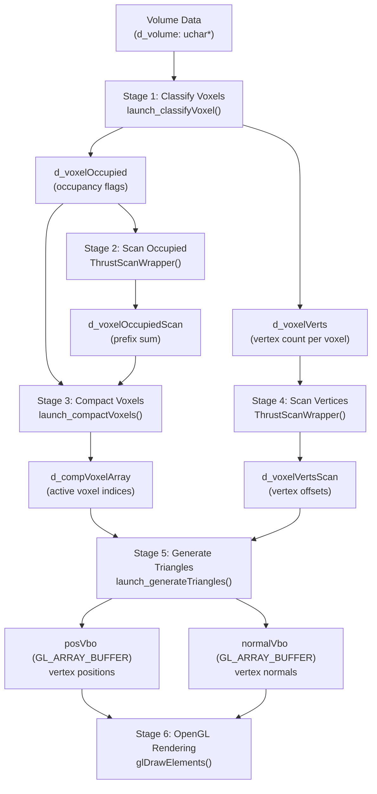
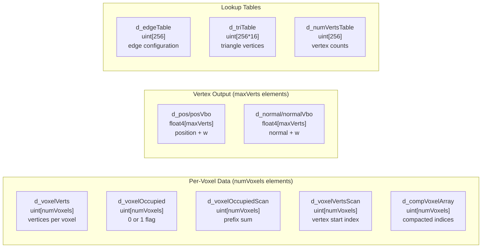
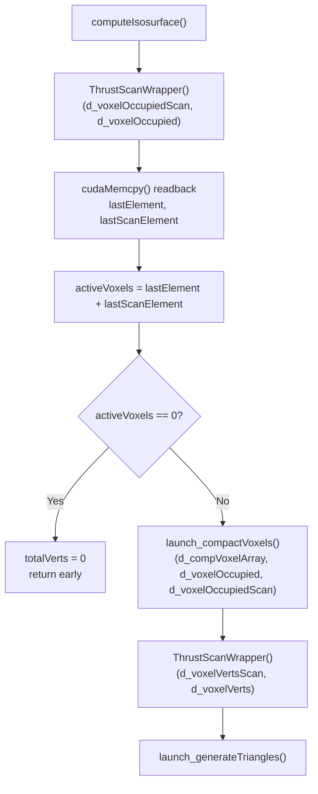
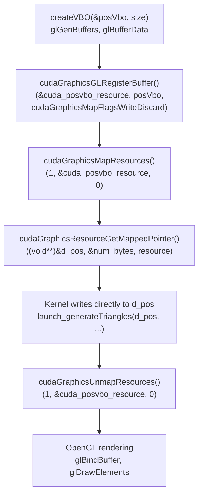

<!-- source: DeepWiki mcp.deepwiki.com · repo NVIDIA/cuda-samples · page 11.3 Volume Rendering and Medical Imaging · fetched 2026-10-26 -->

# Volume Rendering and Medical Imaging

Relevant source files

The following files were used as context for generating this wiki page:

- [CHANGELOG.md](CHANGELOG.md)
- [Common/data/CT_skull_512x512_8u.raw](Common/data/CT_skull_512x512_8u.raw)
- [Common/data/CT_skull_512x512_8u_Gray.raw](Common/data/CT_skull_512x512_8u_Gray.raw)
- [Common/data/teapot_512x512_8u.raw](Common/data/teapot_512x512_8u.raw)
- [Common/helper_image.h](Common/helper_image.h)

## Purpose and Scope

This page documents the volume rendering and medical imaging samples in Category 5, focusing on GPU-accelerated techniques for visualizing 3D volumetric data. The primary samples covered are **marchingCubes**, which demonstrates isosurface extraction from volume datasets, **volumeRender**, which implements ray casting, and **simpleTexture3D**, showing basic 3D texture sampling. These samples leverage CUDA-OpenGL interoperability for real-time visualization of medical and scientific data.

For physics simulation and particle rendering, see [11.1](). For fluid dynamics visualization, see [11.2](). For general OpenGL integration patterns, see [8.1]().

## Marching Cubes Algorithm (marchingCubes)

The marching cubes algorithm extracts geometric isosurfaces from 3D scalar field data by evaluating the field at the corners of a regular grid of voxels. Each voxel can generate 0-5 triangles depending on how the isosurface intersects it, determined by lookup tables indexed by the voxel's corner configuration.

The sample implements a multi-stage GPU pipeline that processes volume data through classification, compaction, and triangle generation stages, using CUDA kernels and the Thrust library for efficient parallel processing.

**Algorithm Pipeline Architecture**

Sources: `marchingCubes.cpp` logic overview.

### Volume Data Management

The sample loads raw volume data and stores it in device memory. A 3D CUDA texture object provides optimized access for kernel operations. The repository provides several medical datasets such as `CT_skull_512x512_8u.raw` [Common/data/CT_skull_512x512_8u.raw:1-1]() and `teapot_512x512_8u.raw` [Common/data/teapot_512x512_8u.raw:1-1]().

| Component | Type | Purpose |
|-----------|------|---------|
| `d_volume` | `uchar*` | Device memory storing raw volume data |
| Volume texture | `cudaTextureObject_t` | 3D texture for optimized sampling in kernels |
| `gridSize` | `uint3` | Dimensions of voxel grid (e.g., 32x32x32) |
| `voxelSize` | `float3` | Physical size of each voxel |
| `isoValue` | `float` | Threshold value for isosurface extraction |

### Intermediate Processing Buffers

The algorithm requires several device arrays to track voxel states and vertex data during the multi-stage pipeline.

**Memory Layout for Marching Cubes Processing**

### OpenGL-CUDA Resource Mapping

The sample uses CUDA-OpenGL interoperability to directly write vertex data into OpenGL Vertex Buffer Objects (VBOs), avoiding host-device memory copies.

| Resource | OpenGL Object | CUDA Handle | Data Type |
|----------|--------------|-------------|-----------|
| Position VBO | `posVbo` | `cuda_posvbo_resource` | `float4*` (x,y,z,w) |
| Normal VBO | `normalVbo` | `cuda_normalvbo_resource` | `float4*` (nx,ny,nz,w) |

## Kernel Execution Pipeline

### Stage 1: Voxel Classification

The `launch_classifyVoxel` kernel evaluates the volume field at each voxel's eight corners and uses lookup tables to determine vertex count and occupancy. One thread is typically assigned per voxel.

### Stage 2-3: Stream Compaction

The algorithm uses Thrust's exclusive scan to compact the sparse voxel array, eliminating empty voxels from further processing. This optimization significantly reduces workload for the expensive triangle generation stage.

**Compaction Process:**
1. Exclusive scan of `d_voxelOccupied` produces `d_voxelOccupiedScan`.
2. Read back the last element to get the `activeVoxels` count.
3. `launch_compactVoxels` builds `d_compVoxelArray` containing only active voxel indices.

**Code Entity Flow for Stream Compaction**

### Stage 5: Triangle Generation

The `launch_generateTriangles` kernel generates actual triangle vertices by:
1. Re-evaluating the volume field at voxel corners.
2. Using lookup tables (`d_triTable`, `d_edgeTable`) to determine triangle configuration.
3. Interpolating vertex positions along voxel edges where the isosurface crosses.
4. Computing vertex normals from volume gradients.
5. Writing directly to mapped VBO pointers.

## Volume Ray Casting (volumeRender)

While `marchingCubes` extracts geometry, `volumeRender` demonstrates **Direct Volume Rendering (DVR)** using ray casting. It samples a 3D texture along rays projected from the camera through each pixel.

### Ray Casting Implementation
1. **Ray Setup**: For each pixel, a ray is generated starting at the camera position and passing through the view plane.
2. **Volume Intersection**: The ray is clipped against the volume's bounding box to find entry and exit points.
3. **Sampling Loop**: The kernel steps along the ray, sampling the 3D texture using `tex3D<float>`.
4. **Compositing**: Samples are mapped to color/opacity via a 1D transfer function texture and accumulated using front-to-back alpha blending.

## 3D Texture Sampling (simpleTexture3D)

The `simpleTexture3D` sample serves as the foundational demonstration of 3D texture capabilities in CUDA.

### Key Features
- **3D Array Allocation**: Uses `cudaMalloc3DArray` to allocate memory optimized for 3D spatial locality.
- **Texture Objects**: Demonstrates `cudaCreateTextureObject` with `cudaResourceDesc` and `cudaTextureDesc`.
- **Filtering**: Shows hardware-accelerated trilinear interpolation by setting `filterMode` to `cudaFilterModeLinear`.
- **Data Conversion**: Includes utilities for converting raw 8-bit data to normalized floats using `ConverterFromUByte` [Common/helper_image.h:69-87]().

## CUDA-OpenGL Interoperability

### Resource Registration and Mapping

The samples demonstrate proper CUDA-OpenGL interop workflow for zero-copy access to graphics resources.

**Interop Workflow**

## Performance Optimization Techniques

- **Early Ray Termination**: In `volumeRender`, ray casting stops once accumulated opacity reaches a threshold (e.g., 0.99), saving significant compute.
- **Empty Space Skipping**: Marching cubes uses stream compaction to avoid processing voxels that do not contain the isosurface.
- **Texture Caching**: All three samples rely on the GPU's texture cache to handle the non-linear memory access patterns typical of 3D spatial sampling.

## Initialization and Configuration

### Volume Data Loading
The samples use `sdkLoadPGM` [Common/helper_image.h:212-232]() or custom raw loaders to bring medical data into memory. The repository includes a variety of datasets:
- `CT_skull_512x512_8u.raw` [Common/data/CT_skull_512x512_8u.raw:1-1]()
- `CT_skull_512x512_8u_Gray.raw` [Common/data/CT_skull_512x512_8u_Gray.raw:1-1]()
- `teapot_512x512_8u.raw` [Common/data/teapot_512x512_8u.raw:1-1]()

Sources: `Common/data/`, `Common/helper_image.h`.

---

