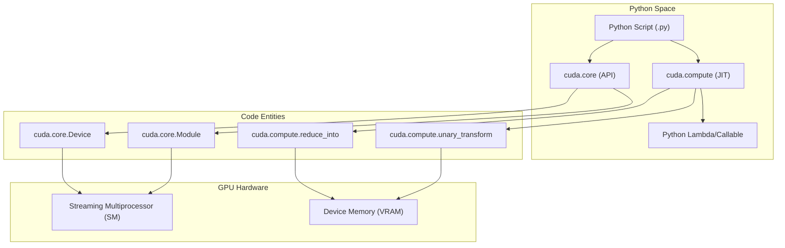
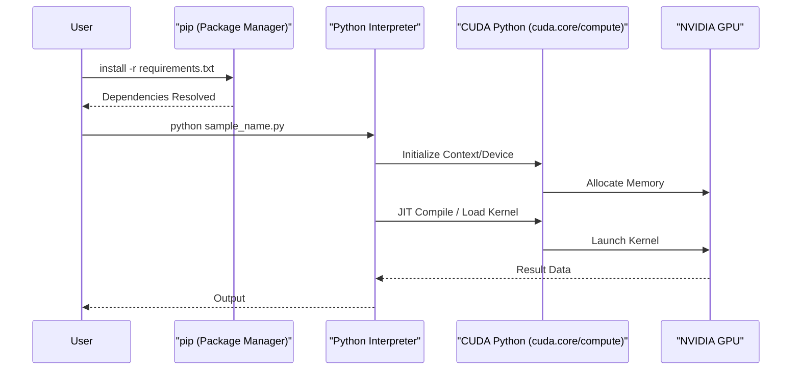

<!-- source: DeepWiki mcp.deepwiki.com · repo NVIDIA/cuda-samples · page 12 Python CUDA Samples · fetched 2026-10-26 -->

# Python CUDA Samples

Relevant source files

The following files were used as context for generating this wiki page:

- [CHANGELOG.md](CHANGELOG.md)
- [README.md](README.md)

The Python CUDA samples demonstrate how to leverage NVIDIA GPUs directly from Python using the [CUDA Python](https://nvidia.github.io/cuda-python/) ecosystem. These samples provide high-performance alternatives to traditional Python processing by bridging the gap between Python's ease of use and the raw power of the CUDA Driver and Runtime APIs.

The collection is organized into four distinct categories that mirror the C++ sample structure, ranging from basic device queries to complex distributed multi-GPU systems. Unlike the C++ samples, these are not built via CMake; instead, they rely on a `pip`-based dependency model defined in per-sample `requirements.txt` files [CHANGELOG.md:16-18]().

## Python CUDA Architecture

The samples primarily utilize two high-level Python interfaces to interact with the GPU:

1.  **`cuda.core`**: Provides a Pythonic wrapper around the CUDA Driver and Runtime APIs. It allows for explicit device management, memory allocation, and kernel launching [CHANGELOG.md:11-12]().
2.  **`cuda.compute`**: A high-level API (part of the `cuda-cccl` package) that enables Just-In-Time (JIT) compilation of Python callables (lambdas) into GPU kernels for operations like reductions and transforms [CHANGELOG.md:11-13]().

### Code Entity Mapping
The following diagram illustrates how Python code entities interact with the underlying CUDA hardware abstraction layer.

**Python-to-CUDA Mapping**

Sources: [CHANGELOG.md:11-18]()

---

## 12.1 Getting Started with Python CUDA
This category introduces the foundational concepts of GPU programming in Python. It covers environment setup, device enumeration, and basic memory management patterns. Key samples include `vectorAdd` and `deviceQuery`, which demonstrate the transition from CPU-bound Python code to GPU-accelerated execution.

**Key Concepts:**
*   **Device Management**: Using `cuda.core.Device` to identify and select GPUs.
*   **Memory Patterns**: Implementing basic `cudaMalloc` and `cudaMemcpy` equivalents in Python.
*   **Runtime Compilation**: Compiling CUDA C++ kernels from within Python strings using NVRTC.

For details, see [Getting Started with Python CUDA (Category 1)](#12.1).

---

## 12.2 Core Concepts in Python CUDA
This section explores advanced GPU features and optimized programming patterns. It highlights the use of `cuda.compute` for writing GPU kernels directly in Python without needing external C++ files.

**Key Concepts:**
*   **JIT Compilation**: Using Python lambdas with `reduce_into` and `inclusive_scan` [CHANGELOG.md:12-13]().
*   **Hardware Features**: SM partitioning via `greenContext` and graph-based execution with `cudaGraphs` [CHANGELOG.md:11-12]().
*   **Modern CUDA Features**: Utilizing `tmaTensorMap` for Tensor Memory Accelerator operations.

For details, see [Core Concepts in Python CUDA (Category 2)](#12.2).

---

## 12.3 Framework Interop and Distributed Computing
These samples demonstrate how Python CUDA integrates into the broader data science and HPC ecosystem. This includes zero-copy data exchange with deep learning frameworks and scaling across multiple GPUs.

**Key Concepts:**
*   **Framework Interop**: Custom kernel integration for **PyTorch** and **TensorFlow** autograd pipelines.
*   **Distributed Execution**: Multi-GPU gradient averaging using MPI and `cuda.core`.
*   **IPC**: Inter-process communication for shared memory pools across Python processes.

For details, see [Framework Interoperability and Distributed Computing](#12.3).

---

## Python Sample Execution Flow

The following diagram shows the typical workflow for running a Python-based CUDA sample compared to the C++ build-and-run cycle.

**Execution Pipeline**

Sources: [CHANGELOG.md:17-18]()

| Category | Purpose | Primary APIs |
| :--- | :--- | :--- |
| **Getting Started** | Basic syntax and setup | `cuda.core` |
| **Core Concepts** | Advanced algorithms and JIT | `cuda.compute`, `Numba` |
| **Framework Interop** | DL Framework integration | `DLPack`, `cuda.core.Stream` |
| **Distributed** | Multi-GPU and IPC | `MPI`, `cuda.core.IpcHandle` |

Sources: [CHANGELOG.md:11-18]()

---

