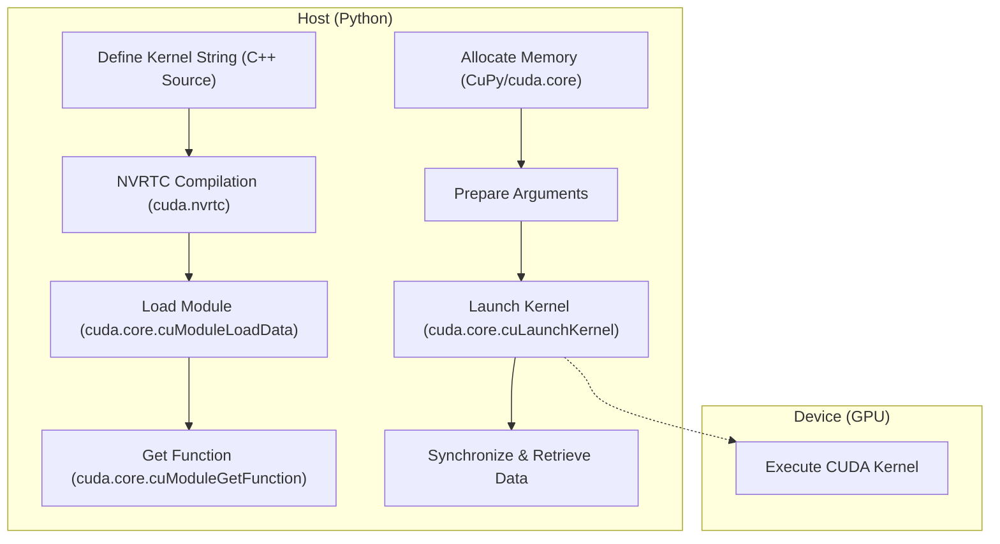
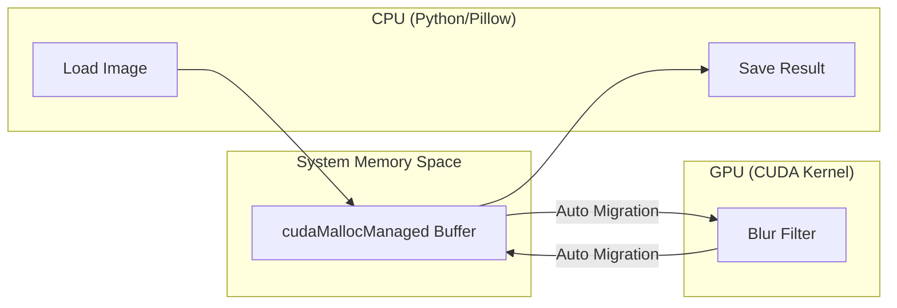
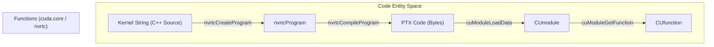

<!-- source: DeepWiki mcp.deepwiki.com · repo NVIDIA/cuda-samples · page 12.1 Getting Started with Python CUDA (Category 1) · fetched 2026-10-26 -->

# Getting Started with Python CUDA (Category 1)

Relevant source files

The following files were used as context for generating this wiki page:

- [CHANGELOG.md](CHANGELOG.md)
- [README.md](README.md)

This page documents the introductory Python CUDA samples, which demonstrate the foundational use of the `cuda.core` and `cuda.compute` APIs to interface Python with NVIDIA GPUs. These samples provide a bridge for developers moving from C++ CUDA to Python, illustrating how to manage devices, compile kernels at runtime, and handle memory using Pythonic patterns.

## Overview of Python CUDA Integration

The Python samples utilize the [CUDA Python](https://nvidia.github.io/cuda-python/) ecosystem. Unlike the C++ samples, these are not built via CMake; instead, they are executed as standalone scripts after installing dependencies via `pip` [CHANGELOG.md:17-18]().

The "Getting Started" category (Category 1) focuses on:
*   **`cuda.core`**: Direct bindings to the CUDA Driver and Runtime APIs.
*   **Runtime Compilation**: Using `cuda.nvrtc` to compile C++ CUDA kernels into PTX or CUBIN from within Python strings.
*   **Interoperability**: Using **CuPy** for array management and memory allocation.
*   **Unified Memory**: Leveraging managed memory for simplified data movement.

### Core Implementation Pattern
The following diagram illustrates the standard workflow for a Python CUDA application using the `cuda.core` API.

**Python CUDA Execution Flow**

**Sources:** [CHANGELOG.md:11-13](), [CHANGELOG.md:17-18]()

---

## Key Introductory Samples

The category includes 8 primary samples that demonstrate different facets of the API.

| Sample Name | Key APIs / Features Demonstrated | Data Flow Pattern |
|:---|:---|:---|
| `deviceQuery` | `cuda.core.cudaGetDeviceProperties` | Host-only metadata retrieval. |
| `vectorAdd` | `nvrtc`, `cuLaunchKernel`, `cupy` | Explicit Host-to-Device (H2D) and D2H. |
| `blurImageUnifiedMemory` | `cuda.core.cudaMallocManaged` | Zero-copy / Managed Memory access. |
| `helloWorld` | `cuda.core` context initialization | Basic driver API setup. |

### 1. Vector Addition (`vectorAdd`)
This sample is the Python equivalent of the foundational C++ `vectorAdd`. It demonstrates the "Manual" workflow:
1.  **Memory**: Uses `cupy.empty` to allocate device memory [CHANGELOG.md:17-17]().
2.  **Compilation**: The kernel is stored as a Python string and compiled using `nvrtc` to generate PTX.
3.  **Execution**: The PTX is loaded into a module, and `cuLaunchKernel` is called with a specific `LaunchConfig`.

### 2. Device Query (`deviceQuery`)
This script enumerates all available CUDA devices and prints technical specifications. It mirrors the C++ `deviceQuery` utility by calling `cudaGetDeviceProperties` and `cudaDeviceGetAttribute` [CHANGELOG.md:27-33]().

### 3. Image Blurring with Unified Memory (`blurImageUnifiedMemory`)
Demonstrates the use of **Unified Memory (UM)**. In this pattern, the programmer does not need to call explicit `memcpy` functions. The sample uses `cudaMallocManaged` to create a buffer accessible by both the CPU (for image loading/saving) and the GPU (for the blur kernel).

**Unified Memory Data Flow**

**Sources:** [CHANGELOG.md:35-40](), [CHANGELOG.md:78-82]()

---

## Technical Components

### API Bridge: `cuda.core`
The `cuda.core` package provides the low-level bindings. Key entities used across Category 1 samples include:
*   **`Device`**: Represents the physical GPU hardware.
*   **`Context`**: The execution environment for the GPU.
*   **`Module`**: A container for compiled kernel code (PTX/CUBIN).
*   **`Function`**: A specific `__global__` entry point within a Module.
*   **`Stream`**: A queue of operations for asynchronous execution.

### Runtime Compilation (NVRTC)
Because Python is interpreted, CUDA kernels must be compiled at runtime. The samples utilize the `cuda.nvrtc` module to transform C++ source code into a format the Driver API can execute.

**Code Entity Association: Compilation to Launch**

**Sources:** [CHANGELOG.md:50-58](), [CHANGELOG.md:124-125]()

### Memory Management Patterns
Category 1 samples demonstrate three primary ways to handle memory in Python:

1.  **CuPy Interop**: Using `cupy.ndarray` to handle allocations. CuPy arrays provide a `__cuda_array_interface__` which allows `cuda.core` to retrieve the underlying device pointer.
2.  **Raw Driver API**: Using `cuMemAlloc` and `cuMemcpyHtoD` for fine-grained control.
3.  **Managed Memory**: Using `cudaMallocManaged` for simplified programming models where the CUDA driver handles page migrations between host and device [CHANGELOG.md:78-82]().

---

## Infrastructure and Utilities

The Python samples rely on a shared utility directory located at `python/Utilities` [CHANGELOG.md:17-17](). These utilities provide boilerplate for:
*   **Error Checking**: Pythonic wrappers around CUDA return codes (similar to `checkCudaErrors` in C++).
*   **Argument Parsing**: Standardized command-line handling for selecting GPUs or setting problem sizes.
*   **Image I/O**: Helper functions for loading and saving images in samples like `blurImageUnifiedMemory`.

**Sources:**
* `CHANGELOG.md:11-13`
* `CHANGELOG.md:17-18`
* `CHANGELOG.md:27-33`
* `CHANGELOG.md:35-40`
* `CHANGELOG.md:50-58`
* `CHANGELOG.md:78-82`
* `CHANGELOG.md:124-125`
* `README.md:86-91`

---

