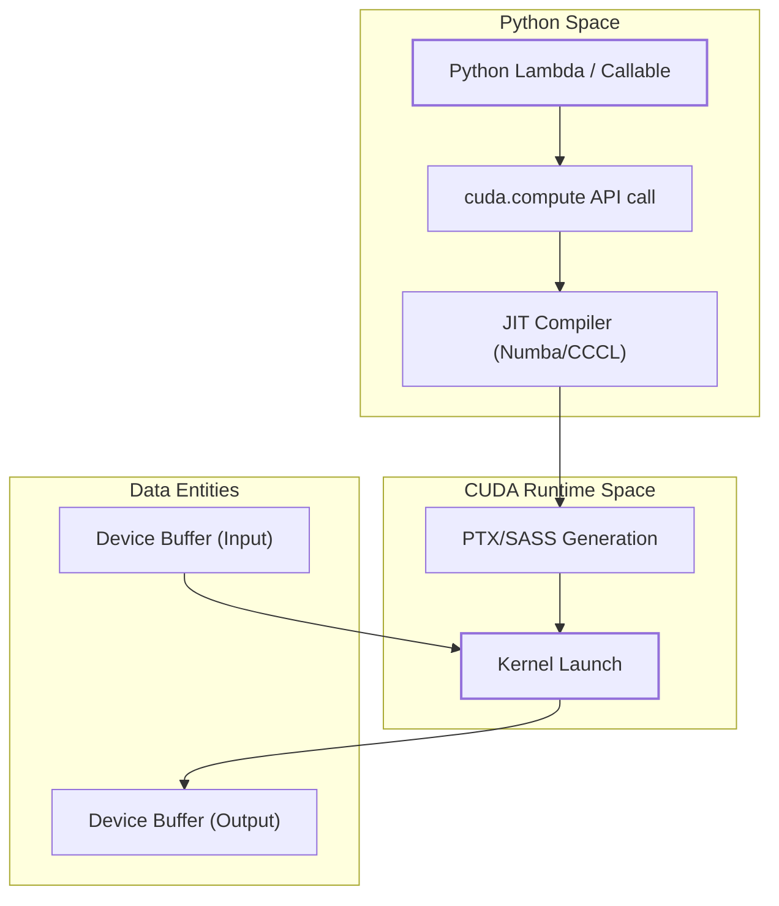
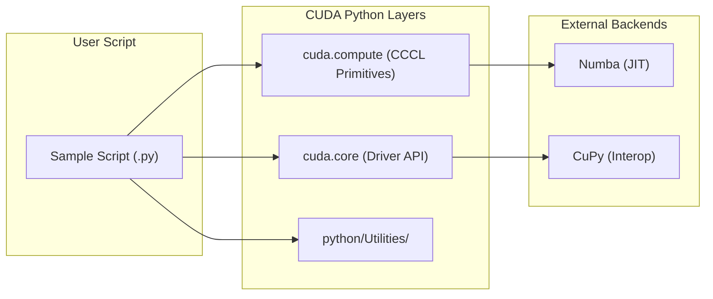

<!-- source: DeepWiki mcp.deepwiki.com · repo NVIDIA/cuda-samples · page 12.2 Core Concepts in Python CUDA (Category 2) · fetched 2026-10-26 -->

# Core Concepts in Python CUDA (Category 2)

Relevant source files

The following files were used as context for generating this wiki page:

- [CHANGELOG.md](CHANGELOG.md)
- [README.md](README.md)

The Python CUDA Core Concepts samples demonstrate advanced programming patterns, specialized hardware features, and high-level abstractions available through the `cuda-python` and `cuda-cccl` packages. These samples bridge the gap between low-level hardware control and Python's high-level syntax, covering areas such as streaming patterns, graph-based execution, SM partitioning, and JIT compilation.

## Overview of Category 2 Samples

The Core Concepts category (located in `python/2_CoreConcepts/`) focuses on 20 samples that showcase the depth of the Python CUDA ecosystem [CHANGELOG.md:11-14](). Unlike the "Getting Started" category which focuses on basic memory movement, these samples implement complex algorithms and hardware-specific optimizations.

### Key Functional Areas
| Area | Key APIs / Components | Description |
|:---|:---|:---|
| **cuda.compute** | `reduce_into`, `unary_transform`, `inclusive_scan` | High-level algorithmic primitives using Python lambdas [CHANGELOG.md:12-13](). |
| **Hardware Partitioning** | `greenContext` | Demonstrates SM partitioning and resource isolation. |
| **Execution Graphs** | `cudaGraphs` | Captures and executes dependencies as a single graph object. |
| **Memory Patterns** | `tmaTensorMap`, `processCheckpoint` | Advanced memory management and checkpointing strategies. |
| **Search Algorithms** | `binarySearch` | Parallel `upper_bound` and `lower_bound` implementations [CHANGELOG.md:13-13](). |

## High-Level Algorithmic Primitives (cuda.compute)

The `cuda.compute` module (provided by the `cuda-cccl` package) allows developers to drive GPU-accelerated algorithms directly from Python using regular callables or lambdas [CHANGELOG.md:12-13]().

### Primitive Operations
The library provides several standard parallel patterns:
*   **`unary_transform`**: Applies a Python function to every element in a sequence.
*   **`reduce_into`**: Performs a parallel reduction (e.g., sum, max) into a destination buffer.
*   **`inclusive_scan`**: Computes a prefix sum or similar associative operation across an array.
*   **`binarySearch`**: Implements `lower_bound` and `upper_bound`, verified against `numpy.searchsorted` for correctness [CHANGELOG.md:13-13]().

### Code Entity Space: cuda.compute Workflow
The following diagram illustrates how Python-defined logic is transformed into executable GPU code via the `cuda.compute` pipeline.

**Figure 1: Python Lambda to GPU Execution Flow**

**Sources:** [CHANGELOG.md:11-14](), [README.md:17-18]()

## Advanced Execution Patterns

### CUDA Graphs
The `cudaGraphs` sample demonstrates how to replace a sequence of stream-based kernel launches with a single graph execution. This reduces CPU launch overhead and allows the CUDA driver to optimize the execution path based on the dependency graph.

### SM Partitioning (greenContext)
The `greenContext` sample explores SM (Streaming Multiprocessor) partitioning. This technique allows a developer to isolate specific GPU resources for different tasks, effectively creating "green contexts" that can run with guaranteed resource availability, minimizing interference between concurrent kernels.

### TMA and Tensor Maps
With the introduction of Hopper architecture features, the `tmaTensorMap` sample demonstrates the use of the Tensor Memory Accelerator (TMA). This hardware unit automates the transfer of multi-dimensional tensors between global memory and shared memory, bypassing standard load/store instructions and improving efficiency for deep learning kernels.

## System Integration and Data Flow

The Python CUDA samples rely on a specific infrastructure that integrates `cuda.core` (Driver API wrappers) and `cuda.compute` (high-level primitives).

**Figure 2: Python CUDA Component Interaction**

**Sources:** [CHANGELOG.md:17-19](), [README.md:17-18]()

## Implementation Details

### JIT Compilation via Numba
Many Category 2 samples utilize **Numba** to compile Python functions into PTX at runtime. This allows the samples to maintain the flexibility of Python while achieving near-native performance. The `cuda.compute` module leverages this to handle the Python lambdas passed to functions like `unary_transform` [CHANGELOG.md:12-13]().

### Error Handling and Utilities
The samples share a common set of utilities located in `python/Utilities/`. These provide:
*   Standardized device initialization.
*   Memory allocation helpers.
*   Performance measurement wrappers.
*   Integration with the `run_tests.py` infrastructure [CHANGELOG.md:107-107]().

### Requirements and Execution
Each sample in this category includes a `requirements.txt` file for its specific dependencies (e.g., `cuda-python`, `numba`, `numpy`). Unlike the C++ samples, these are not managed by the root CMake build system and must be run using a standard Python interpreter after installing dependencies [CHANGELOG.md:17-18]().

**Sources:**
*   [CHANGELOG.md:11-14]() (Python 13.3 samples)
*   [CHANGELOG.md:16-19]() (Python 13.2 directory structure)
*   [README.md:17-18]() (General Python sample instructions)

---

