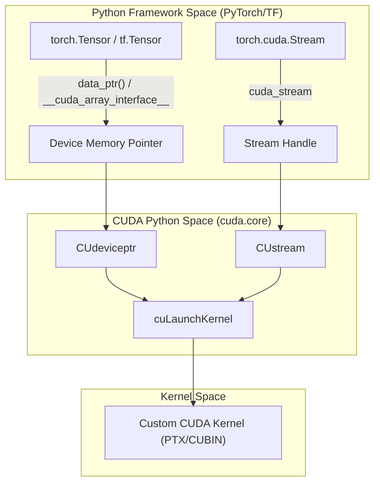
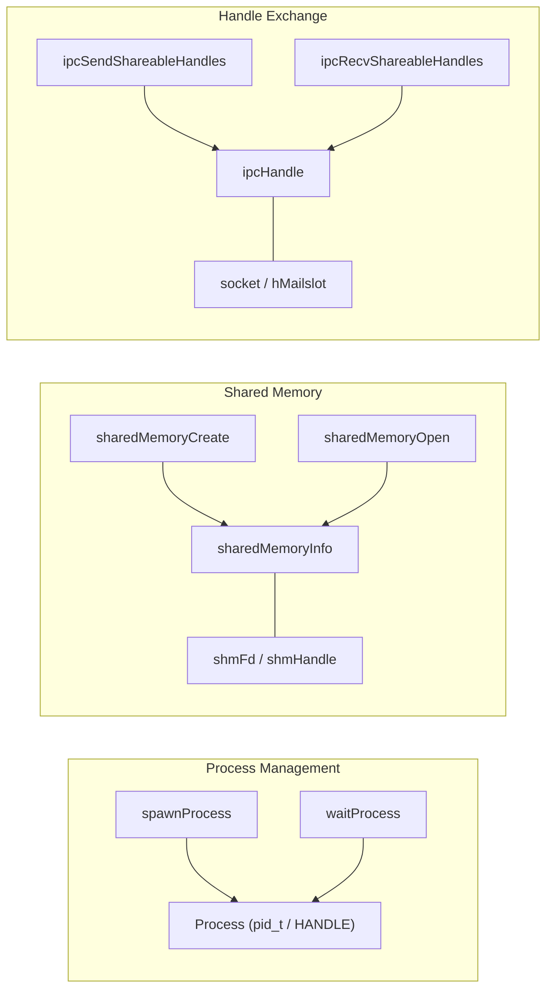

<!-- source: DeepWiki mcp.deepwiki.com · repo NVIDIA/cuda-samples · page 12.3 Framework Interoperability and Distributed Computing · fetched 2026-10-26 -->

# Framework Interoperability and Distributed Computing

Relevant source files

The following files were used as context for generating this wiki page:

- [CHANGELOG.md](CHANGELOG.md)
- [Common/helper_multiprocess.h](Common/helper_multiprocess.h)

This section covers the Python-based CUDA samples that demonstrate integration with deep learning frameworks (PyTorch, TensorFlow) and multi-GPU distributed computing patterns. These samples utilize the `cuda.core` and `cuda.compute` Python APIs to bridge high-level Python workflows with low-level CUDA performance.

## Framework Interoperability

The interoperability samples demonstrate how to integrate custom CUDA kernels into existing deep learning pipelines, specifically focusing on PyTorch and TensorFlow. A key aspect is the ability to share GPU memory buffers and CUDA streams between the framework and custom CUDA code without unnecessary host-device synchronizations.

### PyTorch Integration (customPyTorchKernel)
The `customPyTorchKernel` sample demonstrates integrating a custom CUDA kernel into the PyTorch autograd system. It shows how to:
1.  **Stream Sharing**: Access the current PyTorch CUDA stream using `torch.cuda.current_stream()` and pass it to `cuda.core` operations to ensure kernel execution is ordered correctly within the PyTorch execution graph.
2.  **Tensor Access**: Retrieve the data pointer from a `torch.Tensor` and wrap it for use in a CUDA kernel.
3.  **Autograd Function**: Implement a `torch.autograd.Function` that calls custom CUDA kernels for both the forward and backward passes.

### TensorFlow Integration (customTensorFlowKernel)
Similar to the PyTorch implementation, the `customTensorFlowKernel` sample demonstrates:
1.  **DLPack Interop**: Using DLPack as a standardized way to share tensors between TensorFlow and CUDA Python.
2.  **Stream Integration**: Ensuring that CUDA kernels launched via `cuda.core` are synchronized with TensorFlow's internal stream management.

### Data Flow: Framework to CUDA Kernel
The following diagram illustrates the data flow when wrapping a framework tensor for a custom CUDA kernel.

**Framework to CUDA Entity Mapping**

**Sources:** [CHANGELOG.md:16-18](), [CHANGELOG.md:11-13]()

---

## Distributed Computing and Multi-GPU Patterns

Distributed computing samples focus on communication between multiple GPUs, either within a single node or across a network using MPI (Message Passing Interface).

### Inter-Process Communication (ipcMemoryPool)
The `ipcMemoryPool` sample demonstrates the use of CUDA IPC (Inter-Process Communication) to share memory between different processes on the same node. It utilizes `cuMemMap` APIs to export and import memory handles.

Key functions involved in this workflow (often abstracted in `helper_multiprocess.h` for cross-platform support):
*   `sharedMemoryCreate`: Creates a shared memory segment for process synchronization [Common/helper_multiprocess.h:88-88]().
*   `ipcSendShareableHandles`: Transfers CUDA memory handles from a producer process to consumer processes [Common/helper_multiprocess.h:135-136]().
*   `ipcRecvShareableHandles`: Receives handles in the consumer process [Common/helper_multiprocess.h:132-133]().

### Multi-GPU Gradient Averaging (multiGPUGradientAverage)
This sample implements a common pattern in distributed deep learning: All-Reduce gradient averaging. It combines MPI for orchestration and `cuda.core` for GPU operations.

*   **Host-Staging Pattern**: Data is staged from the GPU to the host, communicated via MPI, and then moved back to the GPU.
*   **Direct GPU Communication**: Demonstrates how to use MPI in conjunction with CUDA streams to overlap communication and computation.

### Simple Peer-to-Peer (simpleP2P)
The `simpleP2P` sample demonstrates direct memory access between two GPUs over NVLink or PCIe without staging through the host. It uses `cudaDeviceEnablePeerAccess` (in C++ equivalents) or the corresponding `cuda.core` attributes to allow one GPU to read/write another GPU's memory directly.

---

## IPC and Multi-Process Infrastructure

The samples rely on a robust set of utilities defined in `Common/helper_multiprocess.h` to handle the complexities of cross-process communication and synchronization across Linux, QNX, and Windows.

### Multi-Process Utility Mapping
The following diagram maps the high-level IPC concepts to the specific structures and functions used in the codebase.

**IPC Utility Entity Mapping**

### Key IPC Components
| Entity | Description | File Reference |
| :--- | :--- | :--- |
| `sharedMemoryInfo` | Structure containing the address, size, and OS-specific handle for shared memory. | [Common/helper_multiprocess.h:78-86]() |
| `ipcHandle` | Abstracted handle for the communication channel (Unix domain socket on Linux/QNX, Mailslot on Windows). | [Common/helper_multiprocess.h:109-121]() |
| `ShareableHandle` | OS-specific type for a handle that can be sent across processes (`int` for FDs, `HANDLE` for Windows). | [Common/helper_multiprocess.h:113-118]() |
| `getSocketFolder` | Returns the temporary directory for IPC sockets, handling QNX `/storage` and Linux `/tmp` differences. | [Common/helper_multiprocess.h:58-76]() |

**Sources:** [Common/helper_multiprocess.h:1-141](), [CHANGELOG.md:57-62]()

---

