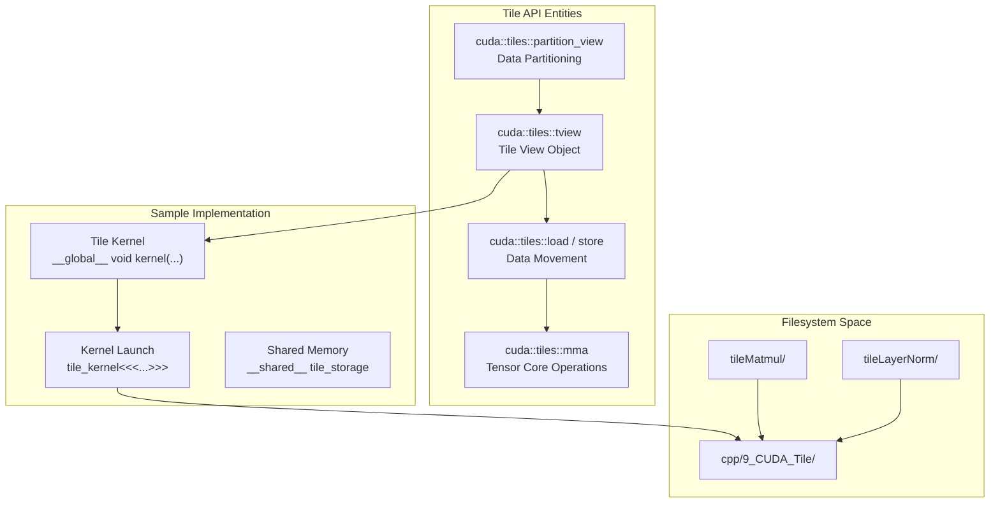
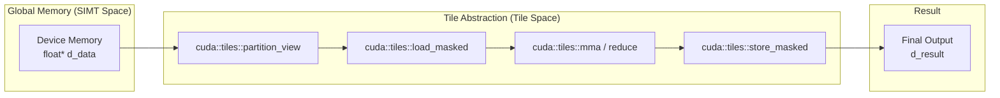

<!-- source: DeepWiki mcp.deepwiki.com · repo NVIDIA/cuda-samples · page 13 CUDA Tile Samples (Category 9) · fetched 2026-10-26 -->

# CUDA Tile Samples (Category 9)

Relevant source files

The following files were used as context for generating this wiki page:

- [CHANGELOG.md](CHANGELOG.md)
- [CMakeLists.txt](CMakeLists.txt)

## Purpose and Scope

This page documents the **CUDA Tile C++** samples introduced in CUDA 13.3, located under `cpp/9_CUDA_Tile`. These samples demonstrate a modern, tile-based programming model for GPUs using the `cuda::tiles` APIs. This abstraction allows developers to write kernels that operate on multi-dimensional "tiles" of data rather than individual threads, simplifying complex operations like Matrix Multiplication (MMA), Layer Normalization, and Sparse Matrix-Vector multiplication.

**Sources:** [CHANGELOG.md:3-4](), [cpp/9_CUDA_Tile/README.md:1-15]()

---

## Tile Programming Model Overview

The `cuda::tiles` library provides a high-level C++ interface for managing data movement and computation on GPU tiles. Key concepts include:

1.  **Tile Views**: Using `cuda::tiles::partition_view` to slice global or shared memory into manageable chunks.
2.  **Masked Operations**: Built-in support for masked loads and stores to handle boundary conditions without manual thread-level branching.
3.  **MMA Abstraction**: High-level `cuda::tiles::mma` functions that abstract away the complexity of Tensor Core instructions.
4.  **Interoperability**: Data is passed between standard SIMT kernels and Tile kernels via global device memory.

**Sources:** [cpp/9_CUDA_Tile/README.md:20-45]()

---

## Sample Categories

The Tile samples are divided into two primary groups: foundational operations and advanced algorithms.

### Tile Fundamentals and Basic Operations
These samples introduce the core syntax and data movement patterns of the Tile API.
*   **helloTile**: A basic introductory sample.
*   **tileVectorAdd**: Demonstrates simple element-wise operations on tiles.
*   **tileTranspose**: Shows how to use tile views for matrix transposition.

For details, see [Tile Fundamentals and Basic Operations](#13.1).

### Advanced Tile Algorithms
These samples demonstrate high-performance implementations of common machine learning and linear algebra primitives.
*   **tileMatmul**: FP16 matrix multiplication with FP32 accumulation using `cuda::tiles::mma`.
*   **tileMatmulAutotuner**: Demonstrates using NVRTC to autotune tile sizes for specific hardware.
*   **tileBmm**: Batched Matrix Multiplication utilizing persistent thread blocks.
*   **tileLayerNorm**: Persistent Layer Normalization with row-wise reductions.
*   **tileRope**: Rotary Position Embedding (RoPE) implementation.
*   **tileSpMV**: Sparse Matrix-Vector multiplication.

For details, see [Advanced Tile Algorithms](#13.2).

**Sources:** [cpp/9_CUDA_Tile/README.md:50-85]()

---

## Code Entity Mapping

The following diagram maps the Tile programming concepts to the specific C++ entities and file structures used in the samples.

**Sources:** [cpp/9_CUDA_Tile/README.md:10-60]()

---

## System Workflow: From SIMT to Tiles

This diagram illustrates how data flows from standard CUDA memory into the Tile abstraction and back.

**Sources:** [cpp/9_CUDA_Tile/README.md:30-55]()

---

## Build System Integration

The Tile samples are integrated into the top-level CMake build system. They require C++17 and CUDA 13.3 or later.

| Requirement | Value | Citation |
| :--- | :--- | :--- |
| **CUDA Version** | 13.3+ | [CHANGELOG.md:3-4]() |
| **C++ Standard** | C++17 | [CMakeLists.txt:9-10]() |
| **CUDA Standard** | CUDA 17 | [CMakeLists.txt:12-13]() |
| **Architectures** | SM 75 - 120 | [CMakeLists.txt:15]() |

**Sources:** [CMakeLists.txt:1-15](), [CHANGELOG.md:3-4]()

---

