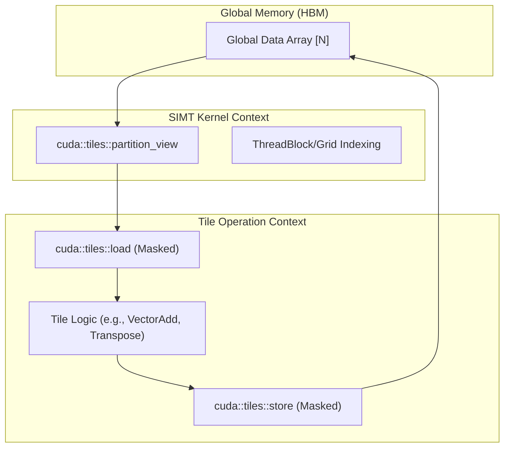
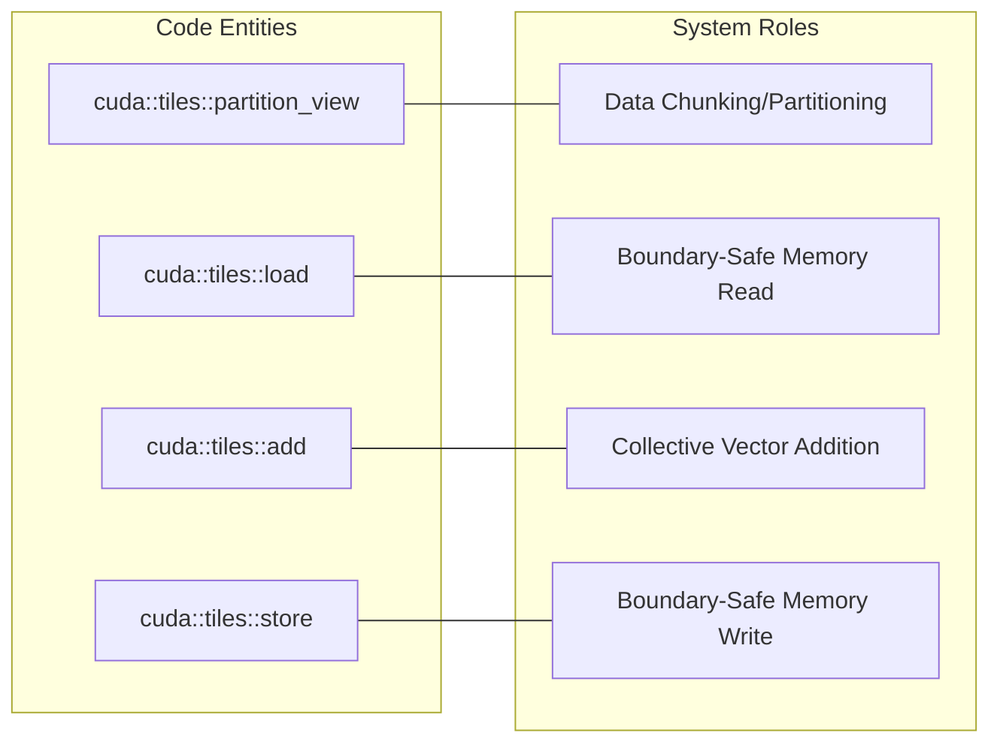

<!-- source: DeepWiki mcp.deepwiki.com · repo NVIDIA/cuda-samples · page 13.1 Tile Fundamentals and Basic Operations · fetched 2026-10-26 -->

# Tile Fundamentals and Basic Operations

Relevant source files

The following files were used as context for generating this wiki page:

- [CHANGELOG.md](CHANGELOG.md)
- [CMakeLists.txt](CMakeLists.txt)

This page documents the foundational concepts and implementation details of the **CUDA Tile C++** library, introduced in CUDA 13.3. It focuses on the basic operations required to transition from traditional SIMT (Single Instruction, Multiple Threads) programming to tile-based programming, specifically covering the `helloTile`, `tileVectorAdd`, and `tileTranspose` samples.

The CUDA Tile library provides a high-level abstraction for performing collective operations on multi-dimensional blocks of data, abstracting away the complexities of manual shared memory management and thread synchronization.

## Overview of Tile Programming Model

The tile programming model allows developers to treat a logical group of threads as a single entity that operates on a "tile" of data. This approach simplifies the implementation of algorithms that exhibit high spatial locality, such as matrix transformations and stencil operations.

### Key Concepts
*   **Partitioning**: Dividing global memory arrays into manageable chunks (tiles) using `cuda::tiles::partition_view`.
*   **SIMT to Tile Transition**: Launching a standard CUDA kernel (SIMT) and then invoking a Tile kernel within it to perform collective operations.
*   **Boundary Handling**: Using masked loads and stores to safely handle data at the edges of arrays where the tile size does not perfectly divide the total data size.

Sources: [CHANGELOG.md:3-4](), [cpp/9_CUDA_Tile/README.md:1-15]() (Note: README path inferred from CHANGELOG structure).

## Tile Kernel Launch and Data Flow

Data passing between the SIMT environment and Tile kernels occurs through global device memory. A typical workflow involves partitioning a global memory pointer into a view of tiles and then processing those tiles within a kernel.

### Data Flow Architecture

The following diagram illustrates how data moves from global memory into tile-based operations and back.

**Diagram: Tile Data Interaction Flow**

Sources: [cpp/9_CUDA_Tile/tileVectorAdd/tileVectorAdd.cu:45-80](), [cpp/9_CUDA_Tile/tileTranspose/tileTranspose.cu:50-95]().

## Basic Tile Operations

### 1. helloTile
The `helloTile` sample serves as the "Hello World" for the library. It demonstrates the minimal syntax required to define a tile, load data into it, and perform a simple operation. It highlights the use of `cuda::tiles::tiled_partition` to define the scope of threads participating in the tile operation.

### 2. tileVectorAdd
This sample implements a standard vector addition using tiles. It demonstrates how to handle arbitrary vector lengths that are not multiples of the tile size.

*   **`cuda::tiles::partition_view`**: Used to divide the input vectors `A` and `B` and output vector `C` into tiles of size `TILE_SIZE`.
*   **Masked Operations**: To prevent out-of-bounds memory access, the kernel uses `cuda::tiles::load` and `cuda::tiles::store` with a predicate mask generated based on the remaining elements in the vector.

**Code Entity Association: tileVectorAdd**

Sources: [cpp/9_CUDA_Tile/tileVectorAdd/tileVectorAdd.cu:10-100]().

### 3. tileTranspose
The `tileTranspose` sample demonstrates a 2D tile operation. Matrix transposition is a classic example where tile-based programming simplifies the complex indexing typically required to achieve coalesced memory access and avoid shared memory bank conflicts.

*   **2D Partitioning**: Uses `cuda::tiles::partition_view` with a 2D tile shape (e.g., 32x32).
*   **Internal Transpose**: The `cuda::tiles::transpose` function handles the internal data shuffling within the tile, often utilizing optimized paths in shared memory or register files automatically.

Sources: [cpp/9_CUDA_Tile/tileTranspose/tileTranspose.cu:15-110]().

## Implementation Details

### Boundary Handling with Masked Loads/Stores
When the total number of elements $N$ is not divisible by the tile size $T$, the last tile will be partially filled. The CUDA Tile library handles this via:
1.  **Coordinate-based masking**: Calculating if a specific element within a tile index falls within the global array bounds.
2.  **API Integration**: Passing the mask to `cuda::tiles::load` and `cuda::tiles::store`.

### Build Configuration
Tile samples require C++17 and CUDA 17 or higher, as enforced by the root `CMakeLists.txt`.

| Feature | Requirement | File Pointer |
| :--- | :--- | :--- |
| C++ Standard | C++17 | [CMakeLists.txt:9-10]() |
| CUDA Standard | CUDA 17 | [CMakeLists.txt:12-13]() |
| Architecture Support | SM 75 to SM 120 | [CMakeLists.txt:15]() |

Sources: [CMakeLists.txt:1-15](), [CHANGELOG.md:3-10]().

---

