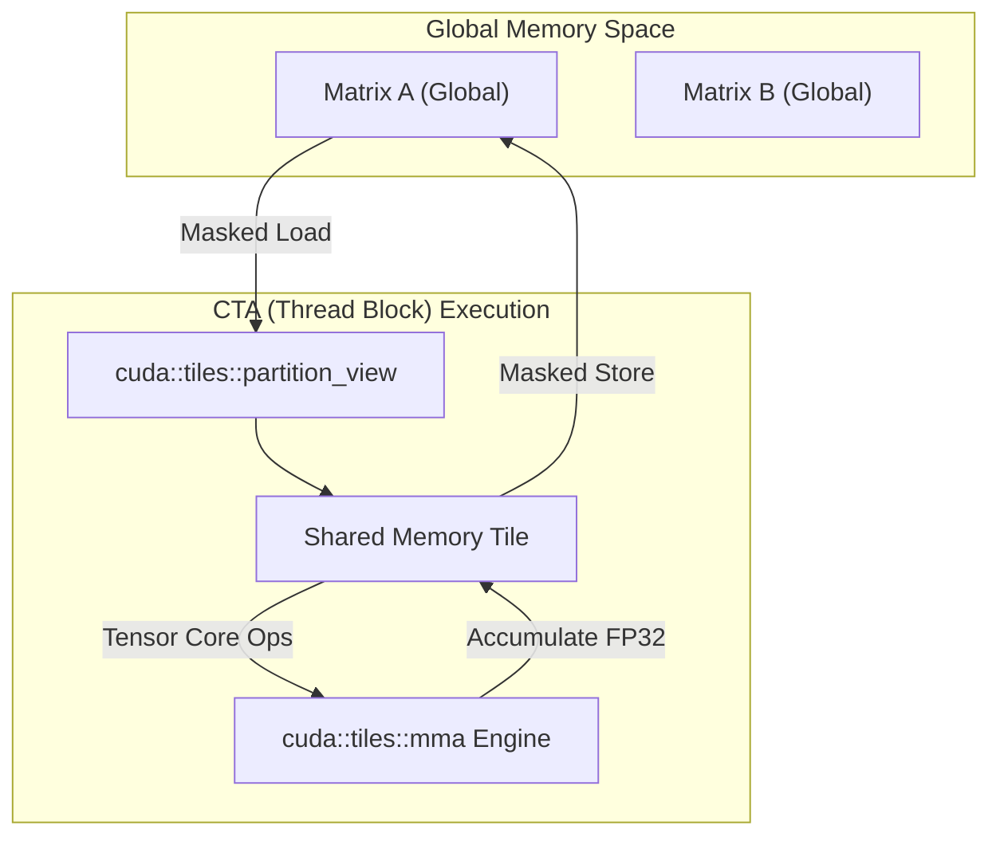
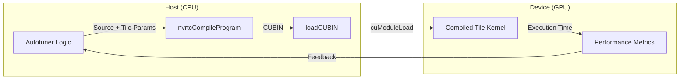

<!-- source: DeepWiki mcp.deepwiki.com · repo NVIDIA/cuda-samples · page 13.2 Advanced Tile Algorithms · fetched 2026-10-26 -->

# Advanced Tile Algorithms

Relevant source files

The following files were used as context for generating this wiki page:

- [CHANGELOG.md](CHANGELOG.md)
- [Common/nvrtc_helper.h](Common/nvrtc_helper.h)

The Advanced Tile Algorithms section covers complex computational patterns implemented using the `cuda::tiles` API introduced in CUDA 13.3 [CHANGELOG.md:3-4](). These samples demonstrate high-performance kernels for linear algebra, normalization, and sparse computations, utilizing persistent thread blocks and hardware-accelerated Matrix Multiply-Accumulate (MMA) operations.

## Matrix Multiplication with `cuda::tiles::mma`

The `tileMatmul` sample demonstrates a high-performance GEMM implementation using FP16 inputs and FP32 accumulation. The core of the computation leverages `cuda::tiles::mma` to interface with Tensor Cores.

### Implementation Details
*   **Data Partitioning**: The implementation uses `cuda::tiles::partition_view` to divide global memory matrices into manageable tiles for processing within the CTA.
*   **MMA Operation**: It utilizes `cuda::tiles::mma` for performing the inner loop product, ensuring that the accumulation happens in higher precision (FP32) to maintain numerical stability while benefiting from FP16 throughput.
*   **Boundary Handling**: Masked loads and stores are used via the tile API to handle cases where matrix dimensions are not perfect multiples of the tile size.

### tileMatmulAutotuner
The `tileMatmulAutotuner` extends this by utilizing NVRTC (Runtime Compilation) to search for optimal tile dimensions ($M, N, K$) for a specific GPU architecture. It uses `compileFileToCUBIN` [Common/nvrtc_helper.h:50-51]() to generate and evaluate different kernel variants at runtime.

**Sources:** [CHANGELOG.md:3-4](), [Common/nvrtc_helper.h:50-183]()

## Batched Matrix Multiplication (tileBmm)

The `tileBmm` sample implements Batched Matrix Multiplication using **persistent blocks**. Unlike standard GEMM where each block handles one tile of the output, persistent blocks loop over multiple batches to reduce the overhead of kernel launches and improve hardware utilization.

### Data Flow for Persistent Blocks
1.  **Grid Launch**: A fixed number of blocks is launched, typically matching the number of Multiprocessors (SMs).
2.  **Work Queue**: Blocks use atomic operations or grid-level indexing to fetch the next available batch/tile index.
3.  **Tile Execution**: Each block performs the MMA sequence for its assigned batch.
4.  **Looping**: The block loops back to the queue until all batches in the batch-dimension are processed.

**Sources:** [CHANGELOG.md:3-4]()

## Persistent Layer Normalization (tileLayerNorm)

`tileLayerNorm` implements a persistent version of the Layer Normalization algorithm. This is a critical component in Transformer architectures.

### Key Features
*   **Row Reductions**: Uses `cuda::tiles` primitives to perform efficient reductions across the hidden dimension (rows) to calculate mean and variance.
*   **Persistence**: By keeping data in registers or shared memory across different stages of the normalization (mean calculation $\rightarrow$ variance calculation $\rightarrow$ scaling), the implementation minimizes global memory round-trips.
*   **Mathematical Flow**:
    *   $\mu = \frac{1}{N} \sum x_i$
    *   $\sigma^2 = \frac{1}{N} \sum (x_i - \mu)^2$
    *   $\hat{x}_i = \frac{x_i - \mu}{\sqrt{\sigma^2 + \epsilon}} \cdot \gamma + \beta$

**Sources:** [CHANGELOG.md:3-4]()

## Rotary Position Embedding (tileRope)

The `tileRope` sample demonstrates the implementation of Rotary Position Embedding (RoPE), a technique used to inject positional information into the hidden states of Large Language Models (LLMs).

### Algorithm Logic
The tile implementation applies a rotation matrix to pairs of elements in the feature vector. For a pair $(x_1, x_2)$, the transformation is:
$$ \begin{pmatrix} x_1 \\ x_2 \end{pmatrix} \rightarrow \begin{pmatrix} \cos \theta & -\sin \theta \\ \sin \theta & \cos \theta \end{pmatrix} \begin{pmatrix} x_1 \\ x_2 \end{pmatrix} $$
The `cuda::tiles` API allows for vectorized loads of these pairs and efficient application of the trigonometric functions across the tile.

**Sources:** [CHANGELOG.md:3-4]()

## Sparse Matrix-Vector Multiplication (tileSpMV)

`tileSpMV` demonstrates Sparse Matrix-Vector multiplication using the Tile API. This is particularly challenging due to the irregular memory access patterns of sparse formats (like CSR).

### Architectural Mapping
The diagram below illustrates how the Tile API maps logical matrix partitions to physical hardware entities in these advanced algorithms.

**Tile-to-Hardware Mapping**

**Component Interaction for tileMatmulAutotuner**

**Sources:** [Common/nvrtc_helper.h:150-183](), [CHANGELOG.md:3-4]()

## Summary of Advanced Algorithms

| Sample | Input Precision | Accumulation | Key API Component |
| :--- | :--- | :--- | :--- |
| `tileMatmul` | FP16 | FP32 | `cuda::tiles::mma` |
| `tileBmm` | FP16 | FP32 | Persistent Blocks + MMA |
| `tileLayerNorm` | FP32/FP16 | FP32 | Row-wise Reductions |
| `tileSpMV` | Mixed | FP32 | Masked Loads/Stores |
| `tileRope` | FP16/BF16 | FP32 | Vectorized Rotations |

**Sources:** [CHANGELOG.md:3-14]()

---

