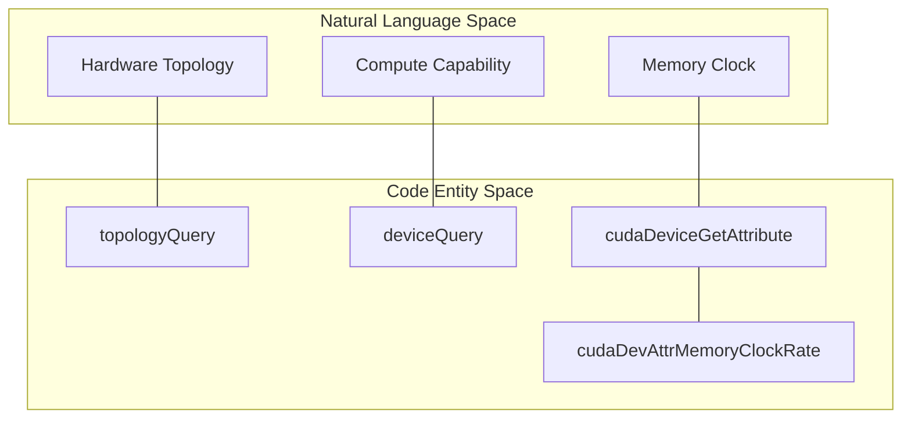
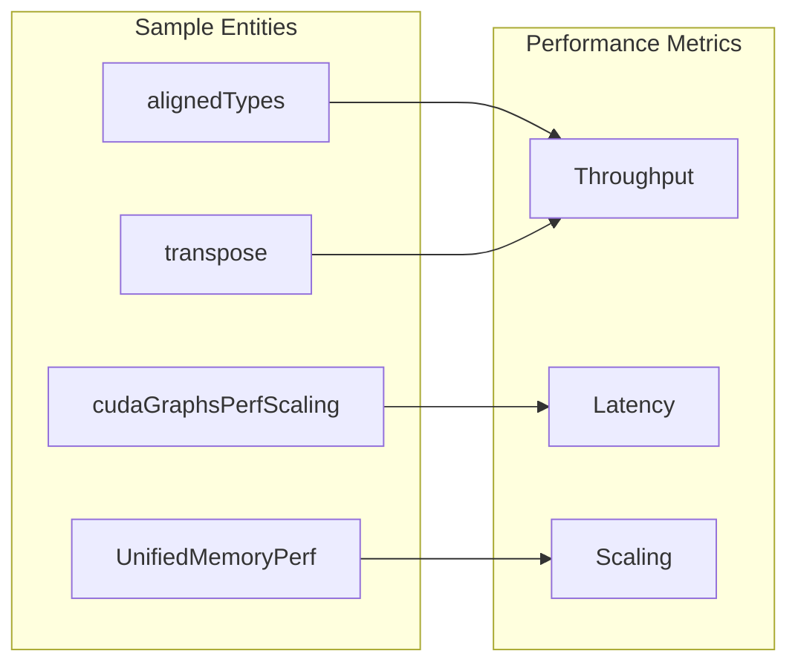

<!-- source: DeepWiki mcp.deepwiki.com · repo NVIDIA/cuda-samples · page 14 Performance and Utilities (Categories 1 and 6) · fetched 2026-10-26 -->

# Performance and Utilities (Categories 1 and 6)

Relevant source files

The following files were used as context for generating this wiki page:

- [CHANGELOG.md](CHANGELOG.md)
- [CMakeLists.txt](CMakeLists.txt)

This page provides a high-level overview of the CUDA samples dedicated to system introspection, device property queries, and performance optimization. These samples are organized into two primary categories: **Category 1 (Utilities)**, which focuses on hardware and software environment discovery, and **Category 6 (Performance)**, which demonstrates techniques for maximizing throughput and minimizing latency in CUDA applications.

## Overview of Categories

The samples in these categories serve as both diagnostic tools and optimization blueprints for developers.

*   **Category 1 (Utilities):** These samples demonstrate how to programmatically query the GPU's capabilities, architecture, and the topological relationship between multiple GPUs in a system. They utilize both the CUDA Runtime and Driver APIs.
*   **Category 6 (Performance):** These samples focus on benchmarking specific hardware features and software patterns. They cover critical performance topics such as memory alignment, matrix transposition strategies, Unified Memory efficiency, and the overhead scaling of CUDA Graphs.

For a detailed breakdown of these categories, see the child pages:
*   [Device Query and Topology Utilities (Category 1)](#14.1)
*   [Performance Benchmarks and Optimization Samples (Category 6)](#14.2)

## System and Device Introspection

The utility samples provide the foundation for writing portable CUDA code that adapts to different hardware configurations. As of CUDA 13.0, many legacy `cudaDeviceProp` fields have been deprecated in favor of the more robust `cudaDeviceGetAttribute` system [CHANGELOG.md:27-34]().

### Hardware Topology and Properties
The codebase uses specific API patterns to bridge the gap between high-level system views and low-level hardware attributes:

| Code Entity | Purpose | API Used |
|:---|:---|:---|
| `deviceQuery` | Enumerates device properties via Runtime API | `cudaGetDeviceProperties` |
| `deviceQueryDrv` | Enumerates device properties via Driver API | `cuDeviceGetAttribute` |
| `topologyQuery` | Maps NVLink and PCIe connectivity | `cudaDeviceGetP2PAttribute` |

### Code-to-System Mapping
The following diagram illustrates how the utility samples map software queries to physical hardware entities.

**Diagram: Utility Query Mapping**

Sources: [CHANGELOG.md:27-42](), [cpp/1_Utilities/deviceQuery/ (implied by context)]()

## Performance Optimization and Benchmarking

Category 6 samples provide quantitative data on how different programming choices affect GPU performance. These benchmarks often utilize CUDA Events for high-precision timing.

### Key Optimization Strategies
*   **Memory Access:** Samples like `alignedTypes` demonstrate the performance delta between aligned and misaligned memory transactions.
*   **Memory Migration:** `UnifiedMemoryPerf` benchmarks the efficiency of Unified Memory compared to traditional pageable or pinned memory, utilizing updated APIs like `cudaMemAdvise_v2` [CHANGELOG.md:78-82]().
*   **Graph Overhead:** `cudaGraphsPerfScaling` measures how the overhead of the CUDA Graph API scales as the complexity and size of the graph increase.

**Diagram: Performance Benchmark Flow**

Sources: [CHANGELOG.md:78-82](), [cpp/6_Performance/ (implied by context)]()

## Infrastructure Support

Both categories rely on the root `CMakeLists.txt` configuration for standard-conforming compilation. For instance, C++17 and CUDA 17 are required standards [CMakeLists.txt:9-13](). Furthermore, performance-sensitive builds typically avoid the `-G` flag (which enables debug symbols but disables optimizations) in favor of `-lineinfo` to maintain profiling capabilities without sacrificing throughput [CMakeLists.txt:17-21]().

Sources: [CMakeLists.txt:9-21](), [CHANGELOG.md:3-109]()

---

