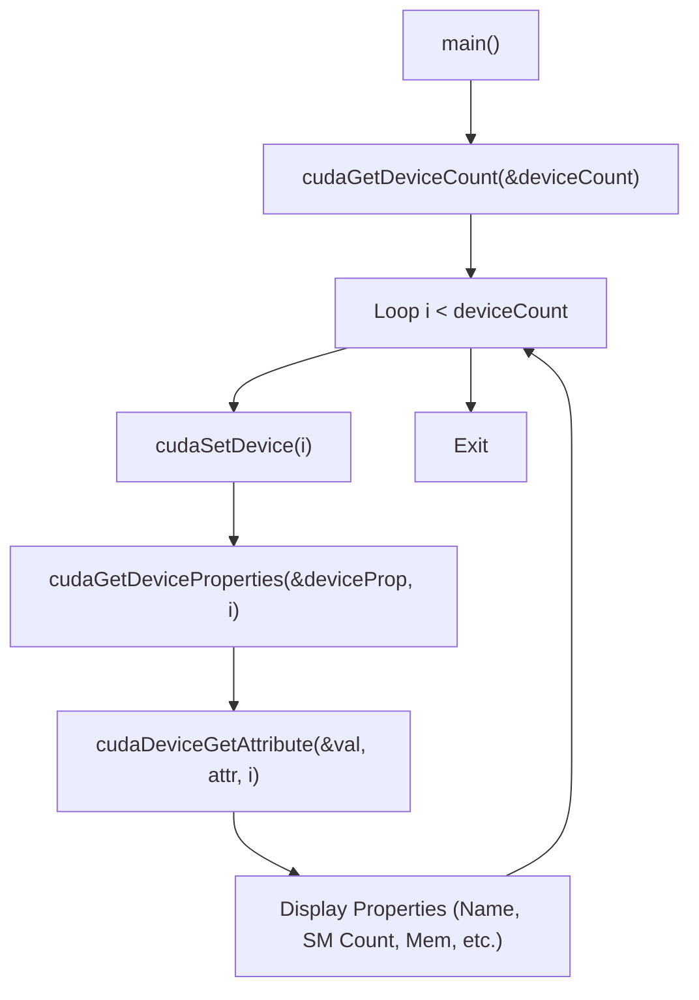
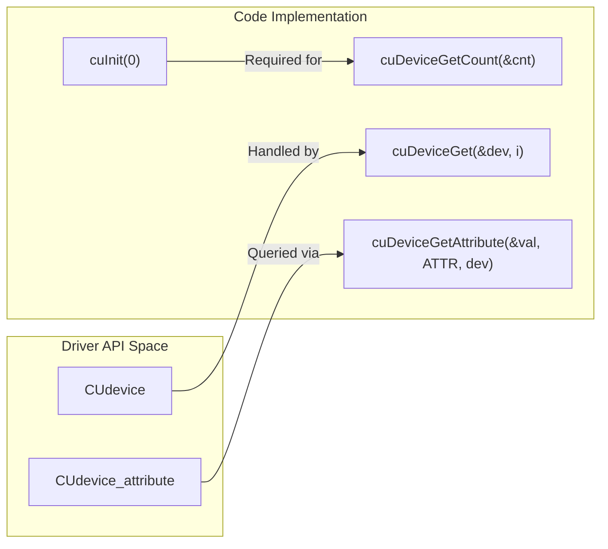

<!-- source: DeepWiki mcp.deepwiki.com · repo NVIDIA/cuda-samples · page 14.1 Device Query and Topology Utilities (Category 1) · fetched 2026-10-26 -->

# Device Query and Topology Utilities (Category 1)

Relevant source files

The following files were used as context for generating this wiki page:

- [CHANGELOG.md](CHANGELOG.md)
- [Common/helper_cuda.h](Common/helper_cuda.h)

This section documents the utilities within the CUDA Samples repository designed for device enumeration, capability querying, and hardware topology discovery. These samples serve as the primary reference for developers to understand the available compute resources and the interconnect architecture (NVLink/PCIe) between multiple GPUs.

## Overview of Category 1 Utilities

Category 1 samples focus on system introspection using both the CUDA Runtime API and the CUDA Driver API. As of CUDA 13.0, several fields in the `cudaDeviceProp` struct have been deprecated in favor of the more extensible `cudaDeviceGetAttribute` system [CHANGELOG.md:26-34]().

| Sample | API Used | Primary Purpose |
| :--- | :--- | :--- |
| `deviceQuery` | Runtime API | Detailed enumeration of GPU properties and limits. |
| `deviceQueryDrv` | Driver API | Driver-level enumeration, including SM-to-core mapping. |
| `topologyQuery` | Runtime API | Detection of P2P (Peer-to-Peer) capabilities and NVLink topology. |

Sources: [CHANGELOG.md:26-42](), [cpp/1_Utilities/deviceQuery/deviceQuery.cpp:1-20]()

## deviceQuery: Runtime API Enumeration

The `deviceQuery` sample demonstrates how to use the CUDA Runtime API to retrieve hardware specifications. It is the standard tool for verifying a CUDA installation and identifying device capabilities such as compute capability, memory clock rates, and warp sizes.

### Key Implementation Details
The sample utilizes `cudaGetDeviceCount` to determine the number of CUDA-capable adapters and iterates through them using `cudaGetDeviceProperties` [cpp/1_Utilities/deviceQuery/deviceQuery.cpp:50-70](). 

**Modern Attribute Querying:**
In accordance with CUDA 13.0 updates, the sample has transitioned from legacy `cudaDeviceProp` fields to `cudaDeviceGetAttribute` for specific metrics [CHANGELOG.md:27-33]():
*   **Clock Rate:** `cudaDevAttrClockRate`
*   **Memory Clock:** `cudaDevAttrMemoryClockRate`
*   **GPU Overlap:** `cudaDevAttrGpuOverlap`
*   **Compute Mode:** `cudaDevAttrComputeMode`

### Data Flow: Runtime Query
Title: Runtime API Device Property Retrieval

Sources: [cpp/1_Utilities/deviceQuery/deviceQuery.cpp:45-100](), [CHANGELOG.md:26-34]()

## deviceQueryDrv: Driver API Enumeration

The `deviceQueryDrv` sample provides the same functionality as `deviceQuery` but utilizes the **CUDA Driver API**. This is useful for applications that manage CUDA contexts manually or need to query device information without linking against the Runtime library.

### Core Functions and Mapping
The Driver API uses `cuDeviceGet` to handles and `cuDeviceGetAttribute` for specific properties. A key utility provided in the `Common` headers used by this sample is the conversion of Compute Capability to CUDA Core counts.

*   **`_ConvertSMVer2Cores`**: A helper function in `helper_cuda.h` (and `helper_cuda_drvapi.h`) that maps the major/minor SM version to the number of processing cores per multiprocessor [Common/helper_cuda.h:890-950]().

### Entity Mapping: Driver API vs Code Symbols
Title: Driver API Entity Association

Sources: [Common/helper_cuda.h:58-66](), [Common/helper_cuda.h:890-910]()

## topologyQuery: Multi-GPU Topology

The `topologyQuery` utility is critical for high-performance multi-GPU applications. It determines the physical and logical relationship between GPUs, specifically identifying if they can share memory via Peer-to-Peer (P2P) access and if they are connected via high-speed NVLink or the PCIe bus.

### Topology Detection Logic
1.  **P2P Support:** Uses `cudaDeviceCanAccessPeer` to check if GPU $A$ can directly access the memory of GPU $B$.
2.  **NVLink Detection:** Queries attributes to determine the link type between devices.
3.  **Affinity:** Checks CPU affinity for each GPU to optimize host-to-device transfers.

### Implementation Pattern
The sample builds a connectivity matrix to represent the system topology.

| Feature | Function/Attribute |
| :--- | :--- |
| **Peer Access** | `cudaDeviceCanAccessPeer(&accessible, dev, peer)` |
| **P2P Atomicity** | `cudaDeviceGetAttribute(..., cudaDevAttrComputeCapabilityMajor, ...)` |
| **P2P Weight** | Evaluation of `cudaP2PAttrPerformanceRank` (where available) |

Sources: [CHANGELOG.md:34-40](), [Common/helper_cuda.h:1050-1100]()

## Error Handling in Utilities

All Category 1 utilities rely on the `checkCudaErrors` macro defined in `helper_cuda.h`. This macro wraps API calls and provides immediate feedback if a query fails, which is essential when probing hardware that may have restricted compute modes or driver mismatches.

*   **`_cudaGetErrorEnum`**: Overloaded function for both `cudaError_t` (Runtime) and `CUresult` (Driver) to return string descriptions of errors [Common/helper_cuda.h:53-66]().
*   **`EXIT_WAIVED`**: A specific return code (2) used when a sample is skipped due to insufficient hardware (e.g., querying P2P on a single-GPU system) [Common/helper_cuda.h:43-45]().

Sources: [Common/helper_cuda.h:31-66](), [Common/helper_cuda.h:1050-1060]()

---

