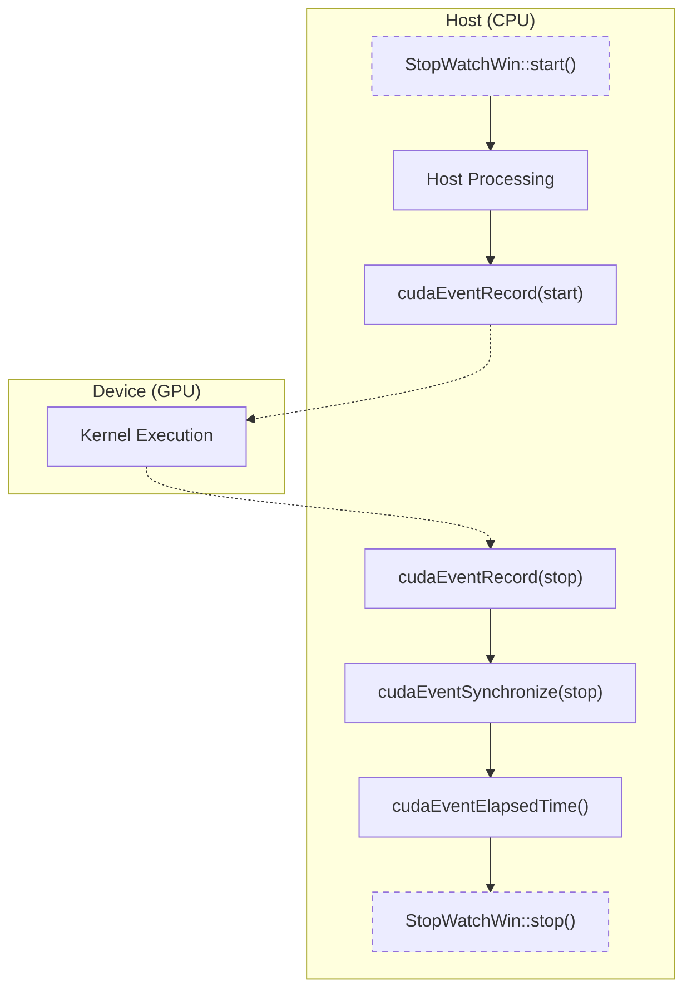
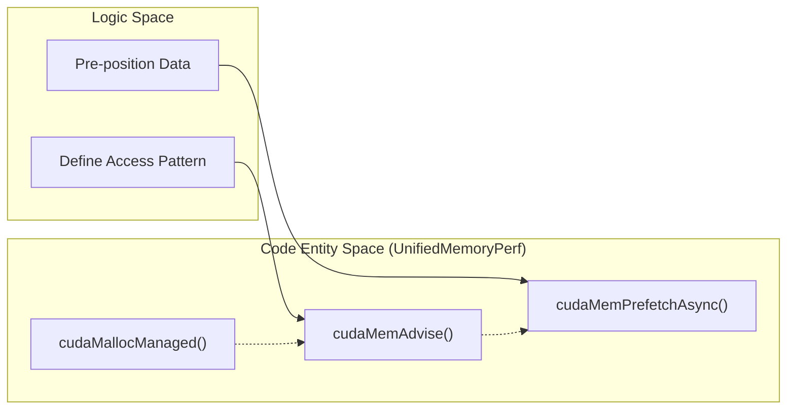

<!-- source: DeepWiki mcp.deepwiki.com · repo NVIDIA/cuda-samples · page 14.2 Performance Benchmarks and Optimization Samples (Category 6) · fetched 2026-10-26 -->

# Performance Benchmarks and Optimization Samples (Category 6)

Relevant source files

The following files were used as context for generating this wiki page:

- [CHANGELOG.md](CHANGELOG.md)
- [Common/helper_cuda.h](Common/helper_cuda.h)
- [Common/helper_timer.h](Common/helper_timer.h)

This page details the performance-focused samples located in the `cpp/6_Performance` directory of the CUDA Samples repository. These samples demonstrate techniques for measuring throughput, optimizing memory access patterns, evaluating Unified Memory performance, and scaling CUDA Graph operations.

## Overview of Performance Measurement
The primary mechanism for timing GPU operations in these samples is the use of **CUDA Events** (`cudaEvent_t`). Unlike CPU timers, CUDA events provide sub-millisecond precision for asynchronous device operations by inserting markers into the CUDA stream.

### Key Timing Utilities
Samples often utilize the following infrastructure for benchmarking:
*   **CUDA Events**: `cudaEventCreate`, `cudaEventRecord`, and `cudaEventElapsedTime` are used to measure the duration between two points in a GPU stream [Common/helper_cuda.h:320-350]().
*   **StopWatchInterface**: A cross-platform CPU timer abstraction used to measure wall-clock time for host-side operations [Common/helper_timer.h:44-67]().

---

## Memory Access and Throughput

### alignedTypes
The `alignedTypes` sample demonstrates the performance impact of memory alignment on global memory throughput. It compares the bandwidth achieved when accessing data using naturally aligned types (e.g., `float4`) versus misaligned structures.

*   **Implementation**: The sample launches kernels that perform simple copy operations using different data structures.
*   **Optimization Strategy**: To maximize throughput, memory accesses should be coalesced. This occurs when all threads in a warp access a contiguous block of memory that is aligned to the size of the access (typically 32, 64, or 128 bytes).
*   **Key Insight**: Using built-in CUDA vector types like `int2` or `float4` ensures the compiler generates instructions that utilize the full bus width (up to 128-bit loads/stores).

### transpose
The `transpose` sample is a comprehensive study of matrix transpose optimization. It demonstrates how to avoid **Shared Memory Bank Conflicts** and maximize global memory coalescing.

| Strategy | Technique |
| :--- | :--- |
| **Simple Copy** | Baseline for memory throughput. |
| **Naive Transpose** | High bank conflicts and non-coalesced writes. |
| **Coalesced Transpose** | Uses shared memory to reorder data so both reads and writes are coalesced. |
| **No Bank Conflicts** | Uses padding in shared memory (e.g., `[TILE_DIM][TILE_DIM + 1]`) to eliminate bank conflicts. |

**Sources:** `cpp/6_Performance/transpose/`, `cpp/6_Performance/alignedTypes/`

---

## Unified Memory Performance
The `UnifiedMemoryPerf` sample benchmarks the performance characteristics of **Unified Memory (UM)** compared to traditional pageable and pinned (page-locked) memory.

### Performance Comparisons
The sample evaluates three main memory allocation strategies:
1.  **Pageable Memory**: Standard `malloc` memory, which requires a staging buffer during `cudaMemcpy`.
2.  **Pinned Memory**: Allocated via `cudaMallocHost`, allowing for Higher-bandwidth DMA transfers and asynchronous copies.
3.  **Unified Memory**: Allocated via `cudaMallocManaged`, providing a single pointer accessible from both CPU and GPU.

### Optimization APIs
The sample demonstrates the use of "Hints" to minimize page fault overhead:
*   **`cudaMemAdvise`**: Used to provide the driver with information about data usage (e.g., `cudaMemAdviseSetReadMostly`) [CHANGELOG.md:78-82]().
*   **`cudaMemPrefetchAsync`**: Manually migrates data to a specific device before a kernel launch to avoid on-demand page faulting [CHANGELOG.md:78-82]().

**Sources:** `CHANGELOG.md:78-82()`, `cpp/6_Performance/UnifiedMemoryPerf/`

---

## Scaling and Graph API

### cudaGraphsPerfScaling
This sample demonstrates the performance benefits of the **CUDA Graphs API** when dealing with complex task dependencies and frequent kernel launches. It measures how graph instantiation and execution scale as the number of nodes in the graph increases.

*   **Workflow**:
    1.  **Capture/Creation**: Building a graph using `cudaStreamBeginCapture` or the explicit `cudaGraphAddNode` API [CHANGELOG.md:75-77]().
    2.  **Instantiation**: Using `cudaGraphInstantiate` to create an executable graph object.
    3.  **Execution**: Launching the graph via `cudaGraphLaunch`.
*   **Scaling Metric**: The sample compares the overhead of launching many small kernels via traditional streams versus a single graph launch.

### LargeKernelParameter
Demonstrates how to pass large amounts of data to a kernel using the `__grid_constant__` qualifier or by leveraging the increased constant memory limits for kernel parameters in newer SM architectures.

---

## System Interaction Diagrams

### Performance Benchmarking Data Flow
This diagram illustrates how `StopWatchWin` and `cudaEvent_t` are used to measure different parts of the execution pipeline.

**Sources:** [Common/helper_timer.h:80-155](), [Common/helper_cuda.h:320-350]()

### Unified Memory Optimization Pattern
This diagram bridges the natural language concept of "Data Prefetching" to the specific CUDA Runtime API calls used in `UnifiedMemoryPerf`.

**Sources:** [CHANGELOG.md:78-82](), `cpp/6_Performance/UnifiedMemoryPerf/`

---

## Optimization Summary Table

| Optimization Area | Key Code Entity / API | Impact |
| :--- | :--- | :--- |
| **Memory Alignment** | `float4`, `int2` | Increases global memory throughput by ensuring coalescing. |
| **Shared Memory** | `__shared__`, `padding` | Eliminates bank conflicts in matrix operations like `transpose`. |
| **Host-Device Transfer** | `cudaMallocHost` | Enables faster DMA transfers and async copies. |
| **Task Scheduling** | `cudaGraphLaunch` | Reduces CPU-side launch overhead for complex dependency chains. |
| **UM Latency** | `cudaMemPrefetchAsync` | Eliminates page fault overhead at kernel launch time. |

**Sources:** `cpp/6_Performance/`, `CHANGELOG.md:78-82()`, `Common/helper_cuda.h:51-66()`

---

