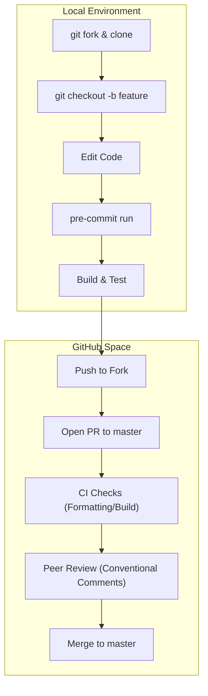
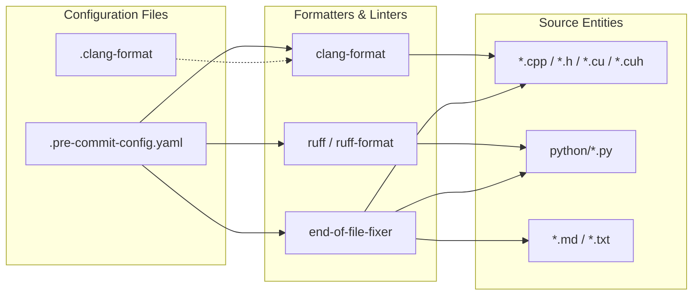

<!-- source: DeepWiki mcp.deepwiki.com · repo NVIDIA/cuda-samples · page 15 Developer Workflow and Code Quality · fetched 2026-10-26 -->

# Developer Workflow and Code Quality

Relevant source files

The following files were used as context for generating this wiki page:

- [.clang-format](.clang-format)
- [.gitignore](.gitignore)
- [.pre-commit-config.yaml](.pre-commit-config.yaml)
- [CONTRIBUTING.md](CONTRIBUTING.md)

This page documents the standardized processes for contributing to the CUDA Samples repository, maintaining code consistency through automated formatting, and ensuring high-quality peer reviews. The repository leverages modern DevOps tools like `pre-commit` and `clang-format` to enforce these standards across C++, CUDA, and Python source code.

## Contributing Process

The CUDA Samples repository follows a standard **fork-and-pull** model for community and internal contributions. Developers are expected to work in isolated feature branches and submit pull requests against the `master` branch.

The lifecycle of a contribution typically involves:
1.  **Forking and Cloning**: Creating a personal copy of the repository.
2.  **Branching**: Developing features or fixes in dedicated branches [CONTRIBUTING.md:15-19]().
3.  **Verification**: Building and testing changes locally to ensure no regressions [CONTRIBUTING.md:23-27]().
4.  **Submission**: Opening a Pull Request (PR) with a clear description of changes [CONTRIBUTING.md:39-44]().

For detailed instructions on branch naming, commit conventions, and the peer review process using **Conventional Comments**, see [Contributing Guidelines](#15.1).

### Contribution Workflow

The following diagram illustrates the transition from local development to the integrated codebase.

**Contribution Lifecycle**

**Sources:** [CONTRIBUTING.md:9-94]()

## Code Formatting and Quality Control

To maintain a uniform style across a diverse set of samples, the repository enforces strict formatting rules. These rules are applied automatically using `pre-commit` hooks, which prevent malformed code from being committed.

Key components of the quality stack include:
*   **clang-format**: Used for all C++ and CUDA (`.cu`, `.cuh`) files, configured for C++17 standards and a 120-character column limit [.clang-format:29-46]().
*   **ruff**: Utilized for Python sample linting and formatting [.pre-commit-config.yaml:107-116]().
*   **General Hooks**: Includes `end-of-file-fixer`, `trailing-whitespace`, and `mixed-line-ending` checks [.pre-commit-config.yaml:13-84]().

For details on configuring these tools and running them locally, see [Code Formatting and Pre-commit Hooks](#15.2).

### Formatting Configuration Entities

This diagram maps the formatting tools to the specific file types they govern within the repository structure.

**Formatting Tool Mapping**

**Sources:** [.pre-commit-config.yaml:85-117](), [.clang-format:1-49]()

## Automation with Pre-commit Hooks

The repository simplifies the developer experience by providing a `pre-commit` configuration. Developers can install these hooks locally so that formatting is validated automatically upon every `git commit` [CONTRIBUTING.md:79-85]().

| Tool | Scope | Primary Files |
| :--- | :--- | :--- |
| `clang-format` | C++/CUDA Style | `.cpp`, `.h`, `.cu`, `.cuh`, `.inl` |
| `ruff` | Python Linting | `python/**/*.py` |
| `ruff-format` | Python Style | `python/**/*.py` |
| `end-of-file-fixer` | File Integrity | All text-based source files |

**Note**: Certain directories, such as `Common/` and binary data folders, are excluded from specific formatting hooks to preserve legacy utility code or binary integrity [.pre-commit-config.yaml:102-105]().

**Sources:** [.pre-commit-config.yaml:12-117](), [CONTRIBUTING.md:45-89]()

---

