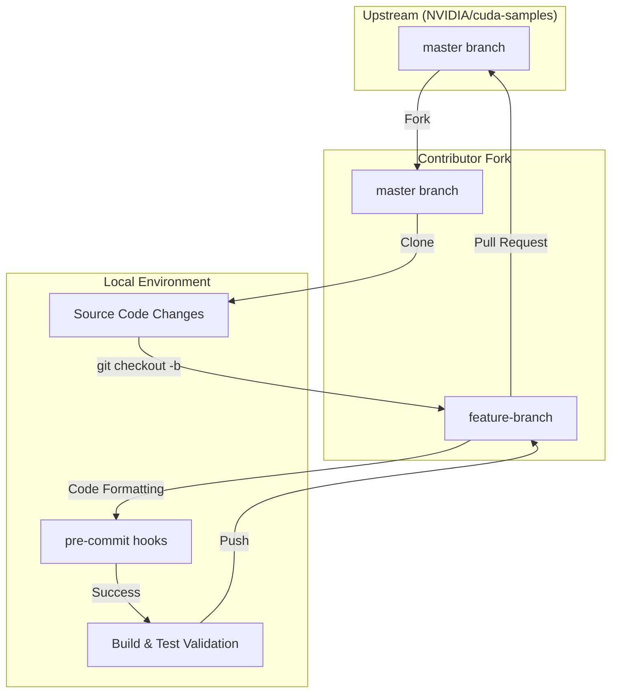
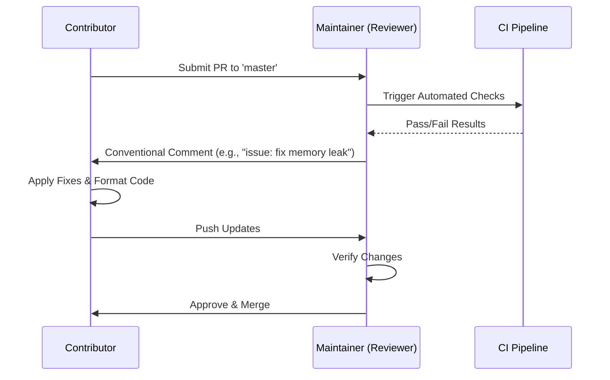

<!-- source: DeepWiki mcp.deepwiki.com · repo NVIDIA/cuda-samples · page 15.1 Contributing Guidelines · fetched 2026-10-26 -->

# Contributing Guidelines

Relevant source files

The following files were used as context for generating this wiki page:

- [.gitignore](.gitignore)
- [CONTRIBUTING.md](CONTRIBUTING.md)

This page outlines the technical workflow and quality standards for contributing to the NVIDIA CUDA Samples repository. The project follows a structured open-source contribution model to ensure that all samples maintain high educational value and technical correctness across various CUDA categories.

## Contribution Model: Fork-and-Pull

The repository utilizes the standard GitHub fork-and-pull model for all external and internal contributions. This ensures that the `master` branch remains stable while features and bug fixes are developed in isolation.

### Step 1: Repository Initialization
Contributors must first create a personal fork of the repository on GitHub and clone it locally to their development environment [CONTRIBUTING.md:9-11]().

### Step 2: Feature Branching
All changes should be performed in a dedicated feature branch rather than the local `master` branch. This facilitates cleaner history and allows for multiple concurrent contributions [CONTRIBUTING.md:15-19]().

### Step 3: Development and Validation
Before committing, contributors are required to build the samples and execute the testing infrastructure to ensure no regressions are introduced [CONTRIBUTING.md:23-27](). 
*   **Build Artifacts**: Generated binaries and build directories are ignored by the version control system to prevent repository bloat [/.gitignore:1-3]().
*   **Testing**: Validation should be performed using the local build system before pushing changes.

### Data Flow of a Contribution

The following diagram illustrates the lifecycle of a contribution from local development to the upstream repository.

**Contribution Workflow Diagram**

**Sources:** [CONTRIBUTING.md:9-44](), [/.gitignore:1-11]()

---

## Commit and Submission Standards

To maintain a clean and navigable project history, the following conventions are enforced.

### Commit Messages
Commits should include a brief, descriptive summary of the changes [CONTRIBUTING.md:29-33](). While the repository is flexible, it is recommended that messages clearly state the scope (e.g., "Common:", "Category 0:", "Python:") to aid maintainers during the review process.

### Pull Request (PR) Submission
PRs must target the `master` branch of the original NVIDIA repository [CONTRIBUTING.md:39-42]().
*   **Description**: The PR description must clearly articulate the purpose, context, and any specific implementation details of the changes [CONTRIBUTING.md:43-44]().
*   **Verification**: Contributors can use `git commit --no-verify` to bypass local checks, but this is discouraged as CI systems will likely reject the PR if standards are not met [CONTRIBUTING.md:87-89]().

---

## Peer Review Process

Once a Pull Request is submitted, it enters the peer review phase where maintainers evaluate the code for technical accuracy, performance, and adherence to CUDA best practices.

### Automated Review Assignment
Maintainers are automatically assigned to incoming PRs to begin the evaluation process [CONTRIBUTING.md:90-92]().

### Conventional Comments
The project encourages the use of **Conventional Comments** to provide structured, actionable feedback. This framework helps distinguish between mandatory changes, suggestions, and minor nitpicks.

| Label | Purpose |
| :--- | :--- |
| **suggestion** | Proposes an alternative implementation that might be better. |
| **issue** | Highlights a bug or a violation of project standards that must be fixed. |
| **question** | Requests clarification on a specific code block. |
| **thought** | Shares a non-blocking observation or idea. |
| **nitpick** | Small, often stylistic changes that are not critical. |

**Sources:** [CONTRIBUTING.md:90-94]()

### Communication Flow in Peer Review

The following diagram maps the interaction between the Contributor and the Reviewer during the PR lifecycle.

**PR Review Interaction**

**Sources:** [CONTRIBUTING.md:47-50](), [CONTRIBUTING.md:90-95]()

---

## Quality Assurance and Formatting

Code quality is enforced through automated tooling and strict formatting rules defined in the repository's configuration.

*   **Pre-commit Hooks**: The repository uses `pre-commit` to run linters and formatters (like `clang-format` and `ruff`) before code is committed [CONTRIBUTING.md:47-53]().
*   **Formatting Standards**: C++ and CUDA code must adhere to the standards defined in `.clang-format`, which includes a 120-column limit and specific brace wrapping rules [CONTRIBUTING.md:53]().
*   **Manual Execution**: Contributors can run all checks manually using `pre-commit run --all-files` to ensure the entire local state is compliant [CONTRIBUTING.md:73-77]().

**Sources:** [CONTRIBUTING.md:45-85]()

---

