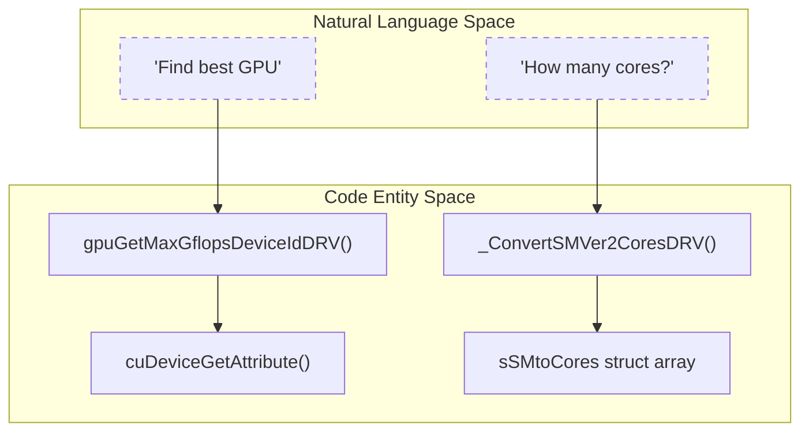
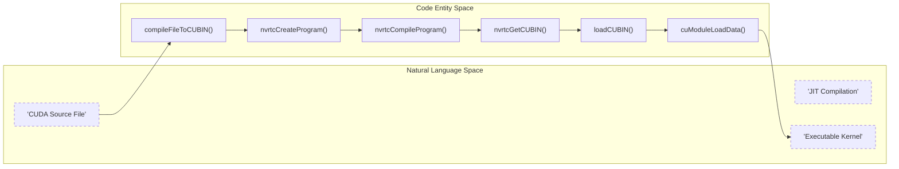

<!-- source: DeepWiki mcp.deepwiki.com · repo NVIDIA/cuda-samples · page 16 Glossary · fetched 2026-10-26 -->

# Glossary

Relevant source files

The following files were used as context for generating this wiki page:

- [CHANGELOG.md](CHANGELOG.md)
- [CMakeLists.txt](CMakeLists.txt)
- [Common/GL/freeglut_std.h](Common/GL/freeglut_std.h)
- [Common/GL/glew.h](Common/GL/glew.h)
- [Common/helper_cuda.h](Common/helper_cuda.h)
- [Common/helper_cuda_drvapi.h](Common/helper_cuda_drvapi.h)
- [Common/helper_multiprocess.h](Common/helper_multiprocess.h)
- [Common/nvrtc_helper.h](Common/nvrtc_helper.h)

This glossary defines codebase-specific terms, CUDA jargon, and abbreviations used throughout the NVIDIA CUDA Samples repository. It serves as a technical reference for onboarding engineers to understand the implementation details of common utilities and domain-specific concepts.

## Core CUDA Concepts and Jargon

### SM (Streaming Multiprocessor)
The fundamental processing unit on an NVIDIA GPU. Each SM contains a set of CUDA cores, registers, and shared memory. The codebase frequently converts SM versions to core counts to estimate performance or verify compatibility.
*   **Implementation:** `_ConvertSMVer2CoresDRV` maps SM major/minor versions to core counts [Common/helper_cuda_drvapi.h:91-143]().
*   **Usage:** Used in `gpuGetMaxGflopsDeviceIdDRV` to identify the most powerful GPU on a system [Common/helper_cuda_drvapi.h:200-240]().

### Compute Capability
A version number (e.g., 7.5, 8.0) that identifies the features supported by the GPU hardware.
*   **Code Reference:** Targeted in `CMakeLists.txt` via `CMAKE_CUDA_ARCHITECTURES` [CMakeLists.txt:15-15]().
*   **Utility:** `checkCudaErrors(cuDeviceGetAttribute(&major, CU_DEVICE_ATTRIBUTE_COMPUTE_CAPABILITY_MAJOR, cuDevice))` [Common/nvrtc_helper.h:85-88]().

### NVRTC (Runtime Compilation)
A library for compiling CUDA C++ source code to PTX or CUBIN at runtime, allowing for kernel specialization based on runtime parameters.
*   **Key Function:** `compileFileToCUBIN` automates the process of reading a `.cu` file, setting architecture flags, and calling `nvrtcCompileProgram` [Common/nvrtc_helper.h:50-183]().
*   **Macro:** `NVRTC_SAFE_CALL` provides error checking for NVRTC-specific result codes [Common/nvrtc_helper.h:40-48]().

## Common Utilities (Common/ Directory)

### Error Handling Macros
The codebase uses standardized macros to wrap CUDA API calls and ensure consistent error reporting and process termination on failure.

| Macro | API Targeted | Source |
| :--- | :--- | :--- |
| `checkCudaErrors(err)` | Runtime API (`cudaError_t`) | [Common/helper_cuda.h:258-270]() |
| `checkCudaErrors(err)` | Driver API (`CUresult`) | [Common/helper_cuda_drvapi.h:65-80]() |
| `NVRTC_SAFE_CALL(Name, x)` | NVRTC API (`nvrtcResult`) | [Common/nvrtc_helper.h:40-48]() |
| `checkIpcErrors(res)` | Multi-process / IPC helpers | [Common/helper_multiprocess.h:105-106]() |

### IPC (Inter-Process Communication)
Abstractions for sharing GPU memory handles and synchronizing between different OS processes.
*   **ShareableHandle:** A platform-agnostic type for IPC handles (`int` on Linux/QNX, `HANDLE` on Windows) [Common/helper_multiprocess.h:109-119]().
*   **Socket Abstraction:** `ipcHandle` wraps Unix domain sockets or Windows Mailslots for handle exchange [Common/helper_multiprocess.h:109-122]().

### GPU Architecture Mapping
The codebase maintains a static mapping of hardware architectures to their physical properties.

**Natural Language to Code Entity Mapping: Architecture Resolution**

*Sources: [Common/helper_cuda_drvapi.h:91-143](), [Common/helper_cuda_drvapi.h:200-240]()*

## Build and Infrastructure Terms

### CUBIN (CUDA Binary)
A text-based or binary representation of a compiled CUDA kernel.
*   **Generation:** `nvrtcGetCUBIN` retrieves the compiled binary from an `nvrtcProgram` [Common/nvrtc_helper.h:174-178]().
*   **Loading:** `loadCUBIN` uses the Driver API `cuModuleLoadData` to prepare the kernel for execution [Common/nvrtc_helper.h:185-212]().

### CCCL (CUDA C++ Core Libraries)
A collection of libraries (Thrust, CUB, libcu++) that provide standard-like C++ primitives for GPU programming.
*   **Integration:** The samples use `CPM` to fetch specific CCCL versions, such as v3.3.3 [CHANGELOG.md:5-5]().
*   **Modernization:** `thrust::identity` is replaced with `cuda::std::identity` to comply with CUDA 13.0 standards [CHANGELOG.md:83-83]().

### Graphics Interoperability
Headers and utilities for sharing data between CUDA and graphics APIs.
*   **FreeGLUT/GLEW:** The repository bundles `freeglut_std.h` and `glew.h` to provide cross-platform windowing and OpenGL extension management [Common/GL/freeglut_std.h:1-111](), [Common/GL/glew.h:1-186]().

## Platform Specifics

### Tegra / Jetson
NVIDIA's embedded SoC platform.
*   **NvSci:** NVIDIA Software Communication Interface, used for cross-process and cross-API (e.g., CUDA to NvMedia) buffer sharing [CHANGELOG.md:73-74]().
*   **cuDLA:** CUDA Deep Learning Accelerator, allowing CUDA kernels to interact with the dedicated DLA hardware [Wiki TOC 9.2]().

**Natural Language to Code Entity Mapping: NVRTC Workflow**

*Sources: [Common/nvrtc_helper.h:50-183](), [Common/nvrtc_helper.h:185-212]()*

## Abbreviations

| Abbreviation | Full Term | Description |
| :--- | :--- | :--- |
| **PTX** | Parallel Thread Execution | Low-level virtual machine and instruction set architecture (ISA). |
| **IPC** | Inter-Process Communication | Mechanisms for processes to share data/synchronize [Common/helper_multiprocess.h:28-141](). |
| **VBO** | Vertex Buffer Object | An OpenGL feature for storing vertex data on the GPU. |
| **UVM** | Unified Virtual Memory | A single memory address space accessible from both CPU and GPU. |
| **LTO** | Link Time Optimization | Optimization across translation units, demonstrated in `jitLto` [CHANGELOG.md:67-67](). |

*Sources: [CHANGELOG.md:1-116](), [CMakeLists.txt:1-34](), [Common/helper_cuda.h:1-270](), [Common/helper_cuda_drvapi.h:1-240](), [Common/helper_multiprocess.h:1-141](), [Common/nvrtc_helper.h:1-212]()*