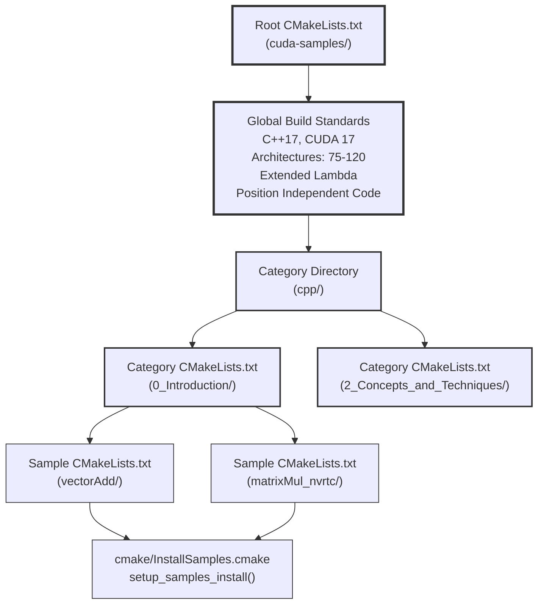
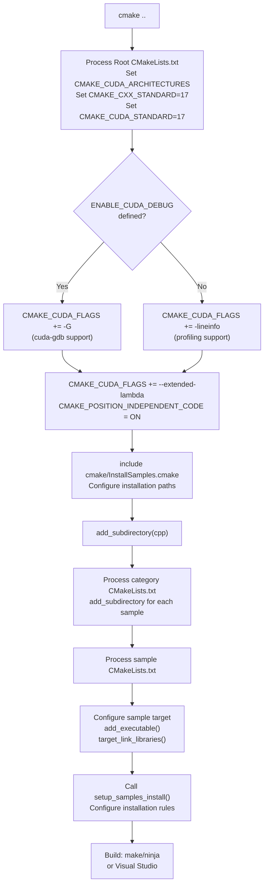
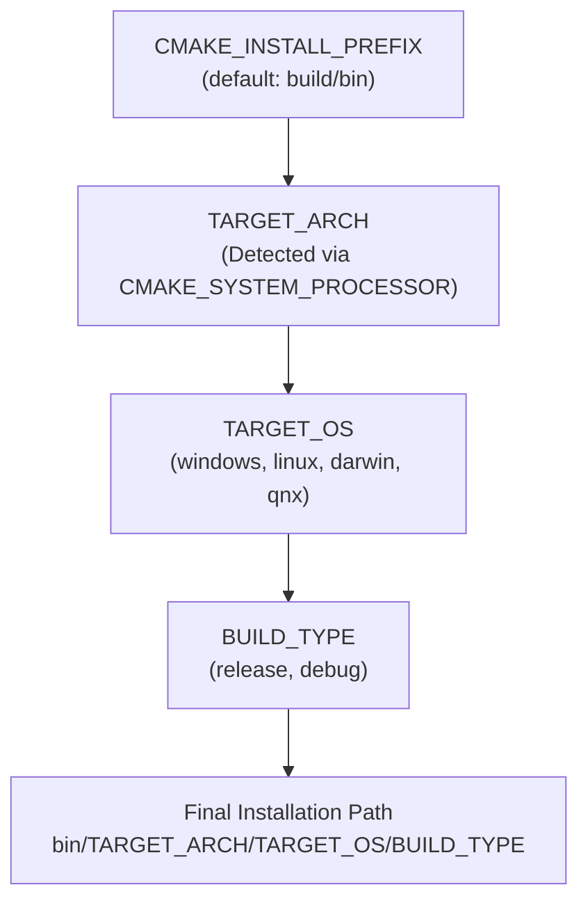

<!-- source: DeepWiki mcp.deepwiki.com · repo NVIDIA/cuda-samples · page 2 Build System · fetched 2026-10-26 -->

# Build System

<details>
<summary>Relevant source files</summary>

The following files were used as context for generating this wiki page:

- [CMakeLists.txt](CMakeLists.txt)
- [cmake/CPM.cmake](cmake/CPM.cmake)
- [cmake/InstallSamples.cmake](cmake/InstallSamples.cmake)

</details>


## Purpose and Scope

This document describes the CMake-based build system architecture used across the CUDA Samples repository. It covers the three-tier configuration hierarchy (Root → Category → Sample), build configuration options, platform-specific toolchains, and the installation system. For detailed information about specific build configuration options and CUDA architecture targeting, see [CMake Configuration and Compilation Options](#2.1). For cross-compilation workflows and platform-specific details, see [Platform-Specific Building and Cross-Compilation](#2.2). For information about testing the built samples, see [Testing Infrastructure](#2.3).

## Build System Architecture

The CUDA Samples build system employs a three-tier CMake hierarchy that allows samples to be built either individually or as part of the complete repository. Each tier has distinct responsibilities and configuration scopes.

### Three-Tier Configuration Hierarchy



**Sources:** [CMakeLists.txt:1-34](), [cmake/InstallSamples.cmake:1-110]()

### Build Configuration Flow



**Sources:** [CMakeLists.txt:1-34](), [cmake/InstallSamples.cmake:18-100]()

## Root Configuration Layer

The root `CMakeLists.txt` establishes global build standards that apply to all samples. It sets the minimum CMake version requirement, defines standard language versions, and configures CUDA-specific compilation flags.

### Global Build Standards

The root configuration establishes the following mandatory settings:

| Setting | Value | Purpose |
|---------|-------|---------|
| `cmake_minimum_required` | 3.20 | Minimum CMake version [CMakeLists.txt:1]() |
| `CMAKE_CXX_STANDARD` | 17 | C++ language standard [CMakeLists.txt:9]() |
| `CMAKE_CUDA_STANDARD` | 17 | CUDA language standard [CMakeLists.txt:12]() |
| `CMAKE_POSITION_INDEPENDENT_CODE` | ON | Enable position-independent code [CMakeLists.txt:7]() |
| `CMAKE_CUDA_ARCHITECTURES` | 75 80 86 87 89 90 100 110 120 | Target GPU architectures [CMakeLists.txt:15]() |

**Sources:** [CMakeLists.txt:1-15]()

### CUDA Compilation Flags

The root configuration sets CUDA compiler flags based on build mode:

**Debug Mode** (when `ENABLE_CUDA_DEBUG` is defined):
- Adds `-G` flag to enable `cuda-gdb` debugging [CMakeLists.txt:18]()
- Note: Significantly affects performance as compiler optimizations are disabled.

**Release Mode** (default):
- Adds `-lineinfo` flag to include line information for profiling tools [CMakeLists.txt:20]()
- Note: `-lineinfo` and `-G` are mutually exclusive.

**Always Applied:**
- `--extended-lambda`: Enables extended lambda expressions in CUDA device code [CMakeLists.txt:23]()
- `-Wno-deprecated-gpu-targets`: Suppresses warnings for older GPU architectures [CMakeLists.txt:16]()
- `/Zc:preprocessor`: MSVC-specific flag for standard-conforming preprocessor (required for CCCL) [CMakeLists.txt:27]()

**Sources:** [CMakeLists.txt:16-29]()

### Architecture Targeting

The build system targets multiple GPU architectures using `CMAKE_CUDA_ARCHITECTURES`:

```cmake
set(CMAKE_CUDA_ARCHITECTURES 75 80 86 87 89 90 100 110 120)
```

This covers:
- **SM 75**: Turing
- **SM 80, 86, 87**: Ampere
- **SM 89**: Ada Lovelace
- **SM 90**: Hopper
- **SM 100, 110, 120**: Blackwell and future architectures.

**Sources:** [CMakeLists.txt:15]()

## Dependency Management

The build system uses `find_package(CUDAToolkit REQUIRED)` at the root to ensure the CUDA development environment is available [CMakeLists.txt:5](). For external dependencies, the project includes `CPM.cmake` (CMake's Missing Package Manager) to manage third-party libraries if needed [cmake/CPM.cmake:1-42]().

## Installation System

The installation system organizes built samples into a structured directory hierarchy based on target architecture, operating system, and build type. This is managed via `cmake/InstallSamples.cmake` [CMakeLists.txt:31]().

### Installation Path Structure

The system constructs the installation path using the following logic:



**Sources:** [cmake/InstallSamples.cmake:22-89]()

### Platform Detection

The installation system automatically detects platform characteristics:
- **Architecture**: Detected using `CMAKE_SYSTEM_PROCESSOR` [cmake/InstallSamples.cmake:23]().
- **OS**: Detected via `WIN32`, `APPLE`, or `CMAKE_SYSTEM_NAME` (checking for `QNX`) [cmake/InstallSamples.cmake:27-40]().
- **Build Type**: Handles both single-config and multi-config (Visual Studio/Ninja Multi-Config) generators [cmake/InstallSamples.cmake:42-59]().

### Installation Function: setup_samples_install

The `setup_samples_install()` function is used by individual samples to:
1. Determine the actual install directory [cmake/InstallSamples.cmake:118-129]().
2. Copy executables and shared libraries to a flat root directory [cmake/InstallSamples.cmake:132-135]().
3. Copy data files from the sample's `data/` directory and the shared `Common/data/` directory [cmake/InstallSamples.cmake:137-152]().
4. Filter out build artifacts like `.o`, `.obj`, and `.pdb` files [cmake/InstallSamples.cmake:181-205]().

**Sources:** [cmake/InstallSamples.cmake:114-324]()

## Cross-Compilation Support

The repository provides toolchain files for cross-compiling to Tegra platforms (aarch64).

### QNX Toolchain Configuration

The QNX toolchain (`toolchain-aarch64-qnx.cmake`) configures the environment for the QNX real-time OS:
- Requires `QNX_HOST` and `QNX_TARGET` environment variables [cmake/toolchains/toolchain-aarch64-qnx.cmake:11-12]().
- Sets `qcc` and `q++` as the compilers [cmake/toolchains/toolchain-aarch64-qnx.cmake:24-25]().
- Configures `CMAKE_CUDA_HOST_COMPILER` to use the QNX C++ compiler [cmake/toolchains/toolchain-aarch64-qnx.cmake:31]().

**Sources:** [cmake/toolchains/toolchain-aarch64-qnx.cmake:1-38]()

For detailed workflows on cross-compilation, see [Platform-Specific Building and Cross-Compilation](#2.2).

---

