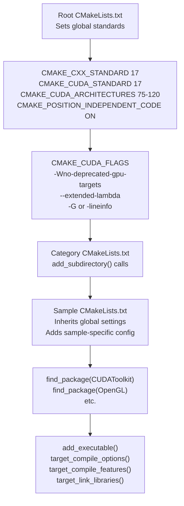
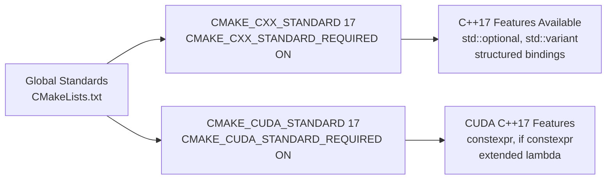
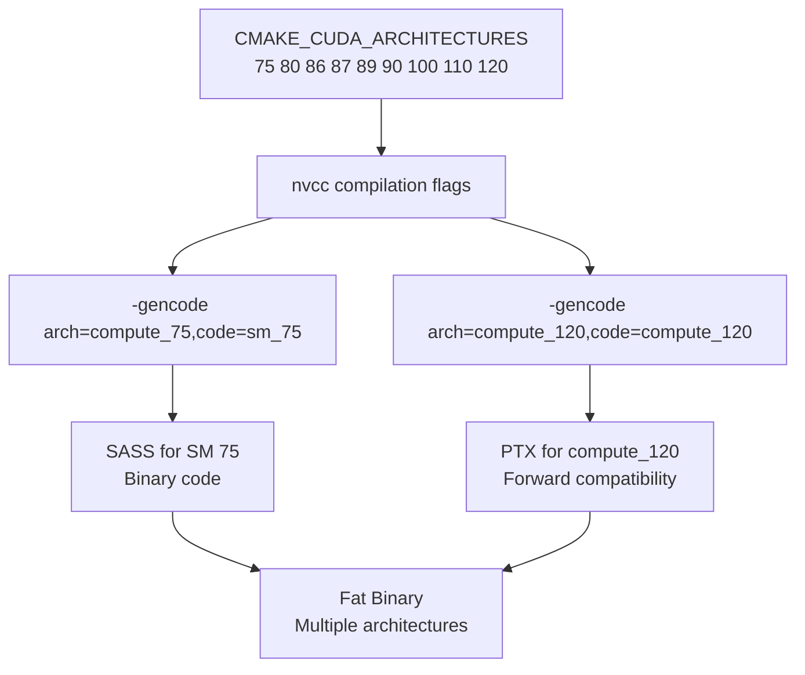
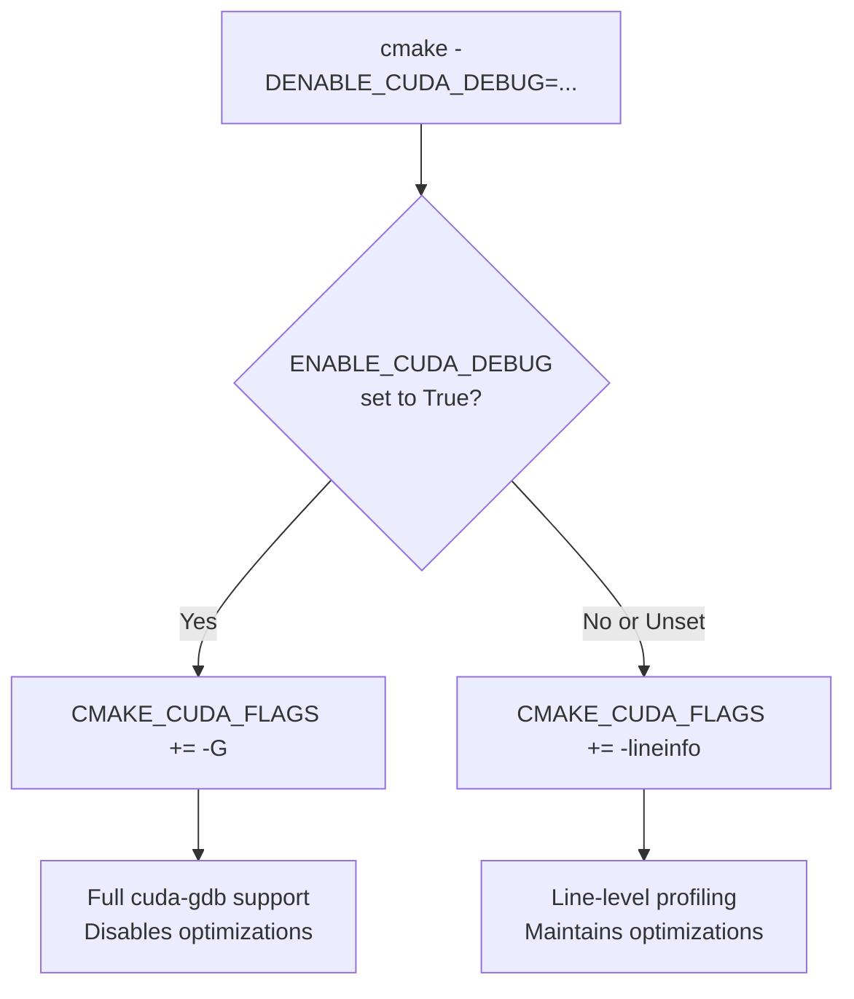
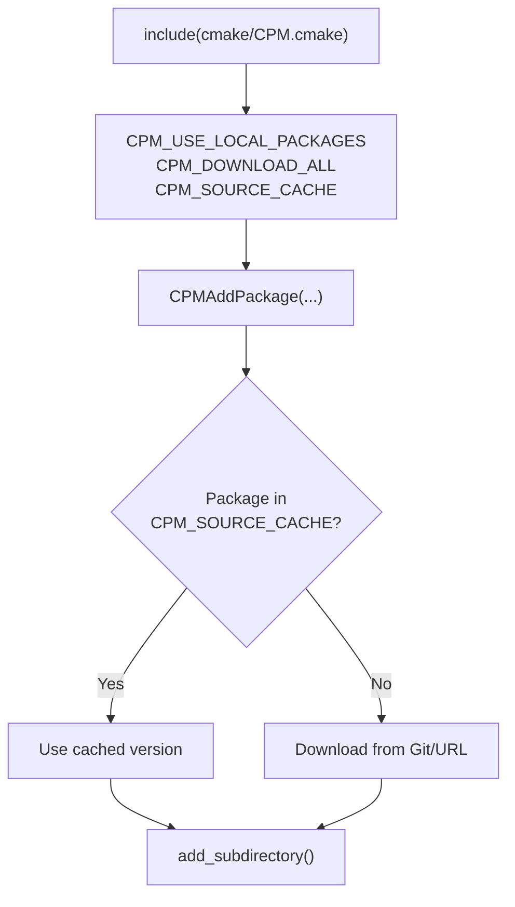
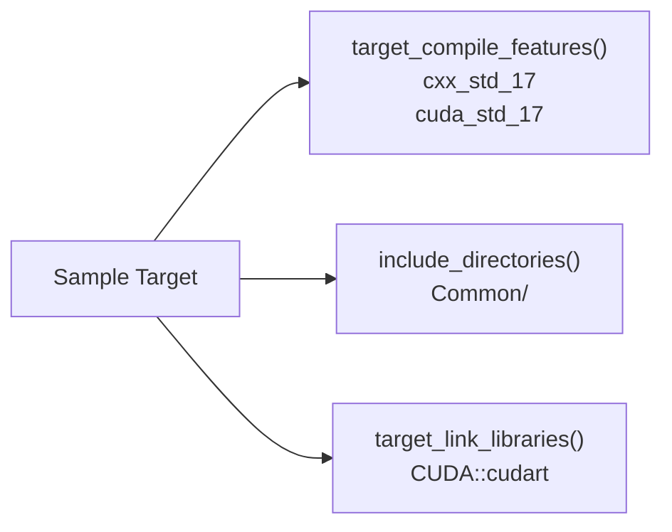

<!-- source: DeepWiki mcp.deepwiki.com · repo NVIDIA/cuda-samples · page 2.1 CMake Configuration and Compilation Options · fetched 2026-10-26 -->

# CMake Configuration and Compilation Options

<details>
<summary>Relevant source files</summary>

The following files were used as context for generating this wiki page:

- [CMakeLists.txt](CMakeLists.txt)
- [cmake/CPM.cmake](cmake/CPM.cmake)
- [cpp/0_Introduction/CMakeLists.txt](cpp/0_Introduction/CMakeLists.txt)

</details>


The NVIDIA CUDA Samples repository uses CMake to configure build settings, compiler flags, and CUDA architecture targeting. This page details the CMake variables and compilation options used across the repository, including CUDA architecture targeting (SM 75-120), debug modes (`-G` vs `-lineinfo`), and standard settings (C++17, CUDA 17, separable compilation).

## CMake Configuration Hierarchy

The CUDA Samples repository uses a three-tier CMake hierarchy: Root → Category → Sample. Configuration settings flow from the root level down to individual samples.

**CMake Configuration Flow**


Sources: [CMakeLists.txt:1-33](), [cpp/0_Introduction/CMakeLists.txt:1-47]()

## Root-Level Global Configuration

The root [CMakeLists.txt:1-34]() establishes global build settings that apply to all samples unless overridden.

### Project Definition and Requirements

```cmake
cmake_minimum_required(VERSION 3.20)
project(cuda-samples LANGUAGES C CXX CUDA)
find_package(CUDAToolkit REQUIRED)
```

The repository requires CMake 3.20 or higher and declares support for C, C++, and CUDA languages. The `CUDAToolkit` package is required for all builds.

Sources: [CMakeLists.txt:1-5]()

### Global Compilation Standards

**Language Standards Configuration**


The root configuration sets C++17 and CUDA 17 as the minimum language standards:

```cmake
set(CMAKE_CXX_STANDARD 17)
set(CMAKE_CXX_STANDARD_REQUIRED ON)

set(CMAKE_CUDA_STANDARD 17)
set(CMAKE_CUDA_STANDARD_REQUIRED ON)
```

These settings ensure all samples use consistent modern C++ features and CUDA capabilities.

Sources: [CMakeLists.txt:9-13]()

### Position-Independent Code and MSVC Compatibility

```cmake
set(CMAKE_POSITION_INDEPENDENT_CODE ON)

if(MSVC)
    add_compile_options($<$<COMPILE_LANGUAGE:CUDA>:-Xcompiler=/Zc:preprocessor>)
endif()
```

The `CMAKE_POSITION_INDEPENDENT_CODE` setting enables PIC generation, required for shared libraries and ASLR support. For Windows builds using MSVC, the `-Xcompiler=/Zc:preprocessor` flag is added to ensure a standard-conforming preprocessor, which is a requirement for the CUDA Core Compute Libraries (CCCL).

Sources: [CMakeLists.txt:7-28]()

## CUDA Architecture Targeting

The CMake configuration targets specific CUDA compute capabilities to ensure compatibility with modern GPU architectures.

### Architecture Configuration

```cmake
set(CMAKE_CUDA_ARCHITECTURES 75 80 86 87 89 90 100 110 120)
```

This line in [CMakeLists.txt:15]() sets the target architectures for all samples in the repository, ranging from Turing (SM 75) to future architectures (SM 120).

**Supported CUDA Compute Capabilities**

| Compute Capability | Architecture | GPU Examples |
|-------------------|--------------|--------------|
| 75 | Turing | RTX 20 series, T4 |
| 80 | Ampere | A100 |
| 86 | Ampere | RTX 30 series |
| 87 | Ampere | Jetson Orin |
| 89 | Ada Lovelace | RTX 40 series, L40 |
| 90 | Hopper | H100 |
| 100, 110, 120 | Future | Blackwell and beyond |

### Code Generation Modes

**Architecture Code Generation**


The highest compute capability generates PTX (virtual architecture) code for forward compatibility, allowing the binary to run on future GPU architectures through JIT compilation. The flag `-Wno-deprecated-gpu-targets` is applied globally to suppress warnings about older architectures.

Sources: [CMakeLists.txt:15-16]()

## Debug Mode Configuration

The repository supports two debugging modes controlled by the `ENABLE_CUDA_DEBUG` CMake variable.

### Debug Modes: -G vs -lineinfo

**Debug Mode Selection**


The configuration logic in [CMakeLists.txt:17-21]():

```cmake
if(ENABLE_CUDA_DEBUG)
    set(CMAKE_CUDA_FLAGS "${CMAKE_CUDA_FLAGS} -G")        # enable cuda-gdb
else()
    set(CMAKE_CUDA_FLAGS "${CMAKE_CUDA_FLAGS} -lineinfo") # add line information
endif()
```

- **`-G`**: Enables full symbolic debugging but significantly impacts performance and disables optimizations.
- **`-lineinfo`**: Default mode. Provides line number information for profilers (NSight) and stack traces without sacrificing performance.

Sources: [CMakeLists.txt:17-21]()

## Dependency Management with CPM

The repository includes `cmake/CPM.cmake`, a setup script for **CMake's Missing Package Manager (CPM)**.

**CPM Dependency Workflow**


CPM provides a seamless way to manage external C++ dependencies by wrapping `FetchContent`. It supports:
- **Version Control**: Ensuring specific versions of dependencies are used across environments [cmake/CPM.cmake:42]().
- **Caching**: Using `CPM_SOURCE_CACHE` to avoid redundant downloads [cmake/CPM.cmake:163-167]().
- **Local Overrides**: Forcing the use of system packages via `CPM_USE_LOCAL_PACKAGES` [cmake/CPM.cmake:109-113]().

Sources: [cmake/CPM.cmake:1-189]()

## Compilation Flags and Standards

### Extended Lambda Support

```cmake
set(CMAKE_CUDA_FLAGS "${CMAKE_CUDA_FLAGS} --extended-lambda")
```

The `--extended-lambda` flag is enabled globally in [CMakeLists.txt:23](). This is critical for modern CUDA programming as it allows `__device__` lambdas to be defined within host code, facilitating the use of Thrust algorithms and Cooperative Groups.

Sources: [CMakeLists.txt:23]()

### Standard Settings for Samples

Individual samples inherit these settings and typically specify their own language requirements and include paths.

**Sample Compilation Pattern**


Sources: [cpp/0_Introduction/CMakeLists.txt:1-47](), [CMakeLists.txt:9-13]()

---

