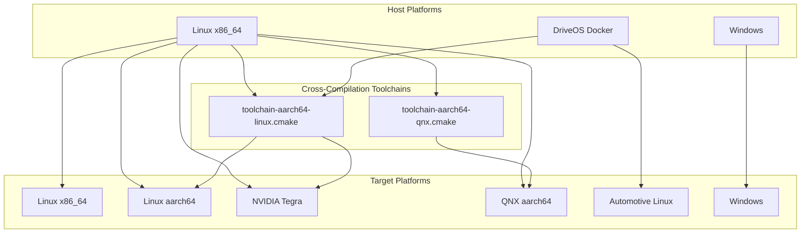
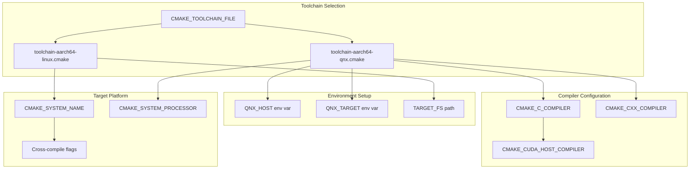
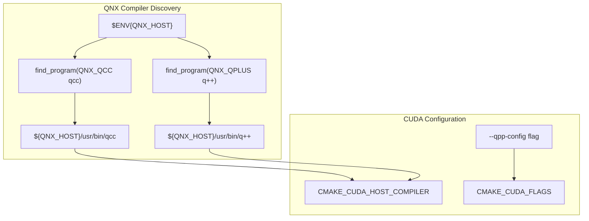

<!-- source: DeepWiki mcp.deepwiki.com · repo NVIDIA/cuda-samples · page 2.2 Platform-Specific Building and Cross-Compilation · fetched 2026-10-26 -->

# Platform-Specific Building and Cross-Compilation

Relevant source files

The following files were used as context for generating this wiki page:

- [cmake/InstallSamples.cmake](cmake/InstallSamples.cmake)
- [cmake/Modules/FindEGL.cmake](cmake/Modules/FindEGL.cmake)
- [cmake/Modules/FindFreeImage.cmake](cmake/Modules/FindFreeImage.cmake)
- [cmake/Modules/FindNVSCI.cmake](cmake/Modules/FindNVSCI.cmake)
- [cmake/toolchains/toolchain-aarch64-linux.cmake](cmake/toolchains/toolchain-aarch64-linux.cmake)
- [cmake/toolchains/toolchain-aarch64-qnx.cmake](cmake/toolchains/toolchain-aarch64-qnx.cmake)

This document covers the cross-platform build system architecture for the CUDA samples repository, including cross-compilation toolchains, platform-specific build flags, and target architecture support. It focuses on building samples for embedded platforms like Tegra, QNX, and automotive Linux environments, as well as the standardized installation pathing used for binary distribution.

For general CMake configuration and helper utilities, see [2.1. CMake Configuration and Compilation Options](). For automated testing across platforms, see [2.3. Testing Infrastructure]().

## Supported Platforms and Target Architectures

The CUDA samples repository supports multiple host and target platform combinations through CMake toolchains and platform-specific build configurations. The system automatically detects the architecture and OS to determine installation paths.

### Platform Support Matrix

Sources: [cmake/toolchains/toolchain-aarch64-linux.cmake:1-2](), [cmake/toolchains/toolchain-aarch64-qnx.cmake:1-2](), [cmake/InstallSamples.cmake:22-40]()

## Installation Paths and Platform Detection

The build system organizes output binaries into a structured hierarchy based on the target environment. This ensures that cross-compiled binaries for different architectures do not collide.

### Detection Logic
The module `cmake/InstallSamples.cmake` performs the following detection:
1.  **Architecture**: Uses `CMAKE_SYSTEM_PROCESSOR` (e.g., `x86_64`, `aarch64`) [cmake/InstallSamples.cmake:22-25]().
2.  **OS**: Detects `windows`, `darwin`, `qnx`, or `linux` based on CMake system variables [cmake/InstallSamples.cmake:27-40]().
3.  **Build Type**: Handles both single-config (e.g., Make) and multi-config (e.g., Ninja Multi-Config, Visual Studio) generators [cmake/InstallSamples.cmake:42-59]().

### Standard Installation Structure
The default installation path follows the pattern:
`bin/${TARGET_ARCH}/${TARGET_OS}/${BUILD_TYPE}` [cmake/InstallSamples.cmake:9-13]().

| Variable | Description | Source |
| :--- | :--- | :--- |
| `TARGET_ARCH` | Target CPU architecture (lowercase) | [cmake/InstallSamples.cmake:24]() |
| `TARGET_OS` | Target operating system | [cmake/InstallSamples.cmake:40]() |
| `BUILD_TYPE_EXPR` | `release` or `debug` (evaluated at install time for multi-config) | [cmake/InstallSamples.cmake:89]() |

Sources: [cmake/InstallSamples.cmake:1-110]()

## Cross-Compilation Toolchain Architecture

The repository provides CMake toolchain files that configure cross-compilation for different target architectures and operating systems.

### Toolchain Configuration Flow

Sources: [cmake/toolchains/toolchain-aarch64-qnx.cmake:1-38](), [cmake/toolchains/toolchain-aarch64-linux.cmake:1-14]()

## Tegra and aarch64 Linux Cross-Compilation

Cross-compilation for NVIDIA Tegra devices and aarch64 Linux systems uses the `toolchain-aarch64-linux.cmake` toolchain file. A critical parameter is `TARGET_FS`, which points to the local copy of the target's root filesystem.

### Key Implementation Details
- **Sysroot**: The toolchain sets `CMAKE_SYSROOT` to `TARGET_FS` [cmake/toolchains/toolchain-aarch64-linux.cmake:24]().
- **CUDA Target Detection**: It automatically checks for `aarch64-linux` vs `sbsa-linux` targets within the CUDA toolkit [cmake/toolchains/toolchain-aarch64-linux.cmake:19-22]().
- **Library Paths**: It adds `rpath-link` flags for `/usr/lib/aarch64-linux-gnu` and `/usr/lib/aarch64-linux-gnu/nvidia` to ensure the linker finds dependencies within the sysroot [cmake/toolchains/toolchain-aarch64-linux.cmake:35-44]().
- **NVVM Pathing**: It resolves the real path of `nvcc` on the target filesystem to set `LIBNVVM_HOME` correctly for samples requiring runtime compilation [cmake/toolchains/toolchain-aarch64-linux.cmake:47-67]().

Sources: [cmake/toolchains/toolchain-aarch64-linux.cmake:1-69]()

## QNX Cross-Compilation

QNX cross-compilation requires the QNX Software Development Platform (SDP) and uses the `toolchain-aarch64-qnx.cmake` toolchain file.

### QNX Toolchain Configuration

The toolchain relies on `QNX_HOST` and `QNX_TARGET` environment variables to locate the `qcc` and `q++` compilers [cmake/toolchains/toolchain-aarch64-qnx.cmake:4-16]().

- **Compiler Flags**: The toolchain forces the use of `qcc` for CUDA host compilation [cmake/toolchains/toolchain-aarch64-qnx.cmake:26]().
- **QNX Source**: Defines `-D_QNX_SOURCE` for both CXX and CUDA flags to enable QNX-specific headers [cmake/toolchains/toolchain-aarch64-qnx.cmake:36-37]().

Sources: [cmake/toolchains/toolchain-aarch64-qnx.cmake:1-38]()

## Platform Dependency Discovery (Modules)

The build system includes custom CMake modules to find platform-specific libraries required for Tegra and advanced samples.

| Module | Purpose | Key Variables |
| :--- | :--- | :--- |
| `FindNVSCI.cmake` | Finds NvSciBuf and NvSciSync libraries for Tegra interop | `NVSCI_LIBRARIES`, `NVSCI_INCLUDE_DIRS` |
| `FindEGL.cmake` | Finds EGL headers/libraries for Tegra graphics output | `EGL_LIBRARIES`, `EGL_INCLUDE_DIRS` |
| `FindFreeImage.cmake` | Finds FreeImage for samples requiring image I/O | `FreeImage_LIBRARIES` |

Sources: [cmake/Modules/FindNVSCI.cmake:1-61](), [cmake/Modules/FindEGL.cmake:1-17](), [cmake/Modules/FindFreeImage.cmake:1-17]()

## Installation Logic for Samples

The `setup_samples_install` function in `cmake/InstallSamples.cmake` handles the deployment of built artifacts.

1.  **Executables**: Copied to a flat root directory within the versioned path (e.g., `bin/aarch64/linux/release/`) [cmake/InstallSamples.cmake:12-13]().
2.  **Data Files**: Preserves relative paths for `.ll`, `.ptx`, and `.fatbin` files by searching in `${CMAKE_CURRENT_SOURCE_DIR}/data` and `Common/data` [cmake/InstallSamples.cmake:136-152]().
3.  **Dynamic Resolution**: The installation script dynamically resolves `INSTALL_DIR` at install-time using `CMAKE_INSTALL_CONFIG_NAME` for multi-config generators [cmake/InstallSamples.cmake:117-129]().

Sources: [cmake/InstallSamples.cmake:112-160]()

---

