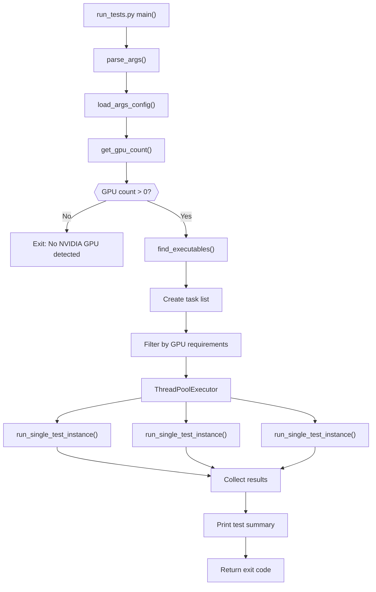
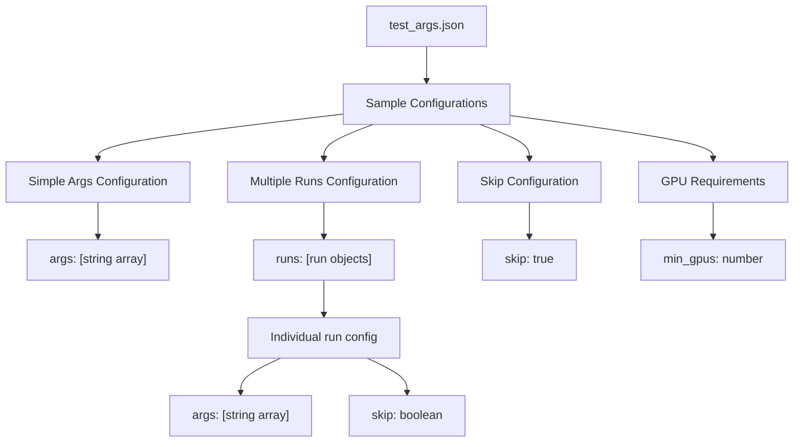
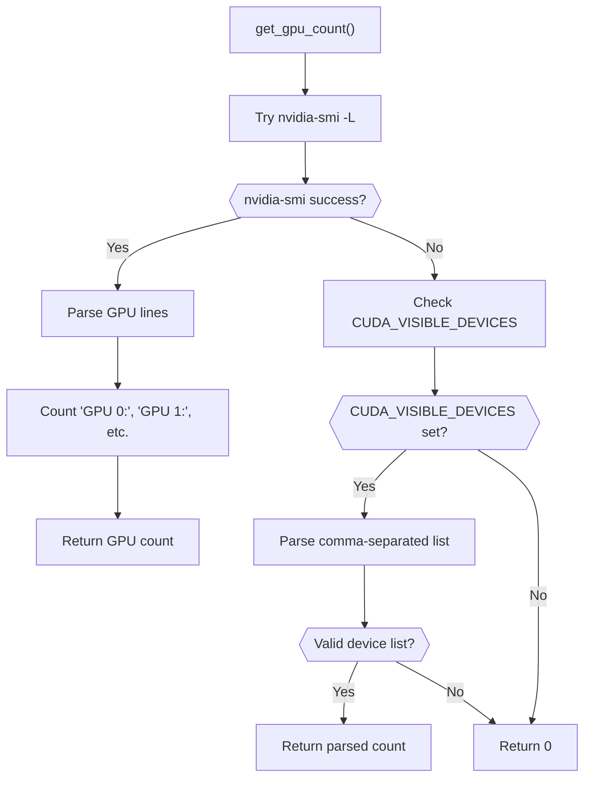
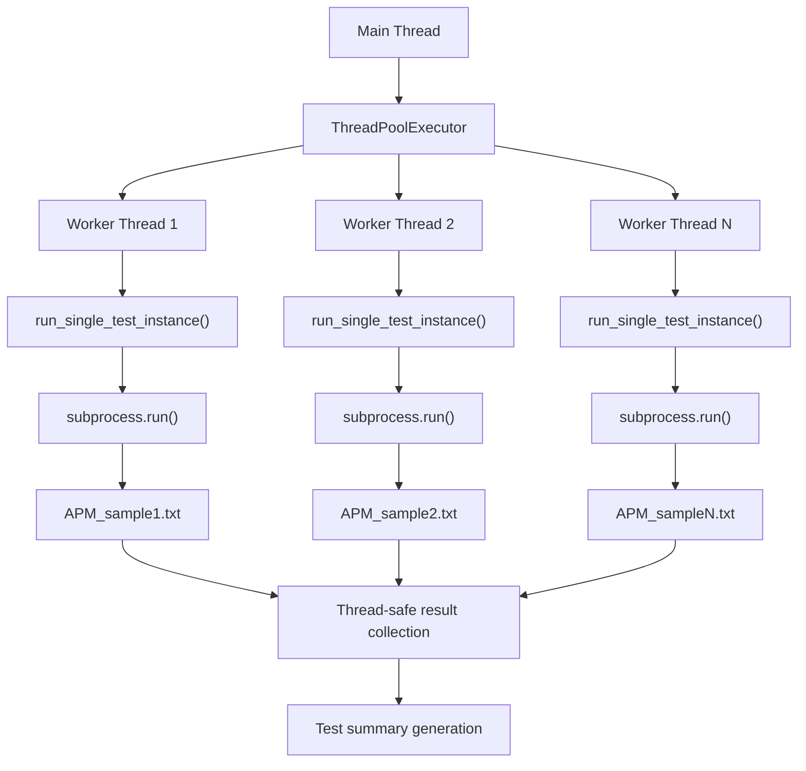
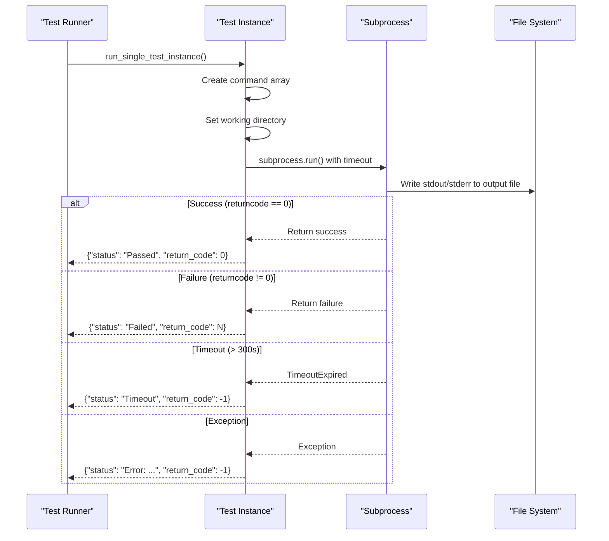
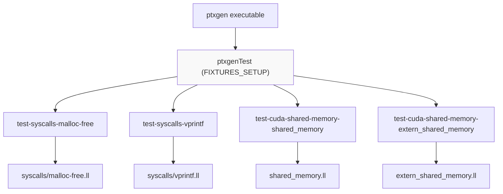
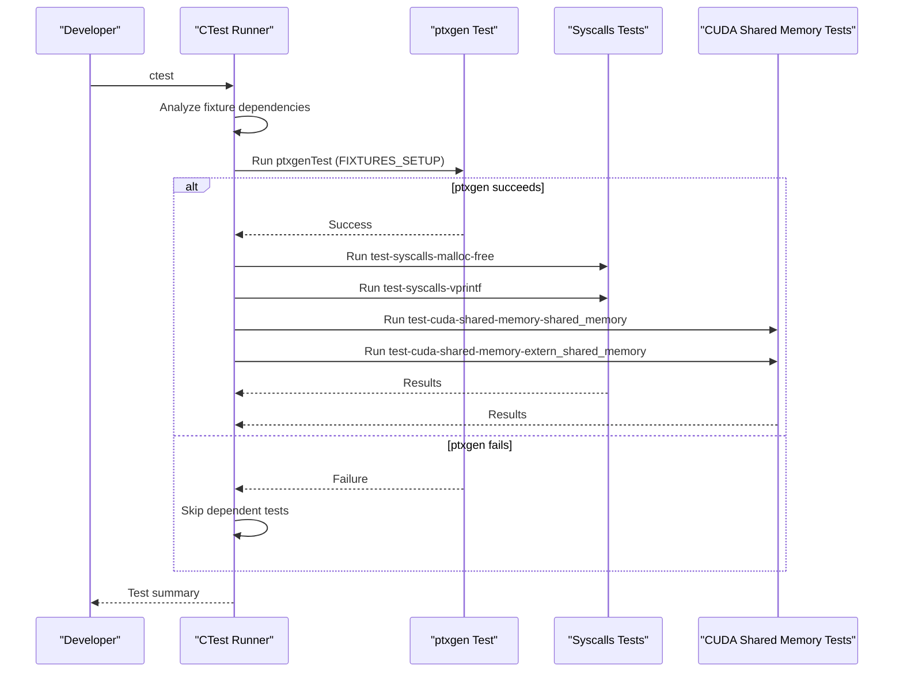

<!-- source: DeepWiki mcp.deepwiki.com · repo NVIDIA/cuda-samples · page 2.3 Testing Infrastructure · fetched 2026-10-26 -->

# Testing Infrastructure

<details>
<summary>Relevant source files</summary>

The following files were used as context for generating this wiki page:

- [.gitignore](.gitignore)
- [.pre-commit-config.yaml](.pre-commit-config.yaml)
- [CMakeLists.txt](CMakeLists.txt)

</details>


The testing infrastructure provides an automated framework for running and validating all CUDA samples in the repository. This system discovers built executables, applies sample-specific configurations, executes tests in parallel, and reports results. The infrastructure handles GPU requirements, timeout management, and output capture to ensure reliable testing across different hardware configurations.

For information about building the samples that this testing system validates, see [Build System](). For details about the individual sample categories being tested, see [Overview]().

## Test Runner Architecture

The testing system centers around the `run_tests.py` script, which orchestrates the entire testing process from executable discovery through result reporting.

### Test Execution Workflow



**Sources:** `run_tests.py` [run_tests.py:165-307]()

### Core Functions and Components

The test runner implements several key functions that handle different aspects of the testing process:

| Function | Purpose | Key Responsibilities |
|----------|---------|---------------------|
| `find_executables()` | Executable Discovery | Recursively searches for executable files, excludes libraries |
| `get_gpu_count()` | Hardware Detection | Uses `nvidia-smi` and `CUDA_VISIBLE_DEVICES` to detect GPU count |
| `load_args_config()` | Configuration Loading | Parses `test_args.json` and validates format |
| `run_single_test_instance()` | Test Execution | Runs individual test with timeout, captures output |
| `normalize_exe_name()` | Name Processing | Normalizes executable names across platforms |

**Sources:** `run_tests.py` [run_tests.py:46-124](), [run_tests.py:126-163]()

## Configuration System

The testing infrastructure uses `test_args.json` to configure how individual samples are executed, including arguments, skip conditions, and GPU requirements.

### Configuration Structure



**Sources:** `test_args.json` [test_args.json:1-347]()

### Configuration Examples

The configuration system supports multiple patterns for different testing scenarios:

**Simple Arguments:**
```json
"simpleTexture3D": {
    "args": ["--file=ref_texture3D.bin"]
}
```

**Multiple Test Runs:**
```json
"recursiveGaussian": {
    "runs": [
        {"args": ["-sigma=10", "-file=data/ref_10.ppm"]},
        {"args": ["-sigma=14", "-file=data/ref_14.ppm"]}
    ]
}
```

**GPU Requirements:**
```json
"simpleP2P": {
    "min_gpus": 2
}
```

**Skip Configuration:**
```json
"simpleCUDA2GL": {
    "skip": true
}
```

**Sources:** `test_args.json` [test_args.json:2-9](), [test_args.json:28-54](), [test_args.json:329-331](), [test_args.json:2-4]()

## GPU Detection and Hardware Requirements

The testing system includes sophisticated GPU detection to ensure samples only run on appropriate hardware configurations.

### GPU Detection Logic



**Sources:** `run_tests.py` [run_tests.py:126-163]()

### Multi-GPU Sample Filtering

The system automatically filters samples based on GPU requirements to prevent execution failures:

| Sample | GPU Requirement | Purpose |
|--------|----------------|---------|
| `simpleP2P` | 2 GPUs | Peer-to-peer memory access |
| `conjugateGradientMultiDeviceCG` | 2 GPUs | Multi-device conjugate gradient |
| `simpleCUFFT_MGPU` | 2 GPUs | Multi-GPU FFT operations |
| `EGLStream_CUDA_CrossGPU` | 2 GPUs | Cross-GPU EGL stream |

**Sources:** `test_args.json` [test_args.json:329-346]()

## Parallel Execution System

The testing infrastructure implements thread-safe parallel execution to efficiently run multiple samples simultaneously.

### Parallel Execution Architecture



**Sources:** `run_tests.py` [run_tests.py:264-290]()

### Thread Safety Implementation

The system implements thread safety through several mechanisms:

```python
print_lock = threading.Lock()

def safe_print(*args, **kwargs):
    """Thread-safe print function"""
    with print_lock:
        print(*args, **kwargs)
```

**Sources:** `run_tests.py` [run_tests.py:39-44]()

## Test Execution and Output Management

Each test instance runs in isolation with comprehensive error handling and output capture.

### Test Instance Execution Flow



**Sources:** `run_tests.py` [run_tests.py:90-124]()

### Output File Naming Convention

The system generates structured output files for each test execution:

| File Pattern | Description | Example |
|-------------|-------------|---------|
| `APM_{executable}.txt` | Single run output | `APM_vectorAdd.txt` |
| `APM_{executable}.run{N}.txt` | Multiple runs output | `APM_recursiveGaussian.run1.txt` |

**Sources:** `run_tests.py` [run_tests.py:247-250]()

## CTest Integration for libNVVM Samples

The libNVVM samples (category 7) use CMake's CTest framework in addition to `run_tests.py` for specialized testing requirements. This dual-system approach handles compilation workflows with fixture dependencies.

### CTest Fixture Architecture

CTest fixtures establish execution order dependencies between tests. The libNVVM samples use this to ensure compilation utilities are available before dependent tests run.

Fixture Dependency Pattern for libNVVM Tests:



**Sources:** `Samples/7_libNVVM/ptxgen/CMakeLists.txt` [Samples/7_libNVVM/ptxgen/CMakeLists.txt:29-32](), `Samples/7_libNVVM/syscalls/CMakeLists.txt` [Samples/7_libNVVM/syscalls/CMakeLists.txt:28-37](), `Samples/7_libNVVM/cuda-shared-memory/CMakeLists.txt` [Samples/7_libNVVM/cuda-shared-memory/CMakeLists.txt:30-40]()

### CTest Configuration in CMakeLists.txt

The libNVVM samples configure CTest fixtures through CMake properties:

**Fixture Setup (`ptxgen`):**
```cmake
add_test(NAME ptxgenTest
   COMMAND ptxgen "${CMAKE_CURRENT_SOURCE_DIR}/test.ll"
   WORKING_DIRECTORY "${CMAKE_CURRENT_BINARY_DIR}")
set_tests_properties(ptxgenTest PROPERTIES FIXTURES_SETUP PTXGENTEST)
```

**Fixture Requirements (dependent tests):**
```cmake
add_test(NAME test-syscalls-malloc-free
    COMMAND "${CMAKE_CURRENT_BINARY_DIR}/../ptxgen/ptxgen" "${CMAKE_CURRENT_SOURCE_DIR}/malloc-free.ll"
    WORKING_DIRECTORY "${CMAKE_CURRENT_BINARY_DIR}")

set_tests_properties(test-syscalls-malloc-free test-syscalls-vprintf
                     PROPERTIES FIXTURES_REQUIRED PTXGENTEST)
```

**Sources:** `Samples/7_libNVVM/ptxgen/CMakeLists.txt` [Samples/7_libNVVM/ptxgen/CMakeLists.txt:29-32](), `Samples/7_libNVVM/syscalls/CMakeLists.txt` [Samples/7_libNVVM/syscalls/CMakeLists.txt:28-37]()

### CTest Execution Model



**Sources:** `Samples/7_libNVVM/CMakeLists.txt` [Samples/7_libNVVM/CMakeLists.txt:30](), `Samples/7_libNVVM/ptxgen/CMakeLists.txt` [Samples/7_libNVVM/ptxgen/CMakeLists.txt:29-32]()

### Relationship Between run_tests.py and CTest

The testing infrastructure provides two complementary testing approaches:

| Testing System | Scope | Execution Method | Configuration |
|---------------|-------|------------------|---------------|
| `run_tests.py` | All samples across categories 0-8 | Python-based parallel execution | `test_args.json` |
| CTest | libNVVM samples (category 7) | CMake test framework with fixtures | `CMakeLists.txt` files |

Both systems validate sample functionality but serve different purposes:
- `run_tests.py` provides uniform testing across all sample categories with flexible configuration.
- CTest enables build-time testing and fixture-based dependency management for compilation workflows.

**Sources:** `run_tests.py` [run_tests.py:1-307](), `Samples/7_libNVVM/CMakeLists.txt` [Samples/7_libNVVM/CMakeLists.txt:1-145]()

## Command Line Interface

The test runner provides a flexible command-line interface for different testing scenarios:

### Available Command Line Options

| Option | Default | Description |
|--------|---------|-------------|
| `--dir` | `.` | Root directory to search for executables |
| `--config` | None | JSON configuration file path |
| `--output` | `.` | Output directory for test results |
| `--parallel` | `1` | Number of parallel tests to run |
| `--args` | None | Global arguments passed to all executables |

**Sources:** `run_tests.py` [run_tests.py:166-174]()

### Usage Examples

```bash
# Basic execution
python run_tests.py

# Custom configuration and output
python run_tests.py --config test_args.json --output test_results

# Parallel execution with global arguments
python run_tests.py --parallel 4 --args --device=0

# Search specific directory
python run_tests.py --dir build/Samples --parallel 8
```

**Sources:** `run_tests.py` [run_tests.py:165-174]()

---

