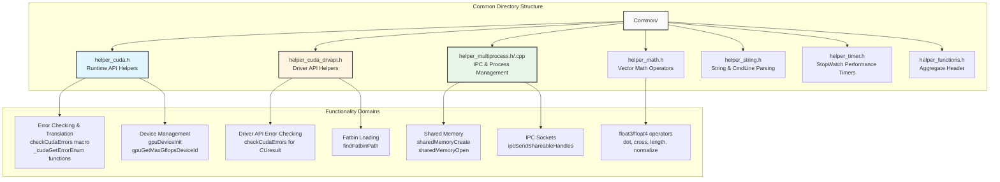

<!-- source: DeepWiki mcp.deepwiki.com · repo NVIDIA/cuda-samples · page 3 Common Utilities and Helper Functions · fetched 2026-10-26 -->

# Common Utilities and Helper Functions

Relevant source files

The following files were used as context for generating this wiki page:

- [Common/helper_cuda.h](Common/helper_cuda.h)
- [Common/helper_cuda_drvapi.h](Common/helper_cuda_drvapi.h)
- [Common/helper_functions.h](Common/helper_functions.h)
- [Common/helper_math.h](Common/helper_math.h)
- [Common/helper_string.h](Common/helper_string.h)
- [Common/helper_timer.h](Common/helper_timer.h)

The `Common/` directory provides a comprehensive set of utility libraries and helper functions used across all CUDA samples. These utilities abstract common CUDA operations, error handling, device management, and inter-process communication, significantly reducing code duplication and improving sample readability.

For information about the build system that compiles these utilities with samples, see [Build System](#2). For details on how samples use these utilities in specific contexts, see individual category pages such as [Introduction Samples (Category 0)](#4) or [Advanced CUDA Features (Category 3)](#5).

## Overview of Common Utilities Architecture

The Common utilities are organized into distinct header files, each targeting a specific CUDA API level or functionality domain. Most headers are header-only implementations, included directly by samples via `#include` statements.

### Common Utilities Organization

**Sources:** [Common/helper_cuda.h:29-32](), [Common/helper_cuda_drvapi.h:28-31](), [Common/helper_multiprocess.h:28-31](), [Common/helper_math.h:28-40](), [Common/helper_timer.h:28-30](), [Common/helper_functions.h:28-31]()

## Runtime API Helpers (helper_cuda.h)

The `helper_cuda.h` header provides high-level abstractions for CUDA Runtime API operations, focusing on error handling, device management, and error string translation across multiple CUDA libraries.

### Error Checking and Translation
The `checkCudaErrors` macro is the primary mechanism for validating API return codes. It utilizes overloaded `_cudaGetErrorEnum` functions to translate library-specific status codes into human-readable strings for the following libraries:
*   **CUDA Runtime & Driver**: `cudaError_t` and `CUresult` [Common/helper_cuda.h:52-66]().
*   **cuBLAS**: `cublasStatus_t` [Common/helper_cuda.h:68-105]().
*   **cuFFT**: `cufftResult`, including new CUDA 13.0+ errors like `CUFFT_NVJITLINK_FAILURE` [Common/helper_cuda.h:107-168]().
*   **cuSPARSE & cuSOLVER**: `cusparseStatus_t` and `cusolverStatus_t` [Common/helper_cuda.h:170-230]().
*   **NPP & nvJPEG**: `NppStatus` and `nvjpegStatus_t` [Common/helper_cuda.h:265-583]().

### Device Management
Functions like `findCudaDevice(int argc, const char **argv)` parse command-line arguments (e.g., `-device=N`) to initialize a specific GPU or automatically select the highest-performance device via `gpuGetMaxGflopsDeviceId()` [Common/helper_cuda.h:809-941]().

For details, see [Runtime API Helpers (helper_cuda.h)](#3.1).

## Driver API Helpers (helper_cuda_drvapi.h)

The `helper_cuda_drvapi.h` header provides parallel functionality to `helper_cuda.h` but for the CUDA Driver API (`cuda.h`).

### Driver API Error Checking
It defines an inline version of `__checkCudaErrors` specifically for `CUresult` types, using `cuGetErrorString` to retrieve error descriptions [Common/helper_cuda_drvapi.h:65-80]().

### SM-to-Cores Mapping
The function `_ConvertSMVer2CoresDRV` maps Streaming Multiprocessor (SM) versions to CUDA core counts. It supports architectures from Kepler (SM 3.0) to Blackwell (SM 12.x) [Common/helper_cuda_drvapi.h:91-143]().

For details, see [Driver API Helpers (helper_cuda_drvapi.h)](#3.2).

## Multi-Process and IPC Utilities

The `helper_multiprocess.h` and `helper_multiprocess.cpp` files provide cross-platform abstractions for inter-process communication and shared memory management.

### Shared Memory and Process Spawning
*   **Shared Memory**: Abstracted via `sharedMemoryCreate` and `sharedMemoryOpen`, using `shm_open` on Unix and `CreateFileMapping` on Windows [Common/helper_multiprocess.cpp:32-119]().
*   **Process Management**: `spawnProcess` and `waitProcess` provide a unified interface for `fork/exec` (Unix) and `CreateProcess` (Windows) [Common/helper_multiprocess.cpp:121-169]().

### IPC Sockets
The library implements `ipcSendShareableHandles` and `ipcRecvShareableHandles` to exchange CUDA memory handles between processes. It uses Unix Domain Sockets with `SCM_RIGHTS` on Linux/QNX and Mailslots with `DuplicateHandle` on Windows [Common/helper_multiprocess.cpp:171-560]().

For details, see [Multi-Process and IPC Utilities](#3.3).

## Graphics, Math, and NPP Utility Headers

Additional headers in `Common/` provide specialized support for graphics interoperability, mathematical operations, and image processing.

### Mathematical Utilities
*   **helper_math.h**: Implements common mathematical operations (dot, cross, length, lerp) for CUDA vector types like `float3` and `float4`, modeled after the Cg standard library [Common/helper_math.h:28-37]().
*   **nvMath.h / nvMatrix.h**: Provide more complex matrix and quaternion math for graphics-heavy samples.

### Performance and String Utilities
*   **helper_timer.h**: Defines the `StopWatchInterface` and platform-specific implementations (`StopWatchWin`, `StopWatchLinux`) for high-precision performance measurement [Common/helper_timer.h:44-155]().
*   **helper_string.h**: Contains string parsing utilities like `checkCmdLineFlag` and `getCmdLineArgumentInt` used by almost every sample to process user input [Common/helper_string.h:127-210]().

For details, see [Graphics and NPP Utility Headers](#3.4).

**Sources:** [Common/helper_math.h:28-37](), [Common/helper_timer.h:44-155](), [Common/helper_string.h:127-210](), [Common/helper_functions.h:51-53]()

---

