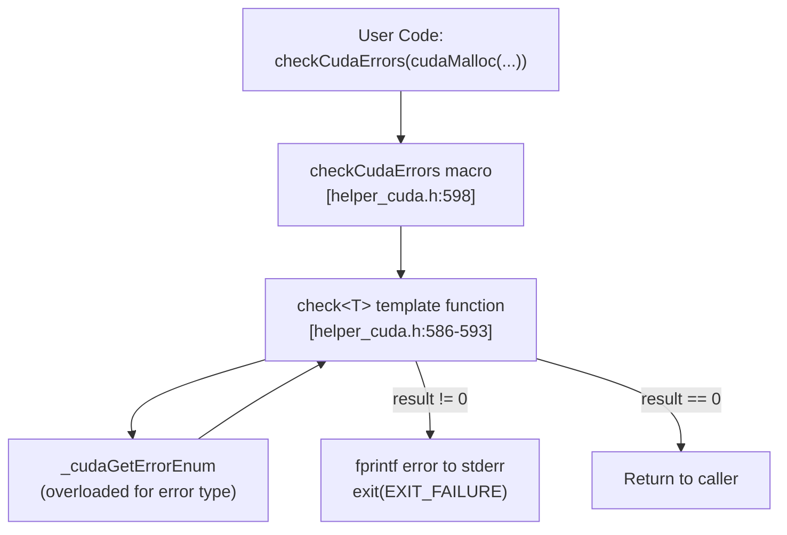
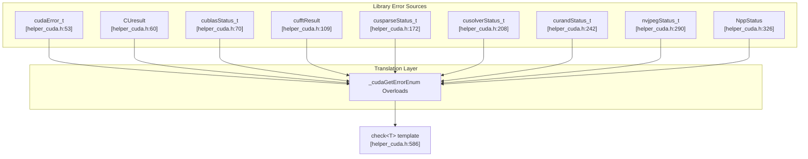
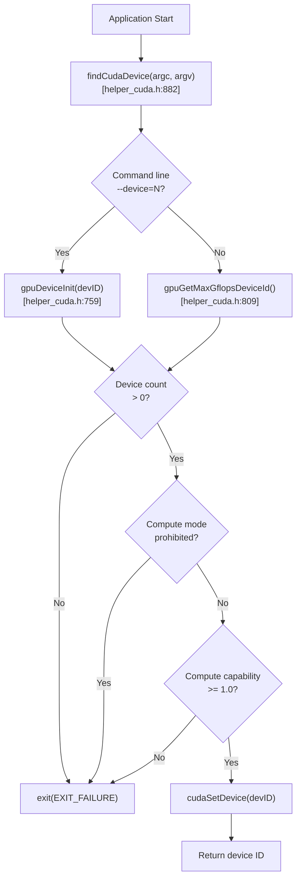

<!-- source: DeepWiki mcp.deepwiki.com · repo NVIDIA/cuda-samples · page 3.1 Runtime API Helpers (helper_cuda.h) · fetched 2026-10-26 -->

# Runtime API Helpers (helper_cuda.h)

Relevant source files

The following files were used as context for generating this wiki page:

- [Common/helper_cuda.h](Common/helper_cuda.h)
- [Common/helper_functions.h](Common/helper_functions.h)
- [Common/helper_image.h](Common/helper_image.h)
- [Common/helper_math.h](Common/helper_math.h)
- [Common/helper_string.h](Common/helper_string.h)
- [Common/helper_timer.h](Common/helper_timer.h)

## Purpose and Scope

This document describes the Runtime API helper utilities provided by [Common/helper_cuda.h:1-988](). These helpers provide high-level abstractions for CUDA Runtime API operations, including comprehensive error checking, device initialization, and error string translation across multiple CUDA libraries. This header is used by most samples in the repository that utilize the CUDA Runtime API.

For Driver API equivalents, see **3.2 Driver API Helpers (helper_cuda_drvapi.h)**. For multi-process and IPC utilities, see **3.3 Multi-Process and IPC Utilities**.

## Overview

The `helper_cuda.h` header provides three primary categories of functionality:

| Category | Key Functions/Macros | Purpose |
|----------|---------------------|---------|
| **Error Handling** | `checkCudaErrors`, `getLastCudaError`, `printLastCudaError` | Automatic error checking with file/line reporting. |
| **Device Management** | `gpuDeviceInit`, `findCudaDevice`, `gpuGetMaxGflopsDeviceId` | Device initialization and selection. |
| **Error Translation** | `_cudaGetErrorEnum` (overloaded) | Convert error codes to human-readable strings. |
| **SM Utilities** | `_ConvertSMVer2Cores`, `_ConvertSMVer2ArchName` | Map SM versions to cores/architecture names. |

**Sources:** [Common/helper_cuda.h:28-32](), [Common/helper_cuda.h:586-633]()

## Error Handling System

### Error Checking Macros

The header defines three primary macros for error handling. These macros bridge the gap between CUDA API return codes and human-readable diagnostic output.

**Diagram: Error Handling Macro Flow**

**Sources:** [Common/helper_cuda.h:586-598]()

#### checkCudaErrors
Defined at [Common/helper_cuda.h:598](), this macro wraps any CUDA Runtime API call and automatically checks the return value. It captures the function call as a string using stringification (`#val`) and passes the file and line number for error reporting.

#### getLastCudaError
Defined at [Common/helper_cuda.h:601](), this macro checks for asynchronous errors after kernel launches by calling `cudaGetLastError()`. This is critical since kernel launches return `void` and do not provide immediate error codes.

#### printLastCudaError
Defined at [Common/helper_cuda.h:619](), this is a non-fatal variant that prints errors to `stderr` but does not exit the application, allowing for recovery or logging.

**Sources:** [Common/helper_cuda.h:595-633]()

## Error String Translation

The header provides overloaded `_cudaGetErrorEnum` functions to translate error codes from multiple CUDA libraries into human-readable strings. Each library has conditional compilation based on its specific header guard.

**Diagram: Error String Translation Architecture**

**Sources:** [Common/helper_cuda.h:52-583]()

### Library Error Code Coverage

| Library | Header Guard | Error Type | Lines | Translation Method |
|---------|-------------|------------|-------|--------------------|
| **CUDA Runtime** | `__DRIVER_TYPES_H__` | `cudaError_t` | 53-55 | `cudaGetErrorName()` |
| **CUDA Driver** | `CUDA_DRIVER_API` | `CUresult` | 60-65 | `cuGetErrorName()` |
| **cuBLAS** | `CUBLAS_API_H_` | `cublasStatus_t` | 70-104 | Switch statement |
| **cuFFT** | `_CUFFT_H_` | `cufftResult` | 109-167 | Switch statement |
| **cuSPARSE** | `CUSPARSEAPI` | `cusparseStatus_t` | 172-203 | Switch statement |
| **cuSOLVER** | `CUSOLVER_COMMON_H_` | `cusolverStatus_t` | 208-237 | Switch statement |
| **cuRAND** | `CURAND_H_` | `curandStatus_t` | 242-285 | Switch statement |
| **nvJPEG** | `NVJPEGAPI` | `nvjpegStatus_t` | 290-321 | Switch statement |
| **NPP** | `NV_NPPIDEFS_H` | `NppStatus` | 326-582 | Extensive switch |

**Sources:** [Common/helper_cuda.h:52-583]()

## Device Management Functions

The header provides functions for GPU device initialization and selection based on command-line arguments or performance metrics.

**Diagram: Device Selection and Initialization Flow**

**Sources:** [Common/helper_cuda.h:757-913]()

### Key Functions

*   **`gpuDeviceInit(int devID)`**: Validates the device count, checks if the compute mode is prohibited, and ensures compute capability is at least 1.0 before calling `cudaSetDevice(devID)` [Common/helper_cuda.h:759-806]().
*   **`gpuGetMaxGflopsDeviceId()`**: Iterates through all available devices and selects the one with the highest theoretical GFLOPS based on `multiProcessorCount * sm_per_multiproc * clockRate` [Common/helper_cuda.h:809-879]().
*   **`findCudaDevice(int argc, const char **argv)`**: The primary entry point for samples. It parses `--device=N` using `checkCmdLineFlag` from `helper_string.h` [Common/helper_string.h:127-151](). If no flag is present, it defaults to the highest performance device [Common/helper_cuda.h:882-913]().

**Sources:** [Common/helper_cuda.h:759-913](), [Common/helper_string.h:127-151]()

## SM Version Utility Functions

These utilities map hardware compute capability (major/minor version) to architecture names and physical core counts.

### _ConvertSMVer2Cores
Maps SM versions to core counts per SM. For example, SM 8.0 (Ampere) has 64 cores per SM, while SM 8.6/8.9 (Ampere/Ada) has 128 [Common/helper_cuda.h:646-699]().

### _ConvertSMVer2ArchName
Maps SM versions to marketing names (e.g., SM 9.0 is "Hopper", SM 7.5 is "Turing") [Common/helper_cuda.h:701-754]().

**Sources:** [Common/helper_cuda.h:646-754]()

## Image and Math Helpers

While `helper_cuda.h` focuses on the API, other headers in the `Common/` directory provide domain-specific support:

*   **`helper_image.h`**: Provides `sdkLoadPGM` and `__loadPPM` for reading image data into buffers [Common/helper_image.h:136-214]().
*   **`helper_math.h`**: Implements standard math operations for CUDA vector types (`float2`, `float3`, `make_float4`, etc.) which are not provided by the default CUDA headers [Common/helper_math.h:88-252]().
*   **`helper_timer.h`**: Defines the `StopWatchInterface` and `StopWatchWin`/`StopWatchLinux` classes for high-resolution performance measurement [Common/helper_timer.h:44-155]().

**Sources:** [Common/helper_image.h:136-214](), [Common/helper_math.h:88-252](), [Common/helper_timer.h:44-155]()

---

