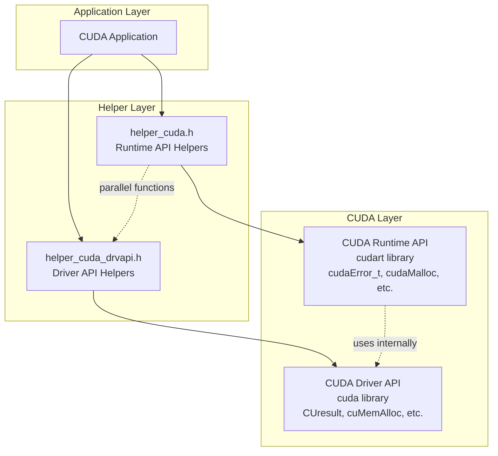
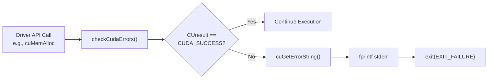
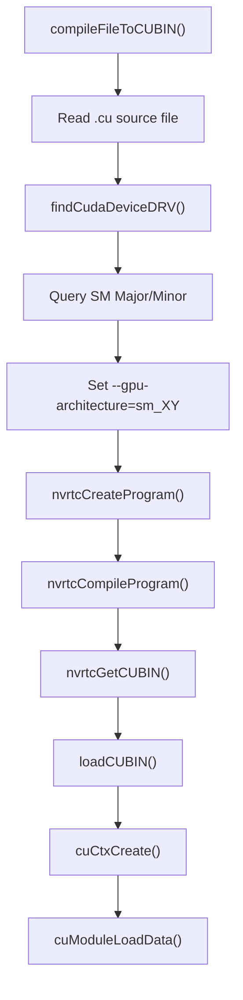

<!-- source: DeepWiki mcp.deepwiki.com · repo NVIDIA/cuda-samples · page 3.2 Driver API Helpers (helper_cuda_drvapi.h) · fetched 2026-10-26 -->

# Driver API Helpers (helper_cuda_drvapi.h)

<details>
<summary>Relevant source files</summary>

The following files were used as context for generating this wiki page:

- [Common/drvapi_error_string.h](Common/drvapi_error_string.h)
- [Common/helper_cuda_drvapi.h](Common/helper_cuda_drvapi.h)
- [Common/helper_cusolver.h](Common/helper_cusolver.h)
- [Common/nvrtc_helper.h](Common/nvrtc_helper.h)

</details>


## Purpose and Scope

This document describes the CUDA Driver API helper utilities provided in [Common/helper_cuda_drvapi.h](). These helpers provide low-level device management, error checking, and module loading functions for applications using the CUDA Driver API (`cuda.h`) rather than the CUDA Runtime API. For Runtime API equivalents, see [Runtime API Helpers (helper_cuda.h)](#3.1).

## Overview

The Driver API helpers provide parallel functionality to the Runtime API helpers but operate on Driver API types (`CUresult`, `CUdevice`, `CUcontext`, `CUmodule`) rather than Runtime API types (`cudaError_t`, device integers). These helpers are essential for samples using explicit Driver API control, including samples that use JIT compilation, dynamic loading, or require fine-grained context management.

### Comparison with Runtime API Helpers



**Key Equivalents:**

| Runtime API Helper | Driver API Helper | Primary Type |
|-------------------|-------------------|--------------|
| `gpuDeviceInit()` | `gpuDeviceInitDRV()` | `int` vs `CUdevice` |
| `gpuGetMaxGflopsDeviceId()` | `gpuGetMaxGflopsDeviceIdDRV()` | `int` vs `CUdevice` |
| `findCudaDevice()` | `findCudaDeviceDRV()` | `int` vs `CUdevice` |
| `checkCudaErrors(cudaError_t)` | `checkCudaErrors(CUresult)` | Error enum types |
| `_ConvertSMVer2Cores()` | `_ConvertSMVer2CoresDRV()` | Same algorithm |

**Sources:** [Common/helper_cuda_drvapi.h:46-88](), [Common/helper_cuda_drvapi.h:91-143]()

## Error Handling

### checkCudaErrors Macro

The `checkCudaErrors` macro provides automatic error checking for all Driver API calls with file and line information. It is guarded by `#ifdef __cuda_cuda_h__` to ensure it is only used when the Driver API is available [Common/helper_cuda_drvapi.h:62]().



**Implementation:**
[Common/helper_cuda_drvapi.h:65-79]() defines the core error checking function:

```cpp
#define checkCudaErrors(err) __checkCudaErrors(err, __FILE__, __LINE__)

inline void __checkCudaErrors(CUresult err, const char *file, const int line) {
  if (CUDA_SUCCESS != err) {
    const char *errorStr = NULL;
    cuGetErrorString(err, &errorStr);
    fprintf(stderr,
            "checkCudaErrors() Driver API error = %04d \"%s\" from file <%s>, "
            "line %i.\n",
            err, errorStr, file, line);
    exit(EXIT_FAILURE);
  }
}
```

For manual error string lookup, the library also provides `drvapi_error_string.h`, which contains a comprehensive mapping of `CUresult` codes to strings, such as `CUDA_ERROR_OUT_OF_MEMORY` [Common/drvapi_error_string.h:64]().

**Sources:** [Common/helper_cuda_drvapi.h:65-79](), [Common/drvapi_error_string.h:46-203]()

## Device Initialization and Selection

### gpuDeviceInitDRV Function

[Common/helper_cuda_drvapi.h:148-197]() initializes a specific CUDA device using the Driver API. It parses command line arguments to allow users to target specific GPUs.

**Key Operations:**
1. **Initialize Driver**: Calls `cuInit(0)` [Common/helper_cuda_drvapi.h:151]().
2. **Count Devices**: Calls `cuDeviceGetCount(&deviceCount)` [Common/helper_cuda_drvapi.h:153]().
3. **Parse Arguments**: Searches for `device=` in command line using `getCmdLineArgumentInt` [Common/helper_cuda_drvapi.h:161]().
4. **Retrieve Handle**: Obtains the `CUdevice` handle via `cuDeviceGet(&cuDevice, dev)` [Common/helper_cuda_drvapi.h:178]().
5. **Verify Mode**: Checks if the device is in `CU_COMPUTEMODE_PROHIBITED` [Common/helper_cuda_drvapi.h:185]().

**Sources:** [Common/helper_cuda_drvapi.h:148-197]()

### gpuGetMaxGflopsDeviceIdDRV Function

[Common/helper_cuda_drvapi.h:200-269]() selects the highest-performance device based on GFLOPS computation.

**Performance Calculation Logic:**
The function queries device attributes using `cuDeviceGetAttribute` for `CU_DEVICE_ATTRIBUTE_MULTIPROCESSOR_COUNT` and `CU_DEVICE_ATTRIBUTE_CLOCK_RATE` [Common/helper_cuda_drvapi.h:208-209](). It then calculates theoretical performance:
`compute_perf = multiProcessorCount * cores_per_sm * clockRate`.

**Sources:** [Common/helper_cuda_drvapi.h:200-269]()

## Architecture and Core Counting

### SM Version to Cores Conversion

The `_ConvertSMVer2CoresDRV()` function maps GPU architecture (SM version) to CUDA core counts per streaming multiprocessor (SM).

[Common/helper_cuda_drvapi.h:91-143]() defines the mapping table:

| SM Version (Hex) | Architecture | Cores per SM |
|------------------|--------------|--------------|
| 0x30-0x37        | Kepler       | 192          |
| 0x50-0x53        | Maxwell      | 128          |
| 0x60             | Pascal GP100 | 64           |
| 0x61-0x62        | Pascal       | 128          |
| 0x70, 0x72, 0x75 | Volta/Turing | 64           |
| 0x80             | Ampere A100  | 64           |
| 0x86-0x90        | Ampere/Hopper| 128          |
| 0xa0-0xc1        | Blackwell    | 128          |

**Sources:** [Common/helper_cuda_drvapi.h:91-143]()

### getCudaAttribute Template

[Common/helper_cuda_drvapi.h:83-87]() provides a type-safe wrapper for device attribute queries:

```cpp
template <class T>
inline void getCudaAttribute(T *attribute, CUdevice_attribute device_attribute,
                             int device) {
  checkCudaErrors(cuDeviceGetAttribute(attribute, device_attribute, device));
}
```

**Sources:** [Common/helper_cuda_drvapi.h:83-87]()

## Fatbin and Module Loading

### NVRTC Compilation Helpers

For samples using Just-In-Time (JIT) compilation, `nvrtc_helper.h` provides utilities to compile `.cu` source files into CUBIN format at runtime.



**Key Functions:**
- `compileFileToCUBIN`: Reads a file, determines the current GPU's architecture, and invokes `nvrtcCompileProgram` with the correct `sm_` flag [Common/nvrtc_helper.h:50-183]().
- `loadCUBIN`: Creates a CUDA context if none exists and loads the compiled CUBIN data into a `CUmodule` using `cuModuleLoadData` [Common/nvrtc_helper.h:185-217]().

**Sources:** [Common/nvrtc_helper.h:50-217]()

### findFatbinPath Utility

[Common/helper_cuda_drvapi.h:379-409]() locates and loads pre-compiled fatbin or PTX files from the SDK file system.

**Behavior:**
1. Searches for the file using `sdkFindFilePath` [Common/helper_cuda_drvapi.h:383]().
2. If the file is a `.fatbin`, it reads the binary content into a `std::ostringstream` [Common/helper_cuda_drvapi.h:395-401]().
3. Returns the path and the loaded content for use with `cuModuleLoadData`.

**Sources:** [Common/helper_cuda_drvapi.h:379-409]()

## Mathematical and Library Helpers

### cusolver and CSR Helpers

The `helper_cusolver.h` header provides utility functions for matrix norm calculations and display, often used in conjunction with the Driver API in linear algebra samples.

**Implementation Highlights:**
- `vec_norminf`: Calculates the infinity norm of a vector [Common/helper_cusolver.h:49-56]().
- `mat_norminf`: Calculates the infinity norm of a dense matrix [Common/helper_cusolver.h:61-72]().
- `csr_mat_norminf`: Calculates the infinity norm for a Compressed Sparse Row (CSR) matrix [Common/helper_cusolver.h:77-96]().
- `second()`: A high-resolution timer implementation for performance benchmarking on Windows, Linux, and macOS [Common/helper_cusolver.h:122-164]().

**Sources:** [Common/helper_cusolver.h:49-164]()

---

