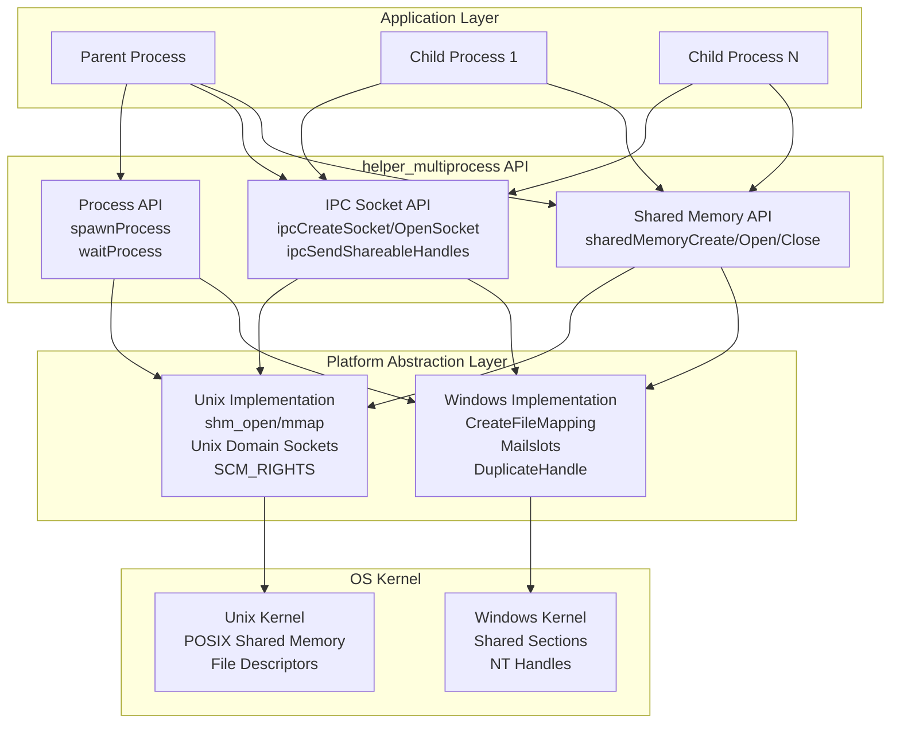
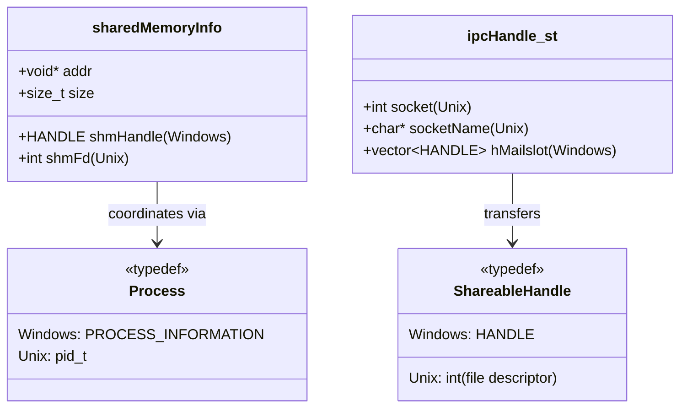
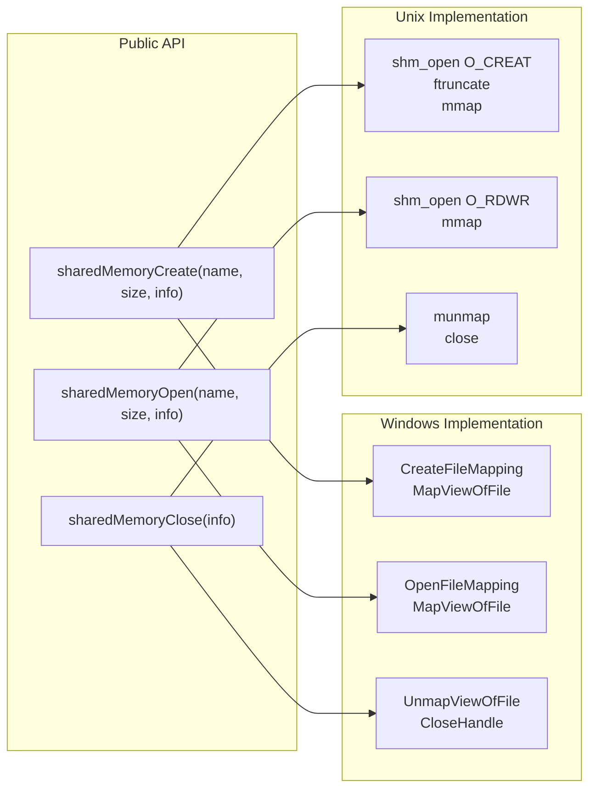
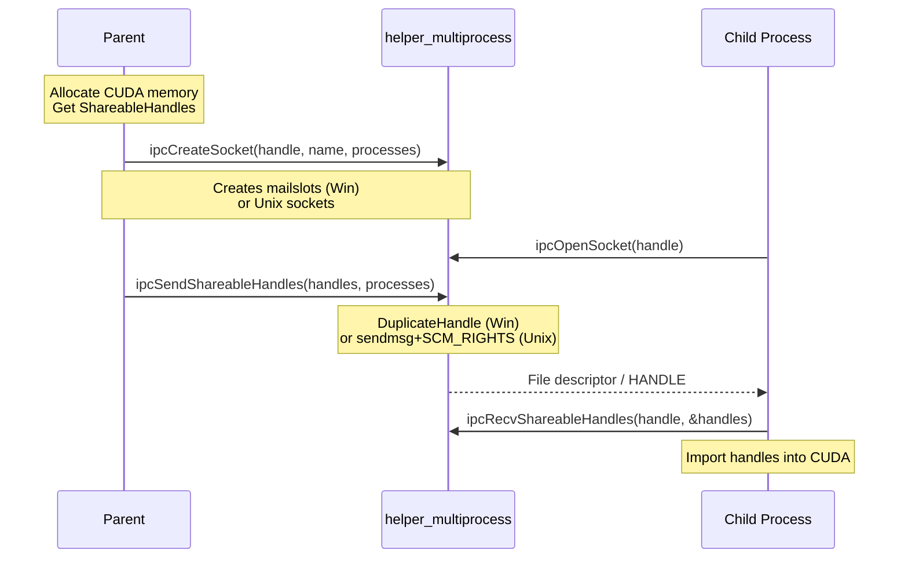

<!-- source: DeepWiki mcp.deepwiki.com · repo NVIDIA/cuda-samples · page 3.3 Multi-Process and IPC Utilities · fetched 2026-10-26 -->

# Multi-Process and IPC Utilities

<details>
<summary>Relevant source files</summary>

The following files were used as context for generating this wiki page:

- [Common/helper_multiprocess.cpp](Common/helper_multiprocess.cpp)
- [Common/helper_multiprocess.h](Common/helper_multiprocess.h)
- [Common/multithreading.cpp](Common/multithreading.cpp)
- [Common/multithreading.h](Common/multithreading.h)

</details>


## Purpose and Scope

This page documents the cross-platform inter-process communication (IPC) utilities provided by [Common/helper_multiprocess.h:1-141]() and [Common/helper_multiprocess.cpp:1-561](). These utilities abstract platform differences between Windows and Unix-like systems (Linux, QNX) to enable multi-process CUDA applications.

The helper_multiprocess system provides three core capabilities:
1. **Shared memory** creation and access for CPU-side coordination between processes.
2. **IPC socket communication** for transferring CUDA shareable handles (file descriptors on Unix, NT `HANDLE`s on Windows) between processes.
3. **Process spawning and synchronization** for launching and managing child processes.

For multithreaded (single-process) coordination, the repository also provides a portable thread library in [Common/multithreading.h:1-77]() and [Common/multithreading.cpp:1-79]().

---

## Architecture Overview

### System Components and Data Flow



**Sources:** [Common/helper_multiprocess.h:1-141](), [Common/helper_multiprocess.cpp:1-170]()

---

## Core Data Structures

### Shared Memory and IPC Handles

The `sharedMemoryInfo` structure and `ipcHandle` type store platform-specific identifiers for shared resources:



| Structure | Platform | Purpose |
|-----------|----------|---------|
| `sharedMemoryInfo` | Cross-platform | Stores mapped address, size, and platform handle [Common/helper_multiprocess.h:78-86]() |
| `Process` | Windows: `PROCESS_INFORMATION`<br/>Unix: `pid_t` | Represents spawned process [Common/helper_multiprocess.h:95-99]() |
| `ipcHandle` | Cross-platform | Socket/mailslot handle for IPC communication [Common/helper_multiprocess.h:109-121]() |
| `ShareableHandle` | Windows: `HANDLE`<br/>Unix: `int` | Transferable CUDA memory handle [Common/helper_multiprocess.h:113-118]() |

**Sources:** [Common/helper_multiprocess.h:78-141]()

---

## Shared Memory API

### Function Signatures and Platform Mappings



### API Details

| Function | Parameters | Windows Implementation | Unix Implementation |
|----------|-----------|----------------------|-------------------|
| `sharedMemoryCreate` | `name`, `sz`, `info*` | [Common/helper_multiprocess.cpp:35-41]() `CreateFileMapping` + `MapViewOfFile` | [Common/helper_multiprocess.cpp:52-62]() `shm_open` + `ftruncate` + `mmap` |
| `sharedMemoryOpen` | `name`, `sz`, `info*` | [Common/helper_multiprocess.cpp:75-80]() `OpenFileMapping` + `MapViewOfFile` | [Common/helper_multiprocess.cpp:89-94]() `shm_open` + `mmap` |
| `sharedMemoryClose` | `info*` | [Common/helper_multiprocess.cpp:104-110]() `UnmapViewOfFile` + `CloseHandle` | [Common/helper_multiprocess.cpp:112-117]() `munmap` + `close` |

**Sources:** [Common/helper_multiprocess.cpp:32-119]()

---

## IPC Socket Communication

### Socket Creation and Handle Transfer Flow



### Platform-Specific Implementations

#### Unix: Unix Domain Sockets with SCM_RIGHTS
Unix implementations use datagram sockets (`SOCK_DGRAM`) in the `AF_UNIX` domain.

| Function | Implementation Details | Lines |
|----------|----------------------|-------|
| `ipcCreateSocket` | Creates socket, binds to path in temp directory, unlinks existing path | [Common/helper_multiprocess.cpp:172-214]() |
| `ipcOpenSocket` | Creates client socket, binds to unique path using `getpid()` | [Common/helper_multiprocess.cpp:216-245]() |
| `getSocketFolder` | QNX: `/storage`, Linux: `$TMPDIR` or `/tmp` | [Common/helper_multiprocess.h:58-76]() |

#### Windows: Mailslots and Handle Duplication
Windows uses Mailslots for data transfer and `DuplicateHandle` for resource sharing.

| Function | Implementation Details | Lines |
|----------|----------------------|-------|
| `ipcCreateSocket` | Prepares a vector of `HANDLE`s for mailslots | [Common/helper_multiprocess.h:116]() |
| `ipcSendShareableHandles` | Uses `DuplicateHandle` to clone the resource handle into the child process's handle table | [Common/helper_multiprocess.h:136]() |

**Sources:** [Common/helper_multiprocess.h:58-141](), [Common/helper_multiprocess.cpp:172-245]()

---

## Process and Thread Management

### Process Spawning

The `spawnProcess` and `waitProcess` functions abstract the platform-specific process lifecycle.

| Function | Windows Implementation | Unix Implementation |
|----------|----------------------|-------------------|
| `spawnProcess` | [Common/helper_multiprocess.cpp:123-138]() `CreateProcess` with concatenated argument string | [Common/helper_multiprocess.cpp:140-148]() `fork()` followed by `execvp()` |
| `waitProcess` | [Common/helper_multiprocess.cpp:153-159]() `WaitForSingleObject` + `GetExitCodeProcess` | [Common/helper_multiprocess.cpp:161-168]() `waitpid()` loop until `WIFEXITED` |

### Multithreading Utility

A simple portable thread library is provided in `multithreading.h` for intra-process concurrency.

| Function | Windows Implementation | POSIX Implementation |
|----------|----------------------|----------------------|
| `cutStartThread` | [Common/multithreading.cpp:32-34]() `CreateThread` | [Common/multithreading.cpp:59-63]() `pthread_create` |
| `cutEndThread` | [Common/multithreading.cpp:37-40]() `WaitForSingleObject` + `CloseHandle` | [Common/multithreading.cpp:66]() `pthread_join` |
| `cutDestroyThread` | [Common/multithreading.cpp:43-46]() `TerminateThread` | [Common/multithreading.cpp:69]() `pthread_cancel` |

**Sources:** [Common/helper_multiprocess.cpp:121-169](), [Common/multithreading.cpp:1-79](), [Common/multithreading.h:35-76]()

---

## Error Handling

The library uses the `checkIpcErrors` macro to handle failures in IPC calls.

```cpp
#define checkIpcErrors(ipcFuncResult) \
    if (ipcFuncResult == -1) { fprintf(stderr, "Failure at %u %s\n", __LINE__, __FILE__); exit(EXIT_FAILURE); }
```

**Sources:** [Common/helper_multiprocess.h:105-106]()

---

