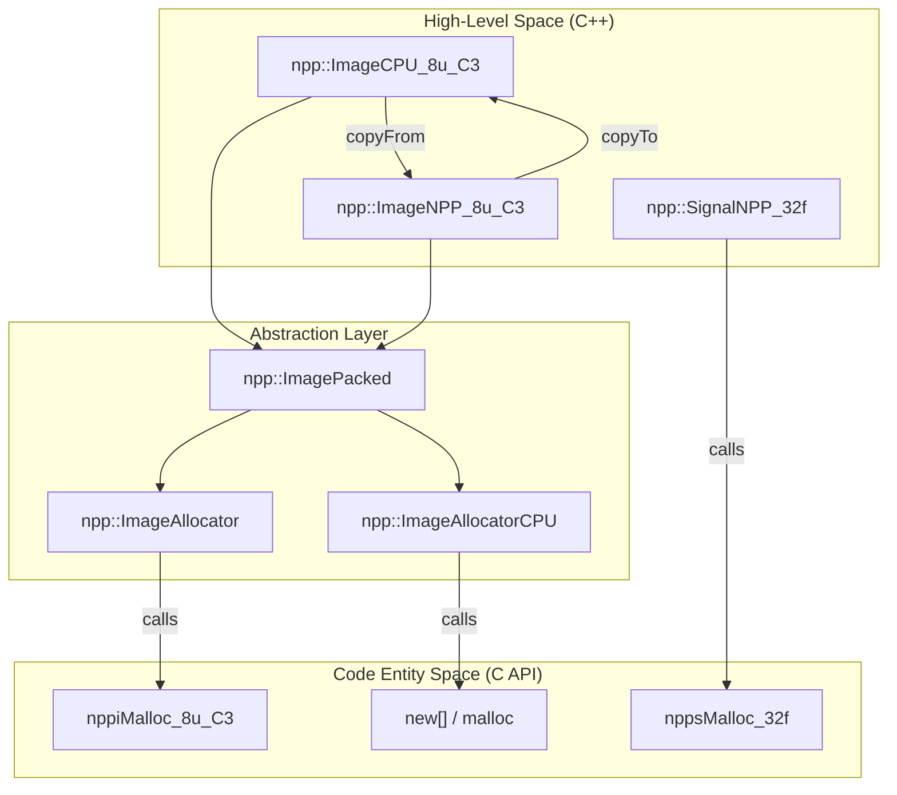
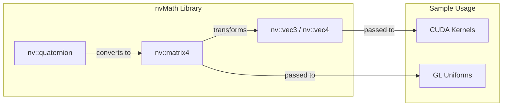

<!-- source: DeepWiki mcp.deepwiki.com · repo NVIDIA/cuda-samples · page 3.4 Graphics and NPP Utility Headers · fetched 2026-10-26 -->

# Graphics and NPP Utility Headers

Relevant source files

The following files were used as context for generating this wiki page:

- [Common/UtilNPP/Exceptions.h](Common/UtilNPP/Exceptions.h)
- [Common/UtilNPP/Image.h](Common/UtilNPP/Image.h)
- [Common/UtilNPP/ImageAllocatorsCPU.h](Common/UtilNPP/ImageAllocatorsCPU.h)
- [Common/UtilNPP/ImageAllocatorsNPP.h](Common/UtilNPP/ImageAllocatorsNPP.h)
- [Common/UtilNPP/ImageIO.h](Common/UtilNPP/ImageIO.h)
- [Common/UtilNPP/ImagePacked.h](Common/UtilNPP/ImagePacked.h)
- [Common/UtilNPP/ImagesCPU.h](Common/UtilNPP/ImagesCPU.h)
- [Common/UtilNPP/ImagesNPP.h](Common/UtilNPP/ImagesNPP.h)
- [Common/UtilNPP/Pixel.h](Common/UtilNPP/Pixel.h)
- [Common/UtilNPP/Signal.h](Common/UtilNPP/Signal.h)
- [Common/UtilNPP/SignalAllocatorsCPU.h](Common/UtilNPP/SignalAllocatorsCPU.h)
- [Common/UtilNPP/SignalAllocatorsNPP.h](Common/UtilNPP/SignalAllocatorsNPP.h)
- [Common/UtilNPP/SignalsCPU.h](Common/UtilNPP/SignalsCPU.h)
- [Common/UtilNPP/SignalsNPP.h](Common/UtilNPP/SignalsNPP.h)
- [Common/dynlink_d3d11.h](Common/dynlink_d3d11.h)
- [Common/exception.h](Common/exception.h)
- [Common/helper_gl.h](Common/helper_gl.h)
- [Common/helper_nvJPEG.hxx](Common/helper_nvJPEG.hxx)
- [Common/nvMath.h](Common/nvMath.h)
- [Common/nvMatrix.h](Common/nvMatrix.h)
- [Common/nvQuaternion.h](Common/nvQuaternion.h)
- [Common/nvShaderUtils.h](Common/nvShaderUtils.h)
- [Common/nvVector.h](Common/nvVector.h)
- [Common/param.h](Common/param.h)
- [Common/paramgl.h](Common/paramgl.h)
- [Common/rendercheck_d3d11.cpp](Common/rendercheck_d3d11.cpp)
- [Common/rendercheck_d3d11.h](Common/rendercheck_d3d11.h)
- [Common/rendercheck_gl.h](Common/rendercheck_gl.h)
- [Common/rendercheck_gles.h](Common/rendercheck_gles.h)

This page documents the shared utility headers and helper libraries provided in the `Common/` directory for graphics API interoperability (OpenGL, D3D11), NVIDIA Performance Primitives (NPP) wrappers, mathematical operations, and shader management. These utilities abstract platform-specific complexities and provide common data structures used across the CUDA Samples repository.

## NPP Utility Library (UtilNPP)

The `UtilNPP` directory provides a C++ object-oriented wrapper around the NVIDIA Performance Primitives (NPP) library. It simplifies memory management, image/signal I/O, and provides type-safe abstractions for NPP data types.

### Image and Signal Abstractions
The library uses a template-based architecture to handle different data types (e.g., `Npp8u`, `Npp32f`) and channel counts.

*   **`npp::Image`**: A base class providing dimensions (`width`, `height`) and `Size` structures [Common/UtilNPP/Image.h:36-138]().
*   **`npp::ImagePacked`**: Inherits from `Image`, adding a pixel array and pitch management. It uses an allocator policy `A` to handle memory [Common/UtilNPP/ImagePacked.h:36-166]().
*   **`npp::Pixel`**: A template structure representing 1, 2, 3, or 4-channel pixels with `operator[]` access [Common/UtilNPP/Pixel.h:34-124]().
*   **`npp::Signal`**: A 1D equivalent of the image class for signal processing [Common/UtilNPP/Signal.h:36-78]().

### Memory Management and Allocators
Memory allocation is decoupled from data structures via allocator classes, allowing the same image class to represent both CPU-side and GPU-side data.

| Allocator Class | Target | Implementation Details |
| :--- | :--- | :--- |
| `ImageAllocatorCPU` | Host | Uses `new[]` and `delete[]` for 2D memory [Common/UtilNPP/ImageAllocatorsCPU.h:37-76](). |
| `ImageAllocator` | Device | Specializations use `nppiMalloc_<type>_C<N>` for padded memory or `cudaMalloc` for "tight" memory [Common/UtilNPP/ImageAllocatorsNPP.h:52-200](). |
| `SignalAllocatorCPU`| Host | Simple 1D `new[]` allocation [Common/UtilNPP/SignalAllocatorsCPU.h:38-62](). |
| `SignalAllocator` | Device | Specializations use `nppsMalloc_<type>` [Common/UtilNPP/SignalAllocatorsNPP.h:42-100](). |

### NPP Data Flow Diagram
The following diagram illustrates how the NPP utility wrappers bridge the gap between high-level C++ objects and the underlying NPP/CUDA C APIs.

**NPP Utility Architecture**

**Sources:** [Common/UtilNPP/ImagesNPP.h:43-146](), [Common/UtilNPP/ImagesCPU.h:42-95](), [Common/UtilNPP/ImageAllocatorsNPP.h:177-198]().

### Error Handling
The NPP utilities use a custom exception hierarchy. The `NPP_ASSERT` macro throws `npp::Exception` objects containing the failed condition, filename, and line number [Common/UtilNPP/Exceptions.h:47-147]().

**Sources:** [Common/UtilNPP/Image.h](), [Common/UtilNPP/ImagePacked.h](), [Common/UtilNPP/ImageAllocatorsNPP.h](), [Common/UtilNPP/Exceptions.h](), [Common/UtilNPP/Signal.h]().

---

## Graphics Helper Utilities

These headers provide boilerplate for initializing graphics contexts and verifying rendering results against reference images.

### OpenGL Utilities
*   **`helper_gl.h`**: Provides `SDKGLGetControlPoints`, extensions checking, and basic GL context helpers.
*   **`rendercheck_gl.h`**: Implements `CheckRender` for OpenGL. It captures the framebuffer and compares it against a gold reference image to validate CUDA-graphics interop samples.

### Direct3D 11 Utilities
*   **`dynlink_d3d11.h`**: A dynamic linking wrapper for D3D11, allowing samples to run on systems without the D3D11 SDK installed by resolving function pointers at runtime.
*   **`rendercheck_d3d11.h`**: Similar to the OpenGL version, provides `CheckRenderD3D11` to validate D3D11 surface contents against reference files.

**Sources:** [Common/rendercheck_gl.h](), [Common/rendercheck_d3d11.h](), [Common/dynlink_d3d11.h]().

---

## Math and Vector Libraries

The repository includes a lightweight linear algebra library optimized for graphics and physics simulations.

### Vector and Matrix Classes
*   **`nvVector.h`**: Defines `vec2`, `vec3`, and `vec4` templates. These classes include common operations like dot product, cross product, and normalization.
*   **`nvMatrix.h`**: Implements `matrix4` for 4x4 transformations, including `identity`, `inverse`, and `transpose` functions.
*   **`nvQuaternion.h`**: Provides `quaternion` math for rotations, including spherical linear interpolation (SLERP).

### Math Interop Diagram
This diagram shows the relationship between the math utility classes and their typical usage in CUDA kernels and host-side graphics setup.

**Math Utility Integration**

**Sources:** [Common/nvVector.h](), [Common/nvMatrix.h](), [Common/nvQuaternion.h]().

---

## Shader and Parameter Utilities

*   **`nvShaderUtils.h`**: Provides helper functions for loading, compiling, and linking GLSL shaders. It includes error logging for shader compilation failures.
*   **`paramgl.h`**: A specialized version of `param.h` for OpenGL. It provides a simple UI abstraction for tweaking sample parameters (e.g., simulation constants) in real-time via the `ParamListGL` class.

**Sources:** [Common/nvShaderUtils.h](), [Common/paramgl.h]().

---

