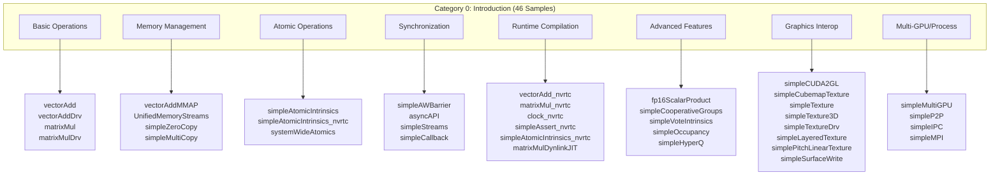
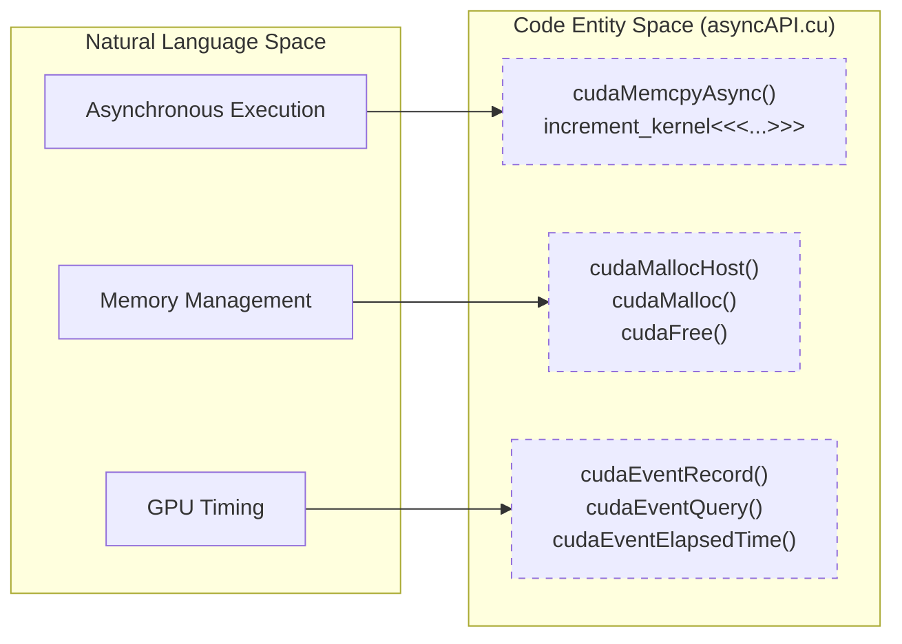

<!-- source: DeepWiki mcp.deepwiki.com · repo NVIDIA/cuda-samples · page 4 Introduction Samples (Category 0) · fetched 2026-10-26 -->

# Introduction Samples (Category 0)

Relevant source files

The following files were used as context for generating this wiki page:

- [cpp/0_Introduction/CMakeLists.txt](cpp/0_Introduction/CMakeLists.txt)
- [cpp/0_Introduction/README.md](cpp/0_Introduction/README.md)
- [cpp/0_Introduction/asyncAPI/asyncAPI.cu](cpp/0_Introduction/asyncAPI/asyncAPI.cu)

## Purpose and Scope

The Introduction Samples provide foundational examples demonstrating core CUDA programming concepts. These 46 samples serve as entry points for developers new to CUDA, illustrating essential GPU programming patterns including memory management, kernel launch configurations, atomic operations, and runtime compilation. 

This category covers the breadth of the CUDA programming model, from basic vector addition to sophisticated inter-process communication and multi-GPU management.

## Sample Overview

The Introduction Samples are located in the `cpp/0_Introduction` directory and contain 46 distinct sample programs [cpp/0_Introduction/CMakeLists.txt:1-46]().

### Introduction Samples Architecture

The following diagram maps the logical categories of introductory samples to the specific subdirectories in the codebase.

Sources: [cpp/0_Introduction/CMakeLists.txt:1-46](), [cpp/0_Introduction/README.md:1-100]()

## Key Topic Groups

### Basic CUDA Operations and Memory Management
These samples establish the foundational "Hello World" patterns of CUDA. They cover the allocation of device memory via `cudaMalloc`, transferring data between Host and Device using `cudaMemcpy`, and the syntax for launching kernels with the `<<<...>>>` execution configuration. 

Key samples include `vectorAdd`, which demonstrates basic array addition, and `matrixMul`, which introduces shared memory usage for tiled matrix multiplication [cpp/0_Introduction/README.md:19-20](). The `asyncAPI` sample further illustrates how to overlap CPU and GPU execution using `cudaEvent_t` and `cudaMemcpyAsync` [cpp/0_Introduction/asyncAPI/asyncAPI.cu:98-115]().

For details, see [Basic CUDA Operations and Memory Management](#4.1).

### Atomic Operations and Synchronization
Atomic operations allow multiple threads to perform read-modify-write operations on shared data without race conditions. Samples like `simpleAtomicIntrinsics` demonstrate global memory atomics such as `atomicAdd` and `atomicMin` [cpp/0_Introduction/README.md:40-41](). 

Synchronization samples introduce more advanced coordination, such as `simpleAWBarrier`, which uses the `cuda::barrier` (Arrival-Wait Barrier) API to synchronize threads within or across blocks [cpp/0_Introduction/README.md:49-50]().

For details, see [Atomic Operations and Synchronization](#4.2).

### Runtime Compilation with NVRTC
The NVRTC (NVIDIA Runtime Compilation) library allows developers to compile CUDA C++ source code to PTX at runtime. This is useful for applications that generate kernels dynamically based on user input or data characteristics. 

Samples like `vectorAdd_nvrtc` and `matrixMul_nvrtc` demonstrate the workflow of loading a `.cu` file as a string, compiling it with `nvrtcCompileProgram`, and loading the resulting PTX into a module for execution [cpp/0_Introduction/README.md:22-23]().

For details, see [Runtime Compilation with NVRTC](#4.3).

### Inter-Process Communication (IPC) Samples
These samples demonstrate how to share GPU memory and events between different OS processes. `simpleIPC` shows how to use `cudaIpcGetMemHandle` and `cudaIpcOpenMemHandle` to enable zero-copy data sharing between processes on the same GPU [cpp/0_Introduction/README.md:70-71](). 

Newer samples like `vectorAddMMAP` demonstrate the `cuMemMap` API for low-level virtual memory management, allowing processes to map the same physical GPU memory into their respective virtual address spaces [cpp/0_Introduction/CMakeLists.txt:45]().

For details, see [Inter-Process Communication Samples](#4.4).

## Code-to-System Mapping

The following diagram bridges the high-level CUDA concepts to the specific API calls and variables used in the introductory samples, such as `asyncAPI`.

Sources: [cpp/0_Introduction/asyncAPI/asyncAPI.cu:85-139]()

## Sample Implementation Patterns

Most introductory samples follow a standard execution flow to ensure clarity for learners:

1.  **Device Initialization**: Using `findCudaDevice` to select the best available GPU [cpp/0_Introduction/asyncAPI/asyncAPI.cu:73]().
2.  **Memory Allocation**: Allocating host memory (often pinned via `cudaMallocHost`) and device memory via `cudaMalloc` [cpp/0_Introduction/asyncAPI/asyncAPI.cu:85-90]().
3.  **Kernel Launch**: Configuring grid and block dimensions (`dim3`) and launching the `__global__` function [cpp/0_Introduction/asyncAPI/asyncAPI.cu:94-114]().
4.  **Verification**: Copying results back to the host and comparing them against a CPU-based reference implementation [cpp/0_Introduction/asyncAPI/asyncAPI.cu:115-135]().
5.  **Cleanup**: Releasing all allocated resources using `cudaFree` and `cudaEventDestroy` [cpp/0_Introduction/asyncAPI/asyncAPI.cu:138-141]().

Sources: [cpp/0_Introduction/asyncAPI/asyncAPI.cu:65-144](), [cpp/0_Introduction/README.md:1-100]()

---

