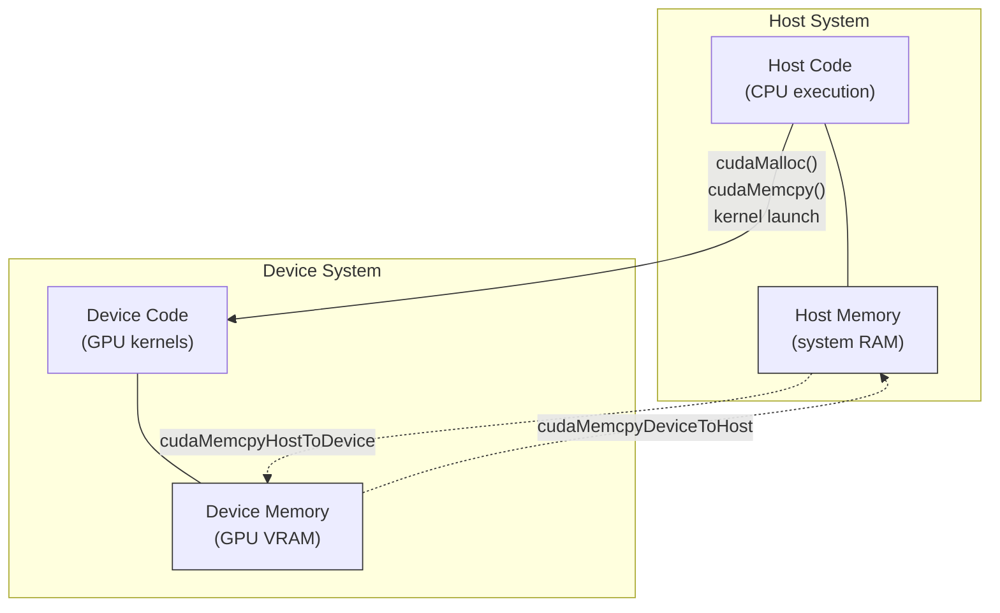
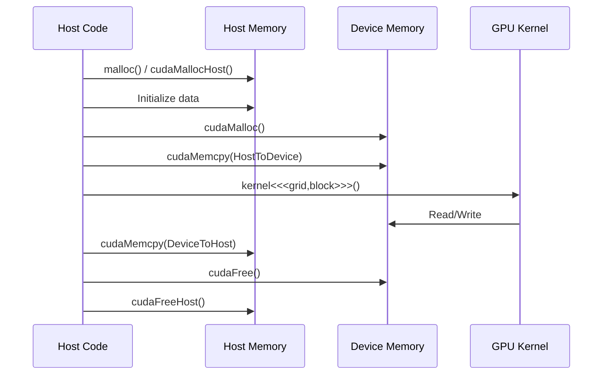
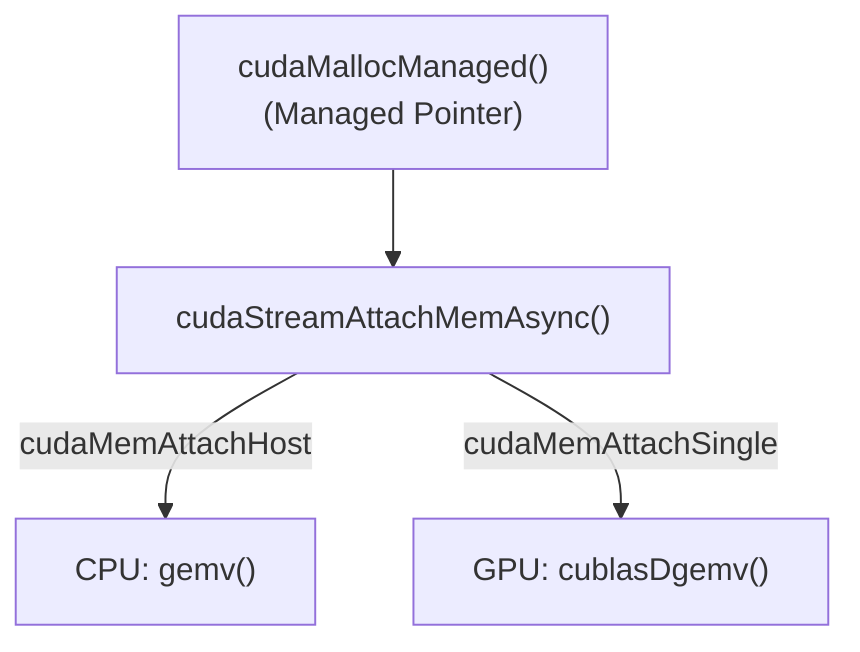
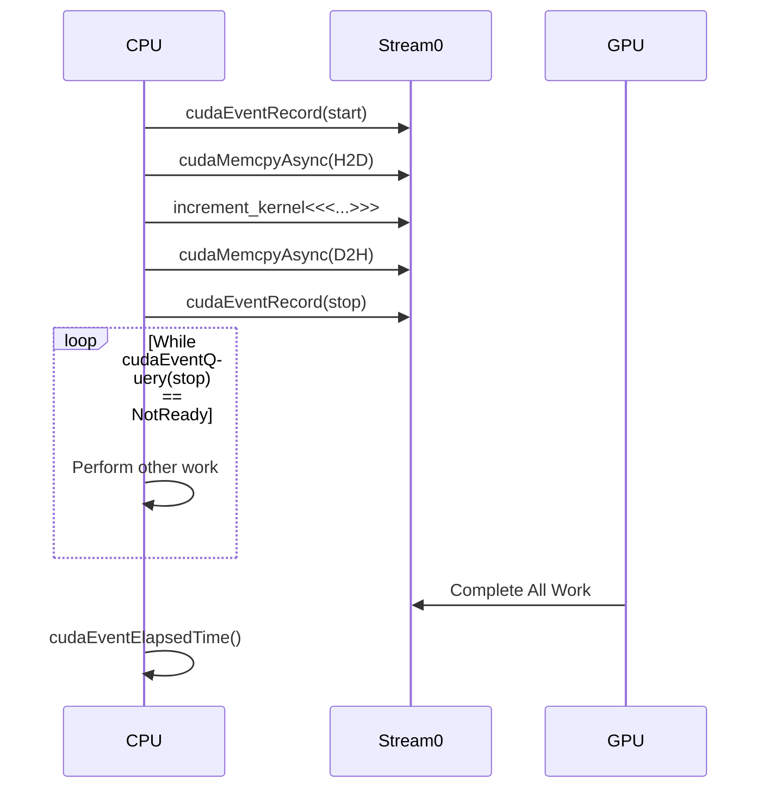
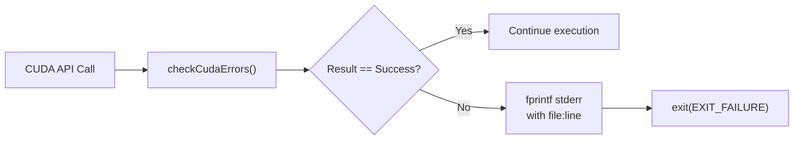

<!-- source: DeepWiki mcp.deepwiki.com · repo NVIDIA/cuda-samples · page 4.1 Basic CUDA Operations and Memory Management · fetched 2026-10-26 -->

# Basic CUDA Operations and Memory Management

<details>
<summary>Relevant source files</summary>

The following files were used as context for generating this wiki page:

- [cpp/0_Introduction/UnifiedMemoryStreams/CMakeLists.txt](cpp/0_Introduction/UnifiedMemoryStreams/CMakeLists.txt)
- [cpp/0_Introduction/UnifiedMemoryStreams/README.md](cpp/0_Introduction/UnifiedMemoryStreams/README.md)
- [cpp/0_Introduction/UnifiedMemoryStreams/UnifiedMemoryStreams.cu](cpp/0_Introduction/UnifiedMemoryStreams/UnifiedMemoryStreams.cu)
- [cpp/0_Introduction/asyncAPI/asyncAPI.cu](cpp/0_Introduction/asyncAPI/asyncAPI.cu)

</details>


## Purpose and Scope

This document covers the fundamental CUDA programming patterns demonstrated in Category 0 (Introduction) samples, focusing on:
- CUDA memory model and memory spaces (host vs. device).
- Memory allocation and transfer APIs (`cudaMalloc`, `cudaMemcpy`, `cudaFree`).
- Unified Memory and stream-based concurrency.
- Asynchronous execution and event-based synchronization.
- Foundational samples: `vectorAdd`, `matrixMul`, `asyncAPI`, and `UnifiedMemoryStreams`.

For atomic operations and synchronization primitives, see [4.2](). For NVRTC runtime compilation details, see [4.3](). For inter-process communication using CUDA memory, see [4.4]().

---

## CUDA Memory Model

CUDA operates on a heterogeneous computing model with distinct memory spaces:



**Memory Transfer Directions**

| Direction Enum | Transfer Path | Use Case |
|---------------|---------------|----------|
| `cudaMemcpyHostToDevice` | System RAM → GPU VRAM | Input data preparation |
| `cudaMemcpyDeviceToHost` | GPU VRAM → System RAM | Result retrieval |
| `cudaMemcpyDeviceToDevice` | GPU VRAM → GPU VRAM | On-device copies |
| `cudaMemcpyDefault` | Auto-detect | Works with Unified Memory |

Sources: [cpp/0_Introduction/asyncAPI/asyncAPI.cu:113-115](), general CUDA programming model.

---

## Memory Allocation and Transfer Patterns

### Standard Allocation Workflow
The canonical CUDA memory management pattern follows this sequence:



### Code Pattern Example (Asynchronous API)
From [cpp/0_Introduction/asyncAPI/asyncAPI.cu:83-141]():

```cpp
// 1. Allocate host pinned memory
checkCudaErrors(cudaMallocHost((void **)&a, nbytes));

// 2. Allocate device memory
checkCudaErrors(cudaMalloc((void **)&d_a, nbytes));

// 3. Async Copy to device
cudaMemcpyAsync(d_a, a, nbytes, cudaMemcpyHostToDevice, 0);

// 4. Launch Kernel
increment_kernel<<<blocks, threads, 0, 0>>>(d_a, value);

// 5. Async Copy from device
cudaMemcpyAsync(a, d_a, nbytes, cudaMemcpyDeviceToHost, 0);

// 6. Cleanup
checkCudaErrors(cudaFreeHost(a));
checkCudaErrors(cudaFree(d_a));
```

Sources: [cpp/0_Introduction/asyncAPI/asyncAPI.cu:83-141]()

---

## Unified Memory and Streams

Unified Memory (UM) simplifies memory management by providing a single address space accessible from both CPU and GPU. The `UnifiedMemoryStreams` sample demonstrates how to manage UM with concurrency.

### Unified Memory Tasks
In `UnifiedMemoryStreams.cu`, data is allocated using `cudaMallocManaged` [cpp/0_Introduction/UnifiedMemoryStreams/UnifiedMemoryStreams.cu:82-84]().



### Visibility Control
To allow concurrent access, memory is attached to specific streams:
- **Host Access**: `cudaStreamAttachMemAsync(stream, ptr, 0, cudaMemAttachHost)` [cpp/0_Introduction/UnifiedMemoryStreams/UnifiedMemoryStreams.cu:163-165]().
- **Device Access**: `cudaStreamAttachMemAsync(stream, ptr, 0, cudaMemAttachSingle)` [cpp/0_Introduction/UnifiedMemoryStreams/UnifiedMemoryStreams.cu:179-181]().

Sources: [cpp/0_Introduction/UnifiedMemoryStreams/UnifiedMemoryStreams.cu:82-181]()

---

## Kernel Launch Syntax

### Runtime API Kernel Launch
CUDA kernels are launched using the triple-chevron syntax `<<<grid, block, shared_mem, stream>>>`:

**Execution Configuration Parameters**

| Parameter | Type | Purpose | Common Values |
|-----------|------|---------|---------------|
| `gridDim` | `dim3` or `int` | Number of blocks in grid | `(N + blockDim - 1) / blockDim` |
| `blockDim` | `dim3` or `int` | Number of threads per block | 256, 512, 1024 |
| `sharedMemBytes` | `size_t` | Dynamic shared memory bytes | 0 (default) |
| `stream` | `cudaStream_t` | CUDA stream for execution | 0 (default stream) |

From [cpp/0_Introduction/asyncAPI/asyncAPI.cu:94-114]():
```cpp
dim3 threads = dim3(512, 1);
dim3 blocks  = dim3(n / threads.x, 1);
increment_kernel<<<blocks, threads, 0, 0>>>(d_a, value);
```

Sources: [cpp/0_Introduction/asyncAPI/asyncAPI.cu:48-52](), [cpp/0_Introduction/asyncAPI/asyncAPI.cu:94-114]()

---

## Asynchronous Operations and Events

### GPU Timing and Overlap
The `asyncAPI` sample illustrates overlapping CPU and GPU execution using `cudaEvent_t`.

1. **Event Creation**: `cudaEventCreate(&start)` [cpp/0_Introduction/asyncAPI/asyncAPI.cu:99-100]().
2. **Recording**: `cudaEventRecord(start, 0)` marks a point in the stream [cpp/0_Introduction/asyncAPI/asyncAPI.cu:112]().
3. **Querying**: `cudaEventQuery(stop)` allows the CPU to check if the GPU has reached the event without blocking [cpp/0_Introduction/asyncAPI/asyncAPI.cu:123]().
4. **Elapsed Time**: `cudaEventElapsedTime(&gpu_time, start, stop)` provides high-resolution GPU timing [cpp/0_Introduction/asyncAPI/asyncAPI.cu:127]().



Sources: [cpp/0_Introduction/asyncAPI/asyncAPI.cu:98-132]()

---

## Error Checking and Helper Functions

### checkCudaErrors Macro
All samples utilize `checkCudaErrors` to wrap API calls. This macro is defined in `helper_cuda.h`.

**Error Handling Flow:**


### Device Selection
Samples use `findCudaDevice(argc, argv)` to select the best available GPU based on compute capability or command-line arguments [cpp/0_Introduction/asyncAPI/asyncAPI.cu:73]().

Sources: [cpp/0_Introduction/asyncAPI/asyncAPI.cu:73-76](), [cpp/0_Introduction/UnifiedMemoryStreams/UnifiedMemoryStreams.cu:49]()

---

## Build System Configuration

### Sample CMakeLists.txt Structure
From [cpp/0_Introduction/UnifiedMemoryStreams/CMakeLists.txt:1-46]():

Key settings for introductory samples:
- **Architectures**: Targets SM 75 through 120 [cpp/0_Introduction/UnifiedMemoryStreams/CMakeLists.txt:11]().
- **Debug Flags**: Uses `-G` for debug and `-lineinfo` for profiling [cpp/0_Introduction/UnifiedMemoryStreams/CMakeLists.txt:13-17]().
- **C++ Standard**: Requires C++17 and CUDA 17 [cpp/0_Introduction/UnifiedMemoryStreams/CMakeLists.txt:39]().
- **Separable Compilation**: Enabled for samples requiring device-side linking [cpp/0_Introduction/UnifiedMemoryStreams/CMakeLists.txt:41]().

Sources: [cpp/0_Introduction/UnifiedMemoryStreams/CMakeLists.txt:1-53]()

---

