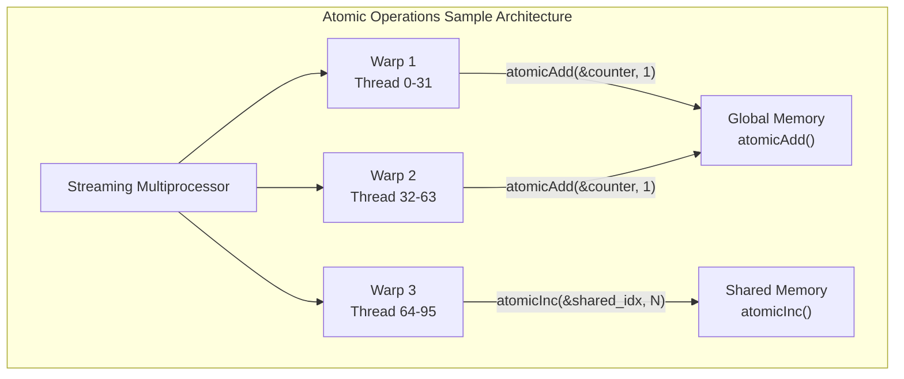
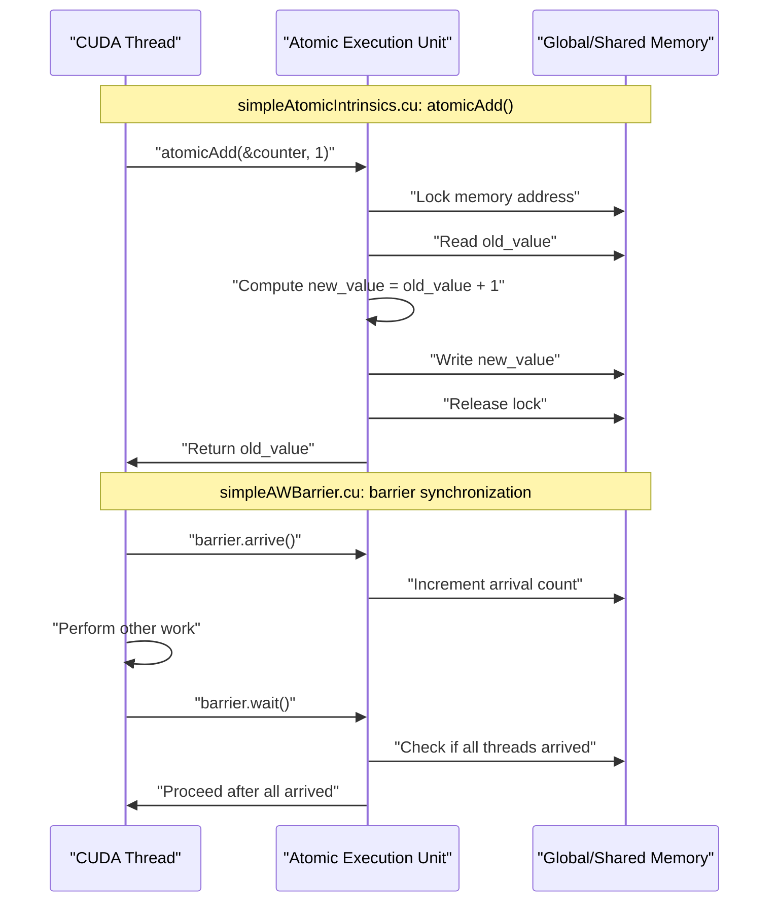

<!-- source: DeepWiki mcp.deepwiki.com · repo NVIDIA/cuda-samples · page 4.2 Atomic Operations and Synchronization · fetched 2026-10-26 -->

# Atomic Operations and Synchronization

<details>
<summary>Relevant source files</summary>

The following files were used as context for generating this wiki page:

- [cpp/0_Introduction/CMakeLists.txt](cpp/0_Introduction/CMakeLists.txt)
- [cpp/0_Introduction/README.md](cpp/0_Introduction/README.md)

</details>


This document provides a technical overview of atomic operations and synchronization mechanisms in CUDA, focusing on the implementation and usage patterns demonstrated by the atomic operations samples within the CUDA Samples repository. These samples demonstrate atomic intrinsics, barriers, and system-wide atomics for GPU synchronization.

## Introduction to CUDA Atomic Operations

Atomic operations in CUDA are special instructions that perform read-modify-write operations on memory in a way that appears indivisible (atomic) to other threads. These operations are essential for safely manipulating shared data in massively parallel GPU environments where thousands of threads may attempt to update shared variables simultaneously.

In CUDA programming, atomic operations provide a mechanism to avoid race conditions when multiple threads access and modify the same memory location concurrently. The samples demonstrate these operations through `simpleAtomicIntrinsics.cu`, `systemWideAtomics.cu`, and `simpleAWBarrier.cu`.

#### CUDA Atomic Operations Memory Model



Sources:
- [cpp/0_Introduction/simpleAtomicIntrinsics/CMakeLists.txt:15]()
- [cpp/0_Introduction/systemWideAtomics/CMakeLists.txt:42]()
- [cpp/0_Introduction/simpleAWBarrier/CMakeLists.txt:49]()

## Key Atomic Operation and Synchronization Samples

The CUDA Samples repository contains several examples demonstrating different aspects of atomic operations and synchronization:

### 1. Simple Atomic Intrinsics (`simpleAtomicIntrinsics`)

The `simpleAtomicIntrinsics` sample demonstrates basic CUDA atomic intrinsics with performance comparison between GPU and CPU implementations. This sample provides a baseline for understanding atomic operation performance characteristics across different memory hierarchies.

**Key source files:**
- `simpleAtomicIntrinsics.cu` - GPU atomic operations kernel implementation
- `simpleAtomicIntrinsics_cpu.cpp` - CPU reference implementation for comparison

**Build configuration:** [cpp/0_Introduction/simpleAtomicIntrinsics/CMakeLists.txt:25]() builds the executable from both source files with [cpp/0_Introduction/simpleAtomicIntrinsics/CMakeLists.txt:11]() specifying compute capabilities 75-120.

The sample demonstrates fundamental atomic operations including `atomicAdd()`, `atomicSub()`, `atomicExch()`, `atomicMin()`, `atomicMax()`, `atomicInc()`, `atomicDec()`, `atomicCAS()`, `atomicAnd()`, `atomicOr()`, and `atomicXor()`.

### 2. System-Wide Atomics (`systemWideAtomics`)

The `systemWideAtomics` sample demonstrates atomic operations that work across the entire system, enabling atomic operations between GPU and CPU for cross-device synchronization. This sample uses system-scope atomic operations to coordinate between host and device memory.

**Key source file:**
- `systemWideAtomics.cu` - System-scope atomic operations implementation

**Platform constraints:**
- [cpp/0_Introduction/systemWideAtomics/CMakeLists.txt:21-22](): Not supported on aarch64 architecture.
- [cpp/0_Introduction/systemWideAtomics/CMakeLists.txt:24-36](): Linux only implementation (uses system-scope atomics requiring unified memory addressing).

The sample demonstrates `atomicAdd_system()` and related system-scope variants that maintain coherency across CPU and GPU memory domains.

### 3. Arrive-Wait Barrier (`simpleAWBarrier`)

The `simpleAWBarrier` sample demonstrates arrive-wait barriers introduced in CUDA 11.0 for advanced thread synchronization patterns. Arrive-wait barriers provide split-phase synchronization where threads can perform useful work between the arrive and wait phases.

**Key source file:**
- `simpleAWBarrier.cu` - Arrive-wait barrier kernel implementation

**Architecture requirements:** [cpp/0_Introduction/simpleAWBarrier/CMakeLists.txt:11]() targets compute capabilities 75-120. Arrive-wait barriers require compute capability 7.0+.

**Platform constraints:** [cpp/0_Introduction/simpleAWBarrier/CMakeLists.txt:23-27](): Not supported on QNX due to platform-specific synchronization primitive requirements.

**Build features:** [cpp/0_Introduction/simpleAWBarrier/CMakeLists.txt:33]() enables `--extended-lambda` for advanced lambda expression support required by barrier primitives.

The sample uses `cooperative_groups::experimental::barrier` or direct barrier intrinsics for split-phase synchronization.

#### Atomic Operations Sample Build Architecture

```mermaid
graph TB
    subgraph "AtomicSamples [CUDA Atomic Operations Samples]"
        direction TB
        
        "SimpleAtomic [simpleAtomicIntrinsics]"
        "SimpleAtomic" --> "CudaImpl [simpleAtomicIntrinsics.cu]"
        "SimpleAtomic" --> "CpuImpl [simpleAtomicIntrinsics_cpu.cpp]"
        
        "SystemWide [systemWideAtomics]"
        "SystemWide" --> "SystemCuda [systemWideAtomics.cu]"
        "SystemWide" --> "LinuxOnly [CMAKE_SYSTEM_NAME=Linux]"
        
        "AWBarrier [simpleAWBarrier]"
        "AWBarrier" --> "BarrierCuda [simpleAWBarrier.cu]"
        "AWBarrier" --> "ExtLambda [--extended-lambda]"
        "AWBarrier" --> "QNXCheck [CMAKE_SYSTEM_NAME!=QNX]"
    end
    
    subgraph "Requirements [Build Requirements]"
        "CC75120 [CMAKE_CUDA_ARCHITECTURES 75-120]"
        "SeparableComp [CUDA_SEPARABLE_COMPILATION ON]"
        "CppStd17 [cxx_std_17]"
    end
    
    "AtomicSamples" --> "Requirements"
```

Sources:
- [cpp/0_Introduction/simpleAtomicIntrinsics/CMakeLists.txt:25-31]()
- [cpp/0_Introduction/systemWideAtomics/CMakeLists.txt:21-37]()
- [cpp/0_Introduction/simpleAWBarrier/CMakeLists.txt:31-33]()

## CUDA Atomic Intrinsics and Synchronization Primitives

CUDA provides various atomic intrinsics and synchronization mechanisms implemented in the sample applications. The samples demonstrate atomic operations on different data types and memory scopes.

### Atomic Intrinsics

| Intrinsic Function | Operation Type | Data Types | Memory Scope | Sample Implementation |
|--------------------|----------------|------------|--------------|----------------------|
| `atomicAdd()` | Read-modify-write addition | int, unsigned int, float, double, `__half` | Global, Shared | `simpleAtomicIntrinsics.cu`, `fp16ScalarProduct.cu` |
| `atomicSub()` | Read-modify-write subtraction | int, unsigned int | Global, Shared | `simpleAtomicIntrinsics.cu` |
| `atomicExch()` | Atomic exchange | int, unsigned int, float | Global, Shared | `simpleAtomicIntrinsics.cu` |
| `atomicMin()` | Atomic minimum | int, unsigned int | Global, Shared | `simpleAtomicIntrinsics.cu` |
| `atomicMax()` | Atomic maximum | int, unsigned int | Global, Shared | `simpleAtomicIntrinsics.cu` |
| `atomicInc()` | Atomic increment with wrap | unsigned int | Global, Shared | `simpleAtomicIntrinsics.cu` |
| `atomicDec()` | Atomic decrement with wrap | unsigned int | Global, Shared | `simpleAtomicIntrinsics.cu` |
| `atomicCAS()` | Compare-and-swap | int, unsigned int | Global, Shared | `simpleAtomicIntrinsics.cu` |

### System-Scope Atomic Variants

System-scope atomic operations maintain memory coherency across the entire system, enabling coordination between CPU and GPU:

| System-Scope Function | Standard Equivalent | Scope | Sample Implementation |
|-----------------------|---------------------|-------|----------------------|
| `atomicAdd_system()` | `atomicAdd()` | CPU-GPU coherent | `systemWideAtomics.cu` |
| `atomicSub_system()` | `atomicSub()` | CPU-GPU coherent | `systemWideAtomics.cu` |
| `atomicCAS_system()` | `atomicCAS()` | CPU-GPU coherent | `systemWideAtomics.cu` |

### Synchronization Primitives

| Primitive | API Function/Type | Usage Pattern | Sample Implementation |
|-----------|-------------------|---------------|----------------------|
| Arrive-Wait Barriers | `cooperative_groups::barrier` | Split-phase thread block synchronization | `simpleAWBarrier.cu` |
| Barrier Arrive | `barrier.arrive()` | Mark thread arrival at synchronization point | `simpleAWBarrier.cu` |
| Barrier Wait | `barrier.wait()` | Wait for all threads to arrive | `simpleAWBarrier.cu` |
| Half-Precision Atomics | `atomicAdd(__half*, __half)` | FP16 atomic operations | `fp16ScalarProduct.cu` |

Sources:
- [cpp/0_Introduction/README.md:40-45]()
- [cpp/0_Introduction/README.md:49-50]()
- [cpp/0_Introduction/README.md:16-18]()
- [cpp/0_Introduction/README.md:111-112]()

## Atomic Operations and Barrier Synchronization Flow

#### Atomic Intrinsics Execution Model



#### System-Wide Atomic Synchronization Architecture

```mermaid
graph TB
    subgraph "HostSide [Host Process - systemWideAtomics.cu]"
        "CPUThread [CPU Thread]"
        "HostOp [atomicAdd_system()]"
    end
    
    subgraph "DeviceSide [GPU Device - systemWideAtomics.cu]"
        "CudaKernel [CUDA Kernel]"
        "DeviceOp [atomicAdd_system()]"
    end
    
    subgraph "MemorySystem [Unified Memory System]"
        "ManagedMem [cudaMallocManaged()]"
        "Counter [int *system_counter]"
    end
    
    "CPUThread" --> "HostOp"
    "HostOp" --> "Counter"
    "CudaKernel" --> "DeviceOp"
    "DeviceOp" --> "Counter"
    "Counter" --> "ManagedMem"
```

Sources:
- [cpp/0_Introduction/simpleAtomicIntrinsics/CMakeLists.txt:15]()
- [cpp/0_Introduction/systemWideAtomics/CMakeLists.txt:42]()
- [cpp/0_Introduction/simpleAWBarrier/CMakeLists.txt:49]()

## Hardware Architecture Requirements and Sample Support

The atomic operation samples target specific CUDA compute capabilities based on required hardware features:

### Current Sample Architecture Targeting

All atomic operation samples use the following architecture configuration from `CMAKE_CUDA_ARCHITECTURES` in [cpp/0_Introduction/simpleAtomicIntrinsics/CMakeLists.txt:11]():

```
CMAKE_CUDA_ARCHITECTURES: 75 80 86 87 89 90 100 110 120
```

### Platform-Specific Constraints

| Sample | Platform Constraint | Source |
|--------|-------------------|---------|
| `systemWideAtomics` | Linux x86_64 only | [cpp/0_Introduction/systemWideAtomics/CMakeLists.txt:21-37]() |
| `simpleAWBarrier` | No QNX support | [cpp/0_Introduction/simpleAWBarrier/CMakeLists.txt:23-27]() |

### Atomic Operation Capability Matrix

| Operation Type | Minimum Compute Capability | Sample Implementation |
|----------------|----------------------------|----------------------|
| Basic Integer Atomics | 7.5+ (Sample target) | `simpleAtomicIntrinsics.cu` |
| System-Wide Atomics | 7.5+ (Sample target) | `systemWideAtomics.cu` |
| Arrive-Wait Barriers | 7.5+ (Sample target) | `simpleAWBarrier.cu` |
| Half-Precision Atomics | 7.5+ (Sample target) | `fp16ScalarProduct.cu` |

Sources:
- [cpp/0_Introduction/simpleAtomicIntrinsics/CMakeLists.txt:11]()
- [cpp/0_Introduction/systemWideAtomics/CMakeLists.txt:11,21-37]()
- [cpp/0_Introduction/simpleAWBarrier/CMakeLists.txt:11,23-27]()

## Performance Considerations and Optimization

### Compilation Optimizations

The atomic operation samples use specific compilation flags for optimal performance and debugging:

**Debug vs Release Configuration:**

Debug mode ([cpp/0_Introduction/simpleAtomicIntrinsics/CMakeLists.txt:14-15]()):
```cmake
if(ENABLE_CUDA_DEBUG)
    set(CMAKE_CUDA_FLAGS "${CMAKE_CUDA_FLAGS} -G")
```

Release mode ([cpp/0_Introduction/simpleAtomicIntrinsics/CMakeLists.txt:16-17]()):
```cmake
else()
    set(CMAKE_CUDA_FLAGS "${CMAKE_CUDA_FLAGS} -lineinfo")
```

**Extended Lambda Support:**

[cpp/0_Introduction/simpleAWBarrier/CMakeLists.txt:33]() enables `--extended-lambda` compilation option for advanced lambda expressions used with barrier primitives.

**Separable Compilation:**

[cpp/0_Introduction/simpleAtomicIntrinsics/CMakeLists.txt:31]() enables separable compilation:
```cmake
set_target_properties(simpleAtomicIntrinsics PROPERTIES CUDA_SEPARABLE_COMPILATION ON)
```

### Best Practices for Sample-Based Optimization

1. **Benchmark with `simpleAtomicIntrinsics`**: Compare CPU vs GPU atomic performance.
2. **Test System-Wide Coordination**: Use `systemWideAtomics` for multi-device scenarios.
3. **Evaluate Barrier Patterns**: Apply `simpleAWBarrier` for complex synchronization requirements.
4. **Optimize Precision**: Consider `fp16ScalarProduct` for memory-bandwidth-limited applications.

Sources:
- [cpp/0_Introduction/simpleAtomicIntrinsics/CMakeLists.txt:14-18,31]()
- [cpp/0_Introduction/simpleAWBarrier/CMakeLists.txt:33]()
- [cpp/0_Introduction/README.md:40-51]()

---

