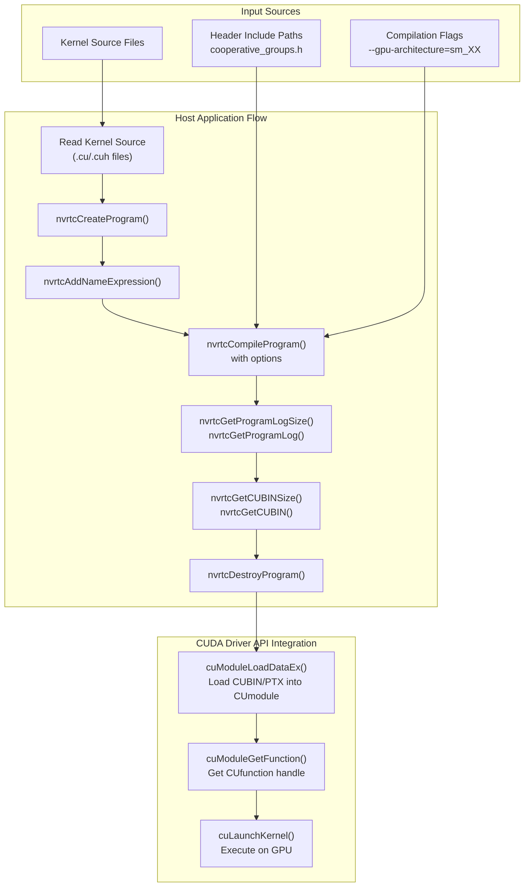
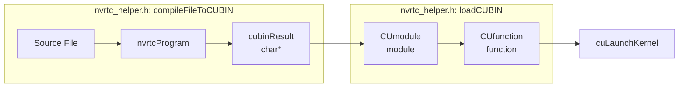
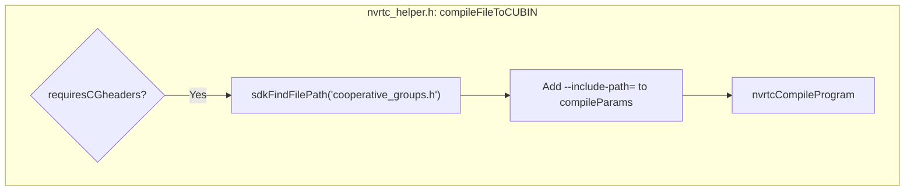
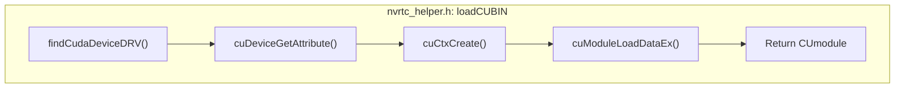

<!-- source: DeepWiki mcp.deepwiki.com · repo NVIDIA/cuda-samples · page 4.3 Runtime Compilation with NVRTC · fetched 2026-10-26 -->

# Runtime Compilation with NVRTC

<details>
<summary>Relevant source files</summary>

The following files were used as context for generating this wiki page:

- [Common/nvrtc_helper.h](Common/nvrtc_helper.h)
- [cpp/0_Introduction/CMakeLists.txt](cpp/0_Introduction/CMakeLists.txt)
- [cpp/0_Introduction/README.md](cpp/0_Introduction/README.md)

</details>


## Purpose and Scope

This document covers the NVIDIA Runtime Compilation (NVRTC) system as demonstrated in the CUDA samples repository. NVRTC enables dynamic compilation of CUDA C++ device code at runtime, allowing applications to generate and compile CUDA kernels on-the-fly. This capability is essential for applications that need to adapt kernel code based on runtime parameters, user input, or dynamic problem characteristics.

For information about ahead-of-time compilation using `nvcc`, see the build system documentation. For advanced compilation techniques using libNVVM, see the libNVVM section.

## NVRTC Overview and Architecture

NVRTC (NVIDIA Runtime Compilation) is a library that provides an API for compiling CUDA C++ device code at runtime. Unlike traditional ahead-of-time compilation with `nvcc`, NVRTC allows applications to compile kernel source code into PTX (Parallel Thread Execution) assembly or CUBIN (CUDA Binary) during program execution. This enables applications to generate specialized kernels based on runtime parameters, perform just-in-time optimization, or support user-provided custom kernels.

**NVRTC Runtime Compilation Workflow**


Sources: [Common/nvrtc_helper.h:50-183](), [Common/nvrtc_helper.h:185-200](), [cpp/0_Introduction/README.md:22-24]()

## NVRTC API Workflow

The NVRTC compilation workflow follows a well-defined sequence of API calls. The utility function `compileFileToCUBIN` in `Common/nvrtc_helper.h` encapsulates this pattern for the samples.

### Compilation Phase

The `compileFileToCUBIN` function demonstrates the following API sequence:

| API Function | Purpose | Implementation in `nvrtc_helper.h` |
|--------------|---------|------------------------------------|
| `nvrtcCreateProgram()` | Creates compilation unit from source string | [Common/nvrtc_helper.h:150-151]() |
| `nvrtcCompileProgram()` | Compiles source to CUBIN/PTX | [Common/nvrtc_helper.h:153-153]() |
| `nvrtcGetProgramLogSize()` | Get compilation log size | [Common/nvrtc_helper.h:157-158]() |
| `nvrtcGetProgramLog()` | Retrieve compilation log | [Common/nvrtc_helper.h:160-160]() |
| `nvrtcGetCUBINSize()` | Get compiled binary size | [Common/nvrtc_helper.h:174-174]() |
| `nvrtcGetCUBIN()` | Retrieve compiled binary | [Common/nvrtc_helper.h:176-176]() |

### Loading and Execution Phase

After NVRTC generates the binary (CUBIN), the CUDA Driver API loads and executes it. This is implemented in `loadCUBIN`:

| Driver API Function | Purpose | Implementation in `nvrtc_helper.h` |
|---------------------|---------|------------------------------------|
| `cuModuleLoadDataEx()` | Load binary into CUDA module | [Common/nvrtc_helper.h:208-208]() |
| `cuModuleGetFunction()` | Get kernel function handle | [Common/nvrtc_helper.h:214-214]() |

**NVRTC to Driver API Data Flow**


Sources: [Common/nvrtc_helper.h:50-183](), [Common/nvrtc_helper.h:185-220]()

## NVRTC Sample Structure and Build Configuration

The NVRTC samples in `cpp/0_Introduction/` follow a naming convention where the sample name is suffixed with `_nvrtc`. These samples compile only host code (C++) and link against the NVRTC and Driver libraries.

### Sample Categorization (Category 0)

| Sample | Description | Source Reference |
|--------|-------------|------------------|
| `clock_nvrtc` | Performance measurement using `clock()` via NVRTC | [cpp/0_Introduction/README.md:10-12]() |
| `matrixMul_nvrtc` | Matrix multiplication implementation using NVRTC | [cpp/0_Introduction/README.md:22-24]() |
| `simpleAssert_nvrtc` | Using `assert()` in device code via NVRTC | [cpp/0_Introduction/README.md:37-39]() |
| `simpleAtomicIntrinsics_nvrtc` | Demonstration of global memory atomics via NVRTC | [cpp/0_Introduction/README.md:43-45]() |
| `vectorAdd_nvrtc` | Basic vector addition using NVRTC | [cpp/0_Introduction/README.md:46-46]() |

Sources: [cpp/0_Introduction/CMakeLists.txt:4-46](), [cpp/0_Introduction/README.md:1-100]()

### Header and Dependency Management

NVRTC compilation often requires external headers like `cooperative_groups.h`. The `compileFileToCUBIN` function handles this by searching for the header path using `sdkFindFilePath` and adding it to the compilation options via `--include-path`.

**NVRTC Header Search Logic**


Sources: [Common/nvrtc_helper.h:108-146]()

## Implementation Details: `nvrtc_helper.h`

The `nvrtc_helper.h` header provides the core infrastructure for runtime compilation across the samples.

### Architecture Targeting
The helper automatically detects the compute capability of the best available device using `findCudaDeviceDRV` and `cuDeviceGetAttribute`. It then constructs the `--gpu-architecture=sm_XY` flag to ensure the compiled code matches the hardware.

```cpp
// Common/nvrtc_helper.h:91-103
std::string compileOptions;
compileOptions = "--gpu-architecture=sm_";
// ... logic to append major and minor capability versions ...
```

### Error Handling
The `NVRTC_SAFE_CALL` macro is used to validate NVRTC API results. If a call fails, it retrieves the error string using `nvrtcGetErrorString` and exits.

```cpp
// Common/nvrtc_helper.h:40-48
#define NVRTC_SAFE_CALL(Name, x)                                \
  do {                                                          \
    nvrtcResult result = x;                                     \
    if (result != NVRTC_SUCCESS) {                              \
      std::cerr << "\nerror: " << Name << " failed with error " \
                << nvrtcGetErrorString(result);                 \
      exit(1);                                                  \
    }                                                           \
  } while (0)
```

Sources: [Common/nvrtc_helper.h:40-48](), [Common/nvrtc_helper.h:78-103]()

## Integration with CUDA Driver API

NVRTC samples exclusively use the CUDA Driver API rather than the Runtime API for kernel management. This is because the Runtime API is designed for ahead-of-time compiled code (fatbins), whereas the Driver API provides the `cuModuleLoadDataEx` function necessary for loading PTX or CUBIN strings generated at runtime.

**Driver API Context and Module Loading**


Sources: [Common/nvrtc_helper.h:185-210](), [Common/nvrtc_helper.h:32-33]()

---

