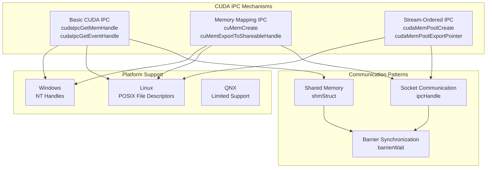
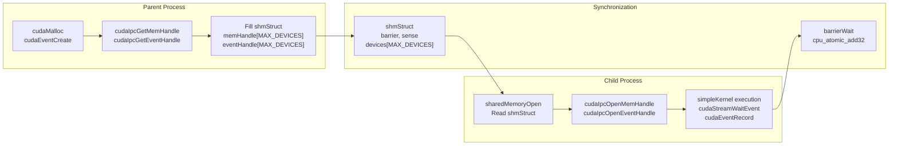
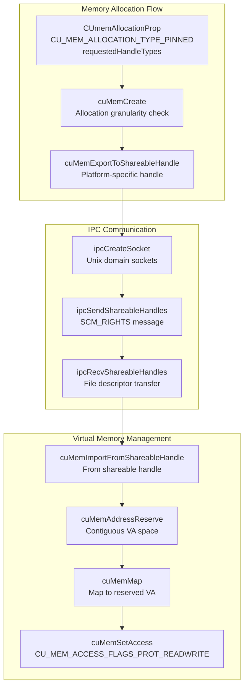
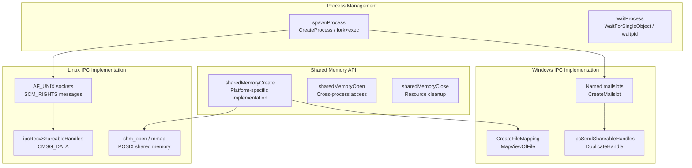
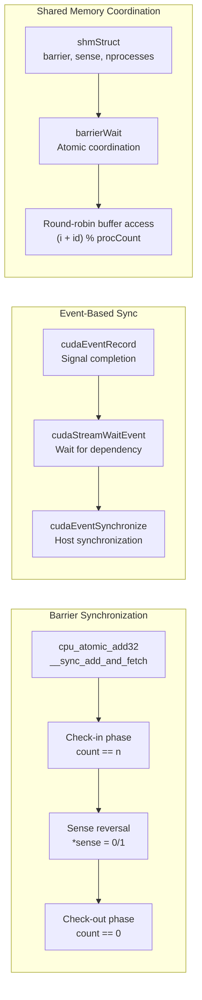

<!-- source: DeepWiki mcp.deepwiki.com · repo NVIDIA/cuda-samples · page 4.4 Inter-Process Communication Samples · fetched 2026-10-26 -->

# Inter-Process Communication Samples

<details>
<summary>Relevant source files</summary>

The following files were used as context for generating this wiki page:

- [Common/helper_multiprocess.cpp](Common/helper_multiprocess.cpp)
- [Common/helper_multiprocess.h](Common/helper_multiprocess.h)
- [cpp/0_Introduction/CMakeLists.txt](cpp/0_Introduction/CMakeLists.txt)

</details>


This document covers CUDA Inter-Process Communication (IPC) mechanisms that enable sharing of GPU memory and synchronization primitives between separate processes. The samples demonstrate three primary IPC approaches: basic CUDA IPC using runtime API handles, advanced memory mapping using driver API virtual memory management, and stream-ordered allocation using memory pools.

For general multiprocess helper utilities, this covers the cross-platform abstraction layer. For CUDA memory management concepts, see the advanced memory management documentation.

## IPC Mechanisms Overview

CUDA provides multiple mechanisms for inter-process communication, each suited for different use cases and memory access patterns:

Title: CUDA IPC Mechanism Comparison


**IPC Mechanism Comparison**

| Mechanism | API Level | Memory Type | Handle Export | Use Case |
|-----------|-----------|-------------|---------------|----------|
| Basic IPC | Runtime | `cudaMalloc` | `cudaIpcMemHandle_t` | Simple memory sharing |
| Memory Mapping | Driver | `cuMemCreate` | Platform-specific | Virtual memory control |
| Stream-Ordered | Runtime | `cudaMallocAsync` | `cudaMemPool` handles | Async allocation sharing |

Sources: [cpp/0_Introduction/simpleIPC/simpleIPC.cu:28-31](), [cpp/0_Introduction/vectorAddMMAP/vectorAddMMAP.cpp:28-31](), [Common/helper_multiprocess.h:105-121]()

## Basic CUDA IPC Implementation

The `simpleIPC` sample demonstrates fundamental CUDA IPC using runtime API handles for memory and event sharing between processes.

Title: simpleIPC Data Flow and Sync


**Core Data Structures**

The `shmStruct` coordinates process communication [cpp/0_Introduction/simpleIPC/simpleIPC.cu:53-61]():

```c
typedef struct shmStruct_st {
    size_t               nprocesses;
    int                  barrier;
    int                  sense;
    int                  devices[MAX_DEVICES];
    cudaIpcMemHandle_t   memHandle[MAX_DEVICES];
    cudaIpcEventHandle_t eventHandle[MAX_DEVICES];
} shmStruct;
```

**Process Workflow**

1.  **Parent Process** ([cpp/0_Introduction/simpleIPC/simpleIPC.cu:203-341]()):
    *   Enumerates peer-capable devices.
    *   Allocates memory and creates events for each device.
    *   Exports handles using `cudaIpcGetMemHandle()` and `cudaIpcGetEventHandle()`.
    *   Spawns child processes with device assignments using `spawnProcess()` [Common/helper_multiprocess.cpp:121-138]().

2.  **Child Process** ([cpp/0_Introduction/simpleIPC/simpleIPC.cu:90-201]()):
    *   Opens shared memory to access handle data via `sharedMemoryOpen()` [Common/helper_multiprocess.cpp:71-101]().
    *   Imports memory and events using `cudaIpcOpenMemHandle()` and `cudaIpcOpenEventHandle()`.
    *   Executes kernels with event-based synchronization.
    *   Cleans up with `cudaIpcCloseMemHandle()`.

Sources: [cpp/0_Introduction/simpleIPC/simpleIPC.cu:53-61](), [cpp/0_Introduction/simpleIPC/simpleIPC.cu:90-201](), [cpp/0_Introduction/simpleIPC/simpleIPC.cu:203-341](), [Common/helper_multiprocess.cpp:71-101]()

## Memory Mapping IPC Architecture

The `vectorAddMMAP` sample demonstrates advanced IPC using CUDA Driver API virtual memory management with platform-specific shareable handles.

Title: cuMemMap API Pipeline


**Platform-Specific Handle Types**

The implementation supports different handle types based on platform defined in the helper headers [Common/helper_multiprocess.h:108-119]():

*   **Linux/QNX**: `CU_MEM_HANDLE_TYPE_POSIX_FILE_DESCRIPTOR`
*   **Windows**: `CU_MEM_HANDLE_TYPE_WIN32`

**Memory Allocation and Export**:
*   Creates pinned allocations with `cuMemCreate()`.
*   Validates granularity requirements using `cuMemGetAllocationGranularity()`.
*   Exports to platform-specific handles with `cuMemExportToShareableHandle()`.

**Virtual Memory Import and Mapping**:
*   Imports handles with `cuMemImportFromShareableHandle()`.
*   Maps to reserved virtual address space with `cuMemMap()`.
*   Sets memory access permissions with `cuMemSetAccess()`.

Sources: [Common/helper_multiprocess.h:108-119](), [Common/helper_multiprocess.cpp:262-312](), [cpp/0_Introduction/vectorAddMMAP/vectorAddMMAP.cpp:28-40]()

## Cross-Platform Helper Infrastructure

The `helper_multiprocess` module provides cross-platform abstractions for shared memory, process management, and IPC handle communication.

Title: helper_multiprocess Abstraction Layer


**Shared Memory Implementation**

Cross-platform shared memory abstraction defined in `sharedMemoryInfo` [Common/helper_multiprocess.h:78-86]():

```c
typedef struct sharedMemoryInfo_st {
    void *addr;
    size_t size;
#if defined(WIN32) || defined(_WIN32) || defined(WIN64) || defined(_WIN64)
    HANDLE shmHandle;
#else
    int shmFd;
#endif
} sharedMemoryInfo;
```

**IPC Handle Communication**

Platform-specific handle transfer mechanisms:

*   **Linux**: Unix domain sockets with `SCM_RIGHTS` for file descriptor passing using `ipcSendShareableHandles` [Common/helper_multiprocess.cpp:262-312](). Socket paths are managed by `getSocketFolder()` [Common/helper_multiprocess.h:60-76]().
*   **Windows**: Named mailslots with `DuplicateHandle()` for handle duplication [Common/helper_multiprocess.cpp:511-535]().

**Process Management Functions**

*   `spawnProcess()`: Cross-platform process creation using `CreateProcess` on Windows or `fork`/`execvp` on Linux [Common/helper_multiprocess.cpp:121-150]().
*   `waitProcess()`: Process completion waiting using `WaitForSingleObject` or `waitpid` [Common/helper_multiprocess.cpp:152-169]().
*   `sharedMemoryCreate()`/`sharedMemoryOpen()`: Shared memory management using `shm_open` (Linux) or `CreateFileMapping` (Windows) [Common/helper_multiprocess.cpp:32-101]().

Sources: [Common/helper_multiprocess.h:60-101](), [Common/helper_multiprocess.cpp:32-169](), [Common/helper_multiprocess.cpp:262-312](), [Common/helper_multiprocess.cpp:511-535]()

## Synchronization Patterns

IPC samples use several synchronization patterns to coordinate multi-process GPU workloads.

Title: Multi-Process Sync Logic


**Barrier Implementation**

The `barrierWait()` function in `simpleIPC` implements a sense-reversing barrier [cpp/0_Introduction/simpleIPC/simpleIPC.cu:71-88]():

```c
static void barrierWait(volatile int *barrier, volatile int *sense, unsigned int n) {
    int count;
    // Check-in
    count = cpu_atomic_add32(barrier, 1);
    if (count == n) *sense = 1;  // Last one in
    while (!*sense);
    
    // Check-out  
    count = cpu_atomic_add32(barrier, -1);
    if (count == 0) *sense = 0; // Last one out
    while (*sense);
}
```

**Work Coordination Pattern**

Processes access buffers in round-robin fashion with event synchronization [cpp/0_Introduction/simpleIPC/simpleIPC.cu:153-170]():

```c
for (int i = 0; i < procCount; i++) {
    int bufferId = (i + id) % procCount;
    checkCudaErrors(cudaStreamWaitEvent(stream, events[bufferId], 0));
    simpleKernel<<<blocks, threads, 0, stream>>>(ptrs[bufferId], DATA_SIZE, id);
    checkCudaErrors(cudaEventRecord(events[bufferId], stream));
    barrierWait(&shm->barrier, &shm->sense, procCount);
}
```

**Atomic Operations**

Platform-specific atomic primitives provide thread-safe coordination [cpp/0_Introduction/simpleIPC/simpleIPC.cu:45-51]():

*   **Linux/QNX**: `__sync_add_and_fetch()` GCC built-ins.
*   **Windows**: `InterlockedAdd()` Win32 API.

Sources: [cpp/0_Introduction/simpleIPC/simpleIPC.cu:45-51](), [cpp/0_Introduction/simpleIPC/simpleIPC.cu:71-88](), [cpp/0_Introduction/simpleIPC/simpleIPC.cu:153-170]()

---

