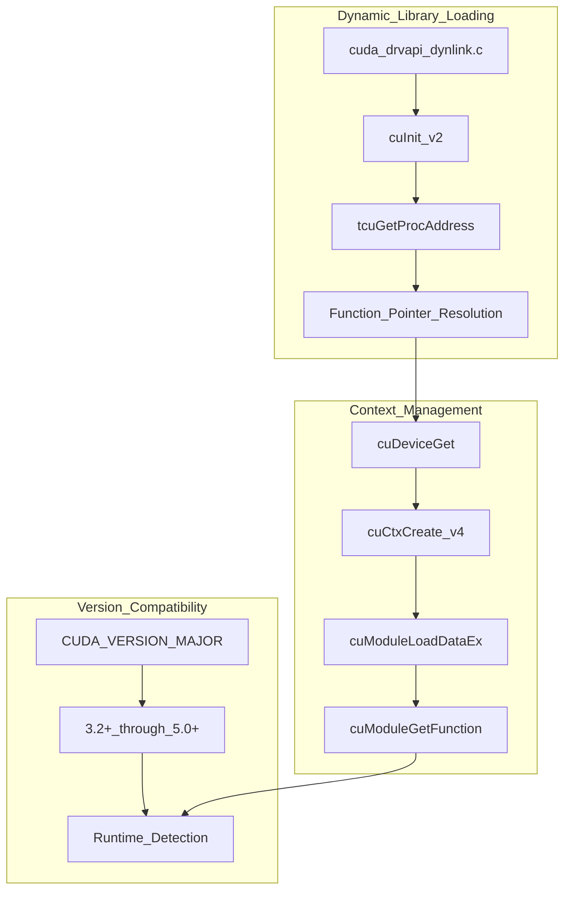
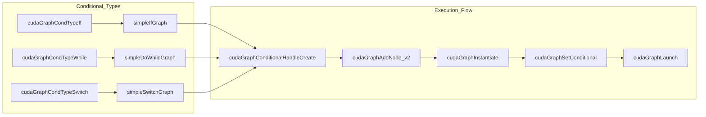
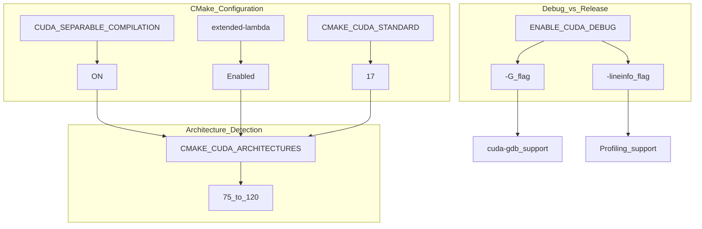
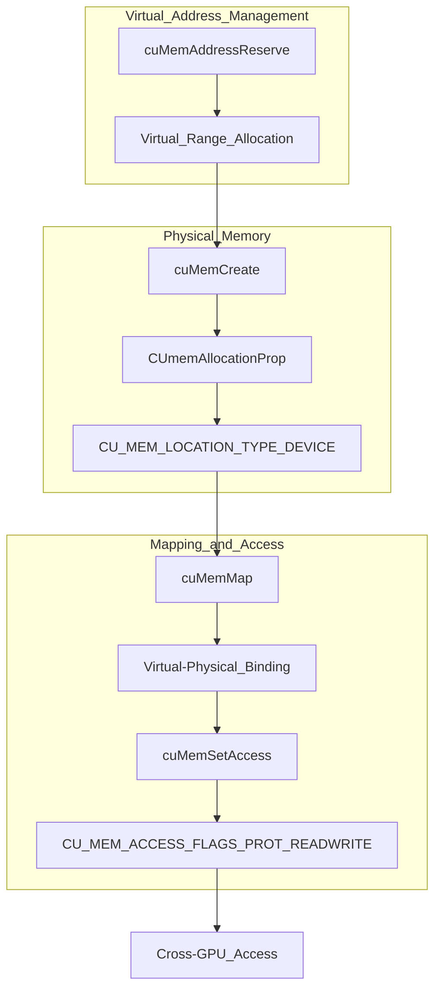
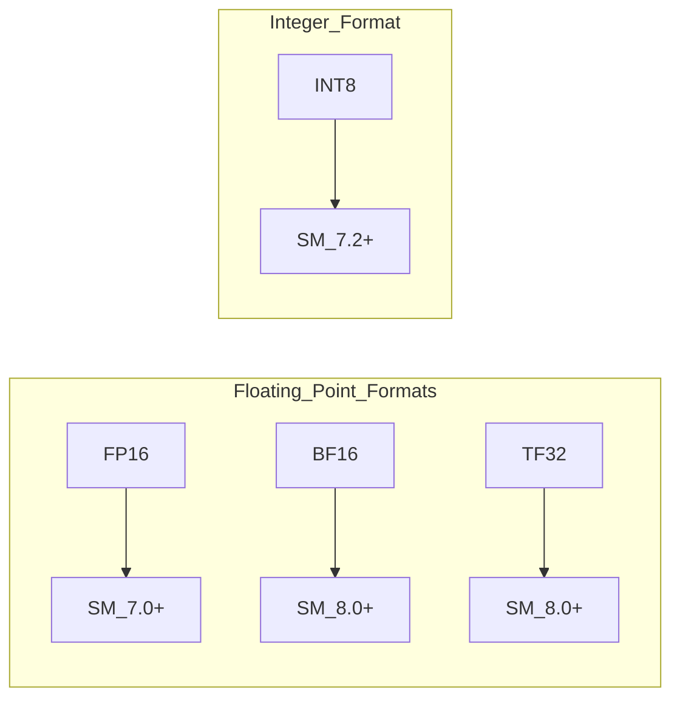

<!-- source: DeepWiki mcp.deepwiki.com · repo NVIDIA/cuda-samples · page 5 Advanced CUDA Features (Category 3) · fetched 2026-10-26 -->

# Advanced CUDA Features (Category 3)

Relevant source files

The following files were used as context for generating this wiki page:

- [CHANGELOG.md](CHANGELOG.md)
- [CMakeLists.txt](CMakeLists.txt)

Category 3 samples demonstrate advanced CUDA programming features that enable sophisticated parallel programming patterns and dynamic execution models. This category focuses on low-level Driver API usage, runtime compilation, CUDA Graphs with conditional execution, dynamic parallelism, virtual memory management, and Tensor Core operations.

These features are typically used in advanced applications requiring fine-grained control over GPU execution, dynamic kernel generation, or specialized hardware acceleration. For foundational CUDA concepts, see [Introduction Samples (Category 0)](#4). For library integration, see [CUDA Libraries Integration (Category 4)](#6).

## Category Overview

The `cpp/3_CUDA_Features` directory contains samples demonstrating five major advanced feature categories. Recent updates in CUDA 13.0 and 13.3 have introduced support for `cudaGraphAddNode_v2` and enhanced memory management attributes.

| Feature Area | Key Samples | Minimum Compute Capability |
|--------------|-------------|---------------------------|
| Driver API & Dynamic Loading | `matrixMulDynlinkJIT` | 5.0 |
| CUDA Graphs | `graphConditionalNodes`, `graphMemoryFootprint` | 7.5 |
| Dynamic Parallelism | `cdpSimpleQuicksort`, `cdpAdvancedQuicksort` | 3.5 |
| Virtual Memory Management | `memMapIPCDrv`, `vectorAddMMAP` | 7.5 |
| Tensor Cores | `cudaTensorCoreGemm`, `tf32TensorCoreGemm` | 7.0+ |

Sources: [CHANGELOG.md:63-77](), [CMakeLists.txt:15-16]()

## Driver API and Dynamic Loading

The CUDA Driver API provides low-level access to CUDA functionality with explicit context management and module loading. The `matrixMulDynlinkJIT` sample demonstrates runtime loading of the CUDA driver library without linking against it at compile time, enabling version-independent CUDA applications.

**Driver API Sample Architecture**

The Driver API has been updated in CUDA 13.0 to use `cuCtxCreate_v4` by default, which includes a `CUctxCreateParams` parameter [CHANGELOG.md:50-58](). This affects several samples including `matrixMulDrv` and `vectorAddMMAP`.

For detailed coverage of Driver API usage patterns and dynamic loading, see [CUDA Driver API and Dynamic Loading](#5.1).

Sources: [CHANGELOG.md:50-58](), [CMakeLists.txt:1-15]()

## CUDA Graphs and Conditional Nodes

CUDA Graphs enable defining complex GPU workloads with reduced CPU overhead. The `graphConditionalNodes` sample demonstrates conditional execution paths within graphs, supporting IF, WHILE, and SWITCH constructs.

**Graph Conditional Node Types**

As of CUDA 13.0, graph node management has transitioned to `cudaGraphAddNode_v2` and `cudaStreamGetCaptureInfo_v3`, which incorporate `cudaGraphEdgeData` parameters [CHANGELOG.md:75-77]().

For detailed graph construction patterns, stream capture integration, and conditional execution examples, see [CUDA Graphs and Conditional Nodes](#5.2).

Sources: [CHANGELOG.md:75-77]()

## CUDA Dynamic Parallelism

CUDA Dynamic Parallelism (CDP) enables kernels to launch child kernels directly from device code. CDP requires compute capability 3.5+ and separable compilation.

**CDP Build Requirements**

The build system enforces `CMAKE_CUDA_STANDARD 17` [CMakeLists.txt:12-13]() and utilizes `-lineinfo` by default in release builds to support profiling tools [CMakeLists.txt:20-21]().

**CDP Sample Progression**

| Sample | Algorithm | Device Launches | Complexity |
|--------|-----------|-----------------|------------|
| `cdpSimplePrint` | Basic printf | Simple | Beginner |
| `cdpSimpleQuicksort` | Recursive sort | Conditional | Intermediate |
| `cdpAdvancedQuicksort` | Optimized sort + bitonic | Multi-level | Advanced |
| `cdpBezierTessellation` | Curve tessellation | Geometric recursion | Advanced |

For detailed CDP patterns, nested kernel launches, and performance considerations, see [CUDA Dynamic Parallelism](#5.3).

Sources: [CMakeLists.txt:1-23](), [CHANGELOG.md:120-124]()

## Memory Mapping and Virtual Memory Management

The `cuMemMap` API family provides fine-grained control over virtual memory management, enabling multi-GPU memory sharing. Recent updates in CUDA 13.0 have introduced `cudaMemAdvise_v2` and `cudaMemPrefetchAsync_v2`, replacing integer device IDs with `cudaMemLocation` structures [CHANGELOG.md:78-82]().

**cuMemMap API Workflow**

**Memory Property Configuration**

| Property | Type | Purpose |
|----------|------|---------|
| `CUmemAllocationProp.type` | `CU_MEM_ALLOCATION_TYPE_PINNED` | Host-accessible memory |
| `CUmemAllocationProp.location.type` | `CU_MEM_LOCATION_TYPE_DEVICE` | Device-local allocation |

For detailed `cuMemMap` usage patterns, IPC handle export/import, and multi-GPU memory sharing, see [Memory Mapping and Virtual Memory Management](#5.4).

Sources: [CHANGELOG.md:65-82]()

## Tensor Core Operations

Tensor Cores provide specialized hardware acceleration for matrix multiply-accumulate operations. Category 3 includes samples demonstrating various precision modes including TF32, BF16, and Integer (IMMA).

**Tensor Core Precision Types**

**WMMA API Functions**

| Function | Purpose |
|----------|---------|
| `wmma::load_matrix_sync` | Load fragment from memory |
| `wmma::mma_sync` | Perform matrix multiply-accumulate |
| `wmma::store_matrix_sync` | Store fragment to memory |

For detailed Tensor Core programming patterns and precision selection, see [Tensor Core Operations](#5.5).

Sources: [CMakeLists.txt:15-16](), [CHANGELOG.md:4-10]()

---

