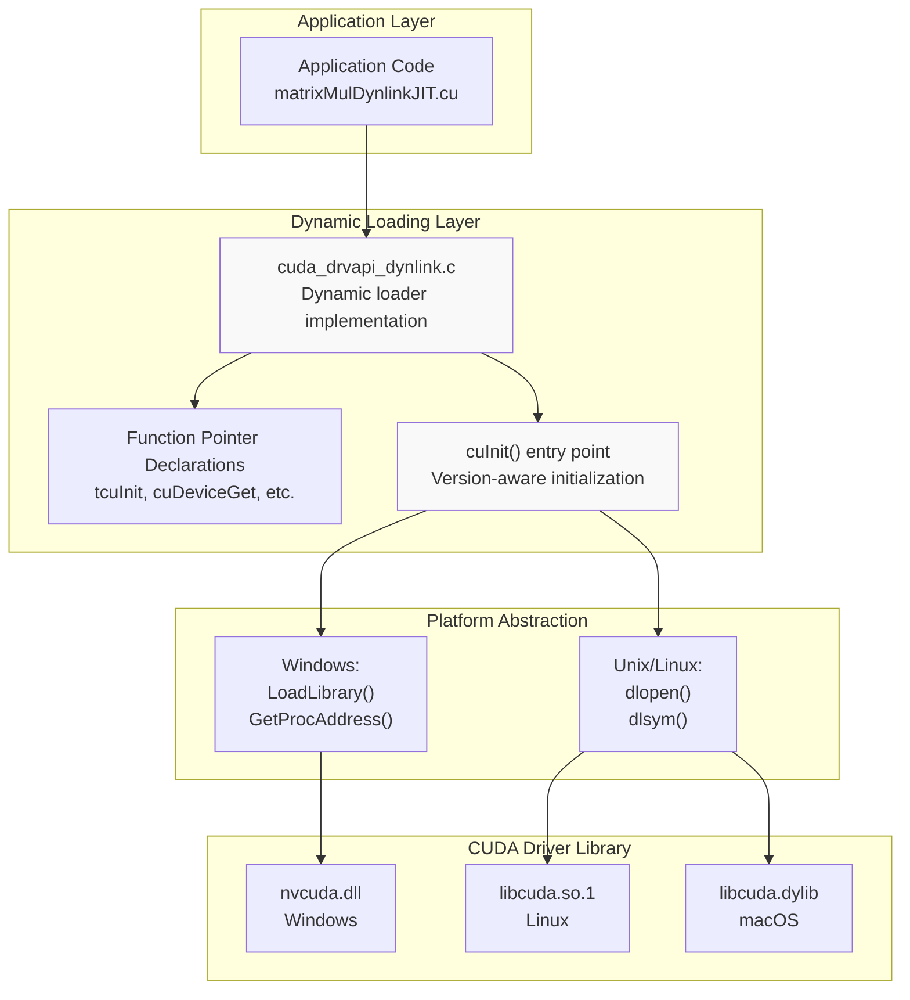
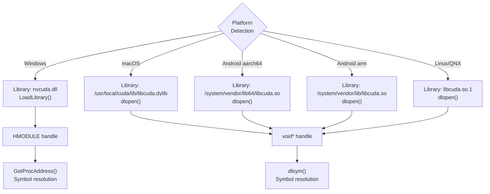
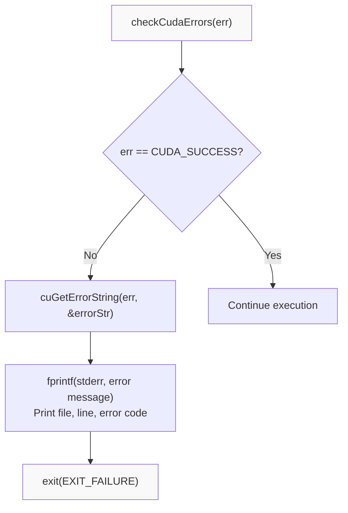
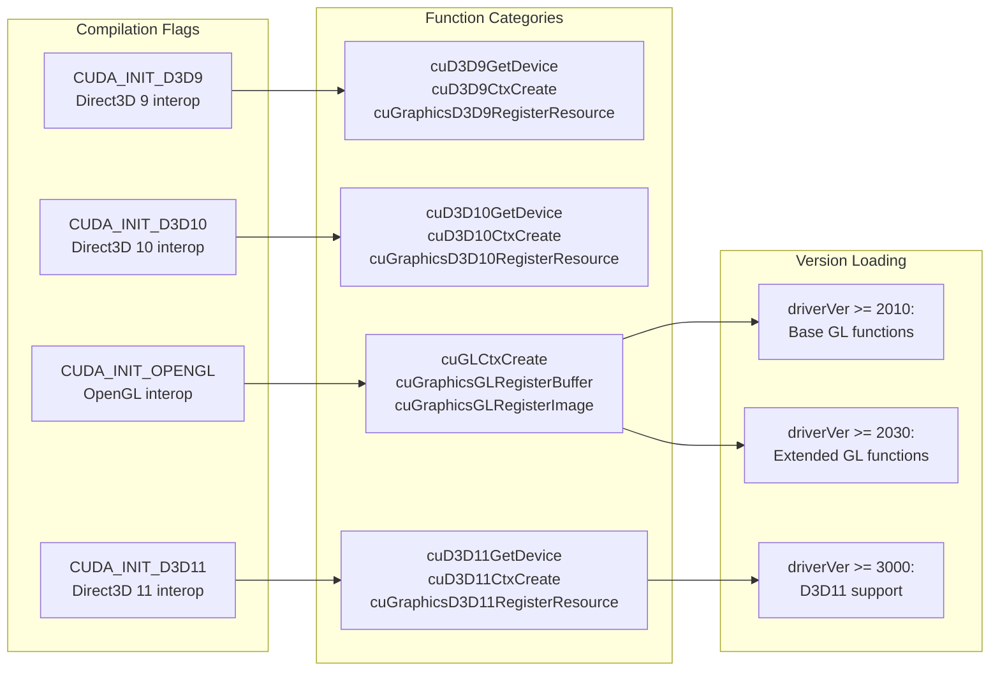
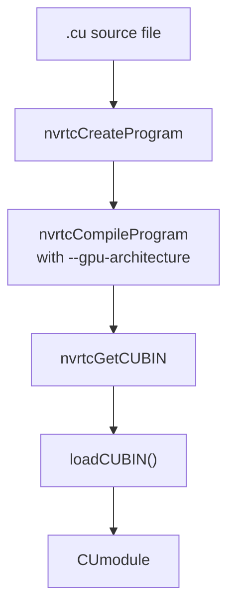

<!-- source: DeepWiki mcp.deepwiki.com · repo NVIDIA/cuda-samples · page 5.1 CUDA Driver API and Dynamic Loading · fetched 2026-10-26 -->

# CUDA Driver API and Dynamic Loading

<details>
<summary>Relevant source files</summary>

The following files were used as context for generating this wiki page:

- [Common/drvapi_error_string.h](Common/drvapi_error_string.h)
- [Common/helper_cuda_drvapi.h](Common/helper_cuda_drvapi.h)
- [Common/nvrtc_helper.h](Common/nvrtc_helper.h)

</details>


## Purpose and Scope

This page documents the dynamic loading mechanism for the CUDA Driver API, as demonstrated in the `matrixMulDynlinkJIT` sample. This approach enables applications to load the CUDA driver library at runtime and resolve function pointers dynamically, providing version compatibility and optional feature loading without compile-time linkage to the CUDA driver.

**Related pages:**
- For Runtime API helpers, see [Common Utilities and Helper Functions](#3)
- For JIT compilation workflows, see [Runtime Compilation with NVRTC](#4.3) and [libNVVM Samples (Category 7)](#10)

## Dynamic Loading Architecture

The dynamic loading system provides a runtime-flexible alternative to static linking against the CUDA driver library. Applications using this approach can adapt to different CUDA driver versions installed on the system and gracefully handle missing features.

### System Components



**Diagram: Dynamic Loading Architecture**

Sources: [Samples/0_Introduction/matrixMulDynlinkJIT/cuda_drvapi_dynlink.c:1-668]()

### Function Pointer System

The dynamic loading layer maintains function pointers for all CUDA Driver API functions. Each function has a corresponding type definition and global pointer variable.

| Function Category | Example Type | Example Pointer | Line Reference |
|------------------|--------------|-----------------|----------------|
| Initialization | `tcuInit` | `_cuInit` | [Samples/0_Introduction/matrixMulDynlinkJIT/cuda_drvapi_dynlink.c:27-27]() |
| Device Management | `tcuDeviceGet` | `cuDeviceGet` | [Samples/0_Introduction/matrixMulDynlinkJIT/cuda_drvapi_dynlink.c:29-29]() |
| Context Management | `tcuCtxCreate` | `cuCtxCreate` | [Samples/0_Introduction/matrixMulDynlinkJIT/cuda_drvapi_dynlink.c:37-37]() |
| Memory Operations | `tcuMemAlloc` | `cuMemAlloc` | [Samples/0_Introduction/matrixMulDynlinkJIT/cuda_drvapi_dynlink.c:57-57]() |
| Module Loading | `tcuModuleLoad` | `cuModuleLoad` | [Samples/0_Introduction/matrixMulDynlinkJIT/cuda_drvapi_dynlink.c:47-47]() |
| Kernel Launching | `tcuLaunchKernel` | `cuLaunchKernel` | [Samples/0_Introduction/matrixMulDynlinkJIT/cuda_drvapi_dynlink.c:108-108]() |
| Graphics Interop | `tcuGraphicsMapResources` | `cuGraphicsMapResources` | [Samples/0_Introduction/matrixMulDynlinkJIT/cuda_drvapi_dynlink.c:155-155]() |

Sources: [Samples/0_Introduction/matrixMulDynlinkJIT/cuda_drvapi_dynlink.c:27-170]()

## Platform-Specific Library Loading

The dynamic loading implementation abstracts platform differences in library loading and symbol resolution through preprocessor macros and conditional compilation.

### Library Name Resolution



**Diagram: Platform-Specific Library Loading Paths**

Sources: [Samples/0_Introduction/matrixMulDynlinkJIT/cuda_drvapi_dynlink.c:228-361]()

### Windows Implementation

The Windows implementation uses the Win32 API for dynamic library management:

**Library Loading:** [Samples/0_Introduction/matrixMulDynlinkJIT/cuda_drvapi_dynlink.c:239-249]()
```c
static CUresult LOAD_LIBRARY(CUDADRIVER *pInstance)
{
    *pInstance = LoadLibrary(__CudaLibName);  // "nvcuda.dll"
    if (*pInstance == NULL) {
        printf("LoadLibrary \"%s\" failed!\n", __CudaLibName);
        exit(EXIT_FAILURE);
    }
    return CUDA_SUCCESS;
}
```

**Handle Retrieval:** [Samples/0_Introduction/matrixMulDynlinkJIT/cuda_drvapi_dynlink.c:251-260]()
```c
CUresult GET_DRIVER_HANDLE(CUDADRIVER *pInstance)
{
    *pInstance = GetModuleHandle(__CudaLibName);
    if (*pInstance) {
        return CUDA_SUCCESS;
    } else {
        return CUDA_ERROR_UNKNOWN;
    }
}
```

**Symbol Resolution Macros:** [Samples/0_Introduction/matrixMulDynlinkJIT/cuda_drvapi_dynlink.c:262-281]()
- `GET_PROC_EX`: Resolves base function names using `GetProcAddress`
- `GET_PROC_EX_V2`: Resolves `_v2` suffixed functions for CUDA 3.2+ compatibility
- `GET_PROC_EX_V3`: Resolves `_v3` suffixed functions for CUDA 4.1+ compatibility

Sources: [Samples/0_Introduction/matrixMulDynlinkJIT/cuda_drvapi_dynlink.c:228-288]()

### Unix/Linux Implementation

The Unix implementation uses POSIX dynamic linking APIs:

**Library Loading:** [Samples/0_Introduction/matrixMulDynlinkJIT/cuda_drvapi_dynlink.c:308-318]()
```c
static CUresult LOAD_LIBRARY(CUDADRIVER *pInstance)
{
    *pInstance = dlopen(__CudaLibName, RTLD_NOW);
    if (*pInstance == NULL) {
        printf("dlopen \"%s\" failed!\n", __CudaLibName);
        exit(EXIT_FAILURE);
    }
    return CUDA_SUCCESS;
}
```

**Symbol Resolution Macros:** [Samples/0_Introduction/matrixMulDynlinkJIT/cuda_drvapi_dynlink.c:331-357]()
- Uses `dlsym()` instead of `GetProcAddress()`
- Identical macro structure to Windows for version-specific function resolution

The library name varies by platform:
- **macOS:** `/usr/local/cuda/lib/libcuda.dylib` [Samples/0_Introduction/matrixMulDynlinkJIT/cuda_drvapi_dynlink.c:295-295]()
- **Android aarch64:** `/system/vendor/lib64/libcuda.so` [Samples/0_Introduction/matrixMulDynlinkJIT/cuda_drvapi_dynlink.c:298-298]()
- **Android arm:** `/system/vendor/lib/libcuda.so` [Samples/0_Introduction/matrixMulDynlinkJIT/cuda_drvapi_dynlink.c:300-300]()
- **Linux/QNX:** `libcuda.so.1` [Samples/0_Introduction/matrixMulDynlinkJIT/cuda_drvapi_dynlink.c:303-303]()

Sources: [Samples/0_Introduction/matrixMulDynlinkJIT/cuda_drvapi_dynlink.c:290-361]()

## Version-Aware Function Resolution

The `cuInit()` function implements a sophisticated version detection and function resolution strategy that adapts to the installed CUDA driver version.

### Initialization Flow

```mermaid
graph TB
    Start["cuInit(unsigned int Flags,<br/>int cudaVersion)"]
    LoadLib["LOAD_LIBRARY(&CudaDrvLib)<br/>Load nvcuda.dll / libcuda.so"]
    InitCore["Resolve cuInit → _cuInit<br/>Call _cuInit(Flags)"]
    
    GetVer["GET_PROC_OPTIONAL(cuDriverGetVersion)<br/>Query driver version"]
    CheckVer{cuDriverGetVersion<br/>available?}
    
    SetVer1["driverVer = 1000<br/>Assume CUDA 1.0"]
    SetVer2["cuDriverGetVersion(&driverVer)<br/>Get actual version"]
    
    LoadCore["Load Core Functions<br/>cuDeviceGet, cuCtxCreate, etc."]
    
    Check5000{driverVer >= 5000?}
    Load5000["Load CUDA 5.0+ functions<br/>cuMipmappedArrayCreate, etc."]
    
    Check4020{driverVer >= 4020?}
    Load4020["Load CUDA 4.2+ functions<br/>cuFuncSetSharedMemConfig, etc."]
    
    Check4010{cudaVersion >= 4010<br/>&& API >= 4010?}
    Load4010["Load CUDA 4.1+ functions<br/>cuIpcGetMemHandle, etc."]
    
    Check4000{cudaVersion >= 4000<br/>&& API >= 4000?}
    LoadV2_4000["Load _v2 variants<br/>cuCtxDestroy_v2, etc."]
    
    Check3020{cudaVersion >= 3020<br/>&& API >= 3020?}
    LoadV2_3020["Load _v2 memory functions<br/>cuMemAlloc_v2, etc."]
    LoadBase["Load base versions<br/>Original function names"]
    
    CheckDriver{driverVer checks}
    LoadDriver4000["driverVer >= 4000:<br/>cuMemHostRegister, cuLaunchKernel"]
    LoadDriver3010["driverVer >= 3010:<br/>cuSurfRefSetArray"]
    LoadDriver3000["driverVer >= 3000:<br/>Graphics interop"]
    
    Done["Return CUDA_SUCCESS"]
    
    Start --> LoadLib
    LoadLib --> InitCore
    InitCore --> GetVer
    GetVer --> CheckVer
    
    CheckVer -->|No| SetVer1
    CheckVer -->|Yes| SetVer2
    
    SetVer1 --> LoadCore
    SetVer2 --> LoadCore
    
    LoadCore --> Check5000
    Check5000 -->|Yes| Load5000
    Check5000 -->|No| Check4020
    Load5000 --> Check4020
    
    Check4020 -->|Yes| Load4020
    Check4020 -->|No| Check4010
    Load4020 --> Check4010
    
    Check4010 -->|Yes| Load4010
    Check4010 -->|No| Check4000
    Load4010 --> Check4000
    
    Check4000 -->|Yes| LoadV2_4000
    Check4000 -->|No| Check3020
    LoadV2_4000 --> Check3020
    
    Check3020 -->|Yes| LoadV2_3020
    Check3020 -->|No| LoadBase
    LoadV2_3020 --> CheckDriver
    LoadBase --> CheckDriver
    
    CheckDriver --> LoadDriver4000
    LoadDriver4000 --> LoadDriver3010
    LoadDriver3010 --> LoadDriver3000
    LoadDriver3000 --> Done
    
    style Start fill:#f9f9f9
    style LoadLib fill:#f9f9f9
    style Done fill:#f9f9f9
```



**Diagram: Version-Aware Initialization Flow in cuInit()**

Sources: [Samples/0_Introduction/matrixMulDynlinkJIT/cuda_drvapi_dynlink.c:386-668]()

### Version Compatibility Matrix

The function resolution logic supports multiple CUDA driver versions with distinct function naming conventions:

| CUDA Version | API Version Check | Key Functions Loaded | Naming Convention |
|--------------|-------------------|---------------------|-------------------|
| 1.0 | Default (1000) | Core device, context, memory functions | Base names |
| 2.0+ | `driverVer >= 2010` | `cuModuleLoadDataEx`, `cuModuleLoadFatBinary` | Base names |
| 2.3+ | `driverVer >= 2030` | `cuMemHostGetFlags`, Graphics interop | Base names |
| 3.0+ | `driverVer >= 3000` | Graphics APIs, `cuMemcpyDtoDAsync` | Base names |
| 3.1+ | `driverVer >= 3010` | `cuModuleGetSurfRef`, `cuCtxSetLimit` | Base names |
| 3.2+ | `cudaVersion >= 3020` | Context, memory, array functions | `_v2` suffix |
| 4.0+ | `cudaVersion >= 4000` | `cuCtxSetCurrent`, `cuLaunchKernel` | `_v2` suffix |
| 4.1+ | `cudaVersion >= 4010` | IPC functions: `cuIpcGetMemHandle`, etc. | Base names |
| 4.2+ | `driverVer >= 4020` | `cuFuncSetSharedMemConfig` | Base names |
| 5.0+ | `driverVer >= 5000` | `cuMipmappedArrayCreate` | Base names |

Sources: [Samples/0_Introduction/matrixMulDynlinkJIT/cuda_drvapi_dynlink.c:467-668]()

### Function Versioning Example

The CUDA Driver API uses versioned function names to maintain backward compatibility. The dynamic loader handles this through conditional resolution:

**Example: Context Creation**

For CUDA 3.2+ applications:
```c
// Line 503: Load the _v2 variant
GET_PROC_V2(cuCtxCreate);  // Resolves to "cuCtxCreate_v2"
```

For CUDA versions before 3.2:
```c
// Line 552: Load the original variant
GET_PROC(cuCtxCreate);     // Resolves to "cuCtxCreate"
```

The `GET_PROC_V2` macro appends `_v2` suffix: [Samples/0_Introduction/matrixMulDynlinkJIT/cuda_drvapi_dynlink.c:269-274]()
```c
#define GET_PROC_EX_V2(name, alias, required)                            \
    alias = (t##name *)GetProcAddress(CudaDrvLib, STRINGIFY(name##_v2)); \
    if (alias == NULL && required) {                                     \
        printf("Failed to find required function \"%s\" in %s\n",        \
               STRINGIFY(name##_v2), __CudaLibName);                     \
        return CUDA_ERROR_UNKNOWN;                                       \
    }
```

Sources: [Samples/0_Introduction/matrixMulDynlinkJIT/cuda_drvapi_dynlink.c:467-591]()

## Driver API Helper Functions

The `helper_cuda_drvapi.h` file provides high-level abstractions over the Driver API, simplifying common operations like device initialization and error checking.

### Error Checking Infrastructure



**Diagram: Error Checking Flow in checkCudaErrors Macro**

Sources: [Common/helper_cuda_drvapi.h:65-80]()

The `checkCudaErrors` macro provides file and line information for debugging by calling the inline `__checkCudaErrors` function [Common/helper_cuda_drvapi.h:69-79](). For raw error string mappings, `drvapi_error_string.h` defines a lookup table `sCudaDrvErrorString` [Common/drvapi_error_string.h:46-203]().

### Device Initialization Functions

| Function | Purpose | Key Operations |
|----------|---------|----------------|
| `gpuDeviceInitDRV()` | Initialize specific device | `cuInit()`, parse command-line args, verify compute mode |
| `gpuGetMaxGflopsDeviceIdDRV()` | Find highest-performance device | Calculate GFLOPS for each device, select maximum |
| `findCudaDeviceDRV()` | General device selection | Command-line device or auto-select highest GFLOPS |

**Device Initialization with Command-Line Override:** [Common/helper_cuda_drvapi.h:148-197]()
```c
inline int gpuDeviceInitDRV(int ARGC, const char **ARGV) {
  int cuDevice = 0;
  int deviceCount = 0;
  checkCudaErrors(cuInit(0));
  checkCudaErrors(cuDeviceGetCount(&deviceCount));
  // ... parse -device=X ...
  checkCudaErrors(cuDeviceGet(&cuDevice, dev));
  return dev;
}
```

**Performance-Based Device Selection:** [Common/helper_cuda_drvapi.h:200-247]()
```c
inline int gpuGetMaxGflopsDeviceIdDRV() {
    // For each device, calculate:
    // compute_perf = multiProcessorCount * sm_per_multiproc * clockRate
    // Return device with maximum compute_perf
}
```

Sources: [Common/helper_cuda_drvapi.h:148-247]()

### SM Version to Cores Mapping

The `_ConvertSMVer2CoresDRV()` function maps compute capability versions to the number of CUDA cores per streaming multiprocessor:

[Common/helper_cuda_drvapi.h:91-143]()

**Architecture Mapping Table:**

| SM Version | Architecture | Cores per SM |
|------------|--------------|--------------|
| 3.0, 3.2, 3.5, 3.7 | Kepler | 192 |
| 5.0, 5.2, 5.3 | Maxwell | 128 |
| 6.0 | Pascal (P100) | 64 |
| 6.1, 6.2 | Pascal (Consumer) | 128 |
| 7.0, 7.2, 7.5 | Volta/Turing | 64 |
| 8.0 | Ampere (A100) | 64 |
| 8.6, 8.7, 8.9 | Ampere (Consumer) | 128 |
| 9.0+ | Hopper/Blackwell | 128 |

This mapping is used in performance calculations: [Common/helper_cuda_drvapi.h:234-235]()
```c
sm_per_multiproc = _ConvertSMVer2CoresDRV(major, minor);
unsigned long long compute_perf = (unsigned long long)multiProcessorCount * sm_per_multiproc * clockRate;
```

Sources: [Common/helper_cuda_drvapi.h:91-143]()

## Optional Graphics Interop Loading

The dynamic loader supports conditional compilation of graphics interoperability functions for Direct3D and OpenGL.

### Conditional Compilation Flags



**Diagram: Graphics Interop Conditional Loading**

These features are disabled by default: [Samples/0_Introduction/matrixMulDynlinkJIT/cuda_drvapi_dynlink.c:16-21]()

**Direct3D 11 Loading:** [Samples/0_Introduction/matrixMulDynlinkJIT/cuda_drvapi_dynlink.c:616-620]()
```c
#ifdef CUDA_INIT_D3D11
    GET_PROC(cuD3D11GetDevice);
    GET_PROC(cuD3D11CtxCreate);
    GET_PROC(cuGraphicsD3D11RegisterResource);
#endif
```

**OpenGL Loading:** [Samples/0_Introduction/matrixMulDynlinkJIT/cuda_drvapi_dynlink.c:644-660]()
```c
#ifdef CUDA_INIT_OPENGL
    GET_PROC(cuGraphicsGLRegisterBuffer);
    GET_PROC(cuGraphicsGLRegisterImage);
#endif
```

Sources: [Samples/0_Introduction/matrixMulDynlinkJIT/cuda_drvapi_dynlink.c:16-666]()

## Usage Patterns

### Basic Initialization Pattern

Applications using dynamic loading follow this initialization sequence:

1. **Include dynamic loader header:** `cuda_drvapi_dynlink.h`
2. **Initialize CUDA Driver:** `cuInit(0, __CUDA_API_VERSION);` which handles library loading and function resolution.
3. **Use Driver API functions:** All resolved function pointers (e.g., `cuCtxCreate`) are now available for use.

### Runtime Compilation with NVRTC

For samples requiring JIT compilation of kernels (like `matrixMulDynlinkJIT`), `nvrtc_helper.h` provides the `compileFileToCUBIN` function [Common/nvrtc_helper.h:50-183]().



**Diagram: JIT Compilation Workflow**

Sources: [Common/nvrtc_helper.h:50-183]()

### Error Handling Pattern

The helper functions provide a consistent error checking pattern:

```c
// Using checkCudaErrors macro
checkCudaErrors(cuInit(0));
checkCudaErrors(cuDeviceGetCount(&deviceCount));

// Macro expands to:
// __checkCudaErrors(err, __FILE__, __LINE__)
// which prints error string and exits on failure
```

Sources: [Common/helper_cuda_drvapi.h:65-80]()

## Key Advantages and Limitations

### Advantages

1. **Version Flexibility:** Applications can run with different CUDA driver versions without recompilation.
2. **Optional Features:** Graphics interop can be conditionally loaded only when needed.
3. **Graceful Degradation:** Missing functions can be detected and handled at runtime.
4. **No Static Dependencies:** No need to link against `cuda.lib` / `libcuda.so` at build time.

### Limitations

1. **Initialization Overhead:** Library loading and function resolution occur at runtime.
2. **Error Detection Delay:** Missing functions only detected during initialization.
3. **Code Maintenance:** Must manually maintain function pointer declarations for new CUDA versions.

Sources: [Samples/0_Introduction/matrixMulDynlinkJIT/cuda_drvapi_dynlink.c:1-668](), [Common/helper_cuda_drvapi.h:1-354]()

---

