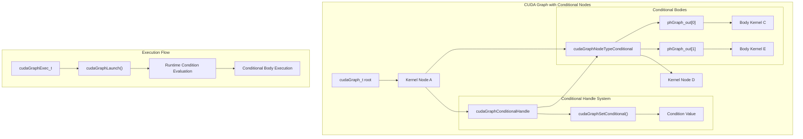
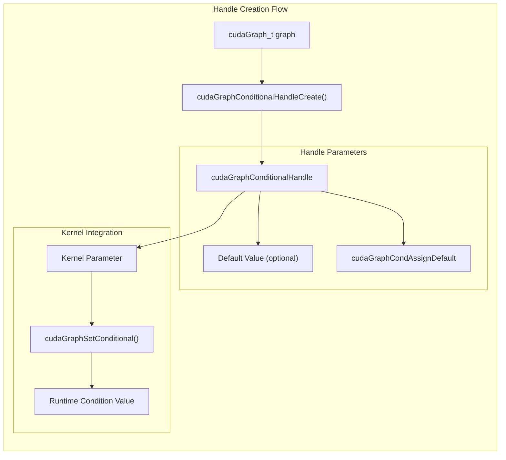
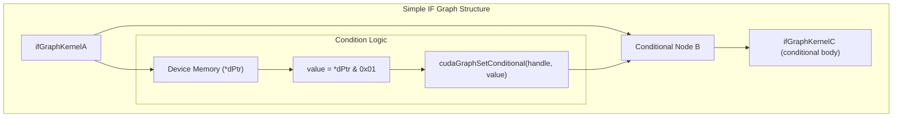
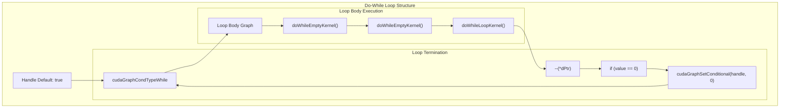
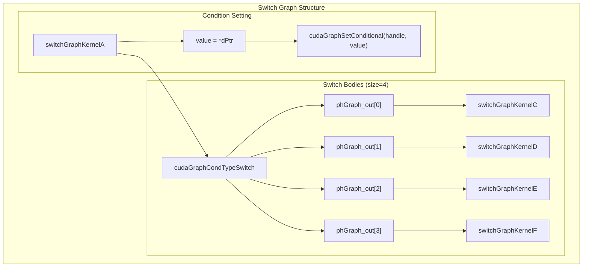
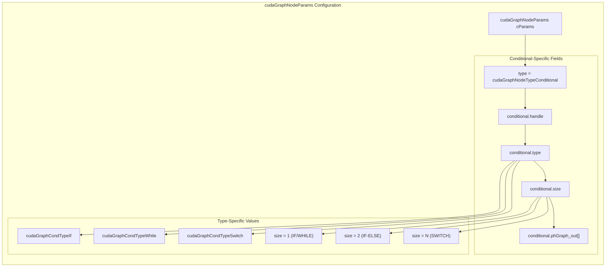
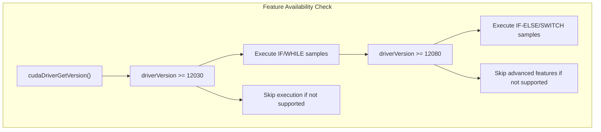

<!-- source: DeepWiki mcp.deepwiki.com · repo NVIDIA/cuda-samples · page 5.2 CUDA Graphs and Conditional Nodes · fetched 2026-10-26 -->

# CUDA Graphs and Conditional Nodes

Relevant source files

The following files were used as context for generating this wiki page:

- [CHANGELOG.md](CHANGELOG.md)
- [CMakeLists.txt](CMakeLists.txt)

This document covers CUDA's conditional graph nodes feature, which enables dynamic control flow within CUDA graphs. Conditional nodes allow graphs to make runtime decisions about which subgraphs to execute based on GPU-computed conditions, enabling if-else logic, loops, and switch statements within the graph execution model.

For information about basic CUDA graph construction and execution patterns, see [Advanced CUDA Features (Category 3)](#5). For broader CUDA feature coverage, see [CUDA Driver API and Dynamic Loading](#5.1).

## Core Architecture and Concepts

CUDA conditional nodes extend the static graph execution model with dynamic control flow. The system uses conditional handles to communicate runtime decisions between kernels and the graph execution engine.

### Conditional Node Architecture

**Sources:** [cpp/3_CUDA_Features/graphConditionalNodes/graphConditionalNodes.cu:60-136]()

### Conditional Node Types

The CUDA conditional system supports multiple control flow patterns through different node types defined in the `cudaGraphCondType` enum:

| Conditional Type | Enum Value | Behavior | Body Graphs |
|-----------------|------------|----------|-------------|
| IF | `cudaGraphCondTypeIf` | Execute if condition is true | 1 |
| IF-ELSE | `cudaGraphCondTypeIf` | Execute first graph if true, second if false | 2 |
| WHILE | `cudaGraphCondTypeWhile` | Execute while condition is true | 1 |
| SWITCH | `cudaGraphCondTypeSwitch` | Execute graph[n] when condition equals n | Multiple |

**Sources:** [cpp/3_CUDA_Features/graphConditionalNodes/graphConditionalNodes.cu:102-106](), [cpp/3_CUDA_Features/graphConditionalNodes/graphConditionalNodes.cu:387-395](), [cpp/3_CUDA_Features/graphConditionalNodes/graphConditionalNodes.cu:491-495]()

## Conditional Handle Management

### Handle Creation and Configuration

The `cudaGraphConditionalHandle` serves as the communication mechanism between kernels and conditional nodes. Kernels call `cudaGraphSetConditional()` to set the condition value that determines execution flow.

**Sources:** [cpp/3_CUDA_Features/graphConditionalNodes/graphConditionalNodes.cu:88-90](), [cpp/3_CUDA_Features/graphConditionalNodes/graphConditionalNodes.cu:178-179]()

## Graph Construction Patterns

### Simple IF Graph Pattern

The basic IF pattern demonstrates conditional execution based on kernel-computed conditions:

In this pattern, `ifGraphKernelA` reads device memory, performs a bitwise operation to determine oddness, and sets the conditional handle. The conditional node then executes `ifGraphKernelC` only if the condition is true.

**Sources:** [cpp/3_CUDA_Features/graphConditionalNodes/graphConditionalNodes.cu:60-66](), [cpp/3_CUDA_Features/graphConditionalNodes/graphConditionalNodes.cu:72-136]()

### Do-While Loop Pattern

The do-while pattern uses default handle values to ensure at least one execution:

**Sources:** [cpp/3_CUDA_Features/graphConditionalNodes/graphConditionalNodes.cu:157-163](), [cpp/3_CUDA_Features/graphConditionalNodes/graphConditionalNodes.cu:165-214]()

### Switch Graph Pattern

The switch pattern enables multi-way branching based on integer condition values:

**Sources:** [cpp/3_CUDA_Features/graphConditionalNodes/graphConditionalNodes.cu:445-450](), [cpp/3_CUDA_Features/graphConditionalNodes/graphConditionalNodes.cu:461-525]()

## Stream Capture Integration

### Captured While Graph Construction

CUDA conditional nodes integrate with stream capture to enable dynamic graph construction:

```mermaid
graph TD
    subgraph "Stream Capture Flow"
        CaptureStream["cudaStream_t captureStream"] --> BeginCapture["cudaStreamBeginCapture()"]
        BeginCapture --> GetInfo["cudaStreamGetCaptureInfo_v3()"]
        GetInfo --> CreateHandle["cudaGraphConditionalHandleCreate()"]
        
        subgraph "Manual Node Addition"
            CreateHandle --> LaunchKernel["capturedWhileKernel<<<>>>"]
            LaunchKernel --> GetDeps["cudaStreamGetCaptureInfo_v3() for dependencies"]
            GetDeps --> AddConditional["cudaGraphAddNode_v2() conditional"]
            AddConditional --> UpdateDeps["cudaStreamUpdateCaptureDependencies()"]
        end
        
        subgraph "Body Graph Capture"
            UpdateDeps --> ContinueCapture["Continue stream capture"]
            ContinueCapture --> EndCapture["cudaStreamEndCapture()"]
            EndCapture --> BodyCapture["cudaStreamBeginCaptureToGraph() for body"]
        end
    end
```

Note that CUDA 13.0 updated the `cudaGraphAddNode` and `cudaStreamGetCaptureInfo` APIs to `v2` and `v3` respectively to include `cudaGraphEdgeData` parameters.

**Sources:** [CHANGELOG.md:75-77](), [cpp/3_CUDA_Features/graphConditionalNodes/graphConditionalNodes.cu:250-337]()

## Node Parameter Configuration

### Conditional Node Parameters Structure

The `conditional.phGraph_out` array provides access to the body graphs that will be populated with the conditional execution logic.

**Sources:** [cpp/3_CUDA_Features/graphConditionalNodes/graphConditionalNodes.cu:102-109](), [cpp/3_CUDA_Features/graphConditionalNodes/graphConditionalNodes.cu:387-395]()

## Version Requirements and Feature Support

The conditional nodes feature has specific CUDA version requirements:

| Feature | Minimum CUDA Version | Driver Version Check |
|---------|---------------------|---------------------|
| Basic IF/WHILE nodes | CUDA 12.3 | `driverVersion >= 12030` |
| IF-ELSE and SWITCH nodes | CUDA 12.8 | `driverVersion >= 12080` |

The sample code includes runtime version checking to ensure feature availability:

**Sources:** [cpp/3_CUDA_Features/graphConditionalNodes/graphConditionalNodes.cu:531-548]()

---

