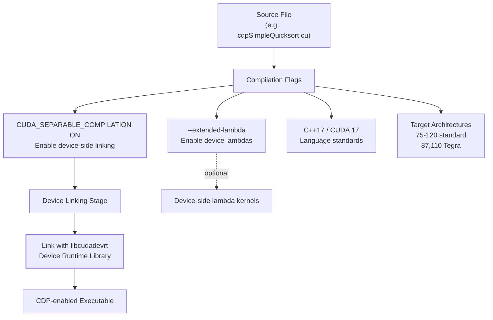
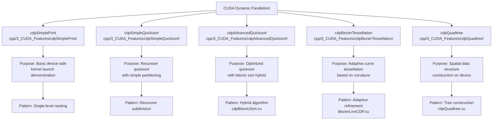
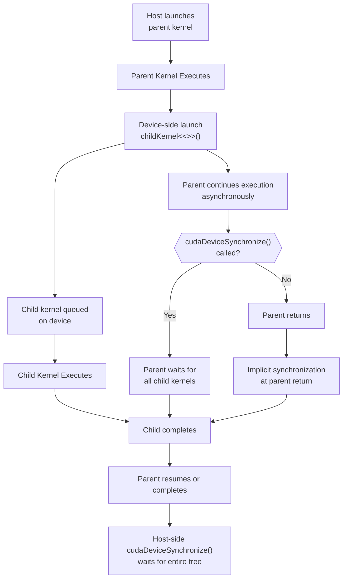
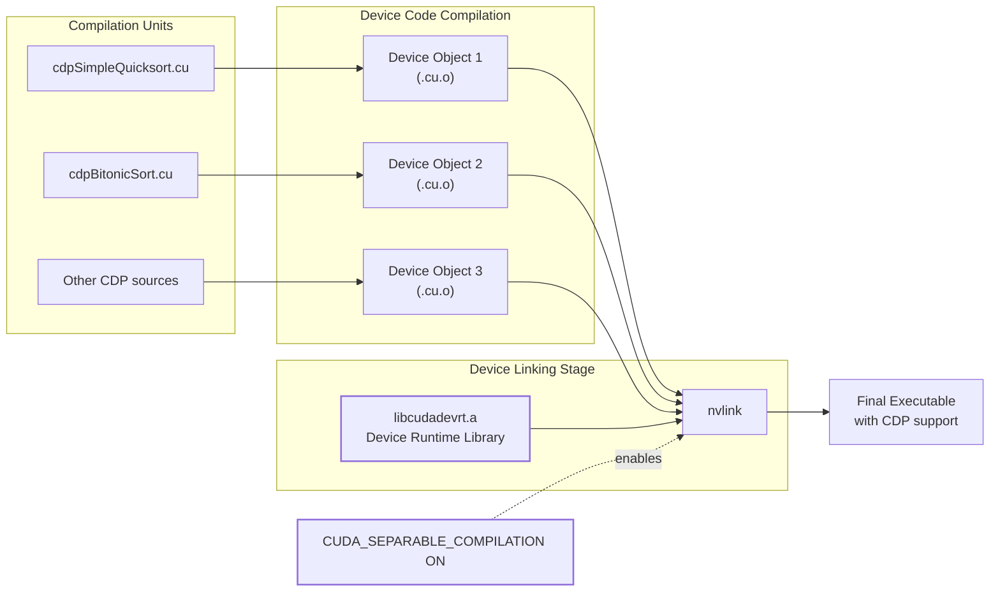
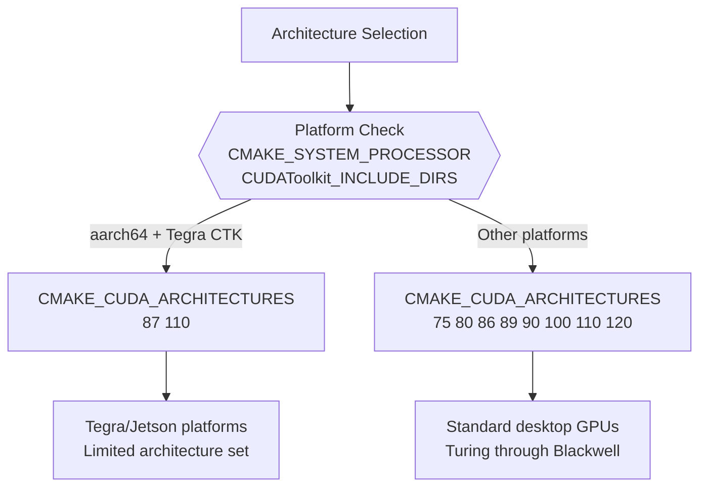

<!-- source: DeepWiki mcp.deepwiki.com · repo NVIDIA/cuda-samples · page 5.3 CUDA Dynamic Parallelism · fetched 2026-10-26 -->

# CUDA Dynamic Parallelism

<details>
<summary>Relevant source files</summary>

The following files were used as context for generating this wiki page:

- [CHANGELOG.md](CHANGELOG.md)
- [CMakeLists.txt](CMakeLists.txt)

</details>


## Purpose and Scope

This document describes CUDA Dynamic Parallelism (CDP), a feature that enables CUDA kernels to launch other kernels directly from device code without returning to the host. This capability allows for recursive and adaptive parallel algorithms where the amount of parallelism can be determined dynamically during execution. The document covers the five CDP samples in the repository ([cpp/3_CUDA_Features/cdp*]()), explains the build system requirements (separable compilation and device runtime library linking), and details the nested parallelism patterns demonstrated by each sample.

For information about CUDA Graphs and conditional execution patterns, see [CUDA Graphs and Conditional Nodes](#5.2). For general Driver API usage and JIT compilation, see [CUDA Driver API and Dynamic Loading](#5.1). For libNVVM's approach to device-side launches, see [Advanced NVVM Features](#10.3).

---

## Overview of Dynamic Parallelism

CUDA Dynamic Parallelism allows kernels executing on the GPU to launch additional kernels without CPU involvement. This capability eliminates the need to transfer control back to the host for launching dependent work, enabling more flexible parallel algorithms that can adapt their parallelism based on runtime data.

### Key Capabilities

| Capability | Description |
|------------|-------------|
| Device-side kernel launches | Kernels can invoke `<<<...>>>` syntax from device code |
| Nested parallelism | Child kernels can themselves launch additional kernels |
| Dynamic work generation | Amount of parallelism determined at runtime on the device |
| Recursive algorithms | Natural expression of recursive parallel algorithms (e.g., quicksort, tree traversal) |
| Adaptive computation | Kernels can conditionally launch child work based on data |

### Architecture Requirements

Dynamic Parallelism is supported on compute capability 3.5 and higher. All CDP samples in this repository target architectures SM 75-120 (Turing through Blackwell), with Tegra platforms restricted to SM 87 and 110.

**Sources:** [CMakeLists.txt:15](), [cpp/3_CUDA_Features/cdpSimpleQuicksort/CMakeLists.txt:14-18](), [cpp/3_CUDA_Features/cdpAdvancedQuicksort/CMakeLists.txt:14-18]()

---

## Build System Requirements for CDP

### Separable Compilation

All CDP samples require **separable compilation** (`CUDA_SEPARABLE_COMPILATION ON` in CMake). Separable compilation allows device code in one translation unit to call device functions or launch kernels defined in another translation unit, which is essential for the device runtime library.

**Diagram: CDP Build Configuration Flow**



**Sources:** [cpp/3_CUDA_Features/cdpSimpleQuicksort/CMakeLists.txt:35-39](), [cpp/3_CUDA_Features/cdpAdvancedQuicksort/CMakeLists.txt:36-40]()

### CMake Configuration Pattern

All five CDP samples follow the same CMake configuration pattern:

| Configuration | Value | Purpose |
|--------------|-------|---------|
| `CMAKE_CUDA_ARCHITECTURES` | 75 80 86 89 90 100 110 120 (standard)<br/>87 110 (Tegra) | Target GPU compute capabilities |
| `CUDA_SEPARABLE_COMPILATION` | ON | Enable device-side linking |
| `--extended-lambda` | Enabled | Allow lambdas in device code |
| `cxx_std_17` / `cuda_std_17` | Required | C++17 and CUDA 17 standards |
| `CMAKE_POSITION_INDEPENDENT_CODE` | ON | Generate position-independent code |

**Sources:** [CMakeLists.txt:9-15](), [cpp/3_CUDA_Features/cdpSimpleQuicksort/CMakeLists.txt:9-39](), [cpp/3_CUDA_Features/cdpBezierTessellation/CMakeLists.txt:9-39]()

---

## CDP Sample Catalog

The repository contains five samples demonstrating different aspects of dynamic parallelism:

**Diagram: CDP Samples and Their Use Cases**



**Sources:** [cpp/3_CUDA_Features/cdpSimplePrint/CMakeLists.txt:5,33](), [cpp/3_CUDA_Features/cdpSimpleQuicksort/CMakeLists.txt:5,33](), [cpp/3_CUDA_Features/cdpAdvancedQuicksort/CMakeLists.txt:5,34](), [cpp/3_CUDA_Features/cdpBezierTessellation/CMakeLists.txt:5,33](), [cpp/3_CUDA_Features/cdpQuadtree/CMakeLists.txt:5,33]()

### Sample Descriptions

#### cdpSimplePrint
- **File:** [cpp/3_CUDA_Features/cdpSimplePrint/cdpSimplePrint.cu]()
- **Purpose:** Introductory demonstration of device-side kernel launches.
- **Pattern:** Single-level kernel nesting with basic printing.

#### cdpSimpleQuicksort
- **File:** [cpp/3_CUDA_Features/cdpSimpleQuicksort/cdpSimpleQuicksort.cu]()
- **Purpose:** Recursive parallel quicksort implementation.
- **Pattern:** Recursive kernel launches for divide-and-conquer sorting.
- **Use Case:** Demonstrates how CDP enables natural expression of recursive algorithms.

#### cdpAdvancedQuicksort
- **Files:** [cpp/3_CUDA_Features/cdpAdvancedQuicksort/cdpAdvancedQuicksort.cu](), [cpp/3_CUDA_Features/cdpAdvancedQuicksort/cdpBitonicSort.cu]()
- **Purpose:** Optimized hybrid sorting using quicksort for large segments and bitonic sort for small segments.
- **Pattern:** Switches between algorithms based on problem size.
- **Special Build:** Limited to 64 registers in debug mode ([cpp/3_CUDA_Features/cdpAdvancedQuicksort/CMakeLists.txt:24]()) to prevent resource exhaustion.
- **Use Case:** Shows performance optimization with hybrid algorithms and CDP.

#### cdpBezierTessellation
- **File:** [cpp/3_CUDA_Features/cdpBezierTessellation/BezierLineCDP.cu]()
- **Purpose:** Adaptive tessellation of Bezier curves.
- **Pattern:** Kernels evaluate curvature and recursively subdivide curves that exceed quality thresholds.
- **Use Case:** Demonstrates adaptive refinement where work generation depends on runtime geometric properties.

#### cdpQuadtree
- **File:** [cpp/3_CUDA_Features/cdpQuadtree/cdpQuadtree.cu]()
- **Purpose:** Parallel construction of quadtree spatial data structures.
- **Pattern:** Recursive subdivision of spatial regions based on point distribution.
- **Use Case:** Shows dynamic tree construction on the device.

**Sources:** [cpp/3_CUDA_Features/cdpAdvancedQuicksort/CMakeLists.txt:24,34](), [cpp/3_CUDA_Features/cdpBezierTessellation/CMakeLists.txt:5]()

---

## Device-Side Kernel Launch Semantics

### Launch Syntax

Device-side kernel launches use the same syntax as host-side launches:

```cpp
childKernel<<<gridDim, blockDim, sharedMem, stream>>>(args...);
```

Key differences from host launches:
- Launches are **asynchronous** with respect to the parent kernel.
- The parent kernel can use `cudaDeviceSynchronize()` to wait for child completion.
- Child kernels inherit certain execution configuration from parent.
- Maximum nesting depth is implementation-dependent (typically 24 levels).

### Execution Model

**Diagram: CDP Execution Flow and Synchronization**



### Implicit Synchronization

- When a parent kernel returns, all child kernels it launched (directly or indirectly) are **implicitly synchronized**.
- Host-side synchronization (e.g., `cudaDeviceSynchronize()`) waits for the entire kernel tree to complete.
- This ensures correct ordering for applications that depend on kernel completion.

---

## Device Runtime Library (libcudadevrt)

### Linking Requirements

Dynamic Parallelism requires linking with the CUDA device runtime library (`libcudadevrt`). This library provides the implementation for device-side kernel launches, memory management, and synchronization primitives.

While not explicitly shown in the provided CMakeLists.txt snippets, CMake's `CUDA_SEPARABLE_COMPILATION ON` property automatically handles linking with `libcudadevrt` when required.

**Diagram: Device Runtime Library Integration**



### Device Runtime API Functions

The device runtime library provides device-side equivalents of many runtime API functions:

| Host API | Device API | Purpose |
|----------|-----------|---------|
| `cudaMalloc` | `cudaMalloc` | Allocate device memory from device code |
| `cudaFree` | `cudaFree` | Free device memory from device code |
| `cudaMemcpy` | `cudaMemcpy` | Copy memory from device code |
| `cudaDeviceSynchronize` | `cudaDeviceSynchronize` | Synchronize child kernels |
| `cudaStreamCreate` | `cudaStreamCreate` | Create streams on device |

**Sources:** [CHANGELOG.md:70](), [cpp/3_CUDA_Features/cdpAdvancedQuicksort/CMakeLists.txt:40]()

---

## Common Build Configuration Elements

### Debug Mode Configuration

All CDP samples support debug mode with specific flags:

```cmake
if(ENABLE_CUDA_DEBUG)
    set(CMAKE_CUDA_FLAGS "${CMAKE_CUDA_FLAGS} -G")        # enable cuda-gdb
else()
    set(CMAKE_CUDA_FLAGS "${CMAKE_CUDA_FLAGS} -lineinfo") # profiling support
endif()
```

**Special Case:** `cdpAdvancedQuicksort` limits register usage to 64 for the `big_bitonicsort` kernel in debug mode to prevent resource exhaustion.

**Sources:** [CMakeLists.txt:17-21](), [cpp/3_CUDA_Features/cdpAdvancedQuicksort/CMakeLists.txt:22-27]()

### Platform-Specific Architecture Selection



The Tegra platform detection uses both processor architecture and CUDA Toolkit installation path to determine if the aarch64 build target is actually a Tegra/Jetson embedded platform.

**Sources:** [CMakeLists.txt:15](), [cpp/3_CUDA_Features/cdpSimpleQuicksort/CMakeLists.txt:11-18](), [cpp/3_CUDA_Features/cdpBezierTessellation/CMakeLists.txt:11-18]()

---

## Extended Lambda Support

All CDP samples enable the `--extended-lambda` compiler flag, which allows lambda functions to be used in device code:

```cmake
set(CMAKE_CUDA_FLAGS "${CMAKE_CUDA_FLAGS} --extended-lambda")
```

This is particularly useful for CDP applications because:
- Device-side kernel launches can capture variables by value.
- Lambda kernels can be passed as functors to child launches.
- Simplifies code for adaptive algorithms that need to capture runtime state.

**Sources:** [CMakeLists.txt:23](), [cpp/3_CUDA_Features/cdpSimpleQuicksort/CMakeLists.txt:35](), [cpp/3_CUDA_Features/cdpAdvancedQuicksort/CMakeLists.txt:36]()

---

## Summary

CUDA Dynamic Parallelism enables device-side kernel launches, allowing for:
- **Recursive algorithms** (quicksort, tree traversal) with natural expression.
- **Adaptive refinement** (Bezier tessellation) based on runtime data.
- **Dynamic work generation** without host synchronization.
- **Nested parallelism** with arbitrary depth.

### Build Requirements
- `CUDA_SEPARABLE_COMPILATION ON` for device-side linking.
- Implicit linking with `libcudadevrt` device runtime library.
- Compute capability 3.5+ (samples target SM 75-120).
- `--extended-lambda` for lambda support in device code.

### Sample Portfolio
- **cdpSimplePrint:** Basic device-side launch introduction.
- **cdpSimpleQuicksort:** Recursive parallel quicksort.
- **cdpAdvancedQuicksort:** Optimized hybrid quicksort/bitonic sort.
- **cdpBezierTessellation:** Adaptive curve tessellation.
- **cdpQuadtree:** Spatial data structure construction.

**Sources:** [CMakeLists.txt:15, 23](), [cpp/3_CUDA_Features/cdpSimpleQuicksort/CMakeLists.txt:5, 33, 40](), [CHANGELOG.md:70]()

---

