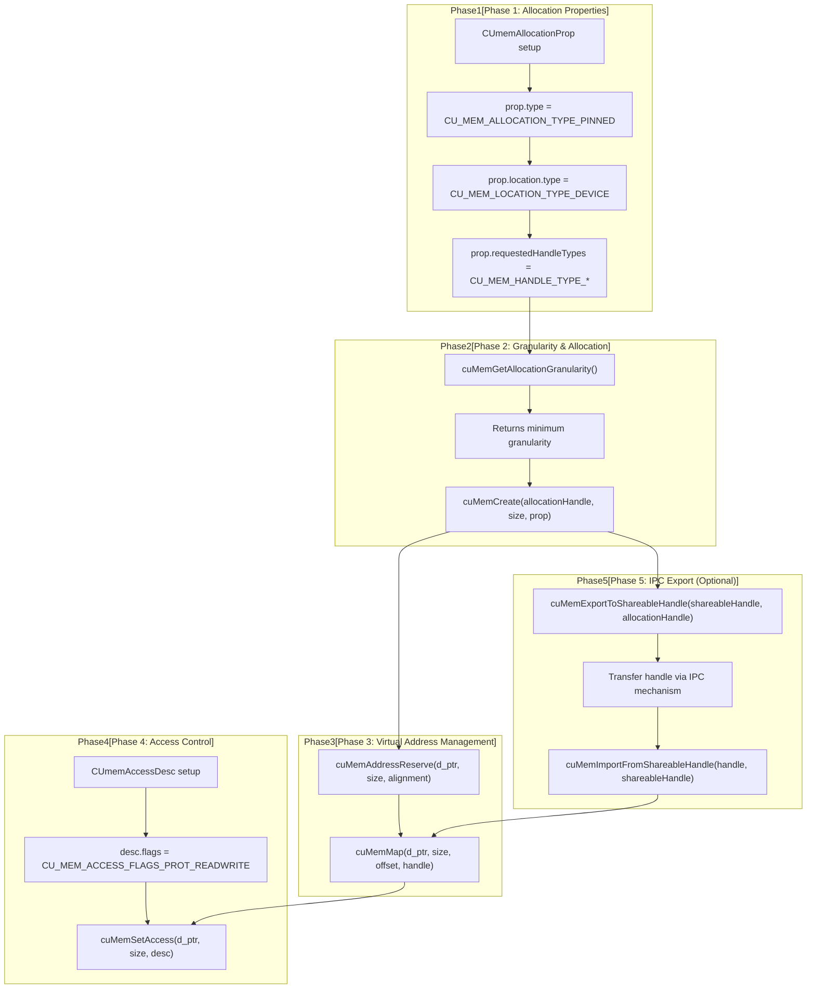
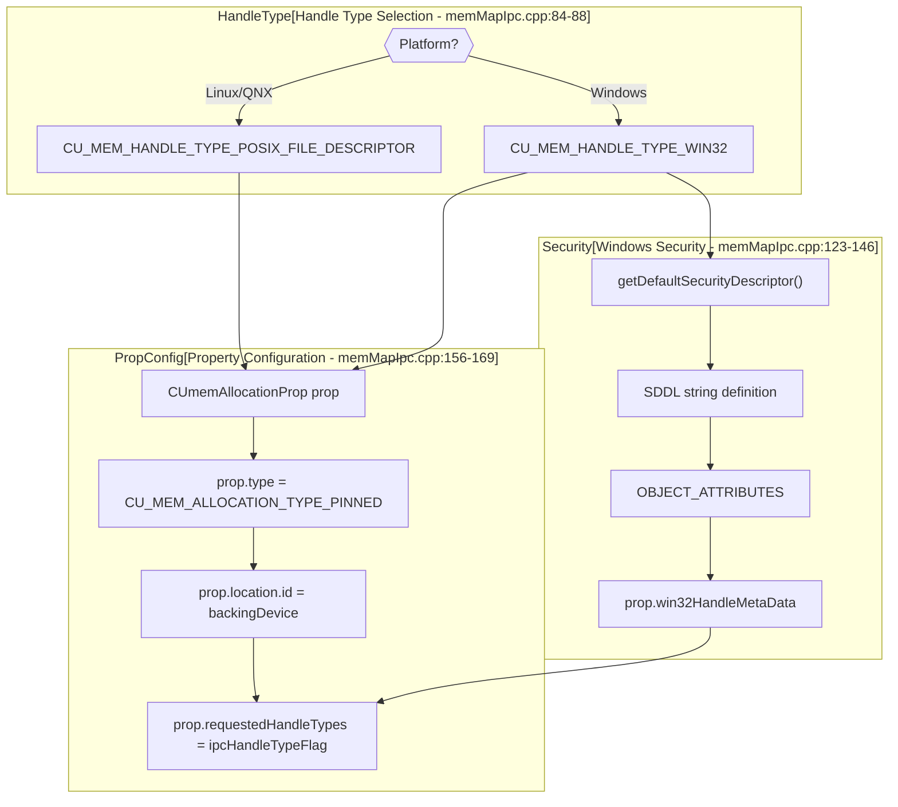
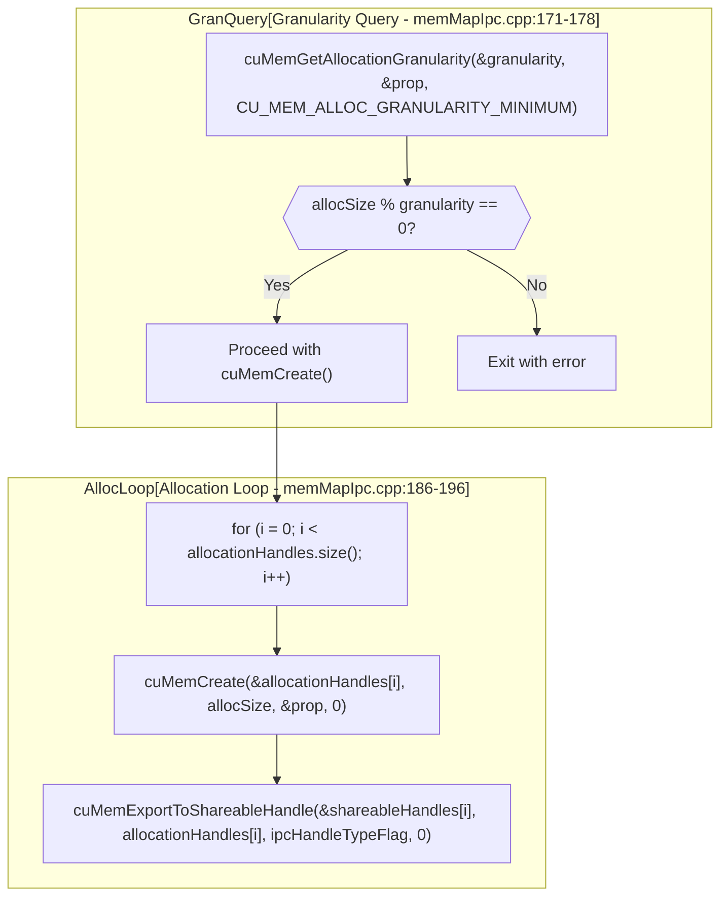
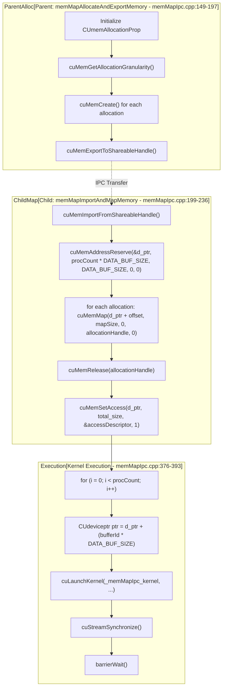
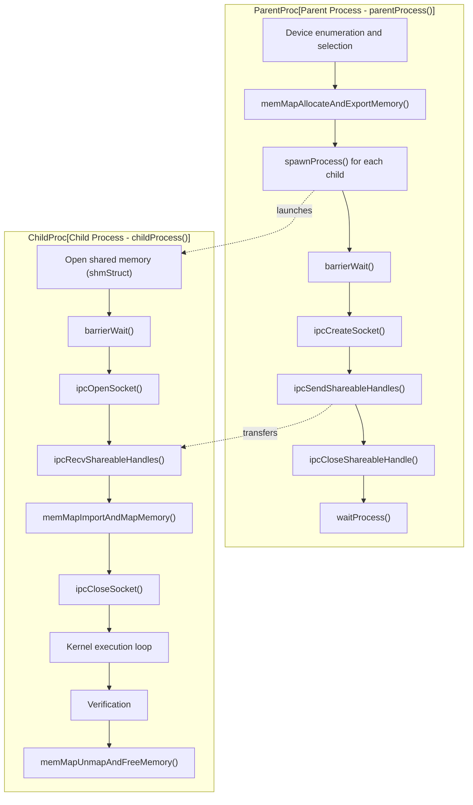
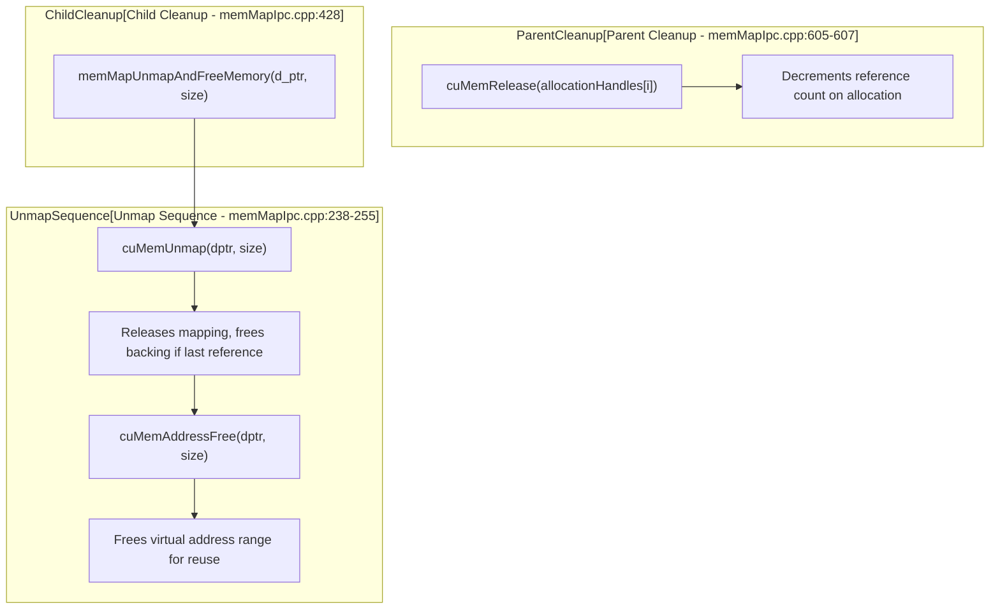
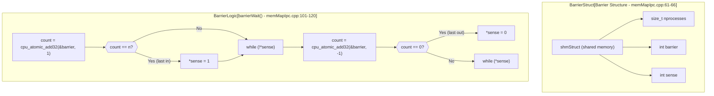

<!-- source: DeepWiki mcp.deepwiki.com · repo NVIDIA/cuda-samples · page 5.4 Memory Mapping and Virtual Memory Management · fetched 2026-10-26 -->

# Memory Mapping and Virtual Memory Management

<details>
<summary>Relevant source files</summary>

The following files were used as context for generating this wiki page:

- [CHANGELOG.md](CHANGELOG.md)
- [Common/helper_multiprocess.h](Common/helper_multiprocess.h)

</details>


## Overview

This page documents CUDA's virtual memory management system through the `cuMemMap` family of APIs, with focus on the `memMapIPCDrv` sample. These APIs provide fine-grained control over physical memory allocation, virtual address space management, and inter-process memory sharing. Unlike traditional `cudaMalloc`, the virtual memory APIs separate physical allocation from virtual address mapping, enabling advanced use cases including IPC, multi-GPU memory layouts, and custom memory pool implementations.

**Related Pages:**
- For basic IPC using `cudaIpcGetMemHandle`, see page 4.4
- For CUDA Driver API fundamentals, see page 5.1
- For multi-process utilities, see page 3.3

**Key Samples:**
- `memMapIPCDrv` - Primary demonstration of cuMemMap with IPC [cpp/3_CUDA_Features/memMapIPCDrv/memMapIpc.cpp]()
- `vectorAddMMAP` - Multi-device memory mapping [cpp/0_Introduction/vectorAddMMAP/]()
- `simpleVulkanMMAP` - Interoperability between Vulkan and CUDA using VMM APIs [cpp/5_Domain_Specific/simpleVulkanMMAP/]()

**Sources:** [CHANGELOG.md:65](), [CHANGELOG.md:58]()

## Virtual Memory API Workflow

The cuMemMap API family separates memory operations into distinct phases: physical allocation, virtual address reservation, mapping, and access control. This separation enables advanced memory management patterns not possible with traditional allocation APIs.

### Complete API Flow Diagram



**Sources:** [cpp/3_CUDA_Features/memMapIPCDrv/memMapIpc.cpp:149-197](), [cpp/3_CUDA_Features/memMapIPCDrv/memMapIpc.cpp:199-236]()

### API Lifecycle

The memory mapping lifecycle requires careful orchestration of allocation, mapping, and cleanup:

| Phase | Functions | Description |
|-------|-----------|-------------|
| **Setup** | `cuMemGetAllocationGranularity` | Query minimum allocation granularity for alignment |
| **Allocate** | `cuMemCreate` | Allocate physical memory, returns `CUmemGenericAllocationHandle` |
| **Reserve** | `cuMemAddressReserve` | Reserve contiguous virtual address range |
| **Map** | `cuMemMap` | Map physical allocation to virtual address |
| **Access** | `cuMemSetAccess` | Set read/write permissions for devices |
| **Export** | `cuMemExportToShareableHandle` | Export for IPC (file descriptor or HANDLE) |
| **Import** | `cuMemImportFromShareableHandle` | Import in another process |
| **Cleanup** | `cuMemUnmap`, `cuMemRelease`, `cuMemAddressFree` | Release resources |

**Sources:** [cpp/3_CUDA_Features/memMapIPCDrv/memMapIpc.cpp:149-256]()

## Allocation Properties and Configuration

The `CUmemAllocationProp` structure controls physical memory characteristics and IPC capabilities.

### Allocation Property Structure

```cpp
// memMapIpc.cpp demonstrates the key property configuration
CUmemAllocationProp prop = {};
prop.type = CU_MEM_ALLOCATION_TYPE_PINNED;  // Device-pinned memory
prop.location.type = CU_MEM_LOCATION_TYPE_DEVICE;
prop.location.id = deviceId;  // Backing device
prop.requestedHandleTypes = ipcHandleTypeFlag;  // Export capability
```

### Platform-Specific Handle Types

The sample supports two handle types for cross-process sharing:

| Platform | Handle Type | Value | System Primitive |
|----------|------------|-------|------------------|
| Linux/QNX | File Descriptor | `CU_MEM_HANDLE_TYPE_POSIX_FILE_DESCRIPTOR` | POSIX file descriptor |
| Windows | NT Handle | `CU_MEM_HANDLE_TYPE_WIN32` | Windows HANDLE |



**Sources:** [cpp/3_CUDA_Features/memMapIPCDrv/memMapIpc.cpp:84-88](), [cpp/3_CUDA_Features/memMapIPCDrv/memMapIpc.cpp:123-146](), [cpp/3_CUDA_Features/memMapIPCDrv/memMapIpc.cpp:156-169]()

### Windows Security Descriptors

On Windows, when using `CU_MEM_HANDLE_TYPE_WIN32`, a security descriptor is required to define access rights for the shared handle:

```cpp
// Defines scope for handle transfer between processes
static const char sddl[] = "D:P(OA;;GARCSDWDWOCCDCLCSWLODTWPRPCRFA;;;WD)";
ConvertStringSecurityDescriptorToSecurityDescriptorA(sddl, SDDL_REVISION_1, &secDesc, NULL);
InitializeObjectAttributes(&objAttributes, NULL, 0, NULL, secDesc);
prop.win32HandleMetaData = &objAttributes;
```

**Sources:** [cpp/3_CUDA_Features/memMapIPCDrv/memMapIpc.cpp:128-144]()

## Granularity Requirements

Memory allocations must be aligned to the minimum granularity supported by the device. This is queried via `cuMemGetAllocationGranularity`.

### Granularity Query and Validation



The granularity typically depends on the GPU architecture and memory type. Common values are 2MB (2097152 bytes) for device memory.

**Sources:** [cpp/3_CUDA_Features/memMapIPCDrv/memMapIpc.cpp:171-178](), [cpp/3_CUDA_Features/memMapIPCDrv/memMapIpc.cpp:186-196]()

## Virtual Address Reservation and Mapping

After physical allocation, virtual address space must be reserved and mapped.

### memMapIPCDrv Implementation Pattern



**Sources:** [cpp/3_CUDA_Features/memMapIPCDrv/memMapIpc.cpp:149-236](), [cpp/3_CUDA_Features/memMapIPCDrv/memMapIpc.cpp:360-393]()

### Virtual Address Reservation Parameters

The `cuMemAddressReserve` function reserves a contiguous range of virtual addresses:

```cpp
// From childProcess() in memMapIpc.cpp:362-363
CUdeviceptr d_ptr = 0ULL;
checkCudaErrors(cuMemAddressReserve(&d_ptr, procCount * DATA_BUF_SIZE, DATA_BUF_SIZE, 0, 0));
```

| Parameter | Purpose | Example Value |
|-----------|---------|---------------|
| `dptr` | Output virtual address pointer | `0ULL` (system chooses) |
| `size` | Total virtual address range | `procCount * DATA_BUF_SIZE` |
| `alignment` | Alignment requirement | `DATA_BUF_SIZE` (4MB) |
| `addr` | Preferred start address | `0` (no preference) |
| `flags` | Reserved flags | `0` |

**Sources:** [cpp/3_CUDA_Features/memMapIPCDrv/memMapIpc.cpp:362-363]()

## Access Permissions

The `CUmemAccessDesc` structure defines which devices can access the mapped memory.

### Access Descriptor Configuration

```mermaid
graph LR
    subgraph "AccessConfig[Access Configuration - memMapIpc.cpp:209-235]"
        DescSetup["CUmemAccessDesc accessDescriptor"]
        LocType["accessDescriptor.location.type = CU_MEM_LOCATION_TYPE_DEVICE"]
        LocID["accessDescriptor.location.id = mapDevice"]
        Flags["accessDescriptor.flags = CU_MEM_ACCESS_FLAGS_PROT_READWRITE"]
        SetAccess["cuMemSetAccess(d_ptr, size, &accessDescriptor, 1)"]
        
        DescSetup --> LocType
        LocType --> LocID
        LocID --> Flags
        Flags --> SetAccess
    end
    
    subgraph "ReleasePattern[Release Pattern - memMapIpc.cpp:227-231]"
        MapComplete["cuMemMap() complete"]
        Release["cuMemRelease(allocationHandle)"]
        Note["Allocation kept alive by mapping"]
        
        MapComplete --> Release
        Release --> Note
    end
    
    SetAccess --> MapComplete
```



**Sources:** [cpp/3_CUDA_Features/memMapIPCDrv/memMapIpc.cpp:209-235]()

### Access Flags

| Flag | Value | Description |
|------|-------|-------------|
| `CU_MEM_ACCESS_FLAGS_PROT_NONE` | 0x0 | No access |
| `CU_MEM_ACCESS_FLAGS_PROT_READ` | 0x1 | Read-only access |
| `CU_MEM_ACCESS_FLAGS_PROT_READWRITE` | 0x3 | Read and write access |

**Sources:** [cpp/3_CUDA_Features/memMapIPCDrv/memMapIpc.cpp:216]()

## IPC Handle Export and Import

Cross-process memory sharing is achieved through shareable handles transferred via IPC mechanisms. The repository provides `helper_multiprocess.h` to abstract these platform-specific mechanisms.

### Complete IPC Flow in memMapIPCDrv



**Sources:** [cpp/3_CUDA_Features/memMapIPCDrv/memMapIpc.cpp:433-611](), [cpp/3_CUDA_Features/memMapIPCDrv/memMapIpc.cpp:306-431](), [Common/helper_multiprocess.h:123-140]()

### IPC Socket Mechanisms

The sample uses `helper_multiprocess` utilities for cross-platform IPC:

- **Unix/Linux**: Uses Unix domain sockets (`AF_UNIX`) and `sendmsg`/`recvmsg` with `SCM_RIGHTS` to pass file descriptors between processes [Common/helper_multiprocess.h:108-112]().
- **Windows**: Uses Mailslots and `DuplicateHandle` to share NT handles between the parent and child processes [Common/helper_multiprocess.h:113-119]().

**Sources:** [Common/helper_multiprocess.h:108-119](), [Common/helper_multiprocess.h:123-140]()

### Export Function Call Pattern

```cpp
// Parent process exports handles - memMapIpc.cpp:194-195
checkCudaErrors(cuMemExportToShareableHandle(
    (void *)&shareableHandles[i], 
    allocationHandles[i], 
    ipcHandleTypeFlag, 
    0));

// Child process imports handles - memMapIpc.cpp:221-222
checkCudaErrors(cuMemImportFromShareableHandle(
    &allocationHandles[i], 
    (void *)(uintptr_t)shareableHandles[i], 
    ipcHandleTypeFlag));
```

**Sources:** [cpp/3_CUDA_Features/memMapIPCDrv/memMapIpc.cpp:194-195](), [cpp/3_CUDA_Features/memMapIPCDrv/memMapIpc.cpp:221-222]()

## Memory Cleanup and Lifecycle Management

Proper cleanup requires unmapping virtual addresses, releasing allocation handles, and freeing virtual address space.

### Cleanup Sequence



**Sources:** [cpp/3_CUDA_Features/memMapIPCDrv/memMapIpc.cpp:238-255](), [cpp/3_CUDA_Features/memMapIPCDrv/memMapIpc.cpp:420-428](), [cpp/3_CUDA_Features/memMapIPCDrv/memMapIpc.cpp:605-607]()

### Reference Counting Behavior

Physical allocations use reference counting:
- `cuMemCreate` initializes reference count to 1.
- `cuMemMap` does not increment reference count.
- `cuMemRelease` decrements reference count.
- `cuMemUnmap` on last mapping releases physical memory if reference count is 0.

**Sources:** [cpp/3_CUDA_Features/memMapIPCDrv/memMapIpc.cpp:227-231]()

## Process Synchronization in memMapIPCDrv

The sample uses CPU-side atomic barriers for multi-process synchronization, managed through a `sharedMemoryInfo` structure provided by `helper_multiprocess.h`.

### Barrier Implementation



**Sources:** [cpp/3_CUDA_Features/memMapIPCDrv/memMapIpc.cpp:61-66](), [cpp/3_CUDA_Features/memMapIPCDrv/memMapIpc.cpp:101-120](), [Common/helper_multiprocess.h:78-86]()

### Atomic Operations

Platform-specific atomic implementations ensure thread-safe barrier operations:

```cpp
// From memMapIpc.cpp:91-96
#if defined(__linux__) || defined(__QNX__)
#define cpu_atomic_add32(a, x) __sync_add_and_fetch(a, x)
#elif defined(WIN32) || defined(_WIN32) || defined(WIN64) || defined(_WIN64)
#define cpu_atomic_add32(a, x) InterlockedAdd((volatile LONG *)a, x)
#endif
```

**Sources:** [cpp/3_CUDA_Features/memMapIPCDrv/memMapIpc.cpp:91-96]()

## Device Capability Requirements

Virtual memory management requires specific device capabilities that must be checked at runtime using `cuDeviceGetAttribute`.

### Required Device Attributes

| Attribute | Purpose |
|-----------|---------|
| `CU_DEVICE_ATTRIBUTE_VIRTUAL_ADDRESS_MANAGEMENT_SUPPORTED` | Core VMM support |
| `CU_DEVICE_ATTRIBUTE_HANDLE_TYPE_POSIX_FILE_DESCRIPTOR_SUPPORTED` | Linux IPC support |
| `CU_DEVICE_ATTRIBUTE_HANDLE_TYPE_WIN32_HANDLE_SUPPORTED` | Windows IPC support |
| `CU_DEVICE_ATTRIBUTE_COMPUTE_MODE` | Must be `CU_COMPUTEMODE_DEFAULT` |

**Sources:** [cpp/3_CUDA_Features/memMapIPCDrv/memMapIpc.cpp:482-510](), [CHANGELOG.md:27-32]()

## Use Cases and Benefits

### Virtual Memory Advantages Over cudaMalloc

| Feature | `cudaMalloc` | `cuMemMap` APIs |
|---------|--------------|-----------------|
| Allocation Control | Opaque allocation | Separate physical allocation and VA mapping |
| IPC Sharing | Limited to `cudaIpcGetMemHandle` | Flexible handle export/import |
| Multi-GPU Layout | Device-specific pointers | Unified virtual address space |
| Memory Pools | OS-managed | Application-controlled VA reservation |
| Granular Access | Device-wide | Per-device access descriptors |

**Sources:** [cpp/3_CUDA_Features/memMapIPCDrv/memMapIpc.cpp:28-31]()

---

