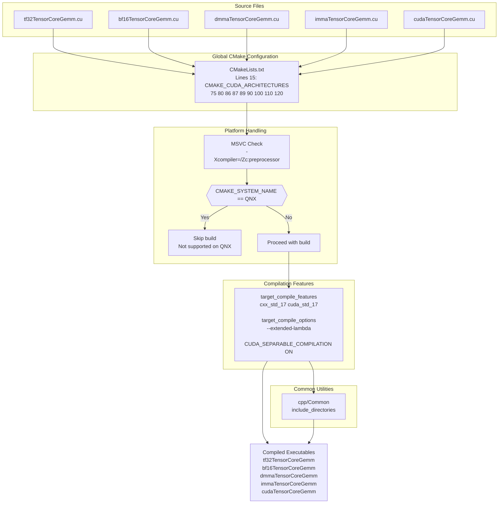
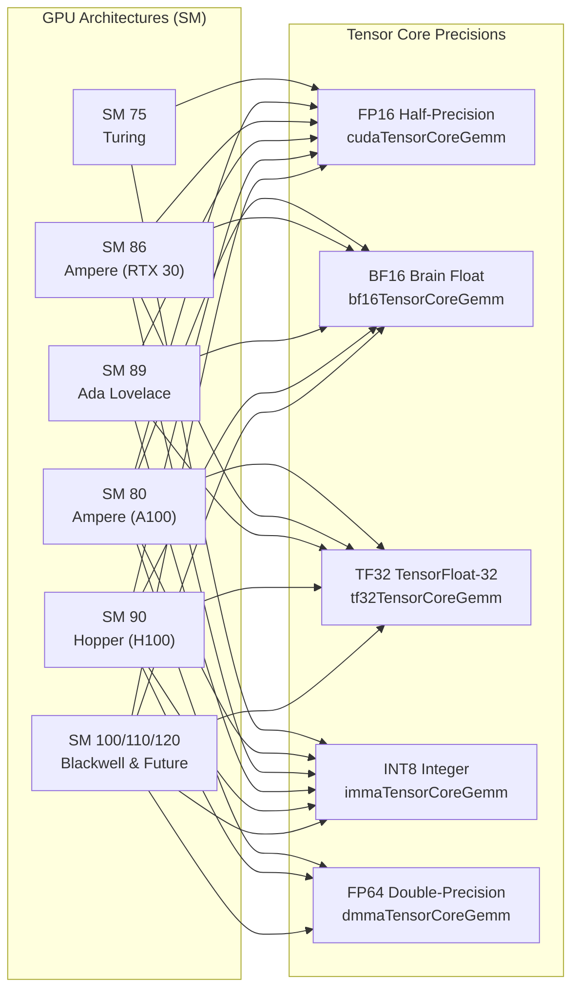
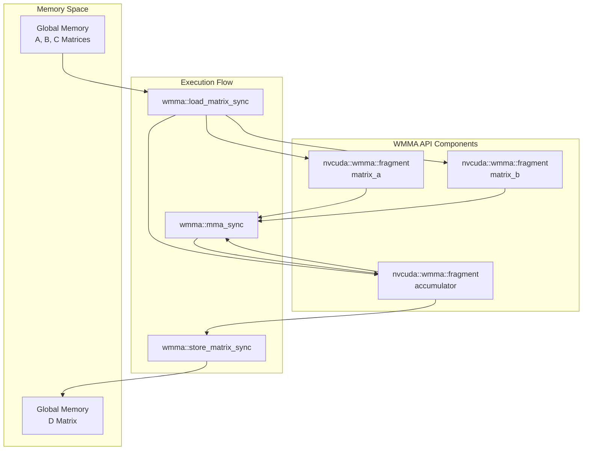

<!-- source: DeepWiki mcp.deepwiki.com · repo NVIDIA/cuda-samples · page 5.5 Tensor Core Operations · fetched 2026-10-26 -->

# Tensor Core Operations

Relevant source files

The following files were used as context for generating this wiki page:

- [CHANGELOG.md](CHANGELOG.md)
- [CMakeLists.txt](CMakeLists.txt)

## Purpose and Scope

This document describes the Tensor Core samples in the CUDA Samples repository, which demonstrate hardware-accelerated matrix operations available on NVIDIA GPUs starting with the Turing architecture (SM 75). Tensor Cores provide specialized matrix multiply-accumulate (MMA) operations with various precision types for high-performance computing (HPC) and machine learning (ML) workloads.

The repository includes five primary Tensor Core samples located in `cpp/3_CUDA_Features/`. Each sample demonstrates a different precision format: TF32, BF16, double-precision (DMMA), integer (IMMA), and half-precision (FP16). For general matrix operations using the cuBLAS library, see [6.1](). For an introduction to basic CUDA programming patterns, see [4.1]().

## Tensor Core Sample Catalog

The repository provides five distinct samples demonstrating different Tensor Core precision types and operation modes:

| Sample Name | Precision Type | Data Format | Primary Use Case | Location |
|-------------|----------------|-------------|------------------|----------|
| `tf32TensorCoreGemm` | TensorFloat-32 | 19-bit mantissa FP32 | Single-precision with reduced mantissa | [cpp/3_CUDA_Features/tf32TensorCoreGemm/]() |
| `bf16TensorCoreGemm` | Brain Float 16 | 16-bit floating point | Machine learning training | [cpp/3_CUDA_Features/bf16TensorCoreGemm/]() |
| `dmmaTensorCoreGemm` | Double-precision MMA | 64-bit floating point | High-precision scientific computing | [cpp/3_CUDA_Features/dmmaTensorCoreGemm/]() |
| `immaTensorCoreGemm` | Integer MMA | 8-bit signed integers | Quantized neural networks | [cpp/3_CUDA_Features/immaTensorCoreGemm/]() |
| `cudaTensorCoreGemm` | Half-precision | 16-bit floating point (FP16) | General-purpose accelerated GEMM | [cpp/3_CUDA_Features/cudaTensorCoreGemm/]() |

All samples implement General Matrix Multiply (GEMM) operations computing `D = alpha * A * B + beta * C` where matrices are of dimension `M x K * K x N = M x N`.

**Sources:** [CHANGELOG.md:18](), [CMakeLists.txt:33]()

## Sample Architecture and Compilation Flow

**Diagram: Tensor Core Sample Build Pipeline**

All Tensor Core samples follow an identical build configuration pattern with three key requirements: C++17/CUDA 17 standard compliance, extended lambda support for device code, and targeted architectures ranging from SM 75 to SM 120. The root `CMakeLists.txt` manages the global architecture settings, while individual sample subdirectories (linked via `cpp/CMakeLists.txt`) handle specific source compilation.

**Sources:** [CMakeLists.txt:1-34](), [CHANGELOG.md:20-22](), [CHANGELOG.md:103-106]()

## Architecture Support and Precision Mapping

**Diagram: Tensor Core Precision Support by GPU Architecture**

Tensor Core capabilities vary by GPU architecture. Turing (SM 75) introduced FP16 and INT8 operations. Ampere (SM 80) added BF16, TF32, and FP64 support. The current build system targets up to SM 120 (Blackwell architecture), ensuring these samples utilize the latest hardware instructions available in the CUDA Toolkit.

**Sources:** [CMakeLists.txt:15](), [CHANGELOG.md:3-5]()

## Warp Matrix Functions Programming Model

Tensor Core operations use the CUDA Warp Matrix Multiply-Accumulate (WMMA) API, which operates at warp granularity (32 threads). The programming model consists of three main phases:

1.  **Fragment Declaration**: Define matrix fragments distributed across warp threads using `nvcuda::wmma::fragment`.
2.  **Data Loading**: Load matrix data from global or shared memory into fragments using `nvcuda::wmma::load_matrix_sync`.
3.  **Matrix Multiply-Accumulate**: Perform hardware-accelerated computation via `nvcuda::wmma::mma_sync`.
4.  **Result Storage**: Write accumulated results back to memory using `nvcuda::wmma::store_matrix_sync`.

**Diagram: WMMA API Data Flow and Code Entities**

The WMMA API abstracts Tensor Core operations through type-safe fragment templates and synchronous warp-level operations. Each fragment represents a portion of a matrix distributed across the 32 threads in a warp.

**Sources:** [CHANGELOG.md:50-58](), [CHANGELOG.md:63-65]()

## Precision Type Details

### TF32 (TensorFloat-32)
TF32 format provides a 19-bit mantissa (vs 23-bit for FP32) with the same 8-bit exponent range. This allows using FP32 inputs while leveraging Tensor Core acceleration.
- **Sample**: `tf32TensorCoreGemm`
- **Architecture**: SM 80+ (Ampere and later)

### BF16 (Brain Float 16)
BF16 maintains FP32's 8-bit exponent but reduces the mantissa to 7 bits. This provides the same dynamic range as FP32 while using half the memory bandwidth.
- **Sample**: `bf16TensorCoreGemm`
- **Use Case**: Popular for machine learning training.

### DMMA (Double-Precision MMA)
Demonstrates FP64 Tensor Core operations available on A100 (SM 80) and Hopper (SM 90) GPUs.
- **Sample**: `dmmaTensorCoreGemm`
- **Use Case**: Scientific computing applications requiring high numerical precision.

### IMMA (Integer MMA)
Demonstrates 8-bit signed integer matrix operations, typically used for quantized neural network inference.
- **Sample**: `immaTensorCoreGemm`
- **Architecture**: Available from SM 75+ (Turing onwards).

### FP16 Half-Precision
The original Tensor Core precision type. FP16 provides balanced performance and accuracy for many ML and HPC applications.
- **Sample**: `cudaTensorCoreGemm`
- **Architecture**: Supported across all Tensor Core generations.

**Sources:** [CMakeLists.txt:15](), [CHANGELOG.md:3-14]()

## Build Configuration Details

All Tensor Core samples share common build requirements defined in the root `CMakeLists.txt` and inherited by the `cpp/` subdirectory:

### Required Compilation Settings
- **C++ Standard**: C++17 (`CMAKE_CXX_STANDARD 17`)
- **CUDA Standard**: CUDA 17 (`CMAKE_CUDA_STANDARD 17`)
- **Extended Lambda**: Enabled (`--extended-lambda`) for device-side lambda usage.
- **MSVC Preprocessor**: For Windows builds, `-Xcompiler=/Zc:preprocessor` is applied to comply with CCCL requirements.

### Debug vs. Release Flags
The build system provides two compilation modes controlled by `ENABLE_CUDA_DEBUG`:
- **Debug Mode**: Adds `-G` flag for `cuda-gdb` support.
- **Release Mode**: Adds `-lineinfo` flag for profiling tools (e.g., Nsight Systems) while maintaining performance.

**Sources:** [CMakeLists.txt:9-28](), [CHANGELOG.md:20-22]()

## Relationship to Other Specialized Operations

### CUDA Tile C++
Starting with CUDA 13.3, the repository includes `cpp/9_CUDA_Tile` samples, which offer a higher-level abstraction for tile-based programming, including `tileMatmul` which uses `cuda::tiles::mma` for Tensor Core acceleration.
- **Source**: [CHANGELOG.md:3-14]()

### Library Integration
Samples in `cpp/4_CUDA_Libraries/` (like `simpleCUBLASXT` or `jitLto`) demonstrate how high-level libraries and JIT compilation techniques interact with the underlying hardware, including Tensor Cores.
- **Source**: [CHANGELOG.md:45-46](), [CHANGELOG.md:66-67]()

**Sources:** [CHANGELOG.md:3-14](), [CHANGELOG.md:45-46](), [CHANGELOG.md:66-67]()

---

