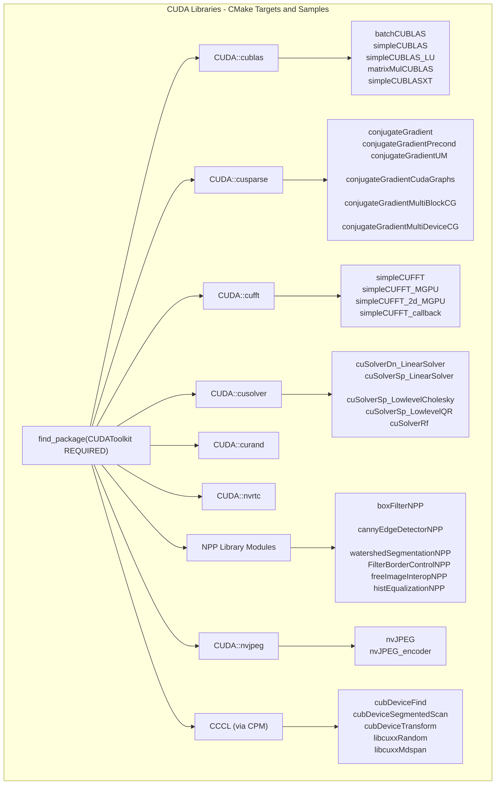
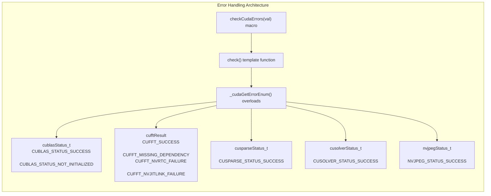

<!-- source: DeepWiki mcp.deepwiki.com · repo NVIDIA/cuda-samples · page 6 CUDA Libraries Integration (Category 4) · fetched 2026-10-26 -->

# CUDA Libraries Integration (Category 4)

Relevant source files

The following files were used as context for generating this wiki page:

- [CHANGELOG.md](CHANGELOG.md)
- [Common/helper_cusolver.h](Common/helper_cusolver.h)
- [Common/helper_nvJPEG.hxx](Common/helper_nvJPEG.hxx)

This page documents the CUDA library samples in the `cpp/4_CUDA_Libraries` directory, which demonstrate integration with NVIDIA's specialized GPU-accelerated libraries for linear algebra, FFT, image processing, random number generation, and runtime compilation. The category contains 35 samples showcasing library-specific APIs, error handling patterns, and optimization techniques.

## Overview of Category 4 Samples

The `4_CUDA_Libraries` directory demonstrates integration with the following CUDA library families:
- **cuBLAS/cuSPARSE**: Dense and sparse linear algebra operations.
- **cuFFT**: Fast Fourier Transform computations.
- **cuSOLVER**: Linear solvers and factorizations.
- **NPP (NVIDIA Performance Primitives)**: Image and signal processing.
- **nvJPEG**: JPEG encoding/decoding.
- **cuRAND**: Random number generation.
- **CCCL (CUDA C++ Core Libraries)**: Standard library primitives for CUDA (CUB, libcu++, Thrust).
- **NVRTC/nvJitLink**: Runtime compilation and link-time optimization.

### Library Categories and CMake Integration

Category 4 Library Dependency Mapping (CMake targets to sample usage):

### Sample Distribution Table

| Library Family | CMake Target(s) | Sample Count | Primary Samples |
|---------------|----------------|--------------|-----------------|
| cuBLAS | `CUDA::cublas` | 5 | `simpleCUBLAS`, `batchCUBLAS`, `simpleCUBLASXT` |
| cuSPARSE | `CUDA::cusparse` | 6 | `conjugateGradient` variants |
| cuFFT | `CUDA::cufft` | 5 | `simpleCUFFT`, `simpleCUFFT_callback` |
| cuSOLVER | `CUDA::cusolver` | 5 | `cuSolverDn_LinearSolver`, `cuSolverSp_LinearSolver` |
| NPP | `CUDA::nppc`, `CUDA::nppisu`, etc. | 6 | `cannyEdgeDetectorNPP`, `watershedSegmentationNPP` |
| nvJPEG | `CUDA::nvjpeg` | 2 | `nvJPEG`, `nvJPEG_encoder` |
| cuRAND | `CUDA::curand` | 2 | `randomFog`, `MersenneTwisterGP11213` |
| CCCL | Fetched via CPM | 5 | `cubDeviceFind`, `libcuxxMdspan`, `libcuxxRandom` |
| NVRTC/JIT | `CUDA::nvrtc`, `CUDA::cuda_driver` | 1 | `jitLto` |

Sources: [CHANGELOG.md:3-14](), [CHANGELOG.md:45-49]()

## Error Handling for CUDA Libraries

The `helper_cuda.h` header provides centralized error handling for all CUDA libraries through the `_cudaGetErrorEnum()` function template specializations. This allows unified error checking across different library APIs using the `checkCudaErrors()` macro.

### Library Error Code Translation

Error code translation mapping from `helper_cuda.h`:

The error handling infrastructure supports:
- **cuBLAS errors** ([Common/helper_cuda.h:68-105]()): Status codes including architecture mismatch and execution failures.
- **cuFFT errors** ([Common/helper_cuda.h:107-168]()): Includes updated codes like `CUFFT_MISSING_DEPENDENCY` and `CUFFT_NVRTC_FAILURE` ([CHANGELOG.md:86-95]()).
- **cuSPARSE/cuSOLVER errors** ([Common/helper_cuda.h:170-238]()): Standard status codes for linear algebra solvers.
- **nvJPEG errors** ([Common/helper_cuda.h:288-322]()): Status codes for JPEG hardware acceleration.

Sources: [Common/helper_cuda.h:52-583](), [CHANGELOG.md:86-95]()

## Linear Algebra with cuBLAS and cuSPARSE

This group demonstrates dense and sparse linear algebra operations.
- **cuBLAS**: High-performance BLAS implementation. Samples include `simpleCUBLAS` and `simpleCUBLASXT` for multi-GPU GEMM ([CHANGELOG.md:45-46]()).
- **cuSPARSE**: Sparse matrix primitives. The `conjugateGradient` family demonstrates solving systems using sparse storage formats like CSR ([Common/helper_cusolver.h:77-79]()).

For details, see [Linear Algebra with cuBLAS and cuSPARSE](#6.1).

## Fast Fourier Transform with cuFFT

cuFFT samples demonstrate 1D, 2D, and 3D FFTs.
- **Callbacks**: `simpleCUFFT_callback` shows how to inject custom logic (e.g., pointwise multiplication) into the FFT load/store process ([CHANGELOG.md:102]()).
- **Multi-GPU**: `simpleCUFFT_MGPU` and `simpleCUFFT_2d_MGPU` demonstrate data decomposition across multiple devices ([CHANGELOG.md:100-101]()).

For details, see [Fast Fourier Transform with cuFFT](#6.2).

## Image Processing with NPP and nvJPEG

This group covers image manipulation and compression.
- **NPP**: Provides functions for filtering (`boxFilterNPP`), edge detection (`cannyEdgeDetectorNPP`), and segmentation (`watershedSegmentationNPP`).
- **nvJPEG**: The `nvJPEG` and `nvJPEG_encoder` samples demonstrate hardware-accelerated decoding and encoding. The `helper_nvJPEG.hxx` utility provides `writeBMP` functions for verifying output ([Common/helper_nvJPEG.hxx:61-63]()).

For details, see [Image Processing with NPP and nvJPEG](#6.3).

## Advanced Library Features

This section covers specialized libraries and modern CUDA C++ features.
- **CCCL 3.3 Features**: Includes `cubDeviceFind` for device-wide search, `libcuxxRandom` for `<cuda/std/random>` engines like `cuda::pcg64`, and `libcuxxMdspan` for DLPack interop with multi-dimensional views ([CHANGELOG.md:5-10]()).
- **JIT and LTO**: `jitLto` demonstrates Runtime Compilation (NVRTC) combined with Link-Time Optimization ([CHANGELOG.md:67]()).
- **cuRAND**: `randomFog` demonstrates random number generation for visual effects.

For details, see [Advanced Library Features](#6.4).

## Library Helper Utilities

The `Common` directory contains specialized headers to simplify library usage:
- `helper_cusolver.h`: Provides utilities for matrix norm calculations (`csr_mat_norminf`) and matrix display ([Common/helper_cusolver.h:77-115]()).
- `helper_nvJPEG.hxx`: Contains BMP writing logic (`writeBMP`, `writeBMPi`) and JPEG processing wrappers ([Common/helper_nvJPEG.hxx:61-187]()).

Sources: [Common/helper_cusolver.h:1-167](), [Common/helper_nvJPEG.hxx:1-200]()

---

