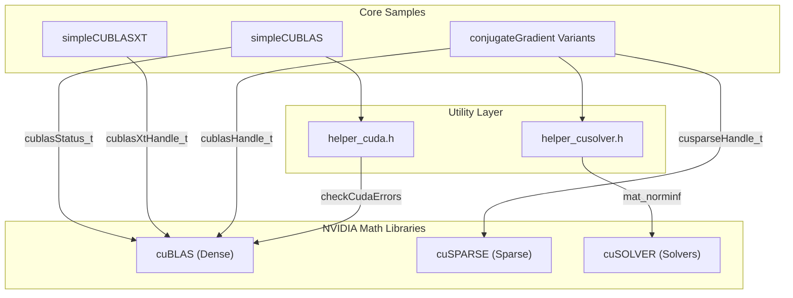

<!-- source: DeepWiki mcp.deepwiki.com · repo NVIDIA/cuda-samples · page 6.1 Linear Algebra with cuBLAS and cuSPARSE · fetched 2026-10-26 -->

# Linear Algebra with cuBLAS and cuSPARSE

<details>
<summary>Relevant source files</summary>

The following files were used as context for generating this wiki page:

- [CHANGELOG.md](CHANGELOG.md)
- [Common/helper_cusolver.h](Common/helper_cusolver.h)

</details>


## Purpose and Scope

This section details the implementation and integration of NVIDIA's high-performance linear algebra libraries: **cuBLAS** (Basic Linear Algebra Subprograms) and **cuSPARSE** (Sparse Matrix operations). These libraries provide optimized kernels for dense and sparse linear algebra, which are fundamental to scientific computing and machine learning.

The documentation covers library initialization, batched operations, multi-GPU scaling, and the integration of specialized solvers like **cuSOLVER**. Key samples include various `conjugateGradient` implementations, `simpleCUBLAS`, and `CUBLASXT` for multi-GPU GEMM.

## Library Architecture and Integration

The CUDA Samples demonstrate a tiered approach to linear algebra, ranging from simple single-GPU calls to complex multi-GPU and multi-block solvers.

### Library Ecosystem Diagram



Sources: [Common/helper_cusolver.h:38-47](), [cpp/4_CUDA_Libraries/simpleCUBLASXT/CMakeLists.txt:31-46]()

## Dense Linear Algebra (cuBLAS)

The `simpleCUBLAS` and `simpleCUBLASXT` samples demonstrate the standard interface for dense matrix operations.

### Key Features and Functions
- **simpleCUBLAS**: Demonstrates basic `cublasSgemm` and `cublasSscal` operations using `cublasHandle_t`.
- **CUBLASXT**: Showcases the "XT" interface which automatically handles data distribution across multiple GPUs for large-scale GEMM (General Matrix Multiply). It uses `cublasXtCreate` and `cublasXtSgemm`.
- **Batched Operations**: Many samples utilize `cublas<t>gemmBatched` to process thousands of small matrices simultaneously, maximizing GPU occupancy.

### Data Flow: Multi-GPU GEMM (cuBLASXT)
1. **Handle Creation**: Initialize with `cublasXtCreate`.
2. **Device Selection**: Map GPUs to the handle using `cublasXtDeviceSelect`.
3. **Execution**: Call `cublasXt<t>gemm`. The library manages host-to-device transfers and peer-to-peer (P2P) communication automatically.

Sources: [cpp/4_CUDA_Libraries/simpleCUBLASXT/CMakeLists.txt:46](), [CHANGELOG.md:46]()

## Sparse Linear Algebra (cuSPARSE)

The `cuSPARSE` library is optimized for matrices where most elements are zero. The samples focus on the **CSR (Compressed Sparse Row)** and **COO (Coordinate)** formats.

### Sparse Matrix Utilities
The header `helper_cusolver.h` provides essential utilities for sparse matrix verification:
- `csr_mat_norminf`: Calculates the infinity norm of a CSR matrix [Common/helper_cusolver.h:77-96]().
- `display_matrix`: Formats CSR data for debugging output [Common/helper_cusolver.h:98-115]().
- `cusparseMatDescr_t`: Descriptor used to define matrix properties (index base, matrix type) [Common/helper_cusolver.h:77-81]().

## Conjugate Gradient Solvers

The `conjugateGradient` samples are the most sophisticated linear algebra examples in the repository, combining `cuBLAS` for vector operations and `cuSPARSE` for Sparse Matrix-Vector multiplication (SpMV).

### Solver Variants and Implementation

| Sample Variant | Parallelism Strategy | Key APIs |
| :--- | :--- | :--- |
| `conjugateGradient` | Basic Single GPU | `cusparseSpMV`, `cublasDdot` |
| `conjugateGradientMultiBlockCG` | Cooperative Groups | `cudaLaunchCooperativeKernel` |
| `conjugateGradientMultiDeviceCG` | Multi-GPU Scaling | `cudaMemAdvise_v2`, `cudaMemPrefetchAsync_v2` |

### Multi-GPU Data Management
In `conjugateGradientMultiDeviceCG`, memory management was updated in CUDA 13.0 to use `cudaMemLocation` for better control over Unified Memory residency:
- `cudaMemAdvise_v2` is used to set preferred locations for sparse segments [CHANGELOG.md:78-80]().
- `cudaMemPrefetchAsync_v2` ensures data is local to the executing GPU before the SpMV kernel begins [CHANGELOG.md:78-80]().

Sources: [CHANGELOG.md:75-80](), [Common/helper_cusolver.h:38-47]()

## Integration with cuSOLVER

While `cuBLAS` and `cuSPARSE` provide the building blocks, `cuSOLVER` provides high-level solvers (LU, QR, Cholesky).

### Solver Utility Logic
The `testOpts` structure in `helper_cusolver.h` is used to parse command-line arguments for solver samples, including sparse matrix file paths and reordering options:
```cpp
struct testOpts {
  char *sparse_mat_filename;  // -F<filename>
  const char *testFunc;       // -R<name>
  const char *reorder;        // -P<name>
  int lda;                    // -lda<int>
};
```
Sources: [Common/helper_cusolver.h:42-47]()

## Build and Platform Configuration

### CMake Requirements
Linear algebra samples require the `CUDAToolkit` and specific library components.
- **Dependencies**: `CUDA::cublas`, `CUDA::cusparse`, and `CUDA::cusolver`.
- **Standards**: C++17 and CUDA 17 are the default for modern samples [CHANGELOG.md:8-10]().
- **Architectures**: Support ranges from SM 75 to SM 120 [CHANGELOG.md:27-34]().

### Platform-Specific Logic
- **QNX/Linux**: Time measurement in solvers uses `gettimeofday` via the `second()` helper [Common/helper_cusolver.h:141-149]().
- **Windows**: Uses `QueryPerformanceCounter` for high-resolution timing [Common/helper_cusolver.h:122-139]().

Sources: [Common/helper_cusolver.h:117-164](), [cpp/4_CUDA_Libraries/simpleCUBLASXT/CMakeLists.txt:31-46]()

---

