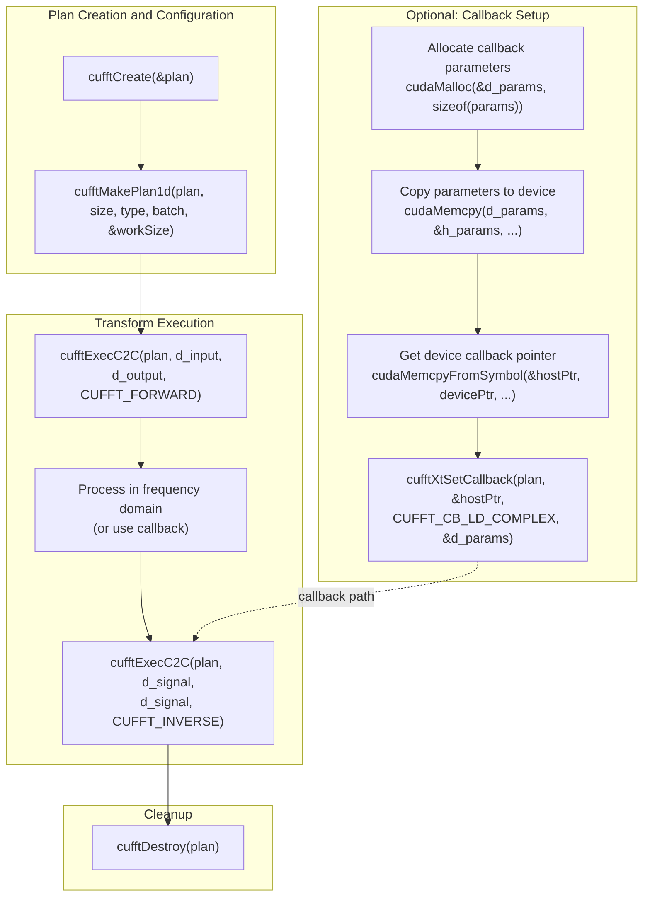
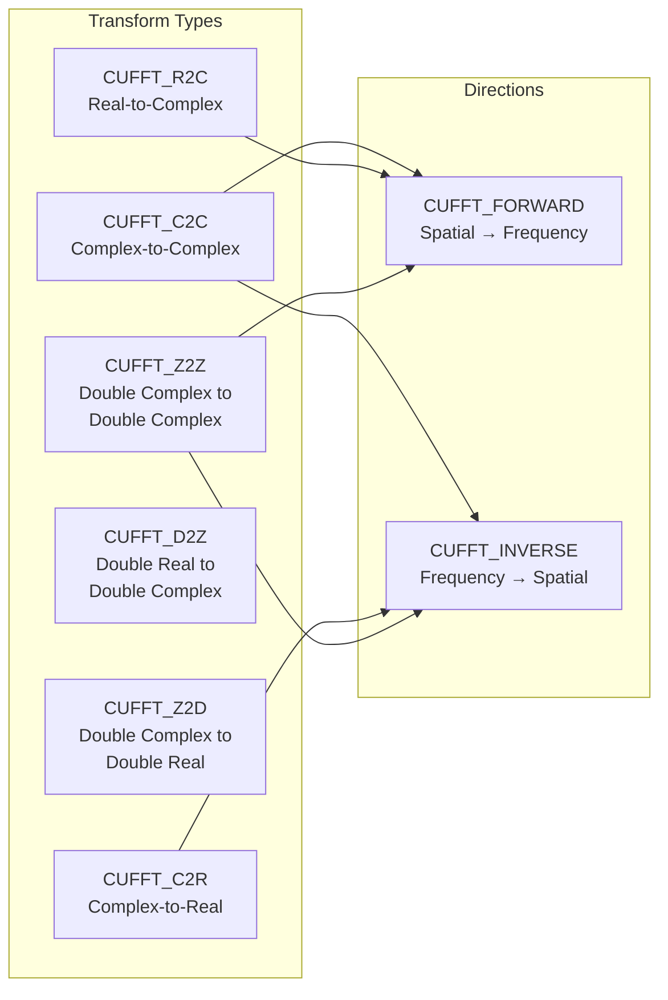
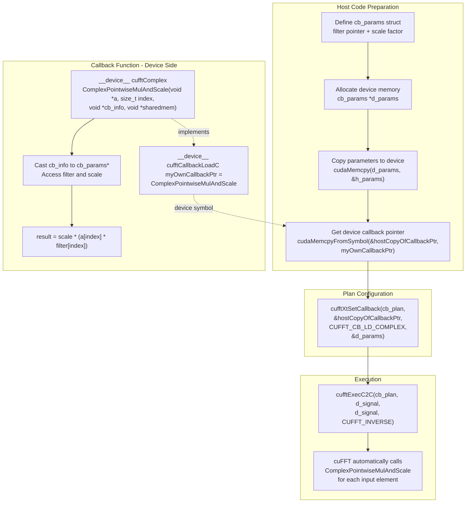
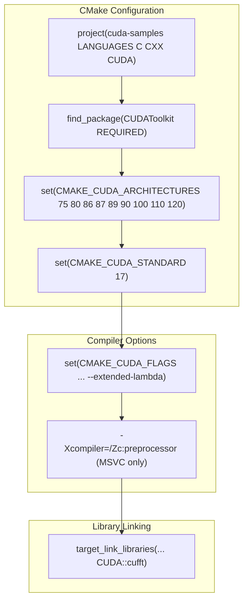

<!-- source: DeepWiki mcp.deepwiki.com · repo NVIDIA/cuda-samples · page 6.2 Fast Fourier Transform with cuFFT · fetched 2026-10-26 -->

# Fast Fourier Transform with cuFFT

<details>
<summary>Relevant source files</summary>

The following files were used as context for generating this wiki page:

- [CHANGELOG.md](CHANGELOG.md)
- [CMakeLists.txt](CMakeLists.txt)

</details>


This page documents the CUDA samples that demonstrate Fast Fourier Transform (FFT) operations using the cuFFT library. These samples illustrate convolution via frequency-domain multiplication, load/store callbacks, and multi-GPU FFT decomposition. For general CUDA library integration patterns, see [6.1]().

## Overview

The repository contains multiple samples demonstrating cuFFT capabilities:

| Sample | Primary Feature | Multi-GPU |
|--------|----------------|-----------|
| `simpleCUFFT` | Basic 1D convolution using FFT | No |
| `simpleCUFFT_callback` | Load/store callbacks for in-transform operations | No |
| `simpleCUFFT_MGPU` | 1D convolution distributed across GPUs | Yes |
| `simpleCUFFT_2d_MGPU` | 2D convolution distributed across GPUs | Yes |
| `oceanFFT` | Ocean height field simulation with OpenGL rendering | No |

All samples demonstrate the core pattern: transform input to frequency domain, perform operations (typically multiplication), and transform back to spatial domain. The callback samples show how to eliminate intermediate kernels by embedding operations within the transform itself.

Sources: [CHANGELOG.md:98-102](), [CMakeLists.txt:33]()

## cuFFT API Workflow

### Basic Execution Pattern



**Diagram: cuFFT API Execution Flow**

The basic workflow consists of three phases: plan creation, execution, and cleanup. Plans define the transform configuration (dimensions, type, batch size) and allocate internal working memory. The callback path shown represents an optional optimization where user code executes during the transform rather than in separate kernel launches.

Sources: [CHANGELOG.md:86-102]()

### Plan Types and Transform Directions



**Diagram: cuFFT Transform Types and Directions**

The samples primarily use `CUFFT_C2C` (complex-to-complex) transforms with both forward and inverse directions. Real-to-complex transforms exploit Hermitian symmetry to reduce memory and computation by approximately 2×.

Sources: [CHANGELOG.md:98-102]()

## Sample Implementation: simpleCUFFT_callback

### Callback Mechanism Architecture



**Diagram: cuFFT Callback Registration and Invocation Flow**

Callbacks eliminate separate kernel launches by embedding pointwise operations within the FFT itself. The device function pointer is retrieved via `cudaMemcpyFromSymbol` and passed to `cufftXtSetCallback` along with user parameters. During transform execution, cuFFT invokes the callback for each element, passing the element index and user parameters.

Sources: [CHANGELOG.md:102]()

### Convolution Implementation Strategy

The samples implement convolution as frequency-domain multiplication following the convolution theorem:

**Convolution Theorem**: `(f * g)(x) = F⁻¹[F[f] · F[g]]`

Where:
- `f * g` represents spatial-domain convolution
- `F[·]` represents forward FFT
- `F⁻¹[·]` represents inverse FFT
- `·` represents element-wise multiplication

**Implementation steps**:

1. **Padding**: Extend signal and filter to handle circular convolution boundary conditions.
2. **Forward transforms**: Transform both padded signal and filter to frequency domain.
3. **Pointwise multiply and scale**: Multiply corresponding frequency bins and scale by `1/N` for proper normalization.
4. **Inverse transform**: Transform back to spatial domain.

The callback version merges step 3 into step 4, eliminating the separate multiplication kernel and associated memory traffic.

Sources: [CHANGELOG.md:98-102]()

## Multi-GPU FFT Decomposition

### Data Distribution Strategy

Multi-GPU FFT samples distribute work by partitioning the input data across devices. For 1D FFTs, each GPU processes a portion of the batch. For 2D FFTs, the data is decomposed along one dimension.

**Key architectural requirements** for multi-GPU FFT:
- Peer-to-peer memory access between GPUs.
- Explicit data transfers between forward and inverse transforms when frequency-domain processing spans multiple devices.
- Synchronization via CUDA streams or events to coordinate work across GPUs.

The samples `simpleCUFFT_MGPU` and `simpleCUFFT_2d_MGPU` demonstrate these patterns for 1D and 2D cases respectively.

Sources: [CHANGELOG.md:100-101]()

### Build Configuration for cuFFT Samples



**Diagram: CMake Build Configuration for cuFFT Samples**

All cuFFT samples follow the standard library sample pattern: require CUDA Toolkit, target architectures SM 75-120, and use C++17/CUDA 17 standards. For MSVC builds, the `/Zc:preprocessor` flag is required for CCCL compatibility.

Sources: [CMakeLists.txt:1-28]()

## Error Handling

### cuFFT Error Codes and Translation

The repository's helper library provides error string translation for cuFFT result codes. Recent updates in CUDA 13.0 introduced new error types to handle JIT and dependency issues.

| Error Code | Meaning |
|------------|---------|
| `CUFFT_SUCCESS` | Operation completed successfully |
| `CUFFT_INVALID_PLAN` | Invalid plan handle |
| `CUFFT_ALLOC_FAILED` | Memory allocation failed |
| `CUFFT_MISSING_DEPENDENCY` | Missing required dependency (New in 13.0) |
| `CUFFT_NVRTC_FAILURE` | NVRTC compilation failure (New in 13.0) |
| `CUFFT_NVJITLINK_FAILURE` | NvJitLink linking failure (New in 13.0) |
| `CUFFT_NVSHMEM_FAILURE` | NVSHMEM operation failure (New in 13.0) |

The `checkCudaErrors` macro (defined in `helper_cuda.h`) wraps cuFFT calls and automatically checks return codes, printing file and line information on failure.

Sources: [CHANGELOG.md:86-97]()

### Usage Pattern

```cpp
// Example cuFFT Error Checking Pattern
cufftHandle plan;
checkCudaErrors(cufftCreate(&plan));
// ... configure and execute ...
checkCudaErrors(cufftDestroy(plan));
```

All cuFFT API calls should be wrapped with `checkCudaErrors` to ensure errors are caught immediately at the point of failure rather than discovered later through silent data corruption.

Sources: [CHANGELOG.md:97]()

## Platform and Architecture Support

### Architecture Targeting

All cuFFT samples target a wide range of compute capabilities to ensure compatibility across desktop and data center GPUs:
- **Standard builds**: SM 75, 80, 86, 87, 89, 90, 100, 110, 120.
- **Debug information**: Enabled via `-lineinfo` by default, or `-G` if `ENABLE_CUDA_DEBUG` is set.

Sources: [CMakeLists.txt:15-21]()

### CCCL Integration

Modern cuFFT samples integrate with the CUDA C++ Core Libraries (CCCL). For MSVC users, the standard-conforming preprocessor must be enabled using `-Xcompiler=/Zc:preprocessor` to avoid build errors.

Sources: [CHANGELOG.md:20-22](), [CMakeLists.txt:25-28]()

---

