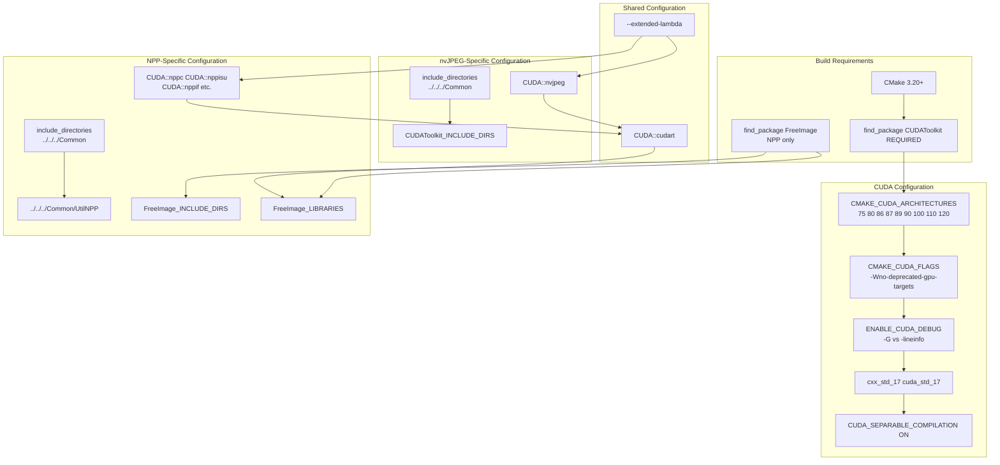
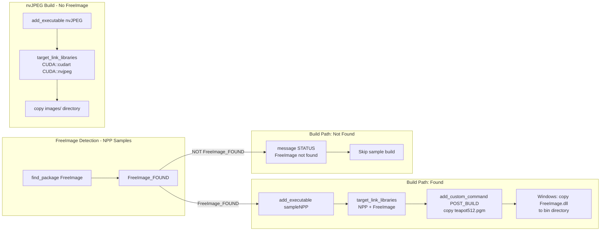
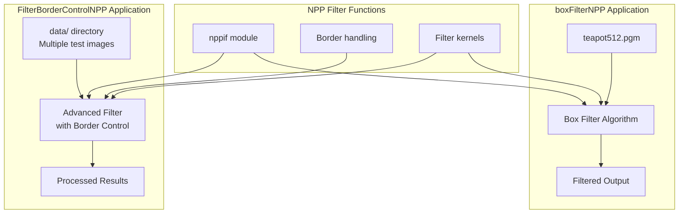
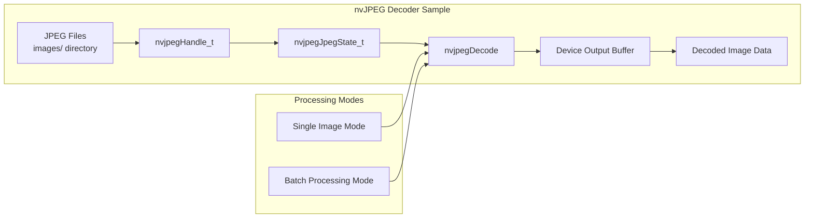
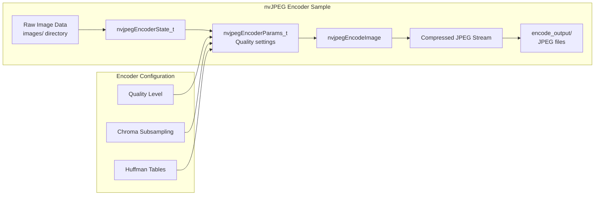
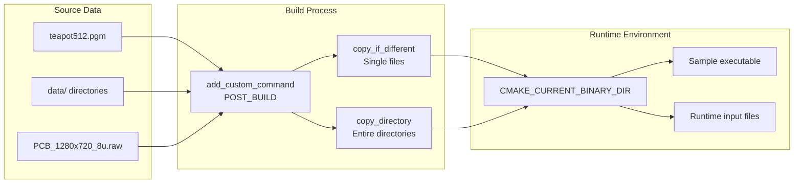

<!-- source: DeepWiki mcp.deepwiki.com · repo NVIDIA/cuda-samples · page 6.3 Image Processing with NPP and nvJPEG · fetched 2026-10-26 -->

# Image Processing with NPP and nvJPEG

<details>
<summary>Relevant source files</summary>

The following files were used as context for generating this wiki page:

- [Common/UtilNPP/Exceptions.h](Common/UtilNPP/Exceptions.h)
- [Common/UtilNPP/Image.h](Common/UtilNPP/Image.h)
- [Common/UtilNPP/ImageAllocatorsNPP.h](Common/UtilNPP/ImageAllocatorsNPP.h)
- [Common/UtilNPP/ImageIO.h](Common/UtilNPP/ImageIO.h)
- [Common/UtilNPP/ImagesNPP.h](Common/UtilNPP/ImagesNPP.h)
- [Common/data/CT_skull_512x512_8u.raw](Common/data/CT_skull_512x512_8u.raw)
- [Common/data/PCB_1280x720_8u.raw](Common/data/PCB_1280x720_8u.raw)
- [Common/data/teapot512.pgm](Common/data/teapot512.pgm)
- [Common/helper_nvJPEG.hxx](Common/helper_nvJPEG.hxx)

</details>


This document covers GPU-accelerated image processing within the CUDA samples repository using two complementary libraries: NVIDIA Performance Primitives (NPP) for image processing operations, and nvJPEG for hardware-accelerated JPEG encoding and decoding. NPP provides filtering, edge detection, histogram operations, and segmentation algorithms, while nvJPEG delivers high-performance JPEG compression and decompression functionality for both single images and batched operations.

For linear algebra operations, see page 6.1. For Fast Fourier Transform operations, see page 6.2. For additional library features including JIT compilation and random number generation, see page 6.4.

## Library Architecture Overview

The CUDA Toolkit provides two complementary libraries for image processing workloads. NPP handles general-purpose image operations through specialized modules, while nvJPEG focuses specifically on JPEG codec operations with hardware acceleration.

### Image Processing Library Organization

```mermaid
graph TB
    subgraph "NPP_Modules" ["NPP Library Modules"]
        NPPC["CUDA::nppc<br/>NPP Core"]
        NPPISU["CUDA::nppisu<br/>Image Support Utilities"]
        NPPIF["CUDA::nppif<br/>Image Filtering"]
        NPPIST["CUDA::nppist<br/>Image Statistics"]
        NPPICC["CUDA::nppicc<br/>Color Conversion"]
        NPPITC["CUDA::nppitc<br/>Threshold & Compare"]
        NPPIDEI["CUDA::nppidei<br/>Data Exchange & Init"]
        NPPIAL["CUDA::nppial<br/>Arithmetic & Logical"]
    end
    
    subgraph "nvJPEG_Library" ["nvJPEG Library"]
        NVJPEG["CUDA::nvjpeg<br/>JPEG Encode/Decode"]
        NVJPEG_BATCH["Batch Processing"]
        NVJPEG_HW["Hardware Acceleration"]
    end
    
    subgraph "NPP_Samples" ["NPP Sample Applications"]
        BoxFilter["boxFilterNPP"]
        CannyEdge["cannyEdgeDetectorNPP"]
        HistEq["histEqualizationNPP"]
        FilterBorder["FilterBorderControlNPP"]
        Watershed["watershedSegmentationNPP"]
        FreeImageInterop["freeImageInteropNPP"]
    end
    
    subgraph "nvJPEG_Samples" ["nvJPEG Sample Applications"]
        NVJPEG_DEC["nvJPEG<br/>Decoder sample"]
        NVJPEG_ENC["nvJPEG_encoder<br/>Encoder sample"]
    end
    
    subgraph "External_Deps" ["External Dependencies"]
        FreeImage["FreeImage Library"]
        CUDART["CUDA::cudart"]
    end
    
    NPPC --> BoxFilter
    NPPC --> CannyEdge
    NPPC --> HistEq
    NPPC --> FilterBorder
    NPPC --> Watershed
    NPPC --> FreeImageInterop
    
    NPPISU --> BoxFilter
    NPPISU --> CannyEdge
    NPPISU --> HistEq
    NPPISU --> FilterBorder
    
    NPPIF --> BoxFilter
    NPPIF --> CannyEdge
    NPPIF --> FilterBorder
    
    NPPIST --> HistEq
    NPPICC --> HistEq
    NPPITC --> FilterBorder
    NPPIDEI --> FilterBorder
    NPPIAL --> FilterBorder
    
    NVJPEG --> NVJPEG_DEC
    NVJPEG --> NVJPEG_ENC
    NVJPEG_BATCH --> NVJPEG_DEC
    NVJPEG_HW --> NVJPEG_DEC
    NVJPEG_HW --> NVJPEG_ENC
    
    FreeImage --> BoxFilter
    FreeImage --> CannyEdge
    FreeImage --> HistEq
    FreeImage --> FilterBorder
    FreeImage --> FreeImageInterop
    
    CUDART --> BoxFilter
    CUDART --> CannyEdge
    CUDART --> HistEq
    CUDART --> FilterBorder
    CUDART --> Watershed
    CUDART --> FreeImageInterop
    CUDART --> NVJPEG_DEC
    CUDART --> NVJPEG_ENC
```



**Sources:** `[Samples/4_CUDA_Libraries/boxFilterNPP/CMakeLists.txt:43-49]()`, `[Samples/4_CUDA_Libraries/cannyEdgeDetectorNPP/CMakeLists.txt:43-49]()`, `[Samples/4_CUDA_Libraries/histEqualizationNPP/CMakeLists.txt:43-50]()`, `[Samples/4_CUDA_Libraries/FilterBorderControlNPP/CMakeLists.txt:43-52]()`, `[Samples/4_CUDA_Libraries/nvJPEG/CMakeLists.txt:36-38]()`, `[Samples/4_CUDA_Libraries/nvJPEG_encoder/CMakeLists.txt:36-38]()`

## Sample Applications Overview

The image processing samples demonstrate both NPP operations (filtering, edge detection, segmentation) and nvJPEG operations (JPEG encoding and decoding with batch processing).

### NPP Samples

| Sample | NPP Modules Used | Primary Function | Input Data |
|--------|------------------|------------------|------------|
| `boxFilterNPP` | nppc, nppisu, nppif | Box filtering operations | teapot512.pgm |
| `cannyEdgeDetectorNPP` | nppc, nppisu, nppif | Edge detection algorithm | teapot512.pgm |
| `histEqualizationNPP` | nppc, nppisu, nppist, nppicc | Histogram equalization | teapot512.pgm |
| `FilterBorderControlNPP` | nppc, nppisu, nppif, nppitc, nppidei, nppial | Advanced filtering with border control | data/ directory |
| `watershedSegmentationNPP` | nppc | Watershed segmentation | CT_skull_512x512_8u.raw |
| `freeImageInteropNPP` | nppc, nppisu, nppif | FreeImage library integration | teapot512.pgm |

### nvJPEG Samples

| Sample | Primary Function | Key Features | Input Data |
|--------|------------------|--------------|------------|
| `nvJPEG` | JPEG decoding (single and batch) | Hardware acceleration, batch processing | images/ directory |
| `nvJPEG_encoder` | JPEG encoding | Single image encoding, quality control | images/, encode_output/ |

**Sources:** `[Samples/4_CUDA_Libraries/README.md:67-71]()`, `[Samples/4_CUDA_Libraries/nvJPEG/CMakeLists.txt:42-46]()`, `[Samples/4_CUDA_Libraries/nvJPEG_encoder/CMakeLists.txt:42-52]()`, `[Common/data/CT_skull_512x512_8u.raw:1-10]()`

## Build Configuration and Dependencies

### CMake Configuration Pattern

Both NPP and nvJPEG samples follow similar CMake configuration patterns for CUDA architectures, library linking, and dependency management. nvJPEG samples do not require FreeImage but share the same CUDA architecture targeting.



**Sources:** `[Samples/4_CUDA_Libraries/boxFilterNPP/CMakeLists.txt:1-17]()`, `[Samples/4_CUDA_Libraries/nvJPEG/CMakeLists.txt:1-17]()`, `[Samples/4_CUDA_Libraries/nvJPEG_encoder/CMakeLists.txt:1-17]()`, `[Samples/4_CUDA_Libraries/histEqualizationNPP/CMakeLists.txt:38-50]()`

### Dependency Management

NPP samples require FreeImage for image I/O operations, while nvJPEG samples handle JPEG format natively without external image libraries.

#### FreeImage Dependency (NPP Samples)

NPP samples implement conditional compilation based on FreeImage availability:



**Sources:** `[Samples/4_CUDA_Libraries/boxFilterNPP/CMakeLists.txt:26-67]()`, `[Samples/4_CUDA_Libraries/cannyEdgeDetectorNPP/CMakeLists.txt:57-67]()`, `[Samples/4_CUDA_Libraries/nvJPEG/CMakeLists.txt:24-46]()`, `[Common/UtilNPP/ImageIO.h:34-47]()`

#### nvJPEG Native JPEG Handling

nvJPEG samples handle JPEG format directly without external dependencies:

| Sample | Input Directory | Output Directory | Data Copy Method |
|--------|----------------|------------------|------------------|
| `nvJPEG` | `images/` | N/A (decoding only) | `copy_directory` POST_BUILD |
| `nvJPEG_encoder` | `images/` | `encode_output/` | `copy_directory` POST_BUILD (both dirs) |

**Sources:** `[Samples/4_CUDA_Libraries/nvJPEG/CMakeLists.txt:42-46]()`, `[Samples/4_CUDA_Libraries/nvJPEG_encoder/CMakeLists.txt:42-52]()`, `[Common/helper_nvJPEG.hxx:28-40]()`

## Image Processing Operations

### Filtering Operations

The filtering samples demonstrate NPP's image filtering capabilities using different NPP modules.



**Sources:** `[Samples/4_CUDA_Libraries/boxFilterNPP/CMakeLists.txt:52-56]()`, `[Samples/4_CUDA_Libraries/FilterBorderControlNPP/CMakeLists.txt:55-59]()`, `[Common/data/teapot512.pgm:1-5]()`

### Computer Vision Operations

Advanced computer vision algorithms are demonstrated through edge detection and segmentation samples using NPP modules.

```mermaid
graph TD
    subgraph "cannyEdgeDetectorNPP_Sample" ["cannyEdgeDetectorNPP"]
        CANNY_INPUT["teapot512.pgm"]
        CANNY_EDGE["nppiFilterCannyBorder_8u_C1R"]
        CANNY_OUTPUT["Edge Map Output"]
    end
    
    subgraph "watershedSegmentationNPP_Sample" ["watershedSegmentationNPP"] 
        WATERSHED_INPUT["Image Input"]
        WATERSHED_SEG["NPP Watershed Algorithm"]
        WATERSHED_OUTPUT["Segmented Regions"]
    end
    
    subgraph "NPP_CV_Modules" ["NPP Computer Vision Modules"]
        NPPIF_CV["CUDA::nppif<br/>Image Filtering"]
        NPPC_CORE["CUDA::nppc<br/>Core Functions"]
        NPPISU_UTILS["CUDA::nppisu<br/>Support Utilities"]
    end
    
    CANNY_INPUT --> CANNY_EDGE
    CANNY_EDGE --> CANNY_OUTPUT
    WATERSHED_INPUT --> WATERSHED_SEG
    WATERSHED_SEG --> WATERSHED_OUTPUT
    
    NPPIF_CV --> CANNY_EDGE
    NPPC_CORE --> CANNY_EDGE
    NPPC_CORE --> WATERSHED_SEG
    NPPISU_UTILS --> CANNY_EDGE
```

**Sources:** `[Samples/4_CUDA_Libraries/cannyEdgeDetectorNPP/CMakeLists.txt:52-56]()`, `[Samples/4_CUDA_Libraries/README.md:10-11]()`, `[Samples/4_CUDA_Libraries/README.md:100-101]()`

## nvJPEG Library Integration

The nvJPEG library provides GPU-accelerated JPEG encoding and decoding capabilities with both single-image and batch processing modes. The library leverages hardware acceleration when available and supports various JPEG formats including baseline, progressive, and extended.

### nvJPEG Decoding Workflow

The `nvJPEG` sample demonstrates high-performance decoding using `nvjpegDecode` and hardware-specific optimizations.



**Sources:** `[Samples/4_CUDA_Libraries/nvJPEG/CMakeLists.txt:24-38]()`, `[Common/helper_nvJPEG.hxx:38-48]()`, `[Samples/4_CUDA_Libraries/README.md:67-68]()`

### nvJPEG Encoding Workflow

The `nvJPEG_encoder` sample demonstrates the use of `nvjpegEncodeImage` with quality and subsampling parameters.



**Sources:** `[Samples/4_CUDA_Libraries/nvJPEG_encoder/CMakeLists.txt:24-38]()`, `[Samples/4_CUDA_Libraries/nvJPEG_encoder/CMakeLists.txt:48-52]()`, `[Common/helper_nvJPEG.hxx:61-85]()`

## Utility Infrastructure

### UtilNPP Helper System

The NPP samples rely on shared utilities in `Common/UtilNPP` for memory management, error handling, and image I/O abstraction.

| Class/Macro | File | Purpose |
|-------------|------|---------|
| `npp::ImageNPP` | `ImagesNPP.h` | Device-side image wrapper for NPP operations. |
| `npp::ImageCPU` | `ImagesCPU.h` | Host-side image storage and management. |
| `npp::ImageAllocator` | `ImageAllocatorsNPP.h` | Specialized memory allocators for 2D pitched data. |
| `NPP_ASSERT` | `Exceptions.h` | C++ exception-based assertion for NPP status codes. |
| `npp::loadImage` | `ImageIO.h` | FreeImage-based loader for NPP image objects. |

**Sources:** `[Common/UtilNPP/ImagesNPP.h:43-46]()`, `[Common/UtilNPP/ImageAllocatorsNPP.h:52-57]()`, `[Common/UtilNPP/Exceptions.h:140-147]()`, `[Common/UtilNPP/ImageIO.h:128-135]()`

### nvJPEG Helper Functions

The `helper_nvJPEG.hxx` utility provides file system and image format support for nvJPEG samples.

| Function | Purpose | Implementation Detail |
|----------|---------|-----------------------|
| `writeBMP` | Device-to-BMP export | Performs `cudaMemcpy2D` from device channels to host BMP format. |
| `writeBMPi` | Interleaved export | Handles interleaved RGB device data for BMP writing. |

**Sources:** `[Common/helper_nvJPEG.hxx:61-80]()`, `[Common/helper_nvJPEG.hxx:186-200]()`

## Data Management and Testing

### Test Data Distribution

NPP and nvJPEG samples use standardized test images and implement consistent data copying strategies.



**Sources:** `[Samples/4_CUDA_Libraries/boxFilterNPP/CMakeLists.txt:52-56]()`, `[Samples/4_CUDA_Libraries/FilterBorderControlNPP/CMakeLists.txt:55-59]()`, `[Common/data/PCB_1280x720_8u.raw:1-10]()`

---

