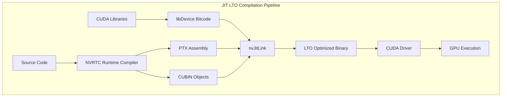
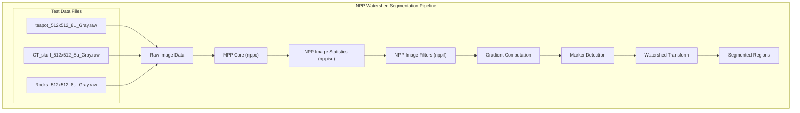
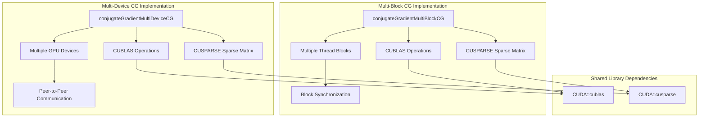

<!-- source: DeepWiki mcp.deepwiki.com · repo NVIDIA/cuda-samples · page 6.4 Advanced Library Features · fetched 2026-10-26 -->

# Advanced Library Features

<details>
<summary>Relevant source files</summary>

The following files were used as context for generating this wiki page:

- [CHANGELOG.md](CHANGELOG.md)
- [Common/nvrtc_helper.h](Common/nvrtc_helper.h)

</details>


This section covers specialized and advanced functionalities of CUDA libraries that go beyond basic operations. These features include just-in-time compilation with link-time optimization (JIT LTO), modern C++ Standard Library (CCCL) integrations such as `mdspan` and `random`, and specialized numerical algorithms.

## JIT Compilation and Link-Time Optimization

The `jitLto` sample demonstrates advanced compilation techniques using NVIDIA's just-in-time linker (`nvJitLink`) combined with runtime compilation (`NVRTC`). This approach enables link-time optimization across multiple compilation units and libraries at runtime.

### JIT LTO Architecture



The JIT LTO sample utilizes several key components:

| Component | Purpose | CMake Link Target |
|-----------|---------|-------------------|
| `NVRTC` | Runtime compilation of CUDA C++ | `CUDA::nvrtc` |
| `nvJitLink` | Link-time optimization | `${NVJITLINK_LIB}` |
| `CUDA Driver API` | Low-level GPU management | `CUDA::cuda_driver` |

The sample utilizes `nvrtcCompileProgram` to generate code and `nvJitLink` to perform the optimization [cpp/4_CUDA_Libraries/jitLto/CMakeLists.txt:38-50](). In CUDA 13.0, `jitLto` was updated to support the new `cuCtxCreate_v4` driver API requirements [CHANGELOG.md:50-67]().

**Sources:** [cpp/4_CUDA_Libraries/jitLto/CMakeLists.txt:1-51](), [CHANGELOG.md:50-67]()

## CCCL 3.3 Feature Samples

CUDA 13.3 introduced a set of samples built against the CUDA C++ Core Libraries (CCCL), demonstrating modern C++ patterns on the GPU [CHANGELOG.md:5-10]().

### libcuxxMdspan (DLPack Interop)
The `libcuxxMdspan` sample demonstrates bridging between DLPack tensors and `cuda::std::mdspan`. It features:
* `cuda::to_device_mdspan`: Converts DLPack data to a multidimensional span [CHANGELOG.md:10-10]().
* `cuda::to_dlpack_tensor`: Exports multidimensional views back to DLPack [CHANGELOG.md:10-10]().
* `cuda::shared_memory_mdspan`: Provides multidimensional views of shared memory within kernels [CHANGELOG.md:10-10]().

### libcuxxRandom
The `libcuxxRandom` sample demonstrates the use of `<cuda/std/random>` for device-side random number generation [CHANGELOG.md:9-9]().
* **Engines**: Uses `cuda::pcg64` and `cuda::std::philox4x32` [CHANGELOG.md:9-9]().
* **Distributions**: Supports uniform, normal, Poisson, and Bernoulli distributions [CHANGELOG.md:9-9]().

### CUB Device Algorithms
New samples for CUB (CUDA Unbound) demonstrate high-level device-wide primitives:
* `cubDeviceFind`: Implements `cub::DeviceFind::FindIf`, `LowerBound`, and `UpperBound` [CHANGELOG.md:6-6]().
* `cubDeviceSegmentedScan`: Implements `ExclusiveSegmentedSum` and `InclusiveSegmentedScan` with custom operators [CHANGELOG.md:7-7]().
* `cubDeviceTransform`: Demonstrates N-to-M transformations where operations return `cuda::std::tuple` [CHANGELOG.md:8-8]().

**Sources:** [CHANGELOG.md:3-14]()

## Advanced NPP Image Processing

The `watershedSegmentationNPP` sample showcases advanced image segmentation algorithms using NVIDIA Performance Primitives. Watershed segmentation is a morphological image processing technique for object detection and segmentation.

### NPP Watershed Segmentation Workflow



The NPP library dependencies [cpp/4_CUDA_Libraries/watershedSegmentationNPP/CMakeLists.txt:41-46]() include:

| NPP Library | Function | CMake Target |
|-------------|----------|--------------|
| `nppc` | Core functions and memory management | `CUDA::nppc` |
| `nppisu` | Image statistics and utilities | `CUDA::nppisu` |
| `nppif` | Image filtering operations | `CUDA::nppif` |

**Sources:** [cpp/4_CUDA_Libraries/watershedSegmentationNPP/CMakeLists.txt:1-68]()

## Multi-Device and Multi-Block Numerical Algorithms

Advanced numerical computing samples demonstrate sophisticated conjugate gradient implementations that utilize multiple execution strategies. These samples were updated in CUDA 13.0 to use `cudaMemLocation` for `cudaMemAdvise_v2` and `cudaMemPrefetchAsync_v2` [CHANGELOG.md:78-80]().

### Conjugate Gradient Execution Models



**Sources:** [cpp/4_CUDA_Libraries/conjugateGradientMultiBlockCG/CMakeLists.txt:1-44](), [cpp/4_CUDA_Libraries/conjugateGradientMultiDeviceCG/CMakeLists.txt:1-43](), [CHANGELOG.md:78-80]()

## NVRTC Helper Utilities

The `Common/nvrtc_helper.h` provides a standardized interface for runtime compilation used across advanced samples.

| Function | Description | Code Reference |
|----------|-------------|----------------|
| `compileFileToCUBIN` | Compiles a `.cu` file to CUBIN at runtime, handling architecture-specific flags. | [Common/nvrtc_helper.h:50-51]() |
| `loadCUBIN` | Loads a compiled CUBIN into a `CUmodule` using the Driver API. | [Common/nvrtc_helper.h:185-185]() |
| `NVRTC_SAFE_CALL` | Macro for error checking NVRTC API results. | [Common/nvrtc_helper.h:40-48]() |

The `compileFileToCUBIN` function automatically detects the current GPU's compute capability using `cuDeviceGetAttribute` to set the correct `--gpu-architecture=sm_` flag [Common/nvrtc_helper.h:85-104]().

**Sources:** [Common/nvrtc_helper.h:1-200]()

## Build System Integration

Advanced library features require specific build configurations and platform restrictions. For example, many advanced library samples exclude QNX platform support [cpp/4_CUDA_Libraries/jitLto/CMakeLists.txt:22-27]() due to library availability constraints:

```cmake
if(CMAKE_SYSTEM_NAME STREQUAL "QNX")
    message(STATUS "Will not build sample ${PROJECT_NAME} - not supported on QNX")
    return()
endif()
```

The samples target modern CUDA architectures (75-120) and require C++17 standard support. In CUDA 13.2, the MSVC flag `-Xcompiler=/Zc:preprocessor` was mandated for CCCL compatibility [CHANGELOG.md:20-22]().

**Sources:** [cpp/4_CUDA_Libraries/jitLto/CMakeLists.txt:11-27](), [CHANGELOG.md:20-22]()

---

