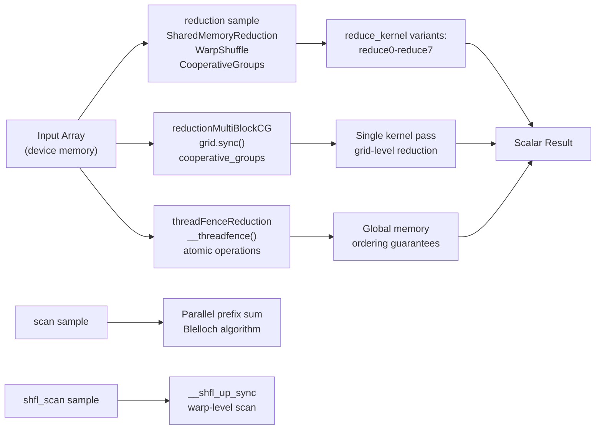
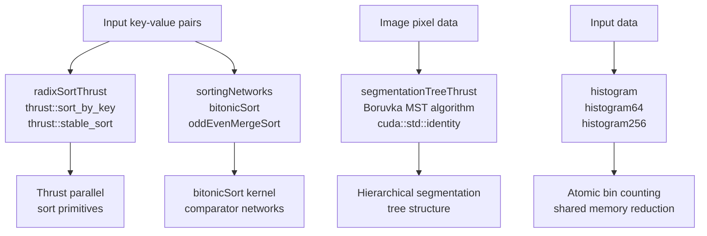
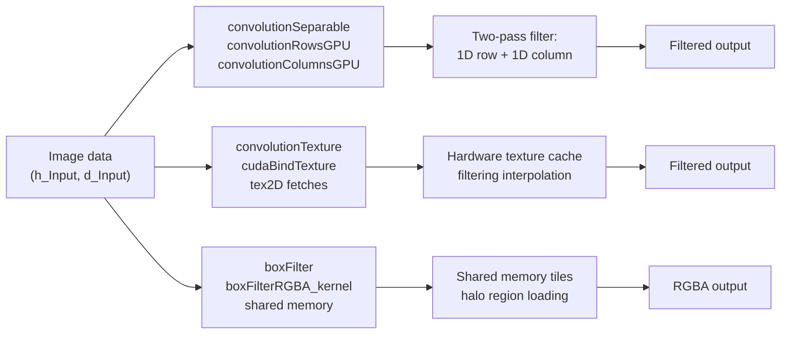
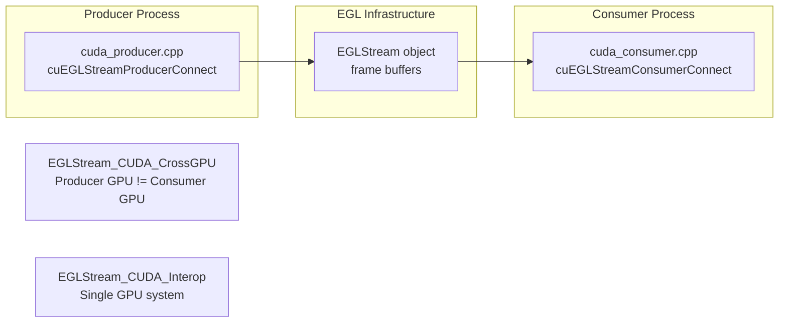

<!-- source: DeepWiki mcp.deepwiki.com · repo NVIDIA/cuda-samples · page 7 Concepts and Techniques (Category 2) · fetched 2026-10-26 -->

# Concepts and Techniques (Category 2)

Relevant source files

The following files were used as context for generating this wiki page:

- [CHANGELOG.md](CHANGELOG.md)
- [CMakeLists.txt](CMakeLists.txt)

The `cpp/2_Concepts_and_Techniques/` directory contains 32 samples demonstrating parallel algorithms, computational patterns, and optimization techniques. These samples implement foundational GPU computing patterns: parallel primitives (reduction, scan, sort), image processing kernels (convolution, filtering, transforms), Monte Carlo simulations, and advanced memory management strategies.

Related documentation: Introduction Samples (page 4) covers basic CUDA operations; Advanced CUDA Features (page 5) covers graphs and dynamic parallelism; Graphics API Interoperability (page 8) covers rendering integration.

## Sample Organization

Category 2 samples are organized by computational domain, demonstrating parallel computing patterns and optimization strategies.

**Sample Organization Diagram**

```mermaid
graph TB
    subgraph Category2["2_Concepts_and_Techniques (32 samples)"]
        ParallelAlg["Parallel Algorithms"]
        ImageProc["Image Processing"]
        GraphicsInterop["Graphics Interop"]
        MonteCarlo["Monte Carlo"]
        MemMgmt["Memory Management"]
        AdvancedProg["Advanced Programming"]
    end
    
    ParallelAlg --> ReductionGroup["reduction<br/>reductionMultiBlockCG<br/>threadFenceReduction<br/>scan<br/>shfl_scan"]
    ParallelAlg --> SortingGroup["sortingNetworks<br/>radixSortThrust<br/>segmentationTreeThrust"]
    ParallelAlg --> MathOps["scalarProd<br/>eigenvalues<br/>histogram"]
    
    ImageProc --> ConvOps["convolutionSeparable<br/>convolutionTexture<br/>boxFilter"]
    ImageProc --> TransformOps["dct8x8<br/>imageDenoising"]
    
    GraphicsInterop --> EGLSamples["EGLStream_CUDA_CrossGPU<br/>EGLStream_CUDA_Interop"]
    
    MonteCarlo --> FinanceApps["MC_SingleAsianOptionP"]
    MonteCarlo --> PiEstimation["MC_EstimatePiP<br/>MC_EstimatePiQ<br/>MC_EstimatePiInlineP<br/>MC_EstimatePiInlineQ"]
    
    MemMgmt --> StreamAlloc["streamOrderedAllocation<br/>streamOrderedAllocationIPC<br/>streamOrderedAllocationP2P"]
    
    AdvancedProg --> LowLevel["inlinePTX<br/>inlinePTX_nvrtc<br/>FunctionPointers"]
    AdvancedProg --> Simulation["particles<br/>interval<br/>threadMigration"]
```

**Sources:** [CHANGELOG.md:43-44](), [CHANGELOG.md:59-62](), [CHANGELOG.md:84-85]()

## Parallel Algorithms and Patterns

Samples demonstrating fundamental parallel computing primitives: reduction, scan, sorting, and histogram operations. These implement data-parallel patterns using shared memory, warp-level primitives, and cooperative groups.

For detailed technical implementation of these primitives, see [Parallel Algorithms and Patterns](#7.1).

### Reduction and Scan Operations

**Reduction Implementation Strategy**

| Sample | Core Functions/Techniques | Optimization Strategy |
|--------|--------------------------|----------------------|
| `reduction` | `reduce0()` through `reduce7()` kernels, `__shfl_down_sync()` | Progressive optimization from naive to highly optimized |
| `reductionMultiBlockCG` | `cooperative_groups::grid_group`, `grid.sync()` | Single-pass grid-wide reduction |
| `scan` | `scan()`, `scanExclusiveShared()` | Work-efficient parallel prefix sum |
| `shfl_scan` | `__shfl_up_sync()`, warp-level scan | Warp shuffle intrinsics for intra-warp communication |

**Sources:** [CHANGELOG.md:35-40](), [CHANGELOG.md:83-85]()

### Sorting and Histogram Algorithms

**Sorting Algorithm Implementations**

| Sample | Key Functions/Types | Algorithm |
|--------|-------------------|-----------|
| `radixSortThrust` | `thrust::sort_by_key()`, `thrust::stable_sort()` | Radix sort using Thrust library primitives |
| `sortingNetworks` | `bitonicSort()`, `oddEvenMergeSort()` kernels | Bitonic and Batcher's odd-even merge networks |
| `segmentationTreeThrust` | `cuda::std::identity()` | Minimum spanning tree for image segmentation |
| `histogram` | `histogram64()`, `histogram256()` kernels | 64-bin and 256-bin histogram computation |

**Sources:** [CHANGELOG.md:83-85]()

## Image and Signal Processing Techniques

Image processing samples demonstrate convolution, filtering, and transform operations optimized for 2D data, using texture memory, shared memory tiling, and separable filter decomposition.

For detailed implementation of image filters and texture usage, see [Image and Signal Processing Techniques](#7.2).

### Convolution and Filtering

**Convolution Implementation Strategies**

| Sample | Key Kernels/Functions | Memory Access Pattern |
|--------|----------------------|----------------------|
| `convolutionSeparable` | `convolutionRowsGPU()`, `convolutionColumnsGPU()` | Coalesced global memory, separable 1D filters |
| `convolutionTexture` | `tex2D()` | Texture memory with hardware interpolation |
| `boxFilter` | `boxFilterRGBA_kernel()`, shared memory tiling | Shared memory for halo regions, OpenGL interop |

**Sources:** [CHANGELOG.md:54-57]()

### Transform and Enhancement Operations

| Sample | Core Functions | Algorithm |
|--------|----------------|-----------|
| `dct8x8` | `CUDAdct8x8()`, `CUDAquantize8x8()` | 8x8 Discrete Cosine Transform for JPEG |
| `imageDenoising` | `KNN_kernel()`, `NLM_kernel()` | K-Nearest Neighbors and Non-Local Means denoising |
| `eigenvalues` | `bisectKernel()` | Parallel bisection for tridiagonal matrix eigenvalues |

## Graphics Interoperability (EGL)

EGLStream samples demonstrate CUDA-EGL interoperability for producer-consumer data exchange, supporting both single-GPU and cross-GPU (multi-process) communication.

**EGLStream Data Flow**

**Sources:** [CHANGELOG.md:60-61]()

## Stream-Ordered Memory Management

Stream-ordered allocation samples demonstrate `cudaMallocAsync`/`cudaFreeAsync` APIs for asynchronous memory management and memory pool sharing.

| API | Usage | Sample |
|-----|-------|--------|
| `cudaMallocAsync` | Asynchronous stream-ordered allocation | `streamOrderedAllocation` |
| `cudaFreeAsync` | Asynchronous stream-ordered deallocation | `streamOrderedAllocation` |
| `cudaMemPoolExportToShareableHandle` | Export pool for IPC | `streamOrderedAllocationIPC` |

**Sources:** [CHANGELOG.md:44](), [CHANGELOG.md:78-80]()

## Monte Carlo Simulation Methods

Monte Carlo samples implement statistical simulations using CURAND library for random/quasi-random number generation.

| Sample | RNG Type | Kernel Approach |
|--------|----------|----------------|
| `MC_EstimatePiP` | Pseudo-random | Batch generation with `curandGenerateUniform()` |
| `MC_EstimatePiQ` | Quasi-random (Sobol) | Batch generation with Sobol sequences |
| `MC_EstimatePiInlineP` | Pseudo-random inline | `curand_uniform()` device function |
| `MC_SingleAsianOptionP` | Normal distribution | `curandGenerateNormal()` for Gaussian paths |

## Advanced Programming Patterns

Advanced samples demonstrate inline PTX assembly, device function pointers, and runtime compilation with NVRTC.

| Sample | Core Technique | Key Functions/Constructs |
|--------|---------------|------------------------|
| `inlinePTX` | Inline PTX assembly | `asm volatile("...")` |
| `inlinePTX_nvrtc` | Runtime compilation | `nvrtcCreateProgram()`, `nvrtcGetPTX()` |
| `threadMigration` | CUDA context migration | `cuCtxSetCurrent()`, `cuCtxPopCurrent()` |

**Sources:** [CHANGELOG.md:52-58](), [CHANGELOG.md:62]()

## Build Configuration

Category 2 samples utilize the root CMake build system with the following global configurations:

- **C++ Standard**: C++17 [CMakeLists.txt:9-10]()
- **CUDA Standard**: CUDA 17 [CMakeLists.txt:12-13]()
- **Architectures**: SM 75 through SM 120 [CMakeLists.txt:15]()
- **Debug Flags**: `-G` for debug builds, `-lineinfo` for release [CMakeLists.txt:17-21]()
- **MSVC Flags**: `-Xcompiler=/Zc:preprocessor` for CCCL compatibility [CMakeLists.txt:26-28]()

**Sources:** [CMakeLists.txt:1-34]()

---

