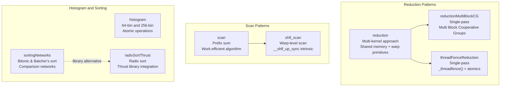
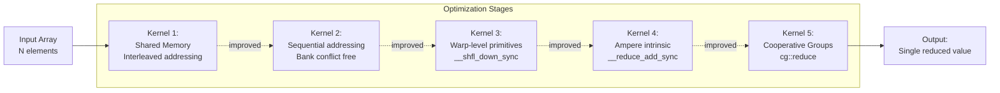
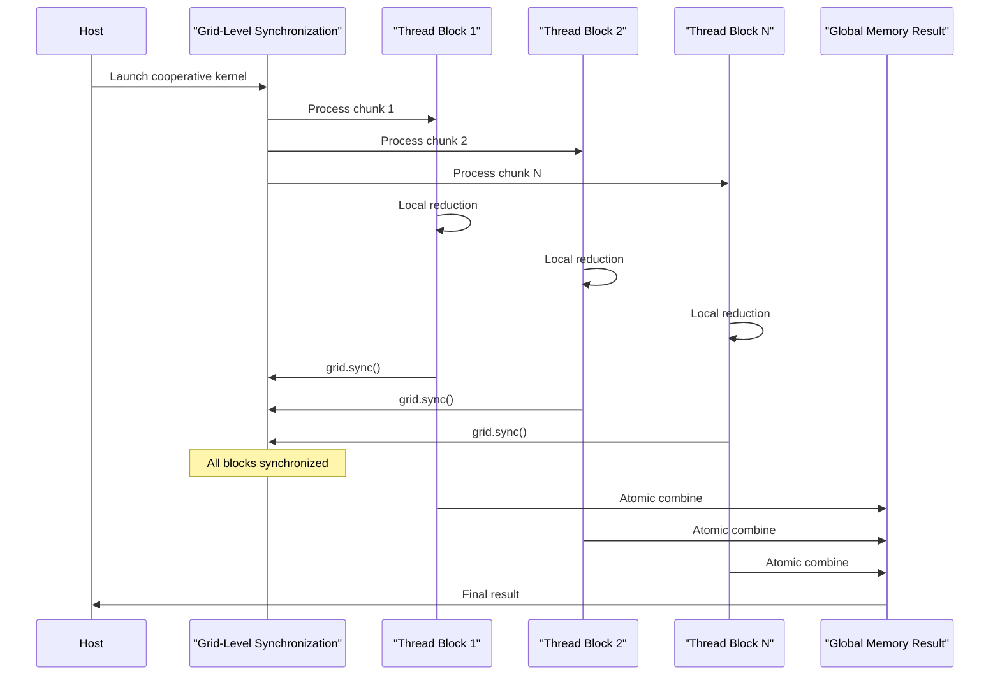
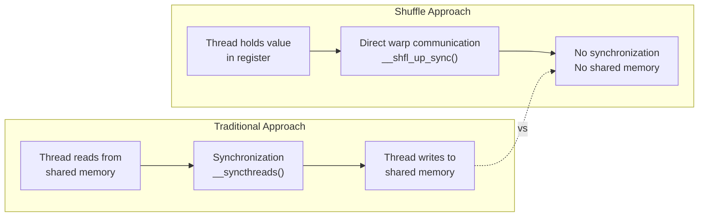
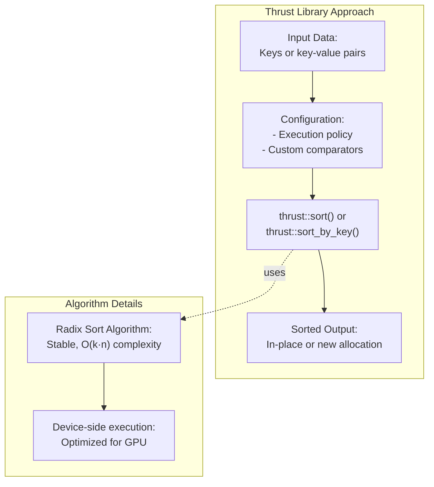
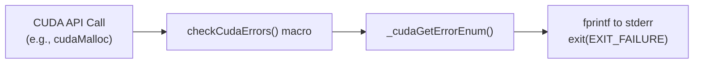

<!-- source: DeepWiki mcp.deepwiki.com · repo NVIDIA/cuda-samples · page 7.1 Parallel Algorithms and Patterns · fetched 2026-10-26 -->

# Parallel Algorithms and Patterns

Relevant source files

The following files were used as context for generating this wiki page:

- [CHANGELOG.md](CHANGELOG.md)
- [Common/helper_cuda.h](Common/helper_cuda.h)

This page documents the fundamental parallel algorithm patterns demonstrated in Category 2 (Concepts and Techniques) of the CUDA Samples repository. These patterns form the building blocks for data-parallel GPU computing, including reduction, scan (prefix sum), histogram, and sorting operations. Each pattern demonstrates progressively optimized implementations using shared memory, warp-level primitives, cooperative groups, and library integrations.

For information about advanced CUDA features like cooperative groups and dynamic parallelism, see [5](). For domain-specific applications that use these patterns, see [11]().

---

## Overview of Parallel Algorithm Samples

The following samples in `cpp/2_Concepts_and_Techniques/` demonstrate core parallel primitives:

| Sample | Pattern | Key Techniques |
|--------|---------|----------------|
| `reduction` | Parallel sum reduction | Shared memory, `__shfl_down_sync`, `__reduce_add_sync`, cooperative groups |
| `reductionMultiBlockCG` | Single-pass multi-block reduction | Multi Block Cooperative Groups, compute preemption |
| `scan` | Parallel prefix sum (scan) | Bank conflict avoidance, work-efficient algorithm |
| `shfl_scan` | Warp-level scan | Shuffle intrinsics (`__shfl_up_sync`), warp primitives |
| `histogram` | Histogram computation | 64-bin and 256-bin implementations, atomic operations |
| `sortingNetworks` | Bitonic and odd-even merge sort | Sorting networks, comparison-based parallel sorting |
| `radixSortThrust` | High-performance radix sort | Thrust library, key-value pairs, integer/float keys |
| `threadFenceReduction` | Single-pass reduction with atomics | Thread fence intrinsic, global atomics |

**Diagram: Parallel Algorithm Pattern Hierarchy**

Sources: [CHANGELOG.md:35-44](), [CHANGELOG.md:83-85]()

---

## Parallel Reduction Patterns

Reduction is a fundamental parallel pattern that combines multiple values into a single result using an associative operator (sum, max, min, etc.). The samples demonstrate multiple optimization levels and implementation approaches.

### Basic Reduction Architecture

The `reduction` sample demonstrates several optimization strategies with increasing sophistication:

**Diagram: Reduction Optimization Progression**

Sources: [CHANGELOG.md:120-125]()

### Key Reduction Implementations

1.  **Shared Memory Reduction**: Uses thread block-level shared memory with sequential addressing to avoid bank conflicts.
2.  **Warp Shuffle Reduction**: Employs `__shfl_down_sync` to perform warp-level reduction without shared memory.
3.  **Ampere Intrinsic**: Uses `__reduce_add_sync` (SM 8.0+) for single-instruction reduction across a warp.
4.  **Cooperative Groups**: Leverages `cooperative_groups::reduce` for block-tile level reduction.

### Multi-Block Cooperative Reduction

The `reductionMultiBlockCG` sample demonstrates single-pass reduction using Multi Block Cooperative Groups, requiring SM 6.0+ with compute preemption capability.

**Diagram: Multi-Block Cooperative Groups Reduction Flow**

Sources: [CHANGELOG.md:34-44]()

---

## Parallel Scan (Prefix Sum)

Scan (prefix sum) computes cumulative results where each output element is the sum of all preceding input elements. This is a building block for stream compaction and radix sort.

### Warp-Level Scan with Shuffle Intrinsics

The `shfl_scan` sample demonstrates warp-level scan using shuffle intrinsics, which is significantly faster than shared memory approaches for warp-sized data.

**Diagram: Shuffle-Based Scan Pattern**

The `__shfl_up_sync` intrinsic allows threads in a warp to directly exchange register values without going through shared memory, enabling faster warp-level algorithms.

Sources: [CHANGELOG.md:83-85]()

---

## Histogram Computation

The `histogram` sample demonstrates efficient parallel histogram computation for 64-bin and 256-bin histograms using atomic operations.

Key techniques:
*   **Shared memory atomics**: Each thread block maintains a local histogram in shared memory using atomic operations, then merges results to global memory.
*   **Memory coalescing**: Organizing memory access patterns to maximize bandwidth.
*   **Atomic operations**: Using `atomicAdd` to safely update histogram bins from multiple threads.

Sources: [CHANGELOG.md:40-41]()

---

## Sorting Algorithms

### Sorting Networks

The `sortingNetworks` sample implements comparison-based parallel sorting algorithms (Bitonic and Odd-Even merge sort) that are particularly efficient for small to medium-sized arrays or batches of arrays.

### Radix Sort with Thrust

The `radixSortThrust` sample demonstrates high-performance parallel radix sort using the Thrust library. Starting in CUDA 13.0, `thrust::identity<uint>()` has been replaced with `cuda::std::identity()` in these implementations [CHANGELOG.md:83-85]().

**Diagram: Thrust Radix Sort Integration**

Sources: [CHANGELOG.md:83-85]()

---

## CCCL and Modern Parallel Primitives

Recent updates (CUDA 13.3) have introduced advanced parallel primitives via the CUDA C++ Core Libraries (CCCL), demonstrated in `cpp/4_CUDA_Libraries/`:

*   **cubDeviceFind**: Implements `cub::DeviceFind::FindIf`, `LowerBound`, and `UpperBound` device-wide search algorithms [CHANGELOG.md:6]().
*   **cubDeviceSegmentedScan**: Implements `cub::DeviceSegmentedScan::ExclusiveSegmentedSum` and `InclusiveSegmentedScan` with custom binary operators [CHANGELOG.md:7]().
*   **cubDeviceTransform**: N-to-M `cub::DeviceTransform::Transform` where the operation returns a `cuda::std::tuple` [CHANGELOG.md:8]().

---

## Code Organization and Helper Utilities

All parallel algorithm samples leverage common helper utilities for error checking and device management. The `helper_cuda.h` header provides the `_cudaGetErrorEnum` function, which translates error codes from various CUDA APIs (Runtime, Driver, cuBLAS, cuFFT, cuSPARSE, cuSOLVER) into human-readable strings [Common/helper_cuda.h:53-228]().

**Diagram: Error Handling Flow**

Sources: [Common/helper_cuda.h:53-228](), [Common/helper_cuda.h:988-1004]()

---

