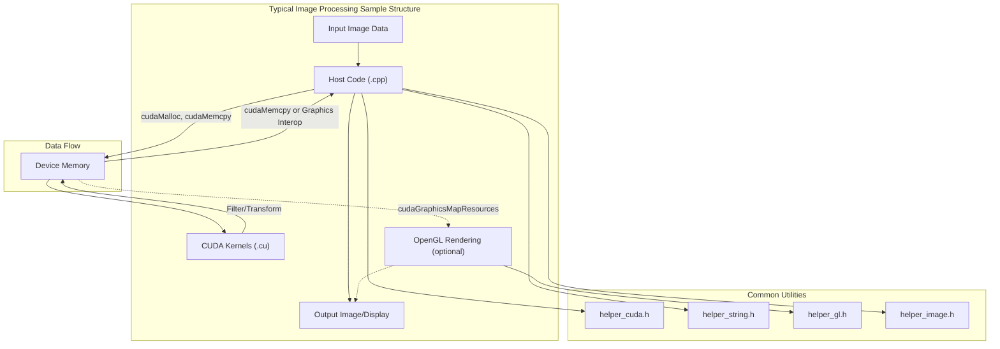
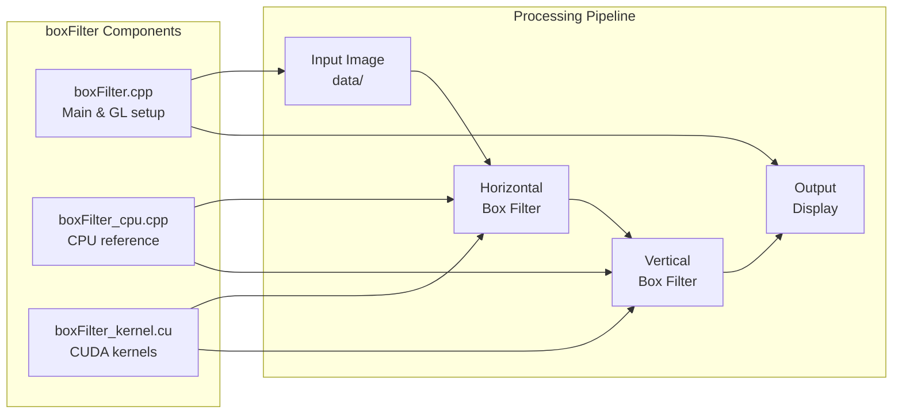
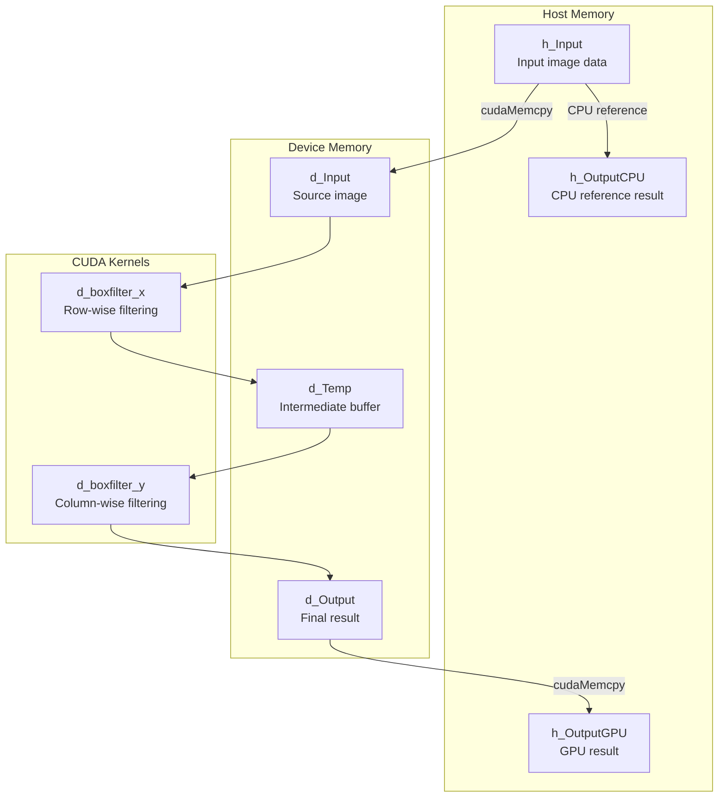
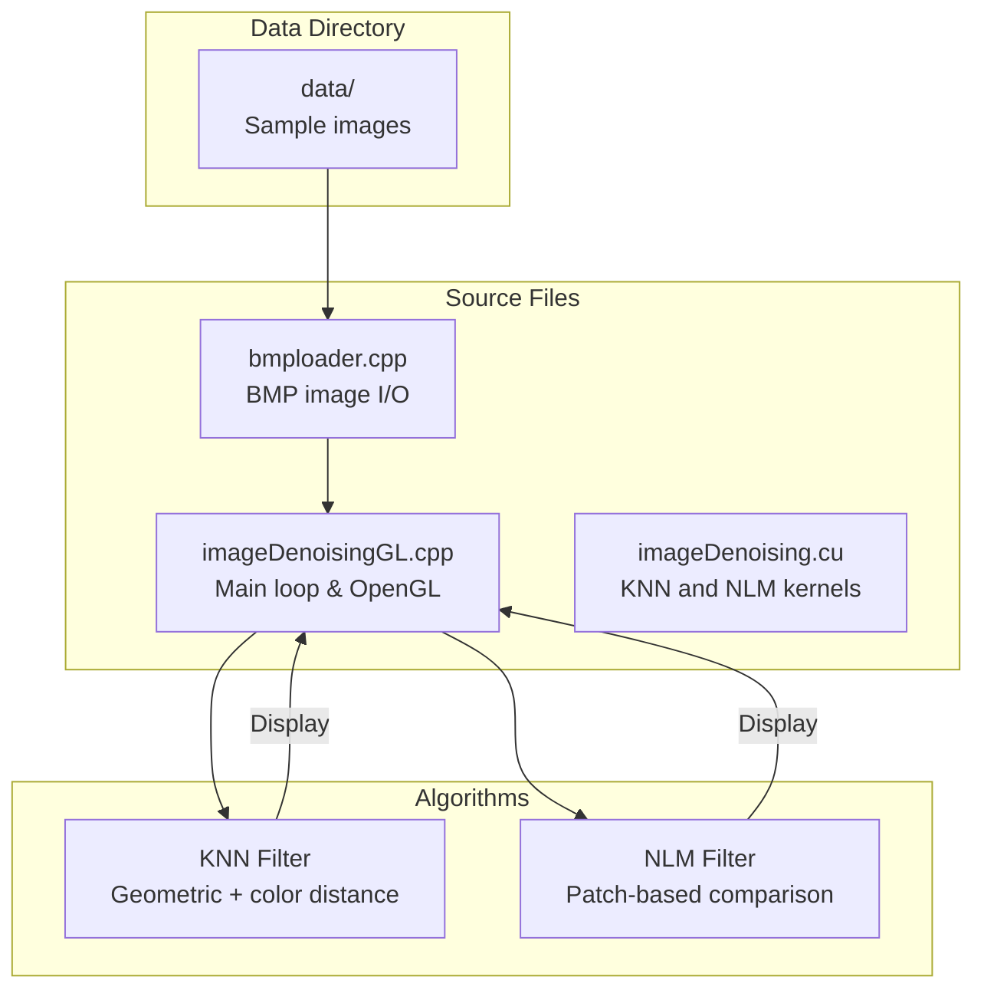
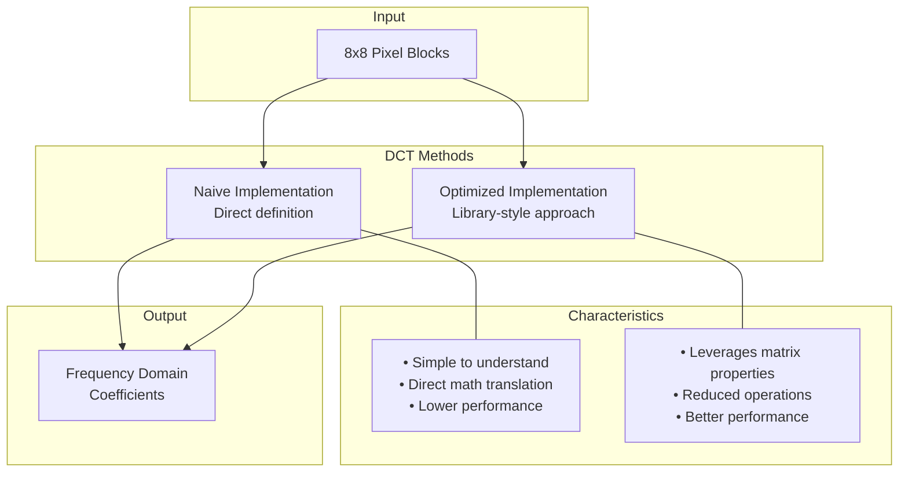
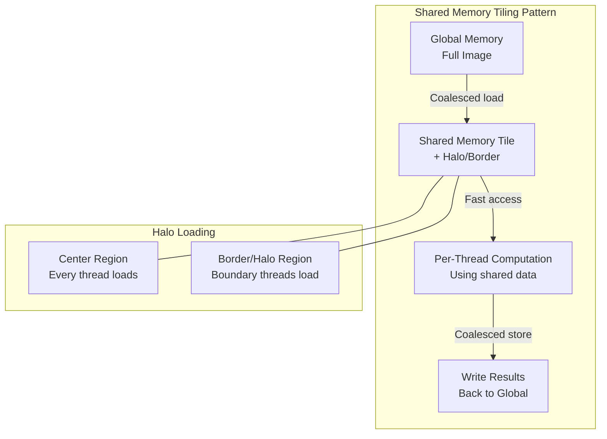

<!-- source: DeepWiki mcp.deepwiki.com · repo NVIDIA/cuda-samples · page 7.2 Image and Signal Processing Techniques · fetched 2026-10-26 -->

# Image and Signal Processing Techniques

<details>
<summary>Relevant source files</summary>

The following files were used as context for generating this wiki page:

- [Common/UtilNPP/Signal.h](Common/UtilNPP/Signal.h)
- [Common/UtilNPP/SignalAllocatorsCPU.h](Common/UtilNPP/SignalAllocatorsCPU.h)
- [Common/UtilNPP/SignalsNPP.h](Common/UtilNPP/SignalsNPP.h)
- [Common/helper_image.h](Common/helper_image.h)
- [Common/helper_math.h](Common/helper_math.h)

</details>


## Purpose and Scope

This page documents the image and signal processing samples in Category 2 (Concepts and Techniques) of the CUDA samples repository. These samples demonstrate fundamental algorithms for image manipulation, filtering, and transformation operations on GPUs. The focus is on practical implementations of convolution filters, denoising techniques, frequency domain transforms, and efficient memory access patterns for 2D data.

For graphics interoperability and visualization examples, see [Graphics API Interoperability](#8). For NPP library-based image processing, see [Image Processing with NPP and nvJPEG](#6.3). For domain-specific applications using these techniques, see [Domain-Specific Applications (Category 5)](#11).

## Overview of Techniques

The image and signal processing samples in this category implement several fundamental algorithm classes:

| Sample | Technique | Key Features |
|--------|-----------|--------------|
| `convolutionSeparable` | Separable 2D convolution | Gaussian kernel, shared memory optimization |
| `convolutionTexture` | Texture-based convolution | Hardware texture filtering, comparison baseline |
| `boxFilter` | Box/averaging filter | Horizontal-vertical decomposition, OpenGL rendering |
| `imageDenoising` | Adaptive denoising | KNN and NLM algorithms, geometric and color distance |
| `dct8x8` | Discrete Cosine Transform | 8x8 block DCT, naive and optimized implementations |
| `FunctionPointers` | Sobel edge detection | Function pointer usage, monochrome filter |

Sources: [Samples/2_Concepts_and_Techniques/README.md:1-99]()

## Sample Architecture Patterns



**Diagram: Standard Architecture for Image Processing Samples**

Sources: [Samples/2_Concepts_and_Techniques/boxFilter/CMakeLists.txt:1-97](), [Samples/2_Concepts_and_Techniques/imageDenoising/CMakeLists.txt:1-98](), [Common/helper_image.h:29-54]()

## Convolution Techniques

### Separable Convolution (convolutionSeparable)

Separable convolution exploits the mathematical property that certain 2D filters can be decomposed into two 1D operations. A 2D Gaussian filter can be applied as two sequential 1D convolutions (horizontal, then vertical), reducing computational complexity from O(width × height × kernelSize²) to O(width × height × 2 × kernelSize).

**Implementation Strategy:**
- Two-pass algorithm: row convolution followed by column convolution
- Shared memory caching to reduce global memory bandwidth
- Gaussian kernel weights precomputed on host

The sample implements a separable convolution filter with configurable kernel radius and demonstrates the performance advantage over naive 2D convolution.

Sources: [Samples/2_Concepts_and_Techniques/README.md:7-8]()

### Texture-Based Convolution (convolutionTexture)

This sample implements the same separable convolution algorithm using CUDA texture memory instead of global memory loads. Texture memory provides:
- Hardware-accelerated interpolation
- Boundary handling (clamping, wrapping)
- Caching optimized for 2D spatial locality

**Performance Comparison:**
The sample is designed to benchmark texture memory performance against the standard global memory approach in `convolutionSeparable`, demonstrating when texture fetches provide benefits versus explicit shared memory management.

**Key Difference:**
```cpp
// Global memory approach (convolutionSeparable)
data = d_Input[idx];

// Texture memory approach (convolutionTexture)
data = tex2D(texRef, x, y);
```

Sources: [Samples/2_Concepts_and_Techniques/README.md:10-11]()

## Box Filter Implementation

The `boxFilter` sample demonstrates a simple averaging filter with horizontal-vertical decomposition and real-time OpenGL visualization.

### Box Filter Architecture



**Diagram: Box Filter Sample Structure**

### Build Configuration

The box filter requires OpenGL and GLUT for visualization:

| Dependency | Purpose |
|------------|---------|
| OpenGL | Graphics rendering |
| GLUT/FreeGLUT | Window management |
| GLEW | OpenGL extension loading (Windows) |

On Windows, the build system copies `freeglut.dll` and `glew32.dll`/`glew64.dll` to the output directory. The sample links against these libraries and includes headers from `Common/`.

Sources: [Samples/2_Concepts_and_Techniques/boxFilter/CMakeLists.txt:1-97]()

### Memory and Kernel Organization



**Diagram: Box Filter Data Flow**

The two-pass approach (horizontal then vertical) allows each pass to maximize memory coalescing by processing rows and columns in their natural layout.

Sources: [Samples/2_Concepts_and_Techniques/README.md:4-5]()

## Image Denoising Techniques

The `imageDenoising` sample implements two adaptive denoising algorithms: K-Nearest Neighbors (KNN) and Non-Local Means (NLM).

### Denoising Sample Components



**Diagram: Image Denoising Sample Architecture**

### Algorithm Characteristics

**K-Nearest Neighbors (KNN):**
- Computes both geometric distance (spatial) and color distance (intensity/RGB)
- Averages the K nearest neighbors based on combined distance metric
- Faster but less sophisticated than NLM

**Non-Local Means (NLM):**
- Compares entire patches (small neighborhoods) around pixels
- Weights contribution by patch similarity
- Better edge preservation and detail retention
- More computationally intensive
- Uses shared memory optimization for patch comparison

Both algorithms are adaptive—they adjust filtering strength based on local image characteristics, preventing over-smoothing of edges while reducing noise in uniform regions.

Sources: [Samples/2_Concepts_and_Techniques/README.md:31-32](), [Samples/2_Concepts_and_Techniques/imageDenoising/CMakeLists.txt:1-98]()

## Discrete Cosine Transform (DCT)

The `dct8x8` sample demonstrates DCT computation for 8×8 pixel blocks, a fundamental operation in JPEG compression and video codecs.

### DCT Implementation Approaches



**Diagram: DCT Implementation Strategies**

Sources: [Samples/2_Concepts_and_Techniques/README.md:13-14]()

## Signal and Image Utilities

The CUDA samples provide a set of utility classes for handling signal and image data, particularly within the NPP (NVIDIA Performance Primitives) context.

### Signal Management Classes

The `npp` namespace provides templates for signal management:
- `Signal`: Base class tracking signal size [Common/UtilNPP/Signal.h:36-78]().
- `SignalTemplate<D, A>`: Extends `Signal` with typed data and an allocator [Common/UtilNPP/Signal.h:80-163]().
- `SignalNPP<D>`: Specialized version using `SignalAllocator<D>` for device-side memory [Common/UtilNPP/SignalsNPP.h:43-97]().

### Allocators and Memory Operations

Signals can be allocated on either the CPU or GPU using specific allocator classes:
- `SignalAllocatorCPU<D>`: Uses `new[]` and `delete[]` for host memory [Common/UtilNPP/SignalAllocatorsCPU.h:38-62]().
- `SignalNPP` methods `copyTo` and `copyFrom`: Handle `DeviceToHost` and `HostToDevice` transfers [Common/UtilNPP/SignalsNPP.h:85-96]().

### Image Loading (helper_image.h)

The `helper_image.h` header provides functions for loading PGM and PPM files:
- `__loadPPM`: Low-level parser for PGM/PPM headers and raw data [Common/helper_image.h:136-210]().
- `sdkLoadPGM`: Template function to load PGM data into a specific type `T` [Common/helper_image.h:212-233]().
- `ConverterFromUByte`: Structs for converting 8-bit image data to `float` (normalized 0.0-1.0) or `unsigned char` [Common/helper_image.h:64-87]().

Sources: [Common/UtilNPP/Signal.h:1-169](), [Common/UtilNPP/SignalsNPP.h:1-114](), [Common/UtilNPP/SignalAllocatorsCPU.h:1-67](), [Common/helper_image.h:1-233]()

## Common Optimization Patterns

### Texture Memory Advantages

| Feature | Benefit for Image Processing |
|---------|------------------------------|
| 2D spatial caching | Optimized for neighborhood access patterns |
| Hardware interpolation | Free bilinear/nearest filtering |
| Boundary handling | Automatic clamping/wrapping |
| Read-only cache | Separate from global memory traffic |

### Shared Memory Tiling



**Diagram: Shared Memory Tiling for Image Kernels**

### Math Utilities (helper_math.h)

Samples utilize `helper_math.h` for vector type operations (e.g., `float2`, `float4`) not standard in CUDA:
- Constructors: `make_float2`, `make_int4`, etc. [Common/helper_math.h:88-252]().
- Host implementations of CUDA functions like `fminf`, `fmaxf`, and `rsqrtf` for CPU reference code [Common/helper_math.h:58-82]().

Sources: [Common/helper_math.h:1-252](), [Samples/2_Concepts_and_Techniques/README.md:1-99]()

## Build System and Dependencies

### Common CMake Patterns

Each sample's `CMakeLists.txt` follows this structure:

1. **Project Setup**: Minimum CMake version 3.20, Project declaration with CUDA/C/CXX.
2. **CUDA Configuration**: Targeting architectures 75-120; using `-lineinfo` for release profiling.
3. **Include Paths**: `Common/` directory for helper headers.
4. **Compilation Features**: C++17 and CUDA 17 standard.
5. **Windows-Specific Handling**: Links against `freeglut.lib` and `glew32.lib`/`glew64.lib` and copies DLLs to output [Samples/2_Concepts_and_Techniques/boxFilter/CMakeLists.txt:22-88]().

Sources: [Samples/2_Concepts_and_Techniques/boxFilter/CMakeLists.txt:1-97](), [Samples/2_Concepts_and_Techniques/imageDenoising/CMakeLists.txt:1-98]()

---

