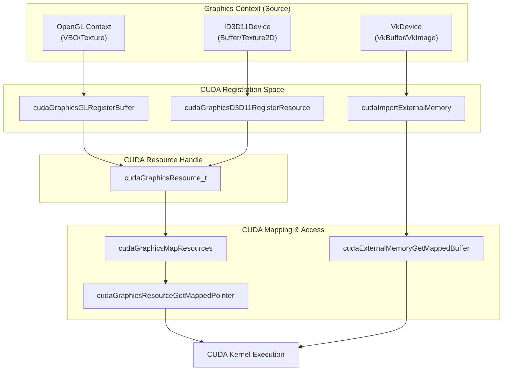
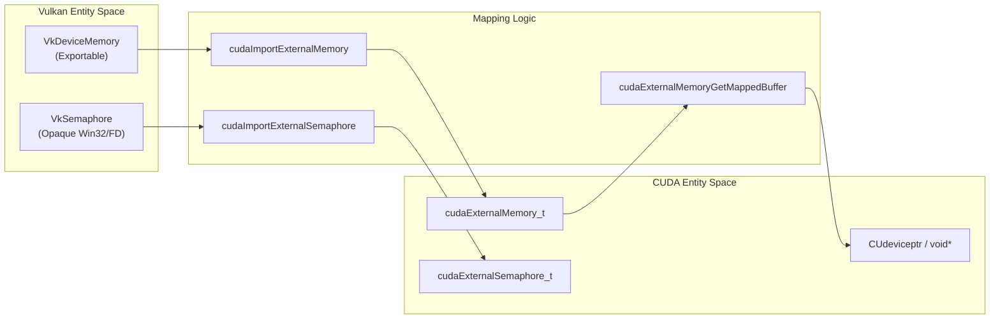

<!-- source: DeepWiki mcp.deepwiki.com · repo NVIDIA/cuda-samples · page 8 Graphics API Interoperability · fetched 2026-10-26 -->

# Graphics API Interoperability

Relevant source files

The following files were used as context for generating this wiki page:

- [Common/GL/freeglut.h](Common/GL/freeglut.h)
- [Common/GL/glew.h](Common/GL/glew.h)
- [Common/helper_gl.h](Common/helper_gl.h)
- [bin/win64/Debug/freeglut.dll](bin/win64/Debug/freeglut.dll)
- [bin/win64/Debug/glew64.dll](bin/win64/Debug/glew64.dll)

## Purpose and Scope

This page documents CUDA's integration with graphics APIs to enable zero-copy data sharing and synchronized rendering between CUDA compute operations and graphics pipelines. The samples demonstrate how to map graphics resources (buffers, textures) into CUDA's address space for direct kernel access without explicit memory copies.

For detailed integration guides, see the following child pages:
- [OpenGL and EGL Integration](#8.1) — Covers `cudaGraphicsGLRegisterBuffer`, VBO mapping, and EGLStream producer-consumer patterns.
- [Direct3D Integration](#8.2) — Covers `cudaGraphicsD3D11RegisterResource`, external memory, and keyed mutex synchronization.
- [Vulkan Integration](#8.3) — Covers `cudaImportExternalMemory`, external semaphores, and `cuMemMap` interop.

For platform-specific graphics integration on NVIDIA Tegra devices (EGL, OpenGL ES), see [Tegra Platform Samples (Category 8)](#9).

## Interoperability Architecture

Graphics API interoperability enables CUDA kernels to directly read from and write to graphics resources while maintaining synchronization between the graphics and compute pipelines. The core mechanism varies by API but follows a common pattern: register the graphics resource with CUDA, map it for kernel access, execute kernels, unmap, and synchronize.

### Bridge: Natural Language to Code Entity Space

The following diagram maps high-level interoperability concepts to the specific CUDA API functions and handles used in the codebase.

**Sources:** [Common/helper_gl.h:67-71](), [Samples/5_Domain_Specific/marchingCubes/marchingCubes.cpp:499-507](), [Samples/5_Domain_Specific/simpleD3D11/simpleD3D11.cpp:28-30]()

## OpenGL Integration

OpenGL interoperability uses `cudaGraphicsResource` handles to wrap OpenGL buffer objects (VBOs) and textures. The primary workflow involves registering OpenGL resources, mapping them to obtain CUDA device pointers, executing kernels, and unmapping before rendering.

### Buffer Object Registration

OpenGL vertex buffer objects are registered with CUDA using `cudaGraphicsGLRegisterBuffer`. The registration establishes a mapping between the OpenGL buffer and CUDA's memory management system. The `marchingCubes` sample demonstrates this by registering position and normal VBOs [Samples/5_Domain_Specific/marchingCubes/marchingCubes.cpp:501-506]().

### Common Utility Headers

The repository provides several helper headers to abstract OpenGL setup and error handling:
- `Common/helper_gl.h`: Contains version checks and Linux-specific GL function loading via `glXGetProcAddress` [Common/helper_gl.h:56-62]().
- `Common/GL/glew.h` and `Common/GL/freeglut.h`: Provide the OpenGL Extension Wrangler and Utility Toolkit infrastructure [Common/GL/glew.h:79-81](), [Common/GL/freeglut.h:1-2]().

For details, see [OpenGL and EGL Integration](#8.1).

## Direct3D 11 Integration

Direct3D 11 interoperability uses two mechanisms:
1. **Legacy CUDA-D3D11 Interop**: Similar to OpenGL, using `cudaGraphicsD3D11RegisterResource`.
2. **External Memory API**: Modern approach using `cudaImportExternalMemory` with shareable NT handles and `IDXGIKeyedMutex` for synchronization.

### External Memory and Keyed Mutex

The modern approach imports a D3D11 resource via a shared handle. The `simpleD3D11` sample demonstrates using `cudaImportExternalMemory` and `cudaExternalMemoryGetMappedBuffer` to obtain a pointer for kernel execution [Samples/5_Domain_Specific/simpleD3D11/simpleD3D11.cpp:28-30]().

For details, see [Direct3D Integration](#8.2).

## Vulkan Integration

Vulkan interoperability uses the external memory and external semaphore extensions to share resources.

### Bridge: Vulkan-CUDA Resource Mapping

This diagram illustrates how Vulkan objects are transitioned into the CUDA execution space using the External Memory API.

**Sources:** [Samples/5_Domain_Specific/simpleD3D11/simpleD3D11.cpp:28-30]() (External Memory patterns), Diagram 5 from architecture overview.

For details, see [Vulkan Integration](#8.3).

## EGL Integration (Tegra-Specific)

EGL interoperability is specific to NVIDIA Tegra/Jetson platforms. It provides integration between CUDA and EGL streams, sync objects, and images, enabling CUDA to produce or consume frames in EGL pipelines.

For detailed documentation, see [Multimedia and OpenGL ES on Tegra](#9.3).

## Build System Support

Graphics interop samples require platform-specific library detection in CMake. The system conditionally builds samples based on the presence of `OpenGL`, `GLUT`, or `Vulkan` packages.

### Windows DLL Management
On Windows, build scripts often perform post-build steps to copy necessary runtime libraries like `freeglut.dll` and `glew64.dll` to the output directory [bin/win64/Debug/freeglut.dll:1-2](), [bin/win64/Debug/glew64.dll:1-2]().

**Sources:** [Samples/2_Concepts_and_Techniques/particles/CMakeLists.txt:75-87](), [Samples/4_CUDA_Libraries/randomFog/CMakeLists.txt:87-106]()

---

